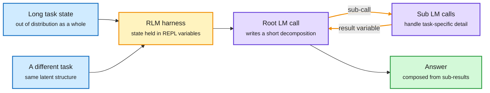

# Language Model Harnesses Are Compositional Generalizers: RL on a Recursive Language Model

**Date:** 2026-10-09 · **Type:** essay with experiments, read in full from the captured page · **Authors:** Alex Zhang and Omar Khattab (the essay's citation block dates it July 2026; it resurfaced this window through the State of AI Report and a saved video conversation)
**Topic:** [Agent harness and model routing](agent-harness-routing.md)

## TL;DR

A harness is the program between the world and the model. It decides what each model call sees and how the next action is chosen. This essay argues that compositional generalization (solving an unseen problem by composing familiar ones) should be the harness's job, because transformers remain unreliable at it. The design rule is that every individual model call should get a prompt that is "locally in-distribution", even when the whole task is far from anything in training. The authors test the rule by training a Recursive Language Model (RLM) with RL. An RLM is a harness in which the root model keeps the task context in variables of a code REPL (an interactive interpreter), writes a short program that decomposes the task, and hands task-specific work to recursive sub-calls. Trained only on short tasks, the RLM improves on held-out tasks 8 to 32 times longer by as much as it improved in training, or more. The same model trained directly as a plain transformer raises its training reward and stays roughly flat on the long tasks.

Two different tasks, one trajectory at the root

Task-specific detail goes down into sub-calls. The root model only ever sees the short decomposition.

Blue is the task, amber is the harness and the recursion, purple is a model call, green is the result.

## The argument

- **The problem.** Post-training has become a brute-force collection of more environments and longer horizons. The essay attributes this to transformers being poor at compositional generalization, so every new domain needs its own data.
- **The criterion.** A good harness reduces unfamiliar problems to familiar ones. Even if the full state is out of distribution, each observation handed to a model call should be locally in-distribution, meaning that call's prompt looks like something the model was trained on.
- **The formal version.** A harness induces an equivalence relation over task states. Structurally similar tasks fall into one class and present the root model with nearly the same token trajectory. Training then only has to cover the classes, not every task.
- **The criticism of shipped harnesses.** Claude Code and Codex-style harnesses append task detail, tool output and reasoning into one growing history. The essay says these histories drift out of the training distribution, which shows up in practice as "context rot".

## Mechanism

The RLM gets its equivalence classes from two features, and the essay says both are needed.

- **Context offloading.** The input-specific context is passed as a symbolic variable, so the root model does not read it directly. Two different problems look alike at the first step. On its own this is not enough, because tool and sub-agent output can still flow back into the main context over a long run.
- **Programmatic sub-agent calling.** Sub-agents and ordinary tools are functions inside the REPL. Their outputs can be stored in variables and passed to later calls without the root model ever reading them. This is what keeps task-specific text out of the root context over a long horizon.

What is trained is the root model only. Two tasks that share a decomposition differ mainly in how many sub-calls are made and what is inside them, and each sub-call handles a small, familiar sub-task.

## Key findings

- **Setup.** Qwen3-30B-A3B-Instruct-2507 is trained both as an RLM and as a base transformer (with YaRN context extension for the longer settings). Training uses prime-rl, described as decoupled PPO with GRPO-like advantages and a KL loss, for 150 steps at batch size 64 with 4 rollouts each, evaluated every 10 steps.
- **Length generalization.** Six environments are trained on a short split and evaluated on a split 8 to 32 times longer: MRCRv2, GraphWalks, LongBenchPro, OOLONG, OOLONG-Pairs and Ada-LEval. On all six the RLM improves significantly on the long evaluation from its starting point. The essay's summary figure is roughly 10 times the evaluation lift for the same training lift, compared with training the transformer directly.
- **The transformer learns something that does not extrapolate.** Its training reward grows and often exceeds the RLM's, while its long-task evaluation stays generally flat.
- **Against a frontier model.** On MRCRv2, GraphWalks, OOLONG and OOLONG-Pairs the trained RLM approaches or exceeds an RLM running the frontier model GPT-5.5 on the long evaluation.
- **Domain transfer.** Three pairs share a strategy but not a subject: OOLONG from TREC questions to spam questions, OBLIQ-Bench Analogues from writing to maths, and OBLIQ-Bench Descriptive from Twitter stance to Wildchat errors. Over 500 training steps the RLM's evaluation reward on the unseen domain tracks its training reward. The base transformer's early evaluation gains come mostly from learning the answer format and then fade.
- **A late switch to the general solution.** In some length experiments the RLM first learns a strategy that only works on short tasks, such as handing the whole problem to one sub-call. It later finds a decomposition that generalizes, so evaluation lift ends above training lift. A user message nudging it to decompose helps where it does not find the strategy alone, as on MRCRv2.
- **Cost.** RLM training runs 1.5 to 3 times longer than the base transformer on same-size tasks, because of several steps per sample and waiting on sub-calls. The authors argue this scales better with task length than training on long contexts does.
- **Trajectory similarity.** An appendix measures how close evaluation trajectories are to the nearest earlier training trajectory, with five proxies including edit distance and 3-gram overlap. RLM root trajectories are closer than those of the appended-context baseline.

## Gaps

- The generalizing strategy is not guaranteed to be found. The authors say so, and they needed a hint on one benchmark. How much supervision is required is named as an open area.
- The trained root model still sometimes prints task-specific information back into its own context, which weakens the equivalence the argument rests on.
- "In-distribution" is never measured directly. The appendix uses token-overlap proxies and says a more principled metric is needed.
- Domain transfer is shown between tasks chosen to share a decomposition. What happens when structure is not shared is not tested.
- One model, one RL recipe. No comparison with a tuned ReAct or coding-agent harness under the same training budget is reported. The essay says training even a simple ReAct agent on these tasks was hard at this model size because of context bloat.

## Relation to earlier wiki pages

- **Extends "the harness has become a training variable".** The [10-04 digest](../daily-digest/2026-10/2026-10-04.md) named this pattern across four results, among them the multi-harness RL guide (train the model inside the harnesses it will ship in) and AutoCompact (train a coding agent to decide when to compact its own context). This essay adds a reason to care beyond scores: the harness decides how far one gradient update carries.
- **In tension with "What Does a Harness Buy? Tokens, Mostly".** That paper, covered in the [10-09 digest](../daily-digest/2026-10/2026-10-09.md), found Claude Code and mini-SWE-agent within 5 points on 447 SWE-bench Verified tasks with the model fixed. The two are compatible if today's shipped harnesses are all the appended-history kind the essay criticizes. Neither source tests that directly.
- **Same economy as the multi-harness guide, from the other side.** The 10-04 guide reported one 2.6B model at 62% and 33% in two harnesses. Harness sensitivity may be strongest for small models, which is where a structured harness would matter most.
- **A second source of abstraction.** [H-JEPA](../world-models-reasoning/2026-10-09-h-jepa-hierarchical-world-models.md) gets coarse units from the prediction horizon inside the network. Here they come from a program outside it.
- **Joint tuning of harness and weights.** [RSIGym](2026-10-09-rsigym.md) lets a research agent edit harness code and training data together. This essay is the hand-designed counterpart: a person chose the harness, and RL trained the model inside it.
- **Context as the scarce resource.** The essay "On the Nature of the Swarm", surfaced via saved reading and covered in the 10-09 Global View, describes sub-agents as a way to build more context than one window holds. The RLM applies the same idea with a training-time payoff.

## Research angle

Why it works: RL updates the policy on root-level trajectories, and the harness has made those trajectories nearly identical across tasks. One gradient therefore serves a whole class of tasks. It is a quotient over the task space, computed by code instead of learned by the network.

This bears on any model of reasoning in concepts instead of tokens. Composition is a core property of concept-level thought, and the essay shows it can live in an external program while the network handles only familiar pieces. Open problems:

- **Where the decomposition comes from.** A person designed the RLM. A model that learned its own equivalence classes would be doing something close to concept formation.
- **Convergence to the general strategy.** The short-task shortcut is a local optimum. A training signal that prefers the length-agnostic strategy without a hand-written hint is missing.
- **A distance that means something.** Token overlap between trajectories is a weak proxy for "same output distribution". A measure that includes the chosen strategy would let the equivalence claim be tested.
- **A matched baseline.** The comparison that would settle the argument with "What Does a Harness Buy?" is an RLM against a standard coding harness, both trained with the same RL budget on the same tasks.

## Links

- Source: [essay](https://alexzhang13.github.io/blog/2026/harness/) · [post](https://x.com/a1zhang/status/2108228912794738973) · [saved conversation](https://x.com/yacinelearning/status/2107452043946336625) (a 90-minute video, not transcribed)
- Digest: [2026-10-09](../daily-digest/2026-10/2026-10-09.md)
- Raw: X feed capture for the 2026-10-09 window (`raw/twitter/feed/2026-10-09-day-ranked.json`, local only). Also surfaced via saved reading.
