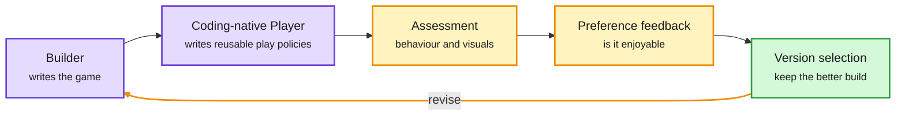

# Recursive Game Creator: An Agentic Product-Level Experience-Oriented Game Harness

**Date:** 2026-10-09 · **Type:** paper (arXiv 2610.08621), read from the first part of the alphaxiv overview only. HuggingFace listed it without an abstract. · **Authors:** Jiajun Chen, Haoyu Wu, Mingda Jia, Xihui Liu (HKU MMLab, The University of Hong Kong, Shenzhen Loop Area Institute)
**Topic:** [Agent harness and model routing](agent-harness-routing.md)
**Signal:** cross-source confirmed (HF + Kurate). It is in HuggingFace Daily Papers and at rank 8 of Kurate's cs.AI weekly list. Every Kurate entry still sits at the default score of 1200, so the rank carries little information.

## TL;DR

Recursive Game Creator (RGC) is a harness, the program that organizes a coding agent's work, for generating games. Its target is the play experience and not just a build that runs. A generated game can meet its functional requirements and still have unclear controls, weak pacing, poor feedback or dull content. RGC adds a Player that tests the game by writing code. Instead of reading a screenshot and choosing every action, the Player writes reusable policies that drive the game through its programmatic interface, then runs them many times. The resulting play data feeds behavioural and visual assessment, preference feedback and a choice of which version to keep, and the cycle repeats. No result numbers were in the portion read, so none are given here.

Build, play by policy, judge the experience, pick a version

The Player is the new part. It plays through code, not through screenshots.

Purple is an agent that writes code, amber is evaluation, green is the kept version.

## The problem

Earlier agentic game generation checked whether the code was correct and whether the game launched. Those checks say nothing about whether the game is hard to control, badly balanced, visually incoherent or without meaningful progression. Judging those needs evidence from play. Testing through the screen is slow, because every step needs a visual read and an action choice, and it ignores the structured state, events and progress signals the game already has.

## Mechanism

- **Four roles.** Designer, Builder, Player and Reviewer. A user brief and the feedback from the previous round inform the Designer's plan. The overview was cut off after this point, so how the Builder and Reviewer work in detail was not read.
- **Policy creation is separate from policy execution.** An agent writes a play policy once and then runs it repeatedly to gather trajectories. This lowers the cost of each trial and allows testing with different strategies and skill levels.
- **Structured evidence.** Because play goes through the game's programmatic interface, the trajectories keep state and event data that a screenshot loop would lose.
- **Criteria that fit the game.** Shared evaluation signals are combined with game-specific ones. The overview's example: a racing game is judged on steering response and track guidance, a visual novel on dialogue and consequential choices.
- **Two kinds of preference.** The harness separates what the user stated from what is inferred from play, and does not treat the two as equivalent when revising.

## Key findings

- The contribution is a workflow that connects policy-based play to experience-oriented diagnosis and then to revision. It is not a new model or training method.
- Playing through code is what makes a playtest cheap enough to run on every iteration.
- No quantitative results were available in the portion read.

## Gaps

- Everything quantitative, until the paper is read in full.
- How "enjoyable" is measured, and whether the preference signal comes from people or from a model, was not in what was read.
- A scripted policy plays the way its author expects. Whether it finds the problems a real player would find is the central validity question, and the portion read does not answer it.

## Relation to earlier wiki pages

- **Same window, same theme.** HuggingFace listed "SWE-Game: Can Coding Agents Build the Games We Want?" (arXiv 2609.33678) beside this paper. It arrived without an abstract and is unread, so only the title is noted.
- **The testing counterpart of verifiable environments.** [PortSimEnv](../reinforcement-learning/2026-10-09-portsimenv-simulation-rl-environments.md) scores a plan against a solver-proven optimum, so its reward cannot be argued with. RGC is at the other end: its target, an enjoyable game, has no ground truth, and the harness has to build its own evidence.
- **A check that executes, not one that reads a report.** OverclaimBench, noted in the [10-09 digest](../daily-digest/2026-10/2026-10-09.md), found that coding agents' final reports often claim work the transcript shows was not done. A Player that runs the game is a check that does not depend on the Builder's own account.
- **Evaluation inside the loop.** [RSIGym](2026-10-09-rsigym.md) gives a research agent an evaluation service and lets it revise a harness from the logs. RGC builds a comparable evaluate-and-revise loop for one product type, with a generated player in place of a benchmark.
- **Structure through code.** [Harnesses as compositional generalizers](2026-10-09-harness-as-compositional-generalizer-rlm.md) argues for moving work out of the model's context and into programs. The coding-native Player is a small instance: the agent writes a policy once and a program does the repeated playing.

## Open questions

- Does a preference signal from scripted play agree with human players?
- Can the play policies be reused as a regression suite across versions, the way unit tests are?
- Does the pattern carry to other generated software with an interactive surface, such as web apps or tools with a UI?

## Links

- Source: [paper](https://arxiv.org/abs/2610.08621) · [HuggingFace page](https://huggingface.co/papers/2610.08621) · [alphaxiv page](https://www.alphaxiv.org/abs/2610.08621)
- Digest: [2026-10-09](../daily-digest/2026-10/2026-10-09.md)
- Raw: `raw/huggingface/2026-10-08-recursive-game-creator-an-agentic-product-level-ex.md` · `raw/kurate/2026-10-09-cs-ai.md`
