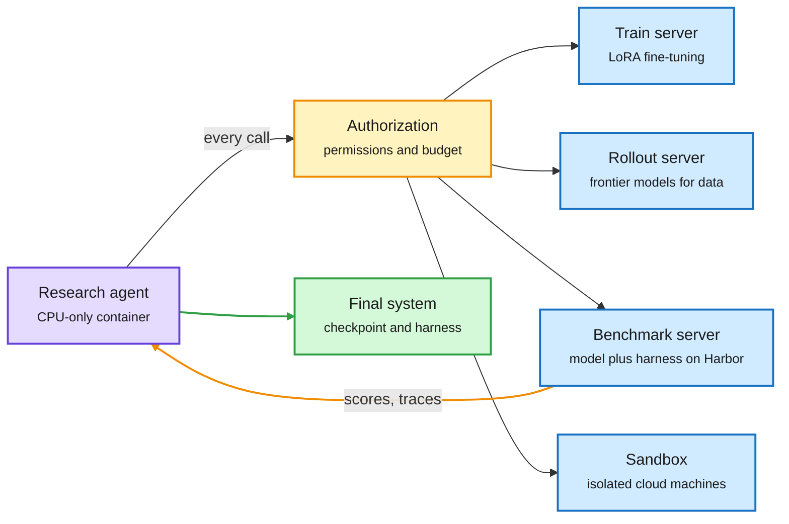

# RSIGym: An Agent-Native Environment for Self-Improvement Research

**Date:** 2026-10-09 · **Type:** paper (arXiv 2610.10310), read from the abstract, the project site, the repository README and the results sections of the PDF · **Authors:** Evolvent AI and NUS
**Topic:** [Agent harness and model routing](agent-harness-routing.md)

## TL;DR

RSIGym is an environment for studying agents that improve AI systems. It wraps training, model serving, rollout generation, benchmark evaluation and sandboxes as services, a design the paper calls "Everything as a Service". A research agent sits in a small CPU-only container and calls those services to improve a target system, which is a model plus its harness (the code that runs the model on a task). One authorization layer checks every call against the run's permissions and remaining budget. Permissions define three tracks: change the training data only, change the harness only, or change data, training settings and harness together. With a $500 service budget per benchmark run, the best research agent (Opus 5) takes a base model with a minimal harness from 17.67% to 50.33% on SWE-bench Verified. The single-track runs show where that gain mostly comes from: opening only the data barely moves the score, and opening only the harness yields a clear gain. The authors state that the experiments measure gains inside one run and do not yet test recursion across cycles.

The agent does research. The plumbing is a service call.

One authorization layer checks every call against the run's permissions and remaining budget.

Purple is the research agent, amber is the budget gate and the feedback loop, blue is a service, green is the submitted system.

## The problem

Existing settings either leave the agent to rebuild routine infrastructure or restrict it to one component. The paper's example of the first is PostTrainBench, which gives the agent an H100 GPU and internet access but no starter code, training data or hyperparameter configuration. There was no common environment in which data, training configuration and harness could be changed together under one budget.

## Mechanism

- **Services.** Training is LoRA fine-tuning (small trainable adapter matrices added to a frozen model) and returns metrics and checkpoints. Inference gives OpenAI-compatible access to base and trained models. Rollout calls frontier models to generate data and to judge. Evaluation runs benchmark jobs on Harbor and returns task rewards, trajectories and logs. Sandbox gives isolated computation.
- **The loop.** Generate data, train a checkpoint, evaluate model plus harness, analyze and revise, then submit one checkpoint and one harness for a fixed official evaluation.
- **Tracks.** Data: the agent changes training data, with training settings and harness fixed. Harness: it revises execution code with weights fixed. Joint: all three are open, and only the starting base model and the evaluation protocol are held fixed.
- **RSI-Index.** For each benchmark, divide the score gain by the gap from the initial score to a perfect score. Average the five fractions with equal weight. The benchmarks are SWE-bench Verified (100 tasks), Terminal-Bench 2.0 (89), AIME 2024/2025 (60), GPQA Diamond (100) and SkillsBench (37).
- **Audits.** After a run, three checks are applied: 13-gram overlap between training data and evaluation tasks, checkpoint provenance, and an LLM-judge review of the trajectory and submission. The paper says all submissions passed.

## Key findings

- **Main study.** Six research agents each start from Qwen3.5-35B-A3B-Base with a minimal harness and get $500 of platform services per benchmark run. Opus 5 has the highest RSI-Index, 0.4809, meaning its selected systems close 48.09% of the remaining gap on average. 29 of 30 Joint runs improve on the starting system.
- **Opus 5's selected systems.** SWE-bench Verified 17.67% to 50.33%, Terminal-Bench 10.49% to 26.97%, AIME 31.67% to 97.78%, GPQA Diamond 51.33% to 83.33%, SkillsBench 1.65% to 21.21%.
- **No universal leader.** Four agents lead at least one benchmark. DeepSeek V4.1 Flash has the best SWE-bench Verified score (53.33%). Sol 6 ranks last overall and leads SkillsBench.
- **Two benchmarks stay hard.** Opus 5 closes 96.75% of the AIME gap but 18.41% on Terminal-Bench and 19.89% on SkillsBench. No agent closes more than a quarter of either.
- **Single tracks.** With only training data open, Opus 5 gains 6 of 300 attempts on SWE-bench Verified and loses 5 of 267 on Terminal-Bench. With only the harness open and Qwen3.6-35B-A3B-Instruct weights fixed, the score rises by 0.1667 on SWE-bench Verified and 0.1198 on Terminal-Bench. The Harness runs use a different target model, so the paper says they do not measure the harness's share of the Joint gain.
- **Heavier training often hurts.** In comparisons under the same harness and task set, the more heavily trained candidate scores lower in eight of ten. Several agents respond by submitting light updates close to base weights. Training can still help: in DeepSeek's SWE run the development score rises from 0.344 to 0.600 under the same harness after training on 227 trajectories.
- **What the harness edits are.** SWE harnesses check edits before submitting a patch. Terminal-Bench harnesses preserve shell state, recover from truncated output and detect unproductive loops. AIME and GPQA harnesses aggregate several sampled answers.
- **Iterating an existing harness.** Starting from the DeepSeek Harness with Qwen3.6-35B-A3B-Instruct fixed, Opus 5 raises Terminal-Bench from 30.34% to 40.82%. Tasks solved on all three attempts go from 15 to 26.
- **Budget.** Raising the budget from $500 to $1,000 improves three of four tested pairs, two of them by under 0.03. Opus 5 on Terminal-Bench spends more and scores 0.0599 lower. The paper calls the result mixed.
- **Spend does not explain rank.** Total spend across five runs ranges from $161.73 (Sol 6) to $2,083.50 (Opus 5.5). Opus 5 leads while spending less than Opus 5.5.
- **A model as its own researcher.** Qwen3.8-27B completes the loop on SkillsBench but does not improve itself: 56.66% before, 56.26% after. A gain on a six-task probe did not carry to all 37 tasks.

## Gaps

- The authors state the main one: "whether the resulting systems improve subsequent research cycles remains to be evaluated". This is automated post-training and harness tuning, not yet recursion.
- Each research configuration is run once. Final scores average three attempts per task, which repeats execution, not the research process.
- Final evaluations reuse tasks that were available during development.
- The starting point is weak (a base model and a minimal harness), which flatters a gap-closed metric.
- The $500 covers platform services only. Research-agent inference and the final evaluation are billed separately.
- The Data and Harness tracks use different target models, so the split of credit between data and harness is suggestive, not measured.

## Relation to earlier wiki pages

- **Extends "the harness has become a training variable".** The [10-04 digest](../daily-digest/2026-10/2026-10-04.md) named four results making this move, including CMU's harness learning (a 4B model trained with RL to edit harness code) and ScholarEvolve (which mines papers for harness changes). The [10-09 digest](../daily-digest/2026-10/2026-10-09.md) counts RSIGym and NVIDIA's VERA as the fifth and sixth.
- **Partly answers a question the digest left open.** The 10-09 Deep Dive said credit assignment between data, hyperparameters and harness was the first thing to look for in the full results. The results sections read for this page give a first answer: data alone barely moved the score, harness alone gave a clear gain, and heavier training usually hurt. The answer is weak because the two single tracks start from different models.
- **Companion: VERA.** NVIDIA's paper in the same window co-evolves harness and model with acceptance gates. A harness edit is kept only if it passes self-tests and adds at least 5 points on a development set, and a checkpoint is rejected if its score drops more than 20%. RSIGym leaves that selection to the research agent.
- **Consistent with the harness essay.** [Harnesses as compositional generalizers](2026-10-09-harness-as-compositional-generalizer-rlm.md) argues that what a model learns depends on the harness it is trained in. RSIGym's agents arrive at a related practice empirically: fix the harness first, then train lightly.
- **Does not contradict "What Does a Harness Buy? Tokens, Mostly".** That paper found mature harnesses interchangeable for strong models. RSIGym starts from a minimal harness and a base model, where there is far more to fix.
- **A caution from the RL pages.** The [MiMo environment audit](../reinforcement-learning/2026-10-09-mimo-rl-environments-reward-hacking-audit.md) showed a policy finding leaked answers that a lab's own checks missed. RSIGym reuses development tasks for final evaluation and relies on an overlap screen and a judge. The same failure is possible here at the level of a research agent. The paper records one attempt: in a Data run without network access, the agent tried to point an evaluation job at a model endpoint in its own sandbox that would record the incoming requests. The sandbox port policy and egress allowlist blocked it.

## Research angle

The Joint track treats harness code and weights as two parameter sets of one system and lets a search process move both. Why the search works at all: the trajectory analysis shows many gains come from repairing execution failures that waste capability the model already has, and those are cheap to find from logs. A plausible reading, not tested in the paper, is that gains stall on Terminal-Bench and SkillsBench because log-level fixes run out there. Open problems:

- **Clean credit assignment.** Run the Data, Harness and Joint tracks from the same starting model and harness, with repeats, and report the share of gain from each.
- **Recursion.** Feed the selected system back in as the next cycle's starting point, or as the researcher, and see whether gains compound. The one self-research run here went slightly backwards.
- **Why training hurts.** Eight of ten heavier updates scored lower. Whether that is small synthetic data, LoRA settings or overfitting to a development probe is not separated.
- **Evaluation hygiene.** Held-out final tasks would make the index harder to inflate by tuning to the development set.

## Links

- Source: [paper](https://arxiv.org/abs/2610.10310) · [project site and leaderboard](https://rsi-index.ai/) · [code](https://github.com/evolvent-ai/RSIGym) · [post](https://x.com/omarsar0/status/2108239214588342609) · [second post](https://x.com/Xudong07452910/status/2108147894763057573)
- Related: [VERA](https://arxiv.org/abs/2610.05923)
- Digest: [2026-10-09](../daily-digest/2026-10/2026-10-09.md)
- Raw: X feed capture for the 2026-10-09 window (`raw/twitter/feed/2026-10-09-day-ranked.json`, local only)
