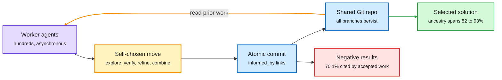

# GitSwarm: Decentralized Compounding Inference

**Date:** 2026-10-11 · **Type:** paper (arXiv 2610.04862) · **Authors:** Vedant Shah, Ankur Samanta, Paras Dahal, Mikhail Plekhanov, Carole-Jean Wu, Scott Yih and colleagues (Meta Superintelligence Labs, with Mila, CMU and Princeton)
**Topic:** [Agent harness and model routing](agent-harness-routing.md)

## TL;DR

Most inference-time compute is organized around individual trajectories or candidates. Partial solutions, experimental findings and failed approaches from one attempt do not inform the next. The paper names the alternative compounding inference: intermediate work persists and later computation can inspect, extend, combine or challenge it. GitSwarm implements it with identical asynchronous agents that share one branchable Git repository and have no central planner. Each contribution is an atomic commit that records which earlier commits it builds on. On ProgramBench it reaches 79.4% against 65.1% for the strongest baseline at the stated budget, and the score keeps rising as workers are added.

The repository is the memory, and the commit graph is the plan

Nobody assigns roles. Each worker reads what exists and decides what to add.

Purple is an agent, amber is its decision and the reuse loop, blue is persistent memory, red is failed work that still gets used, green is the result.

## Mechanism

- **Substrate.** Homogeneous asynchronous workers share one branchable Git repository.
- **Contributions.** Each is an atomic commit. An `informed_by` field records which earlier commits, on any branch, it depends on.
- **No planner.** No central process assigns roles. Each worker decides whether to explore, experiment, verify, refine or synthesize.

## Results

- **IMOProofBench-Advanced.** All 30 problems solved in one run with GPT-5.5 Codex workers, using under one million output tokens according to the curated summary.
- **ProgramBench.** 79.4% mean score against 65.1% for a single Codex agent prompted to continue at a comparable budget.
- **Scaling with workers.** 73.1% with 100 workers, 79.4% with 500. The sequential baseline stays between 63.1% and 65.1% across its checkpoints.
- **Reuse.** 94.7% of ProgramBench contributions are subsequently built upon. The selected solution's ancestry covers 82 to 93% of the contribution graph.
- **Research setting.** On three GPU-backed architecture tasks (Residual Matrix Transformer, Looped Transformer, NanoChat), workers ran 395 experiments in the first 26 hours across twelve idea families and improved on the starting architectures. 70.1% of commits labelled negative are cited by later accepted work.

## Gaps

- Budget against the baseline is described as comparable. A total token count for the swarm was not in what was read.
- All workers run one frontier model. Mixing cheap and strong workers is not shown.
- Read from the abstract and a curated summary. alphaxiv has no overview.

## Production companion: Prime Agent's Rust rewrite

Prime Intellect published an account of its coding agent rewriting itself from TypeScript to Rust in the same window (about half the post was read).

- **Scale.** 2,209 agents, 16,758 agent-to-agent messages, 228.70 billion tokens from a GLM-5.3 endpoint, across more than 10,000 sandboxes, over two weeks. Of those tokens, 192.99 billion went to the implementation and 35.70 billion to a performance hillclimb.
- **Verification first.** Human work went into four parity specifications: terminal frames diffed between the two binaries, session transcripts and provider requests diffed, every daemon protocol message checked, and a component-by-component feature audit.
- **Orchestration.** One root agent wrote no product code. It ordered tasks topologically, merged finished work and kept the overview. Each task passed through four agents: planner, implementer in a dedicated worktree, adversarial reviewer on a different model in a separate context, and verifier in a fresh sandbox. A failed review or verification sends the feature back.
- **Outcome.** Nine crates with a one-way dependency graph enforced by Cargo, the largest source file down from about 15,000 lines to about 2,500. The company reports roughly 13 times faster time to usable input and 83% less startup memory.

The difference from GitSwarm is the root orchestrator. Both rely on persistent shared state and on separating generation from verification.

## Related: where harness effort pays

"An Empirical Study of Harness Design for Coding Agents" (arXiv 2609.20804, saved in the same window, abstract and introduction read) fixes the execution loop of a light harness and varies planning, action space and context management across 176 matched settings, four models, SWE-bench Verified and Terminal-Bench 2.1.

- Context management becomes more valuable as the context budget tightens, mostly by preventing overflow failures.
- Rule-based elision before LLM summarization is the most efficient strategy. Making elided content recoverable adds machinery models rarely use and no accuracy.
- Planning is an accuracy scaffold for weaker models and a cost saver for stronger ones.
- Predefined tools help models with weaker bash proficiency. Bash-capable models do well with a bash-only interface at much lower cost.

## Relation to earlier wiki pages

- **Measures what the swarm essay argued.** The 10-09 Global View covered "On the Nature of the Swarm", which says multi-agent systems are structured inference scaling. GitSwarm counts reuse directly and shows scaling with head count where one long run plateaus.
- **Contrast with DeLM** (10-09: a shared context and task queue in place of a main agent, up to 17.5 points better). Both remove the main agent. GitSwarm adds explicit dependency links between contributions.
- **Explains a 10-09 tension.** "What Does a Harness Buy? Tokens, Mostly" found two harnesses within 5 points for a strong model. The component study says each component's value depends on model strength and budget, so strong models with large windows should make harnesses look interchangeable.
- **The harness as a training variable, now eight results.** The concept page counted six through 10-09. This window adds HarnessSQL (Qwen3-14B from 22.2% to 54.8% on Spider 2.0-SQLite when trained inside its deployment harness) and MASS (Sakana: a model fine-tuned on its own multi-agent traces, 1.2 to 1.6 times higher performance per output token after two cycles on Qwen3.6-27B). CMU's Harness Learning from 10-04 resurfaced with one new detail: its 4B proposer beats the 35B teacher at single-step revision.

## Research angle

- Credit assignment over the commit graph. The `informed_by` links are a ready-made structure for attributing the final score to contributions, which could become a training signal for the workers.
- Whether cheap models can do most of the commits. The LangChain routing post in the same window reports a 64% drop in median cost per coding task from routing inside the harness.

## Links

- Source: [paper](https://arxiv.org/abs/2610.04862) · [summary](https://academy.dair.ai/papers/gitswarm-decentralized-compounding-inference-2610.04862) · [post](https://x.com/omarsar0/status/2109287161199812802) · [Prime Agent blog](https://www.primeintellect.ai/blog/prime-agent-rust) · [harness study](https://arxiv.org/pdf/2609.20804)
- Digest: [2026-10-11](../daily-digest/2026-10/2026-10-11.md)
- Raw: X feed capture for the 2026-10-11 window (local only). The Prime Agent post and the harness study were also surfaced via saved reading.
