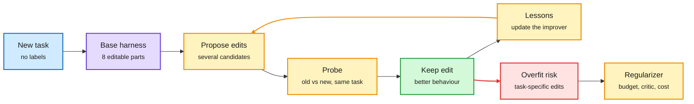

# Self-Improving Harnesses, and Why the Interface Matters

**Date:** 2026-11-01 · **Type:** four papers and one toolkit: Harness² (Google, arXiv 2610.14224, alphaXiv overview read), RRSI (Google, arXiv 2609.24972, abstract and project page read), RSIHub (arXiv 2610.32253, abstract read), FlashRSI (Renmin University, project page read) and "Matched Capabilities, Different Behaviors" (arXiv 2610.34298, abstract read; on both HuggingFace and Kurate's cs.AI board) · **Surfaced via** saved reading (Harness² saved six times)
**Topic:** [Agent harness and model routing](agent-harness-routing.md)

## TL;DR

The harness (the prompts, tools, memory, skills, guardrails and control flow around a frozen model) is now being optimized automatically. **Harness²** improves the harness at test time for each new task without a verifier, by running old and new harnesses side by side and keeping edits whose behaviour changes for the better, then distilling reusable lessons into the improver. **RRSI** names the failure that follows: evolved harnesses overfit the tasks they are evolved on. It regularizes the search (an annealed edit budget, a critic that rejects benchmark-specific edits, a noise floor and a cost rule) and gains up to 4.3 points on five out-of-distribution benchmarks while using 30% fewer policy tokens. **RSIHub** and **FlashRSI** put a dozen methods on shared infrastructure and find rankings that do not hold across models, benchmarks or held-out splits. Separately, a controlled study shows that exposing *identical* capabilities through MCP or a CLI changes agent behaviour: paired trajectories diverge structurally in 94.3% of 2,004 episodes.

The harness is now a trained artifact, and it overfits like one

Weights stay frozen; the search over harness edits is where generalization is won or lost.

Blue is the task, purple is the harness, amber is the improvement loop and its regularizer, green is a kept edit, red is the overfitting risk.

## Harness²

Eight editable components: system prompt, guardrails, memory, tool guidance, subagents, skills, scripts and middleware plugins. Every task starts from the same base harness, so a task-specific harness is never carried forward. A fixed "improvement harness" proposes edits, probes them against the old harness under the same conditions and composes the useful ones. Execution outcomes are treated as behavioural evidence, not proof of correctness, because there is no verifier. After each task, what was learned about *editing* (which weakness, which edit, which behaviour change) updates the improver. Reported gains, one step, frozen GLM-5 and Gemini 3.5 Flash: up to 11.5 points on WorkBuddy-Bench, 4.5 on JobBench and 11.8 on LAB.

## RRSI

Proposal side: an annealed budget lets early rounds bundle a few coordinated edits and late rounds only one attributable change; every candidate is logged with hypothesis, diff, score and cost; exploration shifts to untouched components when progress stalls. Selection side: a leakage critic rejects task names, entities, answers or benchmark logic; a gain must clear the variance measured on the unchanged harness; extra inference tokens must be paid for by measured gain; components that stop earning their place are pruned. Abstract: up to 6.0 points on the evolve split, up to 4.3 on five out-of-distribution benchmarks, 30% fewer policy tokens. The project page with Claude Opus 4.8 as the policy reports +4.0 average on the three evolve benchmarks and +3.4 on six held-out ones, all improving, and 36% fewer tokens.

## RSIHub and FlashRSI

RSIHub re-implements AHE, Hyperagents, A-Evolve and GEPA without changing its core and keeps evaluation outside what methods can modify. A saved summary reports the largest gain on Terminal Bench 2 as MiniSWE from 56.2% to 69.7%, the best gain with Codex as 2.2 points, rankings changing on τ³ Banking, and some gains reversing on held-out splits. FlashRSI covers 12 methods, 30 benchmarks and native Claude Code, Mini-Agent and Codex integrations; its authors find gains easiest in-domain and near-domain, OOD hard, and restricting evolution to skills or prompts alone sometimes better.

## MCP versus CLI with matched capabilities

MICA renders both interfaces from one semantic action contract and routes actions through one runtime. Across six models and three environments, interface choice changes task performance, interaction cost, action selection, failure pathways and recovery; early divergences carry through later steps. DART keeps validated semantic commitments and repairs only interface-specific realization: better score in all six settings by up to 9.0 points and up to 27.1k fewer MCP tokens per task.

## Gaps

Harness² and RSIHub were read at abstract or overview depth. Most gains are on agentic benchmarks with model-graded rubrics.

## Relation to earlier wiki pages

- **Continues** the established pattern "the harness is a training variable" on the [concept page](agent-harness-routing.md) (eight results by 10-11) and CMU's Harness Learning (10-04, a 4B model trained to edit harness code). The new element is regularization and held-out testing.
- **Connects to** [RSIGym](2026-10-09-rsigym.md) (10-09), where harness-only edits gave a clear gain and data-only edits barely moved the score.
- **Interface study connects to** the multi-harness RL guide (10-04), where one model scored very differently across harnesses: the same effect, isolated to one variable.

## Research angle

Harness evolution is a learning algorithm over text programs, so classic ML hygiene applies: held-out splits, regularization, and noise floors. The open question for the core topics is the split between what belongs in the harness and what belongs in the weights. Multi-harness RL (training weights across harnesses) and harness evolution (fixed weights, evolving harness) are now both mature enough for a head-to-head at equal compute.

## Links

- Harness²: https://arxiv.org/abs/2610.14224 · https://github.com/google-research/harness2
- RRSI: https://arxiv.org/abs/2609.24972 · https://regularized-rsi.com
- RSIHub: https://arxiv.org/abs/2610.32253 · FlashRSI: https://github.com/RUC-NLPIR/FlashRSI
- MCP versus CLI: https://arxiv.org/abs/2610.34298
- Raw: `raw/huggingface/2026-10-31-matched-capabilities-different-behaviors-a-control.md`, `raw/kurate/2026-11-01-cs-ai.md`, and saved reading for the window (local only)
