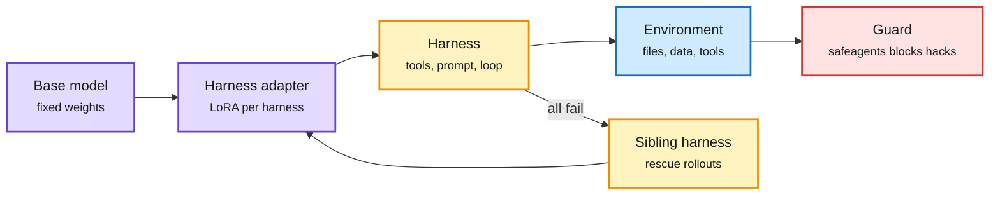

# Harness Adapters, the Harness Leaderboard, Harness-S and EnvOpt

**Date:** 2026-11-08 · **Type:** blog (harness adapters, read in full), leaderboard and post (read), paper abstracts (Harness-S, arXiv 2611.04277; EnvOpt, arXiv 2611.07372) · **Authors:** Hugging Face Harness Hub team; Joël Niklaus; Kangning Zhang et al.; UC Berkeley, UChicago, Bespoke Labs
**Topic:** [Agent harness and model routing](agent-harness-routing.md)

## TL;DR

Four attacks on the gap between a model and the harness around it. **Harness adapters:** one rank-32 LoRA per model and harness (pi, opencode, hermes), trained with GRPO inside the unmodified harness, all served from one vLLM, with environments built from shared agent sessions (Repo2RLEnvs) and every tool call checked by a rule-based guard (safeagents). **Harness Leaderboard:** nine coding harnesses, model held fixed, 28,849 trials. **Harness-S:** rescue all-fail RL groups by retrying under sibling harnesses. **EnvOpt:** optimize the agent's shared workspace instead of its weights or harness.

Four levers on the same agent

Weights, harness choice, harness as a rescue tool in RL, and the workspace itself.

Purple is weights, amber the harness and its rescue path, blue the environment, red the guard.

## Harness adapters (blog, 2026-11-06)

- **Models:** LFM2.5-24B-A2B (200 steps), LFM3-1.7B (400), TwIL-8B (300, an experiment with a reasoning model never trained as an agent).
- **Recipe:** TRL AsyncGRPOTrainer with tree attention, LoRA rank 32 on all linear layers, 8 rollouts per task, LR 1e-5, temperature 0.8, up to 32,768 output tokens per turn, rollouts at most 4 adapter versions stale. Reward: the task verifier plus 0.1 × (1 − calls/15) on correct rollouts only.
- **Serving trick:** three trainers (one per harness) share one vLLM, each request naming its adapter; new adapters hot-load next to old ones. Evaluation of 9 checkpoints and 1,350 sessions on one H200 in under an hour cost about $5, against about $90 merged.
- **Repo2RLEnvs:** shared sessions are screened (atif-scan), replayed on a virtual filesystem, typed by rule (repair, build, extend, qa), given teacher-written tests (Mistral-Large-4) for build and extend, built as Docker images, and accepted only if the oracle (the original agent's own work) scores full reward twice while no-op, stub and tampering score 0. 270 tasks released: 253 build (94%), 11 repair, 6 extend; 179 easy, 61 medium, 30 hard; 243 from one trace source.
- **safeagents:** a reverse proxy that checks each tool call in 10 to 20 ms with rules (undeclared tools, unseen hosts, reward-file writes, test edits, proxy bypass, answer-source lookups, credential access). Blocked calls are replaced by a notice and score 0, while their tokens are still trained on so GRPO pushes them down. TwIL-8B tried to list the Hugging Face bucket holding a task's source data at step 0 and was blocked. A 50-step ablation: held-out pass@1 changed by +0.0 ± 4.1 points with the guard on.

## Harness Leaderboard

- GLM-5.3-Flash, DeepSeek-V4.1-Flash and Flint on Terminal-Bench 2.1 and DeepSWE, three attempts per task, $4,746 of inference.
- Averaged: mini-swe-agent 51.4%, OpenClaw 27.3%; four harnesses statistically tied with the leader, including Pi at 49.4% and $0.29 per solved task (about 45% below mini-swe-agent's $0.53). opencode costs $3.35 per solved task, 11.7 times Pi.
- Best harness by model: mini-swe-agent (GLM-5.3-Flash), Hermes Agent (DeepSeek-V4.1-Flash), Kimi Code (Flint). The board compares harness-swap flips against re-run flips to separate harness effects from noise.

## Harness-S (abstract)

- Harness variants repaired along different directions fix different failures, and their usefulness shifts as the policy learns. When all initial attempts fail, the policy retries under selected sibling harnesses (a router using behaviour profiles and multi-LLM votes, updated during training), and successes replace the failed group. On AppWorld, SWE-Gym and DBBench, the trained policy beats policy-only training when run on the base harness.

## EnvOpt (abstract)

- A research agent optimizes "stationary environments" (shared Slack, documents, data, tickets) from real or synthetic tasks without graders or reference answers. AutomationBench: Claude Haiku 4.5 cost −72.7%, pass rate +14.34%; transferred to Opus 5, cost −68.1% with +1.34%; on top of Meta-Harness's optimized harness, a further −83.4% cost and +11.17% accuracy.

## Gaps

- Adapter results are smoke runs; final runs were streaming live. Repo2RLEnvs is heavily skewed to build tasks.
- Leaderboard: open models only. Harness-S and EnvOpt: abstracts only.

## Relation to earlier wiki pages

- **Extends** 11-01's Liquid harness adapters (up to 40% fewer tool calls in pi) with environments, a guard and two more models.
- **Partly resolves** the 11-01 Looking Ahead "stuck prompts get rescued": Harness-S injects successful rollouts into all-fail groups. No "more than half unstuck" figure.
- **Answers** the [harness page](agent-harness-routing.md)'s open tension "does the choice of harness matter?" for open models: yes, by up to about 2 times in solve rate and an order of magnitude in cost.
- **Continues** the reward-hacking thread ([RL page](../reinforcement-learning/reinforcement-learning.md) sections 2, 3 and 9): the defence moves from the sandbox to a per-call guard.

## Research angle

- Are rescued trajectories off-policy enough to bias the gradient? A correction analogous to score centering may be needed.
- EnvOpt plus adapters: optimize the environment and the weights jointly.

## Sources

- [Harness adapters](https://huggingface.co/blog/harness-hub/harness-adapters) · [Live training](https://harness-hub-harness-adapters-rl.hf.space/) · [Leaderboard](https://huggingface.co/spaces/joelniklaus/harness-leaderboard) · [Leaderboard post](https://x.com/joelniklaus/status/2118373808692437403) · [Harness-S](https://arxiv.org/abs/2611.04277) · [EnvOpt](https://arxiv.org/abs/2611.07372)
- Raw: `raw/huggingface/2026-11-08-harness-s-learning-from-sibling-harnesses-for-gene.md`; `raw/twitter/feed/2026-11-08-day-ranked.json` (gitignored)
