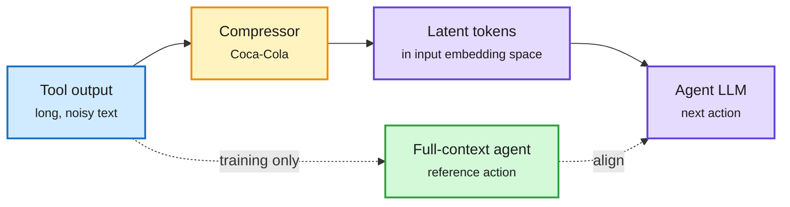

# Tools Need Not Speak in Text: Latent Context Compression for Agents (Coca-Cola)

**Date:** 2026-11-08 · **Type:** paper (arXiv 2611.06500, abstract only) · **Cross-source confirmed (HF + Kurate cs.AI #16)** · **Authors:** Yuetong Liu, Zhehao Zhou, Yitong Zhang, Haorui Chen, Jia Li
**Topic:** [Agent harness and model routing](agent-harness-routing.md)

## TL;DR

Agents normally paste raw tool outputs into their context, where long noisy observations raise cost and distract. Pruning and summarization stay in discrete text, which caps compression. Coca-Cola compresses each tool observation into continuous latent tokens placed in the agent's input embedding space. **Action-Preserving Training** aligns the agent's next-action distribution under the full and compressed observations, so the latents keep what changes decisions. On web-search agents across four QA benchmarks and two model families: 70.01% to 89.24% fewer tokens and 24.45% to 55.97% less end-to-end runtime, with task performance consistently improved.

The agent reads embeddings, not tool dumps

Trained so the next action under compression matches the next action under the full text.

Blue is the raw observation, amber the compressor, purple what the agent sees, green the training reference.

## Gaps

- Abstract only; compression ratio per observation, compressor size and training data not read.
- Web-search QA only; exact-string-sensitive settings such as coding are untested. The compressor is tied to its agent.

## Relation to earlier wiki pages

- **Extends** 11-01's cache-engineering notes (agents dropping and re-positioning their own KV cache) from cache management to representation.
- **Pairs with** [SwarmEvolve](../reinforcement-learning/2026-11-08-s3-swarms-and-swarmevolve.md) (this window): two cases of agents passing information as vectors.
- **Same principle as** decision models ([page](../decision-models/decision-models.md)): keep what changes the action.

## Research angle

- A shared compressor across agents of one family; compression of the agent's own past turns, not just tool outputs.

## Sources

- [Paper](https://arxiv.org/abs/2611.06500)
- Raw: `raw/huggingface/2026-11-08-tools-need-not-speak-in-text-latent-context-compre.md`; `raw/kurate/2026-11-08-cs-ai.md`
