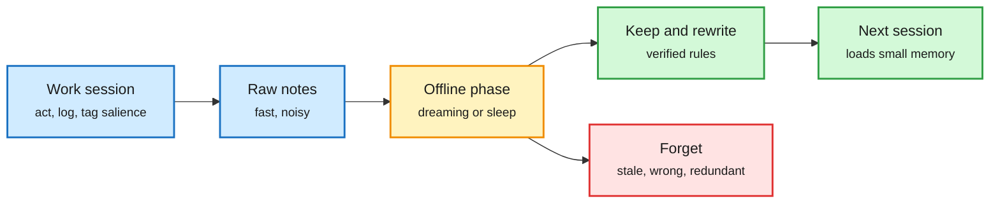

# Agents That Sleep: Anthropic's "Dreaming" and Haber and Tononi's Selectionist Case

**Date:** 2026-11-08 · **Type:** engineering post (Anthropic, read) plus paper abstract (Haber and Tononi, arXiv 2611.02216, Kurate q-bio.NC #7) plus news coverage of a Nature commentary · **Authors:** Anthropic engineering; Ido Haber and Giulio Tononi
**Topic:** [Cognition, concepts and decision-making](cognition-decision.md)

## TL;DR

Two sources from opposite ends reached one design in one week. Anthropic describes Claude's memory as notes captured during work plus "dreaming", offline reflection on logs between sessions to correct mistakes and rewrite notes, explicitly modelled on hippocampal capture and sleep-time replay into neocortex. Haber and Tononi argue from the selectionist theory of sleep that persistent agents already show the costs of unregulated plasticity (semantic drift, weaker retrieval, spreading errors, full capacity), map sleep's three phases ("ringing, resonance and renormalization") onto memory operations, and predict that selective consolidation will beat instruction-driven consolidation as memory stores grow.

Capture online, consolidate offline

Fast writes during work, a slow selective rewrite between sessions.

Blue is the online phase, amber the offline consolidation, green what survives, red what is dropped.

## Key findings

- **Memory as prediction (Anthropic):** writing a rule predicts the pattern will recur; writing a verified fact predicts a future session will rely on it unchecked.
- **Continual Learning Bench 1.0 database task:** Sonnet 4.6 produced scattered untested theories; Opus 4.7 consolidated notes and marked checked facts; Sonnet 5 marked graded answers and wrote corrections; Opus 5 first "closed the loop" (rule, how it was verified, trap warnings); Opus 5.5 and Sonnet 5.5 also closed it.
- **Pokémon Red at about step 10,000:** Sonnet 3.7 wrote 413 memory files in 225 folders and earned one badge, at one point spending 17 steps creating six files and deleting nine with no game actions. Fable 5 wrote nine files in two folders plus a global.md dashboard and earned four badges, storing only what the screen did not show (strategy, plans, tested rules). Opus 5.5 kept a small rewritten folder and beat the game.
- **Steering:** tell Claude what memory is for, not how to use it.
- **Haber and Tononi (abstract):** continual learning under finite capacity, while interacting with the environment, must be paid for with sleep; engineers of stateful agents are independently facing sleep's questions of what to forget and when.
- **Context:** Tononi co-signed a Nature commentary with Anil Seth and Ned Block arguing current AI is not conscious and that consciousness does not depend on computation alone (The Decoder coverage).

## Gaps

- Anthropic's evaluations are single runs; dreaming's isolated effect is not quantified in the captured text.
- Haber and Tononi offer a theory and a prediction, no experiment in the abstract.

## Relation to earlier wiki pages

- **First substantive cognition entry since 10-11** on the [cognition page](cognition-decision.md), and the first linking a theory of the brain to an engineering practice.
- **Extends** the 11-01 agent-memory notes (plain retrieval beats many memory systems; Routed Continual Learning; TreeFlex) with an offline consolidation phase.
- **Bears on** [THX-02](../decision-models/2026-11-08-thx-02-drex-and-dpdm.md): deciding what to remember is a fast decision that could be verified by a slow pass.

## Research angle

- Test the selectionist prediction: grow a memory store into thousands of items and compare selective (consistency-with-memory) against instructed consolidation; look for a crossover with size.
- For the reasoning project: fast episodic capture during action and slow rule extraction offline is the memory side of dual-process thinking.

## Sources

- [Anthropic: The components of agent memory](https://www.anthropic.com/research/components-of-agent-memory) · [Do agents need to sleep?](https://arxiv.org/abs/2611.02216) · [The Decoder on the Nature commentary](https://the-decoder.com/the-brain-as-computer-metaphor-shaped-modern-ai-but-may-be-misleading-the-consciousness-debate/) · [Teortaxes counterpoint](https://x.com/teortaxesTex/status/2118854638523076781)
- Raw: `raw/kurate/2026-11-08-q-bio-nc.md`; `raw/rss/2026-11-08-the-decoder-com.md`; `raw/twitter/feed/2026-11-08-day-ranked.json` (gitignored)
