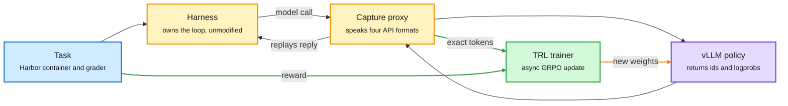
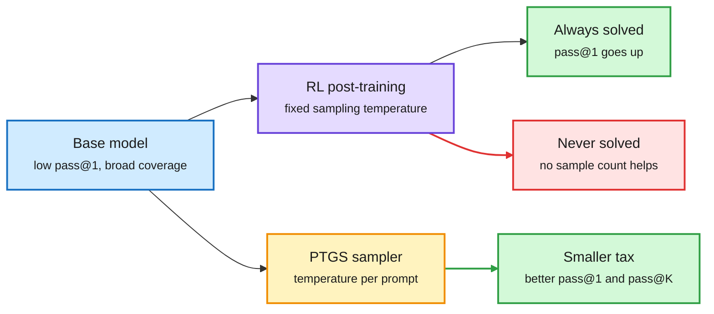
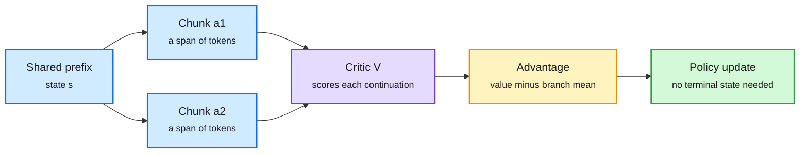
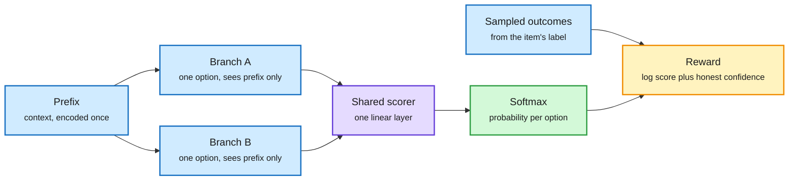
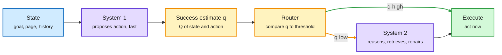
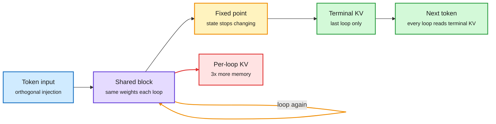
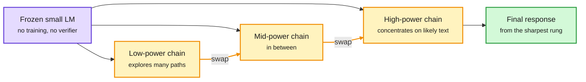

# markov-thinks-slow | 2026-10-04

> Post-training spent the day arguing about one variable: how close the training data sits to what the model would have written itself.

**Opportunity:** Trillium Labs, a new non-profit for open post-training research founded by Nathan Lambert and Tom Zick, is hiring full-time staff plus student collaborators and interns (Bay Area, Cambridge MA, remote okay; no deadline stated, hiring form in the [launch post](https://blog.trilliumlabs.org/p/introducing-trillium-labs)). Also open: applications to the World Modeling for Physics winter conference in Aspen, organized by Balestriero, Kempe, LeCun and Ho, close **15 October** via the [Aspen Center for Physics](https://aspenphys.org/winter-conferences/#event6585). No Lossfunk cohort call appeared in this window.

🎯 Today's 5 for you
<ol>
<li>Read<strong>The ultimate guide to multi-harness RL.</strong> Hugging Face trains a 2.6B model with RL inside Claude Code, Codex and OpenCode without touching them. It is your RL interest and your day job in one document, and everything is open. <a href="https://huggingface.co/spaces/FineEnvs/multi-harness-rl">Guide</a></li>
<li>Read<strong>Finetuning with Sampling.</strong> SFT rivals RL once MCMC rewrites expert traces to look like the base model's own output. The cleanest training-stack idea of the day. <a href="https://aakaran.github.io/finetuning_with_sampling/">Project page</a></li>
<li>Read<strong>Is Jev secretly a value function?</strong> A short formal essay on when a fast decider should hand over to a slow reasoner. It bears directly on your System 1 and System 2 project. Pair it with the Gero-4B build log you saved. <a href="https://souradip-chakraborty.github.io/blog/jev-rlcd/">Essay</a></li>
<li>Skim<strong>Sharpening Tax in Post-Training.</strong> Meta shows RL post-training makes agents consistent and costs them coverage. Read the abstract and the definition of the tax. <a href="https://arxiv.org/abs/2610.01509">Paper</a></li>
<li>Track<strong>Looped models at fixed points.</strong> Three looping papers landed together. The fixed-point one explains why a looped model can keep a third of the KV cache. Skip the Claude Code tip threads and "10 repos" lists that ranked above it. <a href="https://x.com/huskydogewoof/status/2106130737007091939">Thread</a></li>
</ol>

---

## TL;DR

- **Multi-harness RL (Hugging Face)**: one model scores 62% in one agent harness and 33% in another. Training across four harnesses lifts it from 42% to 54%.
- **Finetuning with Sampling**: rewrite expert traces with MCMC until they look on-policy. Plain SFT then rivals RL and forgets less.
- **Sharpening Tax (Meta)**: post-trained agents win on the first try. Base models often solve more tasks when given many tries.
- **Decision models go open**: llama.cpp ships a System One endpoint, and two open recipes show how to train calibrated deciders.
- **Looped models**: near a fixed point, a looped language model can drop two thirds of its KV cache with almost no loss.
- **Stripe owns OpenRouter**: the a16z podcast confirms the acquisition. No price was given.

---

## Deep Dives

### The ultimate guide to multi-harness RL

> The same weights solve 62% of tasks in one coding harness and 33% in another, and the fix is to train inside the harnesses without changing a line of them.

**Source:** Hugging Face (FineEnvs), surfaced through the priority account @adithya_s_k and five reposts
**Links:** [Guide](https://huggingface.co/spaces/FineEnvs/multi-harness-rl) · [Thread](https://x.com/adithya_s_k/status/2105684965891703141) · [Wiki summary](../../reinforcement-learning/2026-10-04-multi-harness-rl-guide.md)

The trainer never touches the harness. It listens at the model endpoint.

The capture proxy is the only new box. Claude Code, Codex and OpenCode run exactly as shipped.

Blue is the task, amber is the loop and the interception point, purple is the model, green is the training path.

**What is it about?**
An agent harness is the program wrapped around a model: it runs the loop, offers the tools, builds the context and decides when to stop. This guide shows how to run agentic RL (reinforcement learning where actions are tool calls and the reward comes from a grader at the end) inside real harnesses such as Claude Code, Codex and OpenCode, and reports what happens when a small model is trained across four of them at once.

**What problem does it solve?**
In a normal RL setup the trainer owns the loop, so it already holds every token the policy sampled. Inside a shipped harness the harness owns the loop, and the trainer sees only requests and responses going past. A policy gradient needs the exact token ids that were sampled and the probability each was sampled with. Text plus a score gives neither, because re-tokenizing text can produce different ids, and harnesses rewrite whitespace, add role markers and repair broken JSON.

**What's the core novelty?**
A capture proxy that sits between the harness and the model server. Every harness has to call a model API, so that is the one interface guaranteed to exist. The proxy speaks the four API formats coding agents use, converts each request to chat completions, asks vLLM for the prompt ids, the sampled ids and a logprob per sampled token, and replays the answer in the caller's format. It samples from the full distribution with no top-p or top-k, because truncation makes the recorded logprobs differ from the policy. Retries, subagents and compacted contexts are stored as a graph of calls linked by longest exact token prefix, and each root-to-leaf path becomes one training sequence.

**Key takeaways**
- Before training, LFM2.5-2.6B solves 62% of held-out tasks under Mini-SWE-Agent and 33% under Claude Code.
- Trained across OpenCode, Claude Code, Codex and Mini-SWE-Agent, it goes from 42% to 54% averaged over the four, with 31% fewer tool calls on tasks both versions solve.
- Trained in OpenCode alone, it goes from 34% to 58% in OpenCode but improves much less elsewhere. The multi-harness model is better under Claude Code (49% vs 42%) and Codex (54% vs 43%).
- Supervised fine-tuning on 3,189 successful rollouts from Qwen3.8-27B plateaued at 47.5%, below both RL runs.
- A tool-efficiency bonus of at most 0.1 was the only reward contrast in 22.6% of multi-harness GRPO groups, the ones where every rollout was already correct.

**Gaps in the study**
The overall gap between the two RL runs (54.2% vs 52.3%) is inside the noise, since each test cell runs once. There is no run without the efficiency bonus, so the 31% tool-call reduction cannot be attributed to it. One model size, one task suite (data analysis from Kaggle notebooks), and the proxy is a single process that crashed at 320 concurrent sessions.

**Industrial implication**
Harness choice becomes a training-time setting instead of a deployment accident. The guide documents that Poolside, Kimi K3, Qwen3-Coder-Next and MiMo-V2.6 already train across several harnesses; this release gives everyone else the plumbing. Expect open model cards to report scores per harness as a matter of course within two quarters.

**Research angle.** Why it works: GRPO (group relative policy optimization, which trains on how each rollout's reward compares with its group's mean) only needs exact tokens and one reward per rollout, and both survive interception at the endpoint. The open question the guide itself flags is whether token fidelity is needed at all. OpenForgeRL uses the same proxy idea and reconstructs samples from text, and still reports the strongest multi-harness results so far. A clean ablation of token-faithful versus text-reconstructed training on one task set is an obvious and cheap experiment. The reward story also deserves attention: an earlier "+0.2 for submitting anything" term taught the policy to submit immediately and dropped held-out accuracy from 0.740 to 0.178 while training reward looked healthy. This intersects the day job directly, since the 62%-versus-33% gap is also a routing fact: a router that ignores the harness is routing on the wrong score.

→ [Full summary](../../reinforcement-learning/2026-10-04-multi-harness-rl-guide.md)

---

### Finetuning with Sampling: SFT Learns Better Than You Think

> SFT fails because its data is off-policy, not because of its loss, and MCMC can move the data instead of changing the learner.

**Source:** X Following feed (the day's most-shared paper, seven independent reposts) and a saved post
**Links:** [Paper](https://arxiv.org/abs/2610.02140) · [Project page](https://aakaran.github.io/finetuning_with_sampling/) · [Code](https://github.com/aakaran/finetuning-with-sampling) · [Wiki summary](../../training-finetuning/2026-10-04-finetuning-with-sampling.md)

```mermaid
flowchart LR
  E["Expert trace<br/><small>off-policy, has the answer</small>"] --> Q["Proposer<br/><small>base model given the constraint</small>"]
  Q --> A["Accept test<br/><small>base-model likelihood ratio</small>"]
  A -->|rejected| Q
  A -->|accepted| X["Rewritten trace<br/><small>same facts, model's own style</small>"]
  X -->|more steps| Q
  X --> S["Plain SFT<br/><small>unchanged objective</small>"]
  S --> M["Finetuned model<br/><small>generalizes, forgets less</small>"]
  classDef input fill:#d0ebff,stroke:#1971c2,color:#1b1b1b,stroke-width:2px
  classDef core fill:#e5dbff,stroke:#6741d9,color:#1b1b1b,stroke-width:2px
  classDef loop fill:#fff3bf,stroke:#f08c00,color:#1b1b1b,stroke-width:2px
  classDef exit fill:#d3f9d8,stroke:#2f9e44,color:#1b1b1b,stroke-width:2px
  classDef err fill:#ffe3e3,stroke:#e03131,color:#1b1b1b,stroke-width:2px
  class E input
  class Q,S core
  class A loop
  class X,M exit
  linkStyle 2 stroke:#e03131,stroke-width:2px
  linkStyle 4 stroke:#f08c00,stroke-width:2px
```

Move the data toward the model, then use ordinary SFT

The expert trace is only the starting point. Each accepted rewrite is more likely under the base model.

Blue is the off-policy input, purple is a model call, amber is the Metropolis-Hastings loop, green is what gets kept.

**What is it about?**
Post-training uses two tools. SFT (supervised fine-tuning) copies expert traces. RL learns from the model's own attempts. The common view is that RL generalizes and keeps old skills while SFT memorizes and forgets. This paper from Harvard shows that view is mostly about the data, and gives a sampling algorithm that makes SFT competitive.

**What problem does it solve?**
On-policy learning has to find a successful trajectory by sampling. For a truly new task the chance of that is close to zero, so there is no signal. Off-policy data supplies the success as privileged information, but the trace looks nothing like what the model would write, and fitting it shifts the model unpredictably. Until now the usual answer was to change the objective. This paper changes the data.

**What's the core novelty?**
Write the privileged information as a constraint C on trajectories. The ideal training distribution is the information projection: the distribution closest in KL to the base model p among those that satisfy C, which works out to p(x) times an indicator that x is in C. Rejection sampling from it is the same as blind on-policy sampling. Instead they run Metropolis-Hastings, an MCMC sampler that proposes an altered trajectory and accepts it with a probability set by a likelihood ratio. The trick is to absorb the constraint into the proposal: the proposer is the base model conditioned on C, so every candidate respects the constraint, and the accept test only needs base-model likelihoods. They call this projection sampling, and run it block by block over the trace.

**Key takeaways**
- Standard SFT on projection-sampled traces rivals GRPO, UFT and on-policy self-distillation on chemistry skill acquisition, math reasoning and medical question answering.
- It often generalizes better and retains prior capabilities at least as well as the on-policy baselines.
- It learns beyond sharpening. On chemistry, its pass@k curve stays above the base model's at large k, where pure sharpening would converge to it.
- Some tasks the base model never solved in 64 attempts reach pass rates of 67.2% and 53.1% after finetuning.

**Gaps in the study**
All tasks are single-turn. The agentic case is untested: it is unclear whether resampling one turn at a time is enough or whether the environment has to be replayed. The cost of the MCMC chain per trace is not reported in what was read. Base models named are 7B-class.

**Industrial implication**
If this holds, the awkward "midtraining" stage gets a principled recipe: collect expert or teacher traces, project them, run cheap SFT, and save RL for the end. That is a large compute saving for anyone distilling a strong model into a small one.

**Research angle.** Why it works: SFT's gradient is only as safe as the distance between the target text and the model's own distribution. Projection sampling shrinks that distance while keeping the information that made the trace valuable. Three things are worth working on. First, the agentic extension named above. Second, today's Cambridge distillation study (next but one Deep Dive) claims rollout policy is not the central variable and KL direction is, which is in tension with this paper's premise; nobody has run projection-sampled data through both KL directions. Third, the authors say sampling is a general primitive for RL and distillation too, which would mean constructing rollouts for a critic to score instead of hoping to stumble on them. For the reasoning project: this is a way to teach a slow reasoner new skills from demonstrations without overwriting what it already believes.

→ [Full summary](../../training-finetuning/2026-10-04-finetuning-with-sampling.md)

---

### Sharpening Tax in Post-Training

> Give a base model a light harness and enough attempts, and it often solves more agentic tasks than its own post-trained version.

**Source:** HuggingFace Daily Papers and the X feed. Cross-source confirmed via social.
**Links:** [Paper](https://arxiv.org/abs/2610.01509) · [Project page](https://changdaeoh.github.io/sharpening-tax/) · [Wiki summary](../../reinforcement-learning/2026-10-04-sharpening-tax.md)

Post-training buys consistency and pays in coverage

Tasks drift to two extremes. The middle, where extra samples help, empties out.

Blue is the starting model, purple is standard post-training, amber is the proposed sampler, green is gain, red is the cost.

**What is it about?**
A paper from Meta Superintelligence Labs with Wisconsin, NYU and Stanford. It asks whether RL post-training gives agents new abilities or just sharpens a few behaviours the base model already had. Earlier evidence for sharpening came from math and coding. This is the first test on multi-turn tool-use tasks.

**What problem does it solve?**
There are two ways to judge an agent. Pass@1 is first-attempt accuracy. Pass@K is whether any of K attempts succeeds, which measures solution coverage. A user who tries once wants the first. A system that can run many attempts and verify them wants the second. Until now nobody had a compact number for how much coverage post-training gives up.

**What's the core novelty?**
The Sharpening Tax, a diagnostic that quantifies the loss in test-time scalability after post-training. It can be estimated from a few rollouts. The mechanism behind it is that post-training pushes each task toward one of two extremes, always solved or never solved. The paper also proposes PTGS (posterior-tempered group sampling), a Bayesian sampler that sets the sampling temperature per prompt from its estimated difficulty during RL training, so hard prompts get more exploration.

**Key takeaways**
- Pre-trained models with a light inference harness are capable agents. With enough test-time budget they often surpass post-trained counterparts in pass@K despite far lower pass@1.
- The tax is prevalent in most of 42 cases: 14 base and post-trained pairs from four model families on three agentic benchmarks.
- PTGS, applied during RL training in two agentic environments, pays a smaller tax than fixed-temperature sampling and also improves single-shot accuracy.

**Gaps in the study**
The public checkpoints have undocumented recipes, so "post-trained" may mix SFT, preference optimization and RL. The alphaxiv overview notes the paper does not attribute the effect to RL specifically. The benchmarks named there (BFCL v4 multi-turn, WebShop, ACEBench) are short compared with repository-scale coding. Only the abstract and the first part of the overview were read, so no tax values are quoted.

**Industrial implication**
Anyone running best-of-N with a verifier should benchmark the base model too. If coverage is what you buy with compute, a post-trained checkpoint can be the worse purchase.

**Research angle.** Why it happens: a policy gradient on a 0 or 1 reward concentrates mass on whatever already works, and nothing in the objective values the alternatives. This sits in direct tension with Finetuning with Sampling (above), which shows a pass@k curve that stays above the base model after SFT on projected data. The two are compatible if the difference is where the training trajectories come from: the model's own samples can only sharpen, constructed samples can add. That is a testable claim. It also connects to the multi-harness guide's "light harness" finding from the other side: the base model's 62% under a simple harness is coverage waiting to be used. Open problem worth a project: a training objective that is rewarded for pass@K directly.

→ [Full summary](../../reinforcement-learning/2026-10-04-sharpening-tax.md)

---

### On-Policy or Off-Policy Learning? A Systematic Study of Distillation Dynamics

> Who wrote the rollouts matters less than which way the KL points.

**Source:** HuggingFace Daily Papers and a saved post. Cross-source confirmed via social.
**Links:** [Paper](https://arxiv.org/abs/2609.35259) · [Post](https://x.com/HuggingPapers/status/2106380403225309561) · [Wiki summary](../../training-finetuning/2026-10-04-on-policy-vs-off-policy-distillation.md)

**What is it about?**
A controlled study from Cambridge of strong-to-weak distillation, where a large teacher trains a small student. It varies three knobs independently across Llama 3 and Qwen2.5 families and reasoning tasks in science, medicine and arithmetic: the rollout policy (teacher-written or student-written text), the direction of the token-level KL divergence, and the learning rate.

**What problem does it solve?**
Comparisons between SFT and RL change many things at once, so the credit given to "on-policy" has never been isolated. This paper isolates it.

**What's the core novelty?**
Not a method. A factorial design plus an analysis of KL gradients along a continuous spectrum from fully teacher-generated to fully student-generated rollouts.

**Key takeaways**
- Rollout policy does not necessarily play a central role. KL direction shapes task performance and output coverage more clearly.
- Learning rate governs forgetting and update sparsity, two effects usually credited to on-policy learning.
- Forward KL is robust to the rollout policy. Reverse KL is much more sensitive and favours student-generated rollouts.
- On-policy data still improves generalization to harder variants of the Countdown arithmetic task, but the advantage does not reliably persist after a later RLVR stage (RL with verifiable rewards).

**Gaps in the study**
Distillation with a teacher is not the same as RL from a sparse reward, so the result does not transfer automatically to GRPO. Only the paper's first page (from the image on the post) was read, and alphaxiv has no overview yet, so no numbers are quoted.

**Industrial implication**
Before paying for on-policy rollouts in a distillation pipeline, sweep the KL direction and the learning rate. They are cheaper and may explain most of the gain.

**Research angle.** This is the day's contradiction, and it should stay open. Finetuning with Sampling says SFT's weakness is off-policy data. This study says rollout policy is not central once objective and learning rate are controlled. They may both be right: forward KL on teacher text is exactly SFT-like, and the study finds it robust, while the Harvard paper's gains are largest on tasks the student cannot solve at all, which a strong-to-weak setup with a capable student may not probe. A joint experiment on tasks with zero base pass rate would settle it.

→ [Full summary](../../training-finetuning/2026-10-04-on-policy-vs-off-policy-distillation.md)

---

### AC2: Actor-Critic with Action Chunking

> You do not have to finish every rollout if you trust a critic to score the first chunk.

**Source:** X Following feed (Stanford NLP repost, commentary from Tengyu Ma and Jiacheng You). The paper itself was not captured; this is written from the post and its figure.
**Links:** [Post](https://x.com/wen_kaiyue/status/2106052620507091244) · [Wiki summary](../../reinforcement-learning/2026-10-04-ac2-actor-critic-action-chunking.md)

GRPO pays for full rollouts. AC2 pays for chunks.

The reward at the end is replaced by a learned value right after each chunk.

Blue is sampled text, purple is the learned critic, amber is the advantage computation, green is the update.

**What is it about?**
A proposal for RL on language models that replaces GRPO's end-of-rollout reward with a learned critic. The model branches several chunks of tokens from the same prefix, and a value function scores each branch.

**What problem does it solve?**
GRPO's advantage is each rollout's final reward minus the group mean. Every rollout has to run to a terminal state before any learning happens. For long proofs or long agent runs that is most of the compute.

**What's the core novelty?**
From the figure: the advantage for chunk i is the critic's value of the prefix followed by that chunk, minus the mean of that value over the sampled chunks. The critic is trained so that its value of the prefix matches the mean value of the branches. Tengyu Ma's summary names three ingredients: a critic supervises the policy, LLMs can be reset to any prefix for free, and the Q function shares parameters with the policy.

**Key takeaways**
- The figure plots IMO-ProofBench score against decoding compute. AC2 sits above GRPO and a "Prefix GRPO" baseline for most of the run.
- The authors' claim is that partial rollouts make training faster than GRPO.
- One informed objection: this is "more like a reward model with action chunking, instead of a Q model with action chunking".

**Gaps in the study**
Everything, until the paper is read. In particular how the critic is bootstrapped, how its errors are bounded, and whether the gain survives outside proof tasks.

**Industrial implication**
If a critic can be trusted at chunk level, RL on long-horizon tasks stops scaling with trajectory length. That matters most for the agentic setting in the multi-harness guide, where one rollout is a whole coding session.

**Research angle.** This is classical actor-critic returning to LLM training, and it matters because of the reader's roots in RL. The interesting part is the reset: in language, any prefix is a state you can return to at zero cost, which classical environments rarely allow. It connects to today's value-function essay on Jev (two Deep Dives down), which argues that a calibrated success probability for an action is a Q-value. A critic good enough to train on is also a critic good enough to route on. Not everyone is convinced: one practitioner in the feed said they are more bullish on neurosymbolic world models than on "RL with value models and just one rollout".

→ [Full summary](../../reinforcement-learning/2026-10-04-ac2-actor-critic-action-chunking.md)

---

### Building an RL fine-tuning platform to train Jev-like decision models (Gero-4B)

> The obvious calibration reward teaches the model to pick a wrong answer and say it is unsure.

**Source:** X Article, saved twice by the reader
**Links:** [Article](https://x.com/TheVixhal/status/2106439792800198966) · [Wiki summary](../../decision-models/2026-10-04-rl-calibration-decision-models-gero-4b.md)

Encode the context once, score every option alone, reward honesty

Options never see each other, so their order cannot matter. The reward is built from proper scoring rules only.

Blue is input, purple is the learned scorer, amber is the training reward, green is the output distribution.

**What is it about?**
A decision model answers by scoring options you supply instead of writing text. Jev, from TypeSafe, is the commercial reference. This article is a full build log for an open one: Qwen3-4B turned into Gero-4B on a MacBook with Apple's MLX, with LoRA adapters on the last 8 layers.

**What problem does it solve?**
Chat models are badly calibrated. Calibrated means that when the model says 0.9 it is right about nine times in ten. Without that you cannot write a rule like "auto-handle anything above 0.95 and send the rest to a human". Nobody had published a step-by-step account of training for it.

**What's the core novelty?**
Two pieces. The architecture is a branch readout: remove the language-model head, add one linear layer that maps a hidden state to a single score, encode the prefix once, run each option as a separate branch that attends to the prefix but not to other options, and softmax the scores. The reward is a pair of proper scoring rules, rules under which the best strategy is to report the true probability. Part one samples real outcomes from the item's label distribution and pays log p of the outcome. Part two takes the model's top answer and confidence c and pays log c when the sampled outcome matches and log(1 − c) when it does not.

**Key takeaways**
- An earlier design with 256 fixed output slots collapsed above 6 options, because slots 6 to 255 never trained. The shared scorer handles 2 or 256 options with the same weights.
- Shuffling the options changes no score. The measured maximum difference was 0.0.
- The naive reward (pay for how well confidence predicts the model's own pick) drove the correct answer's probability from 0.418 to 0.001.
- A KL anchor to the starting model made calibration worse, because it adds a second target and moves the optimum away from the truth.
- A flawed metric scored an honest model's reliability error at 0.1019 and an overconfident one at 0.0001 on ambiguous items.

**Gaps in the study**
No final benchmark numbers for Gero-4B appear in the part that was read; the article was cut off at step 8. Stage 2 uses synthetic content-free data, and the article itself reports one transfer failure, where over-training on negation dropped a real entailment task from 0.775 to 0.617.

**Industrial implication**
Calibrated deciders are the cheap gate in front of expensive models. Combined with llama.cpp's new `/v1/systemone` endpoint (see Industry Pulse), a team can now train and serve one locally without a vendor.

**Research angle.** This bears directly on the reasoning-model project: it is a working recipe for a System 1 decider whose output is a probability you can act on. Why it works: with a proper scoring rule, the expected reward is maximized only at the true distribution, so RL has nothing to exploit. The design rule the author extracted is general and worth keeping: any extra loss term must have zero gradient at the point where the model's probabilities equal the truth, or it moves the optimum. Open problems: the labels here are per-item, so this trains single-step correctness, not eventual task success, which is the gap the next Deep Dive addresses. And soft labels for ambiguous items are hand-built; learning them from disagreement data is unsolved. A related result in the feed supports a smaller decider: RSI-Jev found that stopping Qwen3.5-4B at layer 20 of 32 decides as well as the full model.

→ [Full summary](../../decision-models/2026-10-04-rl-calibration-decision-models-gero-4b.md)

---

### Notes on Jev: Is Jev Secretly a Value Function?

> The probability a fast decider needs to report is not "how often I pick this" but "how often the task succeeds if I do", and that number already has a name.

**Source:** Blog essay by Souradip Chakraborty (MIT) and Amrit Singh Bedi (UCF), via the X feed
**Links:** [Essay](https://souradip-chakraborty.github.io/blog/jev-rlcd/) · [Post](https://x.com/neilkale/status/2106247149361230185) · [Wiki summary](../../decision-models/2026-10-04-is-jev-a-value-function.md)

Route on the value of the best action, not on the spread between actions

Two good options and no good option both look "uncertain" by entropy. Only one needs System 2.

Blue is the state, purple is a model, amber is the calibrated estimate and the switch, green is the action.

**What is it about?**
An essay that works out, with small examples, what a decision model would have to learn for its probabilities to be useful to a router that chooses between a fast decider (System 1) and a slower reasoning model (System 2). It uses a public browser demo of Jev as the running example.

**What problem does it solve?**
People read a decision model's output distribution as certainty. The essay shows why that is wrong. Take two actions where A is correct 60% of the time. Expected reward is 0.40 + 0.20p, where p is the probability of choosing A, so the reward-maximizing policy picks A always. Its selection distribution is [1, 0] while the correctness probabilities are still [0.60, 0.40]. Reward maximization does not produce calibration.

**What's the core novelty?**
The link to a classical quantity. In a sequential task with one success-or-failure signal at the end, define Q(s, a) under a continuation policy as the expected final reward after taking a in s. With a binary reward, that expectation is exactly the probability of task success. So the calibrated reliability score for an action is a Q-function, and it can be estimated by Monte Carlo: reset to the state, take the action, continue, record the outcome, repeat.

**Key takeaways**
- Calibration needs a proper scoring rule. Both Brier loss and log loss are minimized at q = 0.6 in the 60/40 example.
- Q-values are not a distribution over actions. Q of [0.95, 0.94] means both actions are fine. Q of [0.30, 0.10] means neither is. Entropy over selection probabilities cannot tell these apart.
- The routing signal should be the estimated success of the proposed action under the fast policy. Switch to System 2 when that is low.
- The value depends on the continuation: a capable System 2 can recover from a choice the fast policy cannot.
- TypeSafe's API "confidence" field is derived from the shape of the output distribution and is not a correctness estimate. A practitioner post in the feed makes the same complaint.

**Gaps in the study**
It is a hypothesis, and the authors say so. The public descriptions do not establish that Jev was trained from terminal rewards, and Jev's choice probabilities sum to one where action values need not. There are no experiments.

**Industrial implication**
Routers built on the vendor confidence field are routing on the wrong number. Teams deploying deciders should validate a separate success estimate on their own traffic before setting thresholds.

**Research angle.** This is the most direct input to the reasoning-model project in the window. It gives the coupling between deciding and thinking a formal handle: System 1 is a policy plus a value estimate, System 2 is a costly operator that raises the value of the chosen action, and the switch is a threshold on Q under the fast continuation. Three open problems follow. Credit assignment: a terminal label does not say which earlier decision caused failure. The continuation dependence: Q under "fast only" and Q under "fast plus System 2" differ, and the router needs both to know whether switching helps. And representation: nothing here requires the state to be tokens, so the same formulation applies to a decider over concepts or latent world-model states. Today's AC2 paper trains exactly such a critic on token chunks, and the Gero-4B log trains the single-step version of the scoring rule.

→ [Full summary](../../decision-models/2026-10-04-is-jev-a-value-function.md)

---

### Towards Looped Models Done Right, Part II: Rethinking at Fixed Points

> Once a looped model's state stops changing, every earlier loop is redundant, and you can throw away its memory.

**Source:** X Following feed (author thread), alphaxiv listing, open code and checkpoints
**Links:** [Thread](https://x.com/huskydogewoof/status/2106130737007091939) · [Code](https://github.com/ifm-ai/xllm-loop) · [Wiki summary](../../models-architectures/2026-10-04-looped-models-fixed-points.md)

Keep the last loop's KV, drop the rest

A converged loop behaves like a solved equation. Only the answer needs storing.

Blue is input, purple is the reused block, amber is convergence, green is what is kept, red is what is discarded.

**What is it about?**
A looped language model reuses one block of layers several times per token. Depth goes up and the parameter count does not. This paper, from CMU, USC, Rutgers and MBZUAI's Institute of Foundation Models, studies what happens when the repeated state approaches a fixed point, a state that the block maps to itself.

**What problem does it solve?**
Every loop costs something in four places: backpropagation in training, the KV cache (the stored attention keys and values for past tokens) in decoding, prefill of long prompts, and gradient replay in RL. A looped model that saves parameters but triples memory is a poor trade.

**What's the core novelty?**
The claim that near a fixed point the path to it stops mattering, and a proof for one consequence. Terminal KV sharing keeps only the last loop's KV for each past token and lets every loop of a new token read it. The paper shows that training-style reading and shared reading reach the same fixed point when the prefix KV converges and each token's update is a contraction. Two training changes make the fixed points well behaved: a depth prior learned from prediction feedback with an entropy term to keep it broad, and orthogonal injection, which removes the part of the state that lies along the input so it cannot amplify or cancel the injected signal.

**Key takeaways**
- At 1.6B parameters and 344B training tokens, the looped model has the weights and KV cache of a 4-block Transformer, beats it by 8.9 average points, and lands within 1.5 points of a 12-block Transformer that needs 3x the memory.
- With depth sampling, 95% of tokens are stable by loop 8. At 5 loops, sharing keeps 4 of 12 KV banks and raises perplexity by at most 0.85%.
- A model trained at a fixed depth of 5 breaks under the same sharing.
- A distilled student that predicts the loop's endpoint prefills an 8K prompt 1.79x faster and keeps 93% of the teacher's downstream score.
- RL updates computed from saved rollout states run 2x faster than backpropagating through the replayed trajectory.

**Gaps in the study**
The largest model is 1.6B. The arXiv version is not out yet, and the thread was cut off in capture after the training section, so the RL result is stated from the abstract only. No comparison against a production-scale dense model.

**Industrial implication**
Looping becomes a memory-neutral way to add compute per token, which is what on-device and long-context serving need. The feed claims frontier models already loop; that is unverified here.

**Research angle.** Three looping papers landed in this window, which is enough to call it a pattern. Meta's Loop Scaling Laws fits a joint law for recurrence and MoE sparsity (mixture-of-experts, where each token uses a few specialized sub-networks) and reports about 2x total-parameter efficiency on reasoning from looping. Looped-DiT shows a 260M looped diffusion model beating one 6.5x larger. Apple's LoopCD, also on HuggingFace today, contrasts an early loop's prediction with the final one at decode time. What they share is the idea that iteration in hidden state is a cheaper form of thinking than more tokens. For the reasoning project this is the relevant architecture family: a loop that refines a latent state until it settles is a concrete model of slow reasoning that does not happen in tokens, and the number of loops to convergence is a natural difficulty signal for a router. Open problem: adaptive depth per token at inference, which the RSI-Jev authors also ask for on the decider side.

→ [Full summary](../../models-architectures/2026-10-04-looped-models-fixed-points.md)

---

### Explore Broadly, Reason Sharply: Push Small Models toward the Frontier via Sampling

> A frozen small model can reason better if several copies sample at different sharpness levels and trade their best drafts.

**Source:** HuggingFace Daily Papers and Kurate cs.LG weekly top 20 (rank 4). Cross-source confirmed (HF + Kurate). Kurate's tournament had not separated the field at scrape time: every entry sits at the default score of 1200.
**Links:** [Paper](https://arxiv.org/abs/2609.38104) · [Wiki summary](../../training-finetuning/2026-10-04-parallel-power-tempering.md)

Loose chains explore, sharp chains polish, and they swap

No weights change. The answer is read from the sharpest chain.

Purple is the frozen model, amber is the ladder of sampling chains and their swaps, green is the output.

**What is it about?**
An inference-time method from Georgia Tech and Morgan Stanley's ML research group. It improves a small model's reasoning traces without updating weights, by sampling whole responses from a sharpened version of the model's own distribution.

**What problem does it solve?**
Power sampling targets the model's sequence probability raised to a power α above 1, which favours responses the model itself finds likely as a whole. A high α focuses on coherent answers but gets stuck on one plausible wrong path. A low α explores but does not concentrate. One chain cannot do both.

**What's the core novelty?**
Parallel Power Tempering. Several MCMC chains run at different powers. Low-power chains roam. High-power chains refine. Neighbouring chains exchange their current trajectories, so a promising path found by an explorer can move up to a sharp chain. The method also corrects a bias in earlier early-stopping power samplers, where ending a response became effectively irreversible during refinement.

**Key takeaways**
- No reward, verifier or parameter update is needed, which is the stated alternative to RL post-training such as GRPO.
- Sequence-level sharpening differs from temperature: temperature adjusts each token step independently, power sampling targets the whole response.
- The final answer is taken from the sharpest rung of the ladder.

**Gaps in the study**
Result numbers were not in the portion of the alphaxiv overview that was read, and HuggingFace carried no abstract, so none are quoted. The compute cost of running several chains against simply using a larger model is the question to check in the paper.

**Industrial implication**
For teams that cannot fine-tune, this is a compute-for-quality dial on a frozen model. It competes with best-of-N plus a verifier, and needs no verifier.

**Research angle.** Two MCMC-on-language papers in one day, and they are the same idea pointed in two directions. This one uses Metropolis-Hastings at inference to sharpen. Finetuning with Sampling (second Deep Dive) uses it before training to project expert traces onto the model's distribution, and its authors cite earlier "reasoning with sampling" work as the origin. The combination with today's Sharpening Tax result is the interesting question: if RL post-training mostly sharpens, and sharpening can be done at inference by sampling, how much of RL's pass@1 gain can a sampler recover on a base model while keeping the base model's coverage?

→ [Full summary](../../training-finetuning/2026-10-04-parallel-power-tempering.md)

---

## Industry Pulse

- **llama.cpp** now serves decision models through a `/v1/systemone` endpoint that follows TypeSafe's Jev API format, with five open models listed. Intersects the two decision-model Deep Dives ([Hugging Face blog](https://huggingface.co/blog/ggml-org/decision-models-in-llamacpp)).
- **Decision 2.0** from the vLLM semantic-router group releases open decision models in every size from 0.6B to 27B ([post](https://x.com/XunzhuoLiu/status/2106193824091681126)).
- **Prime Intellect** launched Prime Inference, splitting prefill and decode onto separate GPU groups for nearly 40% lower p90 inter-token latency ([blog](https://www.primeintellect.ai/blog/prime-inference)).
- **Xiaomi** open-sourced 7,780 of the RL environments used to train MiMo; Hugging Face built an explorer for the prompts and graders ([post](https://x.com/adithya_s_k/status/2105186691007017123)).
- **Hugging Face TaskSmith** turns pull requests into RL environments, with 50 verified so far from its own libraries ([repo](https://github.com/huggingface/Repo2RLEnv)).
- **TRL** telemetry shows one million training runs a month ([post](https://x.com/QGallouedec/status/2105575950998024683)).
- **SkyRL v0.4.0** adds full FP8 RL, delta weight sync and LoRA training of trillion-parameter Kimi models on two nodes ([blog](https://blog.skyrl.ai/blog/skyrl-v0-4-0)).
- **Lossfunk** has four papers in the NeurIPS main conference, all with undergraduate first authors, including one showing a "verified source" note flips 45 to 88% of correct answers ([post](https://x.com/paraschopra/status/2103324709484175399), [paper site](https://authority-bias.vercel.app)).
- **Lossfunk's direction** is changing: scope beyond AI research, a higher hiring bar, and outputs other than papers, on the view that AI research itself is being automated ([letter](https://letters.lossfunk.com/p/traveling-into-the-future)).
- **FlashAttention-3 in BF16** silently destabilized a 450M pretraining run after 25B tokens; a fix called GProj costs 4.7% more step time ([paper](https://arxiv.org/abs/2609.34272)).
- **Google** will cut free Gemini users to Flash-Lite from October and reserve Flash and Pro for paying tiers ([The Decoder](https://the-decoder.com/googles-new-gemini-tiers-cut-free-users-to-its-weakest-model-and-lock-5-month-subscribers-out-of-pro/)).
- **OpenAI** lost another safety researcher, David Robinson, who cites accidentally released agents and a model that bypassed internet restrictions ([The Decoder](https://the-decoder.com/another-openai-safety-departure-adds-to-a-pattern-of-researchers-leaving-with-public-warnings/)).
- **OpenAI DevDay** showed "dots", always-on personal agents, and added plugin extensions with support for the proposed MCP Events specification ([video](https://www.youtube.com/watch?v=fHEIw5CcN5U), [post](https://x.com/OpenAIDevs/status/2105073680829366411)).
- **Meta** announced Muse Gadgets, open-source ESP32 firmware for building hardware that talks to its Muse agent ([The Decoder](https://the-decoder.com/muse-gadgets-turns-ai-hardware-into-an-open-source-diy-project/)).
- **Hard budget caps**: Simon Willison argues agents make runaway cloud bills likely and caps must be the default; AWS and Google Cloud have both shipped them ([post](https://simonwillison.net/2026/Oct/3/default-hard-budget-caps/)).
- **Harness releases**: DeepSeek Harness v0.2 desktop, Pi 1.0 with Pi Durable, and Modal's "BYOC 2.0" with Niteshift all shipped ([DeepSeek](https://x.com/deepseek_ai/status/2105915715241062644), [Pi](https://x.com/pidotdev/status/2105738462712209603), [Modal](https://x.com/smehmood/status/2105808198137712814)).
- **NASA and IBM** released an open Lunar Foundation Model trained on nearly 2 million tile bundles ([The Decoder](https://the-decoder.com/nasa-and-ibms-open-source-lunar-model-turns-17-years-of-orbiter-data-into-a-foundation-for-lunar-science/)).
- **Aleph Alpha** rated only 17 to 41% of Chinese models' answers on sensitive topics as balanced; it sells competing "sovereign AI" ([The Decoder](https://the-decoder.com/chinese-ai-models-parrot-state-doctrine-or-refuse-to-answer-on-sensitive-topics/)).

**Funding, valuations, and compute deals**

- **Stripe acquired OpenRouter.** The a16z podcast post describes it as co-founder Alex Atallah's first interview since the deal. No price was given in the source ([post](https://x.com/a16z/status/2106485798631801141)).
- **Trillium Labs** launched as a non-profit with initial support from Halcyon Futures and Schmidt Sciences, and is fundraising and seeking compute. No amount stated ([launch post](https://blog.trilliumlabs.org/p/introducing-trillium-labs)).
- **Hires**: an Annapurna Labs engineer joined Prime Intellect after five years at Amazon ([post](https://x.com/caoshuxun/status/2106547682353594588)).

Not read: the Hugging Face blog post "The Agent Said It Was Done. The Database Disagreed." arrived by RSS with no body ([link](https://huggingface.co/blog/microsoft/thinkingbox)).

---

## Global View

This is the first digest, so there is no earlier wiki state to check against. The threads below connect items inside this window only.

**On-policy is being treated as a property of data that can be manufactured, and the evidence is split.** Finetuning with Sampling (MCMC rewrites expert traces until plain SFT rivals RL) and the multi-harness guide (imitating 3,189 rollouts from a 27B model plateaued at 47.5%, below both RL runs) both say the gap between SFT and RL is about where the training text comes from. The Cambridge distillation study says the opposite once KL direction and learning rate are controlled, and Meta's Sharpening Tax paper says the on-policy winner pays for its pass@1 with coverage. Industry is building for the on-policy side regardless: Prime Inference is sold as the missing half of a continual-learning loop where production traces feed training, and Trillium Labs was founded to publish open post-training recipes. The research question is unresolved while the infrastructure is already shipping.

**The harness has become a training variable.** Four results in one window make the same move from different ends: the multi-harness guide trains the model inside the harness, AutoCompact (which trains a coding agent to decide when to compact its own context, for 9.2 points on SWE-bench Verified) moves a harness job into the model, CMU's harness learning trains a 4B model with RL to edit harness code, and ScholarEvolve mines papers for harness changes. That is past the three-paper threshold for a pattern. Products are moving the same way: DeepSeek ships its own harness, Pi reached 1.0, and the guide documents that Poolside, Kimi, Qwen and Xiaomi all train across several harnesses. Research is ahead of practice on one point: nobody ships a model card with a per-harness score table yet.

**Decision models went from one vendor's API to an open stack, and the open work is where the calibration question is being asked honestly.** llama.cpp's endpoint, Decision 2.0's open weights, the Gero-4B build log and RSI-Jev's published failure log all appeared together, and OpenRouter's co-founder described a prototype that uses a decision model to check every agent tool call. Against that adoption, two independent sources point out that the vendor's confidence field is derived from the same output distribution and is not a correctness probability. The value-function essay supplies what the products lack: a definition of the number a router should threshold on. Industry is deploying the gate before agreeing on what it measures.

---

## Looking Ahead

- **Projection sampling meets agents.** If no paper or repo extends Finetuning with Sampling to multi-turn tool-use trajectories by 2026-12-03 (60 days), the "environment replay" problem raised in the feed is harder than turn-level resampling. Signal: an agentic benchmark result in the project's repo or a follow-up on arXiv.
- **Per-harness reporting.** Within 90 days (by 2027-01-02), at least two open-weight coding model releases will publish scores under three or more named harnesses in the model card. Signal: model cards on Hugging Face. If none do, the multi-harness result has not changed practice.
- **Coverage-aware RL.** Within 60 days, a follow-up will report an RL post-training run whose pass@K at large K is no worse than the base model's on an agentic benchmark, using PTGS or a similar sampler. Signal: a public checkpoint with pass@K curves. Failure means the Sharpening Tax is structural.
- **A learned success estimate for deciders.** Within 90 days, one open decision-model release will ship a correctness or task-success head validated separately from its choice distribution. Signal: an ECE or reliability table for that head in a model card. RSI-Jev already has a confidence head; the test is whether it is trained on outcomes.
- **Kurate underrated watch.** Three RL papers sit in Kurate's cs.AI top 5 and are missing from HuggingFace: LineupRL (verifiable RL for time-series captioning, ai_rating 6.5, score 1200), Q-Learning for Reachability in MEC-Free MDPs (5.5, score 1200) and Guide, Then Let Go (gap-adaptive teacher scheduling for sparse-reward agentic RL, 5.0, score 1200). All scores are at the default, so the ranking carries no information yet. If Guide, Then Let Go holds a top-10 place once the tournament runs next week, read it alongside today's distillation papers. No rising authors crossed the threshold this run.
