# markov-thinks-slow | 2026-11-01

> Three weeks of work point the same way: the cheapest gains now come from removing the part of a signal that carries no information, in RL gradients, in auxiliary losses and in the views a model learns from.

**Opportunity:** The Lossfunk residency has opened applications for Batch 10 on a rolling basis. It is a six-week, on-site programme in Indiranagar, Bangalore, full-time or alongside a day job (at least 15 hours a week), where residents bring their own project. No deadline is stated ([residency page](https://lossfunk.com/residency), [post](https://x.com/paraschopra/status/2115054822257045830)). Also open, with no deadline: Modal is hiring interns and full-time researchers in RL, ML and large models for a new research team ([post](https://x.com/rasoolfa/status/2110420149874618529)).

🎯 Today's 5 for you
<ol>
<li>Read<strong>Score centering.</strong> Off-policy RL instability is mostly a bias you can subtract, not a variance you must clip. One additive term, and an outside run where it was the difference between 61.1% and 0%. Core RL mastery material. <a href="https://x.com/nrehiew_/status/2110948202853826853">Paper notes</a></li>
<li>Read<strong>I tried every LLM architecture change since 2020.</strong> 1,129 runs judged at equal serving cost. The conclusion that only about 2% of a modern model's loss is left for architecture to remove should change how you rank research directions. <a href="https://x.com/nv_pavlichenko/status/2116154049217089946">Article</a></li>
<li>Read<strong>The Platonic Representation Theorem (Balestriero and LeCun).</strong> Separately trained JEPAs learn the same representation up to a rotation if their positive pairs are good views. It is the strongest result yet on what a shared concept space needs, which is the heart of your reasoning-model project. <a href="https://arxiv.org/abs/2610.39302">Paper</a></li>
<li>Read<strong>Carbon-X's model card.</strong> A complete, open mid-training recipe: 302B tokens, the data mix, the learning-rate trade-off and two rounds of async GRPO. Rare to see every stage written down. <a href="https://huggingface.co/HuggingFaceBio/Carbon-X">Model card</a></li>
<li>Skim<strong>Next-Concept Modeling.</strong> Generate a coarse code for the whole text, then refine; 10 to 31 times faster than diffusion LMs at small scale. Skim for the "plan in a compressed code, then verbalize" idea. Skip the Claude Code cost-router and "second brain" threads that ranked high in the feed. <a href="https://arxiv.org/abs/2610.14162">Paper</a></li>
</ol>

---

## TL;DR

- **Score centering**: RL instability under sampler mismatch is drift. Subtract the sampler's mean score and training stops collapsing.
- **Unlearnable RLVR prompts**: measured with 256 rollouts, many "impossible" prompts just never got a group with mixed rewards.
- **Carbon-X (Hugging Face)**: a 14B model mid-trained on DNA plus text nearly matches GPT-6.1 Sol on DNA tasks at 1/1,800 the cost.
- **Architecture mega-ablation**: MoE and linear attention are the real wins since GPT-3. Only about 2% of loss is left for architecture.
- **Platonic Representation Theorem**: JEPAs trained apart converge to one representation if views are good. A 109M text model beats 72B LLMs on alignment.
- **Decision models move into loops**: streaming decisions, gates on agent tool calls, and retrieval by navigation all appeared this window.

---

## Deep Dives

### Score Centering Stabilizes Off-Policy Reinforcement Learning

> Most RL instability from mismatched samplers is not noise to be clipped. It is a bias that pushes the weights even when rewards carry no information, and it can be subtracted.

**Source:** saved post with the abstract and Figure 1, Nathan Lambert's post of the appendix table, River's reproduction blog, and a critique thread. Paper by Martin Marek and Max Ryabinin (Together AI). The arXiv identifier was not in the captured sources.
**Links:** [Paper notes](https://x.com/nrehiew_/status/2110948202853826853) · [Appendix table](https://x.com/natolambert/status/2116271281351881120) · [River reproduction](https://river.ai/custom-losses) · [Wiki summary](../../reinforcement-learning/2026-11-01-score-centering.md)

Drift is a bias you can subtract, not a variance you must clip

Importance weights rescale the sampled token. Score centering removes the part of the gradient that would move the weights even with zero information.

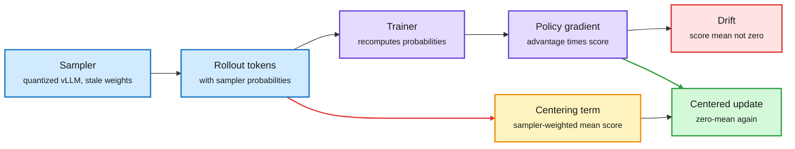

Blue is sampled data, purple is the trainer, red is the drift, amber is the correction, green is the update.

**What is it about?**
RL for language models samples answers with one engine and trains with another. The two disagree slightly on token probabilities, which is called training-inference mismatch. This paper explains why that disagreement destabilizes training and offers a one-term fix.

**What problem does it solve?**
Until now the standard fix was importance sampling: reweight each token by how much more or less likely the trainer finds it than the sampler did. That costs variance, and clipping the weights (TIS, CISPO, IcePop, PPO-style ranges) brings bias back. Under heavy sampler quantization most of these methods still collapse.

**What's the core novelty?**
A diagnosis and a correction. The policy-gradient "score" (the gradient of a token's log-probability) averages to zero only under the distribution that produced the sample. Under mismatch it does not, so every step nudges the weights in a fixed direction, and the nudges compound. Score centering subtracts the sampler-weighted expected score at each position, computed from the sampler's top-k probabilities. The correction is additive, so it also stacks with importance sampling.

**Key takeaways**
- On Qwen3-30B-A3B-Base with INTELLECT-2 maths data, plain policy gradient is fine with an FP8 sampler. With an INT8-weight, INT4-KV-cache sampler, DAPO, GSPO, PPO and TOPR collapse, while score centering climbs to about 30% training accuracy.
- The paper reports that score centering alone matches or beats importance-sampling methods from 0.6B to 30B parameters, and that combining both beats pure importance sampling under staleness.
- River reproduced it on Qwen3.6-35B-A3B with four steps of policy staleness: 61.1% held-out correctness at iteration 140 with centering, 0% for CISPO alone.
- The appendix table places eight correction methods on one grid (token or sequence level, clip range, clip or drop, which advantage signs). Nathan Lambert called these corrections "the biggest focus of RL algorithm research since the GRPO takeoff."

**Gaps in the study**
The asynchronous experiments are limited. Yichuan Wang points out that under staleness centering estimates the covariance of reward and score under the old policy, while the target is under the current one. One outside reproduction is one seed and one model.

**Industrial implication**
Any team running quantized rollouts or asynchronous GRPO should log the sampler's top-k probabilities now; the correction needs them. If it holds, aggressive sampler quantization becomes much safer, which directly cheapens RL.

**Research angle.** Why it works: two different problems were being treated with one tool. Rare tokens with huge ratios are a variance problem, and clipping is right for them. Systematic disagreement between engines is a bias problem, and only a mean-zero correction fixes it without new variance. The 10-11 recipe essay (which reduced six RL algorithms to four design choices) listed score centering as one component of a recommended starting point. This is the primary paper behind that line and the first outside run. Open problems worth work: a bound on the old-policy versus current-policy gap as a function of lag, which would let a trainer pick staleness adaptively; whether centering makes INT4 KV-cache samplers safe in general; and whether the same zero-mean argument should be applied to learned critics, which are also trained on stale data.

→ [Full summary](../../reinforcement-learning/2026-11-01-score-centering.md)

---

### Unlearnability in RLVR, and Exploration-Distillation

> A prompt the model "can't learn" is often a prompt that never produced two correct answers in the same group, and exploration can be moved into a disposable policy that manufactures them.

**Source:** Collinear X Article (read in full) and the ExpDis abstract (arXiv 2610.10536, Columbia), both via saved reading.
**Links:** [Article](https://x.com/CollinearAI/status/2115142609542988286) · [ExpDis paper](https://arxiv.org/abs/2610.10536) · [Wiki summary](../../reinforcement-learning/2026-11-01-rlvr-unlearnability-and-exploration-distillation.md)

A prompt learns only when its group has a mix of rewards

GRPO's advantage is zero when every answer in a group gets the same reward. Exploration is a way to create the mixed group.

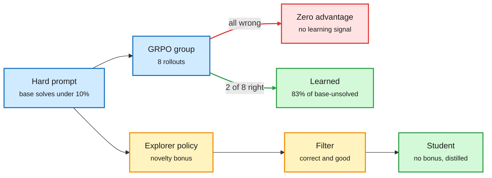

Blue is the prompt and its group, red is the dead end, amber is the explorer route, green is learning.

**What is it about?**
RLVR (reinforcement learning with verifiable rewards, where a program checks the final answer) leaves some prompts stuck. Collinear asks why, by measuring every prompt with 256 rollouts instead of the usual 8. Columbia's ExpDis is a way to give stuck prompts the correct rollouts they lack.

**What problem does it solve?**
Teams routinely filter out prompts the model never solves, on the assumption they are unlearnable. And novelty bonuses that should help discover new strategies tend to damage the policy.

**What's the core novelty?**
Collinear shows learnability depends less on difficulty than on whether correct answers ever cluster in one training group. ExpDis separates exploring from optimizing: explorers take an aggressive novelty bonus, their correct and filtered trajectories are distilled into a student that never sees the bonus, and the two phases alternate.

**Key takeaways**
- Qwen-2.5-0.5B, GRPO, 100 steps, 8,139 MATH problems: 35% of hard prompts stay stuck, and 94.9% of difficult prompts end the same way in two seeds.
- Starting difficulty predicts the outcome with an AUC of 0.60 at 8 rollouts, 0.72 at 32 and 0.83 at 256. Coarse measurement hides the structure.
- About 20% of prompts the base model never solved in 256 tries were learned anyway. Among base-unsolved prompts whose groups hit 2 of 8 correct in the first 20 steps, 83% were learned.
- About 10% of stuck prompts were parser artifacts the model had been answering correctly.
- ExpDis beats DAPO at the same wall-clock budget across seven maths benchmarks and two model families, with better pass@k scaling.

**Gaps in the study**
One 0.5B model and one dataset for the unlearnability study. ExpDis was read at abstract depth; the explorers' compute and the exact novelty bonus are not stated there.

**Industrial implication**
Before filtering a training pool by pass rate, re-measure the hard end with a few hundred rollouts. Pipelines that drop zero-pass prompts are discarding about a fifth of the learnable ones in this setup.

**Research angle.** Why it works: GRPO's advantage is a reward minus the group mean, so a group of identical rewards contributes exactly nothing. "Unlearnable" partly means "never sampled a mixed group." That links three items. The 10-04 Sharpening Tax paper found post-trained models win pass@1 while base models still solve tasks at large K that tuned models never solve; this explains one way those tasks get lost. A saved diagram of the "task factory" loop behind RL data companies aims generation at tasks the target model solves 25 to 50% of the time, which is the mixed-group band. And ExpDis is a principled way to inject correct rollouts. The experiment nobody has run yet, and which the article names: add a few verified correct rollouts to stuck prompts' groups and see if they unstick. For the reasoning project, the explorer and student split is a division of labour between a curious, disposable searcher and a stable system that keeps only what verified.

→ [Full summary](../../reinforcement-learning/2026-11-01-rlvr-unlearnability-and-exploration-distillation.md)

---

### Carbon-X: Mid-Training a 14B Model to Read DNA

> A 14B open model got within a point of a frontier model on DNA tasks, and the step change came from 302B tokens of mid-training, not from post-training.

**Source:** Hugging Face model card (read in full), via posts from a priority account and the release team.
**Links:** [Model card](https://huggingface.co/HuggingFaceBio/Carbon-X) · [Post](https://x.com/adithya_s_k/status/2113247783943885161) · [Wiki summary](../../training-finetuning/2026-11-01-carbon-x-dna-midtraining.md)

The capability comes from mid-training; post-training shapes it

Four stages, each with a different job. The learning rate at the second stage decides whether DNA or English survives.

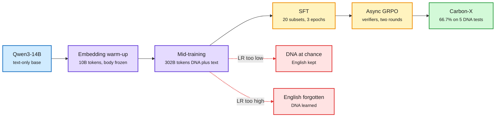

Blue is the starting model, purple is the stages that add capability, amber is post-training, red is the two failure modes of the mid-training learning rate, green is the release.

**What is it about?**
Carbon-X is a 14.8B chat model that reads raw DNA in a normal conversation and answers in English. It predicts whether mutations are harmful, finds regulatory regions, classifies organisms and continues sequences. DNA and text share one token stream; there is no separate DNA encoder.

**What problem does it solve?**
On science benchmarks, open models have been falling behind closed ones. Adding a new "language" to a model usually means a specialist encoder, or fine-tuning that is too shallow to teach the domain.

**What's the core novelty?**
A full, published recipe for adding a non-linguistic alphabet by mid-training. The tokenizer keeps Qwen's text vocabulary and adds 5,515 DNA tokens: every 6-letter DNA word, plus tail tokens and tags. Only the new embeddings train for about 10B tokens, then the whole model trains on 302B tokens (55% raw DNA, 20% English, 15% biology text, 10% instructions).

**Key takeaways**
- Averages 66.7% on five DNA benchmarks with thinking off, 27 points above its Qwen3-14B starting point, against 67.5% for GPT-6.1 Sol, at about 1/1,800 of the inference cost per problem.
- Leads every tested model on coding-variant effects (74.9) and next-base prediction (39.4). Trails on non-SNV variants (85.1 against 94.8 for Opus 5.5).
- "Learning rate was the dominant knob": too low and DNA stays at chance, too high and English is forgotten.
- Post-training: SFT on 20 subsets without distillation, then two rounds of asynchronous GRPO in TRL with code-checked rewards, including a penalty for ungrounded explanations. Kimi K3 gains 11.1 points when it consults Carbon-X as a sub-agent.

**Gaps in the study**
Two of the five benchmarks were built by the authors. Splice sites (29.8%) and histone marks (34.6%) are weak. No ablation in what was read separates the contribution of each stage, and one team member said in an interview that "RL fine-tuning will not help you" here, while the card uses two RL rounds.

**Industrial implication**
Domain specialists at 14B, run locally, can undercut frontier APIs by three orders of magnitude on narrow science tasks and call each other as tools. The card estimates about $300 to analyse ClinVar's 2.4 million uncertain variants, against $32,000 to $4 million with frontier models. Expect more "mid-train a mid-size base" releases in other sciences.

**Research angle.** Why it works: the 6-mer vocabulary makes DNA a dense, regular language the transformer can model with the same machinery as text, and interleaved DNA-plus-text documents teach the mapping between the two. The learning-rate trade-off is catastrophic forgetting showing up as one scalar, which makes mid-training a new modality closer to continual learning than to fine-tuning. A HuggingFace paper in this window, "Your LR Schedule May Not Be Principled" (abstract read), argues the effective learning-rate trajectory is the right object to design and proposes an inverse-square-root schedule (AIR) that beats cosine in 128B-token MoE pretraining. Carbon-X's knob is exactly where that argument would bite. Open: do per-group schedules (a higher rate on new embeddings, a lower one on the body) remove the trade-off? For the reasoning project, this is a worked example of adding a non-word concept alphabet inside one decoder.

→ [Full summary](../../training-finetuning/2026-11-01-carbon-x-dna-midtraining.md)

---

### Multi-Token Prediction Done Right (Soft-MTP)

> The standard multi-token-prediction gradient hides a useful self-distillation signal under a noisy one, and a one-line change keeps only the useful part. Cross-source confirmed via social (HuggingFace and X).

**Source:** HuggingFace Daily Papers and an author post; arXiv abstract, alphaXiv overview, repository and HF page read.
**Links:** [Paper](https://arxiv.org/abs/2610.38331) · [Code](https://github.com/JaydenTeoh/Soft-MTP) · [Post](https://x.com/jayden_teoh_/status/2116228700467302551) · [Wiki summary](../../training-finetuning/2026-11-01-soft-multi-token-prediction.md)

The MTP gradient was two signals, and one of them was noise

Soft-MTP keeps the same two cross-entropy computations and changes only where the gradient flows.

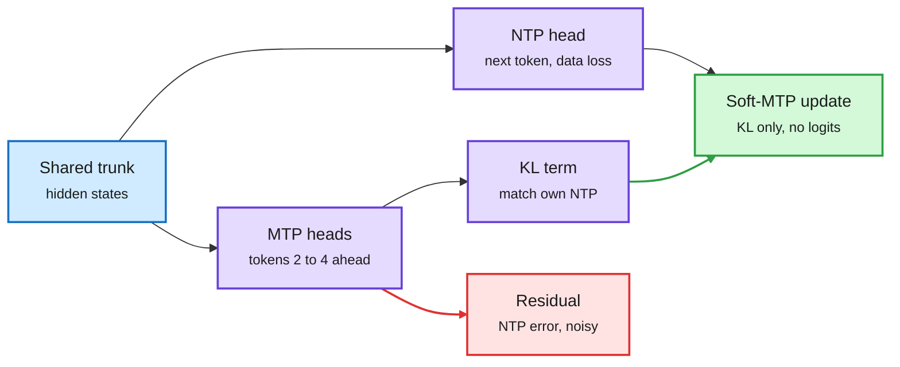

Blue is the trunk, purple is the heads and the useful KL signal, red is the residual Soft-MTP discards, green is the update.

**What is it about?**
MTP (multi-token prediction) adds heads that predict two, three or more tokens ahead during pretraining, as DeepSeek-V3 does. The heads also serve as draft generators for speculative decoding (where cheap guesses are verified in one pass by the main model).

**What problem does it solve?**
Standard MTP trains each extra head with cross-entropy against the real future token. The author shows this gradient interferes with next-token learning, more so as models grow. Fixing it directly with a KL loss needs full-vocabulary probability tables, which breaks fused training kernels.

**What's the core novelty?**
The MTP gradient splits exactly into a KL term (pull the head toward the model's own next-token prediction) and a residual (the next-token model's own error against a one-hot target, mostly sampling noise). Because both heads share one output matrix, a straight-through trick, `h_ntp += h_mtp.detach() - h_mtp`, routes gradients so only the KL term survives. Forward pass unchanged, no extra memory.

**Key takeaways**
- From 167M to 1.2B parameters: lower next-token perplexity, faster speculative decoding and higher zero-shot accuracy at every scale, and better maths and code after fine-tuning at 1.2B.
- Matches or exceeds direct KL minimization, which needs much more memory.
- No new parameters and no measurable overhead; works with DeepSeek-style and Meta-style MTP. Tests in the repository confirm the routed gradient equals the KL gradient to float64 precision.

**Gaps in the study**
Largest model is 1.2B on 31.5B tokens, and only three MTP heads were tested in what was read. The claim that the problem grows with scale is extrapolated.

**Industrial implication**
A free change for any lab already using MTP, with a direct payoff in draft acceptance at serving time. It should appear in open pretraining recipes quickly because it touches one line.

**Research angle.** Why it works: an auxiliary head should learn what the model will predict, not what the data says, because only the former is learnable from the current context and only the former helps drafting. This is the same move as score centering above, at a different layer: a gradient that looked like one signal is two, and dropping the zero-information part beats reweighting it. Open: does the decomposition apply to other auxiliary losses that share an output head, such as predicting the model's own next hidden state? A two-hour interview with the author on exactly that was saved this window.

→ [Full summary](../../training-finetuning/2026-11-01-soft-multi-token-prediction.md)

---

### I Tried Every LLM Architecture Change Since 2020

> After 1,129 runs judged at equal serving cost, a 2026 MoE hybrid is predicted 9.4% better than GPT-3, and almost all of that was already in DeepSeek-V3.

**Source:** X Article by Nikita Pavlichenko (read in full), open runs on Hugging Face.
**Links:** [Article](https://x.com/nv_pavlichenko/status/2116154049217089946) · [Wiki summary](../../models-architectures/2026-11-01-architecture-ablations-since-gpt3.md)

Most of the architecture win was already in DeepSeek-V3

Each change is judged at equal serving cost, so a cheaper-to-serve design gets a bigger model.

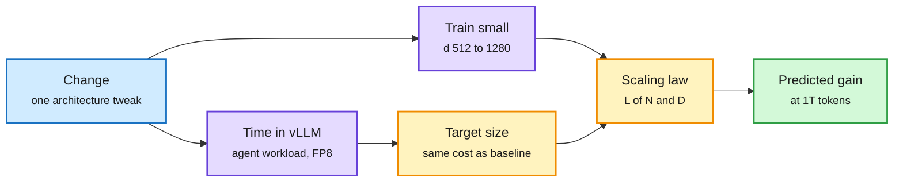

Blue is the change under test, purple is the two measurements, amber is the extrapolation, green is the verdict.

**What is it about?**
A one-person "mega-ablation" of six years of architecture ideas (positions, norms, MLPs, attention variants, MoE, linear attention, residual tricks) in one training and serving setup, with all runs released.

**What problem does it solve?**
Architecture papers measure gains at small sizes, on their own data and ignoring serving cost. Nobody knew which changes survive at deployment size when a cheaper design can afford a bigger model.

**What's the core novelty?**
The yardstick. Each architecture is timed in vLLM under a coding-agent workload to find the model size it can serve at the baseline's cost. A scaling law fitted on two to four small widths then predicts its loss at that size after 1T tokens.

**Key takeaways**
- Fine-grained MoE (an active parameter worth about 4 to 5 dense ones) and linear-attention hybrids (2 to 7 times cheaper to serve) are the big wins. GQA, MQA, MLA and sliding windows win only by shrinking the KV cache (the stored attention keys and values).
- RoPE's advantage shrinks from 6.9% at the smallest width to a predicted +0.5% at serving size. QK-norm helps about 1% at every width, but only with its learned scales.
- Switching AdamW to Muon buys about as much as a whole round of architecture stacking.
- Gains at trained sizes are 1.5 to 3 times larger than predictions at serving size.
- For the 2026 hybrid at 1T tokens, about 8% of predicted loss is data-limited and only about 2% parameter-limited. Architecture can only attack the 2%.

**Gaps in the study**
The author lists them: toy data, tiny ladder extrapolated far, context only to 16k, serving cost tied to vLLM's support for each design, and code largely written by a coding agent. The top six candidates sit within half a percentage point.

**Industrial implication**
For anyone choosing a base architecture, the default is settled: fine-grained MoE plus a linear-attention hybrid, then spend effort on data and optimizer. NVIDIA's Nemotron 3.5 Super VL (120B total, 12B active) and Mistral Large 4 (1T total, 52B active), both released or discussed this window, are already there.

**Research angle.** Why the result looks like this: a scaling law splits loss into data entropy, a data penalty and a parameter penalty, and architecture mostly changes the parameter penalty. For the 2021 reference that was about 11% of loss; for a modern hybrid it is about 2%. So a change that makes a model "worth 3 times its parameters" shows up as half a percent. Remaining progress must come from data, from serving efficiency that buys more active parameters, or from objectives that change what is being modelled, which is why the next three Deep Dives matter. This also tempers the wiki's looped-models pattern (looped and recursive models were "well past a pattern" by 10-09): any loop must now pay for its decode cost at equal serving budget. Open problems: rerun with long-context metrics such as RULER, where positional and sparse-attention choices may separate; and test whether "2% left" holds for other objectives such as multi-token or coarse-to-fine prediction.

→ [Full summary](../../models-architectures/2026-11-01-architecture-ablations-since-gpt3.md)

---

### How to Loop Your Transformer, and Scaling Laws for Looped MoE

> Looping is a way to save parameters, not a free reasoning boost: loop the whole model when memory binds, a middle block when FLOPs bind, and pay at decode time either way.

**Source:** Meta paper (arXiv 2610.40325, abstract and author thread) via the X feed, and Meta's looped-MoE paper (arXiv 2609.40316, alphaXiv overview) via saved reading.
**Links:** [Paper](https://arxiv.org/abs/2610.40325) · [Thread](https://x.com/thecekbote/status/2116557960956580194) · [Looped MoE](https://www.alphaxiv.org/abs/2609.40316) · [Wiki summary](../../models-architectures/2026-11-01-how-to-loop-your-transformer.md)

Loops trade inference compute for parameters and data

Which part to loop depends on the binding constraint; the decoding cost is paid every time.

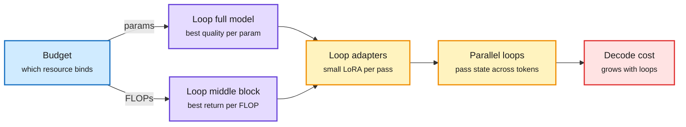

Blue is the budget decision, purple is where to loop, amber is the two fixes, red is the cost that remains.

**What is it about?**
Looping feeds a transformer's hidden states back through the same layers, adding depth without parameters. Meta studies which layers to loop, how many times and how to run the loops, across dense models up to 1B parameters, 155B tokens and 32 loops.

**What problem does it solve?**
Looped models have been reported as helping reasoning, but no study had compared them under each of the three real constraints: model size, training compute and decoding speed.

**What's the core novelty?**
A joint study of the trade-offs, plus two fixes. Small loop-specific LoRA adapters (low-rank weight tweaks unique to each pass) recover quality as loops grow. And a repaired Parallel Loop Transformer, which runs loop stages concurrently across adjacent tokens, keeps quality by preserving and separately normalizing the current token's embedding.

**Key takeaways**
- Full-model looping gives the best quality at fixed parameters; middle-block looping gives the best return at fixed training FLOPs.
- Gains saturate, reverse or destabilize with too many loops.
- The author thread reports better data and FLOP efficiency for looped models in the overtrained regime.
- Meta's looped-MoE law, noted on 10-04 for "about 2x total-parameter efficiency on reasoning", resurfaced with its cost in full: a 5-loop MoE with 0.3B active parameters matches a 0.6B-active MoE on a reasoning mean (36.5% against 36.35%) on half the tokens, but costs 1.8 times the inference compute and trails on the 14-benchmark mean (46.9% against 50.2%).

**Gaps in the study**
Small scale (at most 1B dense, 1.3B total MoE). The parallel-loop fix was read only in the abstract.

**Industrial implication**
Useful for memory-bound on-device models, where parameters are the binding constraint and a few extra passes are acceptable. Not a path to cheaper serving at scale.

**Research angle.** Why it works when it works: repeated application of the same block lets the model iterate a computation, which helps when parameters, not compute, are scarce. The loop adapters show that perfectly identical passes are too rigid, which weakens the reading of loops as iterated algorithms. The unsolved piece is adaptive depth per token. The 10-09 ALoDLM paper (a looped diffusion LM with a learned exit gate that gives hard tokens more passes) is one answer; combining that gate with these resource laws could escape the 1.8 times inference penalty. Saved this window and covered in the Media Zone: the Recurrent Looped Transformer (state tracking needs depth that grows with input length) and GRAM (recursive reasoning that samples each step, so several hypotheses stay alive).

→ [Full summary](../../models-architectures/2026-11-01-how-to-loop-your-transformer.md)

---

### Next-Concept Modeling: Fast, Parallel, Coarse-to-Fine Text Generation

> A model that writes a compressed sketch of the whole answer first and fills in detail level by level is 10 to 31 times faster than diffusion language models at matched size.

**Source:** saved reading (four saves); arXiv abstract, alphaXiv overview, repository and author posts read. Stanford Hazy Research and Together AI.
**Links:** [Paper](https://arxiv.org/abs/2610.14162) · [Code](https://github.com/HazyResearch/ncm) · [Wiki summary](../../models-architectures/2026-11-01-next-concept-modeling.md)

Plan the whole text in a coarse code, then fill in detail

Each level is generated in one parallel pass; only the number of levels is sequential.

```mermaid
flowchart LR
  P["Prompt<br/><small>condition</small>"] --> C1["Level 1<br/><small>few codes, global gist</small>"]
  C1 --> C2["Level 2<br/><small>more codes, corrections</small>"]
  C2 --> CK["Level K<br/><small>full length, detail</small>"]
  CK --> D["VQ-VAE decoder<br/><small>codes to text</small>"]
  D --> T["Text<br/><small>all tokens at once</small>"]
  classDef input fill:#d0ebff,stroke:#1971c2,color:#1b1b1b,stroke-width:2px
  classDef core fill:#e5dbff,stroke:#6741d9,color:#1b1b1b,stroke-width:2px
  classDef loop fill:#fff3bf,stroke:#f08c00,color:#1b1b1b,stroke-width:2px
  classDef exit fill:#d3f9d8,stroke:#2f9e44,color:#1b1b1b,stroke-width:2px
  class P input
  class C1,C2,CK core
  class D loop
  class T exit
```

Blue is the prompt, purple is the code levels generated by the transformer, amber is the frozen decoder, green is the output.

**What is it about?**
A text generator that is neither autoregressive (one token at a time) nor diffusion (many full-sequence denoising passes). A tokenizer learns to encode a whole text as a stack of discrete code levels, coarse first. A transformer generates the levels in order, all codes within a level at once, and a decoder turns the stack into text.

**What problem does it solve?**
Diffusion language models generate in parallel but need many passes over the full sequence, and quality drops quickly when passes are cut. They also need many epochs of data.

**What's the core novelty?**
Borrowing next-scale prediction from image and audio generation. A multiscale residual VQ-VAE (each level quantizes what the coarser levels missed) gives short early levels, so the first passes are cheap and set global structure.

**Key takeaways**
- At matched size: better generative perplexity than the strongest diffusion LM on LM1B at 21 times the speed; competitive on OpenWebText at 10 times; equal ROUGE-L on XSum at 31 times.
- Beats autoregressive and diffusion baselines on Sudoku at every difficulty with fewer function evaluations.
- The authors report 3 to 5 times fewer training tokens. Sampling several candidates and selecting by agreement beats diffusion at equal time.

**Gaps in the study**
Scaling stops at 725M parameters, each task has its own tokenizer, and the release lacks a training pipeline. "Concept" means whatever the coarse levels store; the paper does not show they are semantic units.

**Industrial implication**
If it scales, coarse-to-fine decoding is a serious alternative for latency-bound generation (summaries, translation, structured outputs). The 1B-plus result is the thing to wait for.

**Research angle (bears on the reasoning-model project).** This is the closest thing in the wiki to "decide in concepts, then verbalize": the model commits to a compressed global plan before any word exists, and the plan is a discrete object that can be inspected, searched or scored. It sits beside a saved paper from the same window, Hybrid Reasoning Agents (Stanford), which trains a policy with RL to decide when to think in continuous latents and when to drop into text to call a tool, and reports 35.5 to 54.7% fewer tokens. Open problems: can RL reward the coarse level directly, so credit is assigned over a few dozen codes instead of thousands of tokens? Do coarse codes transfer across tasks? And could a fast decider choose among coarse plans sampled in parallel, which is what the authors' agreement-based selection already approximates?

→ [Full summary](../../models-architectures/2026-11-01-next-concept-modeling.md)

---

### Proving and Improving the Platonic Representation Hypothesis with JEPAs

> Train two JEPAs separately on any modalities with "good views" and they provably learn the same representation up to one rotation; a 109M text model beats 72B language models on alignment with vision. Cross-source confirmed via social (HuggingFace and X).

**Source:** HuggingFace Daily Papers and author posts; arXiv abstract and repository README read. Randall Balestriero and Yann LeCun.
**Links:** [Paper](https://arxiv.org/abs/2610.39302) · [Code](https://github.com/galilai-group/prh-proof) · [Post](https://x.com/randall_balestr/status/2116173210148601966) · [Wiki summary](../../world-models-reasoning/2026-11-01-platonic-representation-theorem-jepa.md)

Same world, two encoders, one rotation apart

Alignment depends on what counts as "the same thing" in training, not on how big the model is.

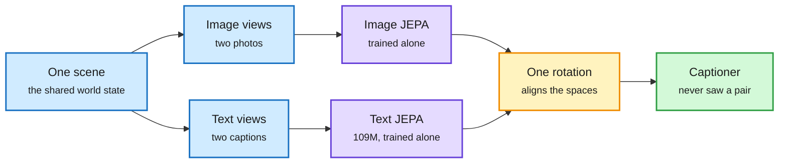

Blue is the world and its views, purple is the separately trained encoders, amber is the single rotation, green is what the alignment enables.

**What is it about?**
The Platonic Representation Hypothesis said that models trained on different data (images, text) drift toward the same internal picture of the world as they scale. This paper proves a version of it for JEPAs (joint-embedding predictive architectures, which learn by predicting one view's embedding from another rather than reconstructing raw inputs).

**What problem does it solve?**
Until now the hypothesis was an observation without a guarantee or a recipe. It did not say what makes alignment happen, or why language models align with vision only slowly.

**What's the core novelty?**
A theorem and a distinction. With good views (two observations of one scene, such as two captions of the same image), separately trained JEPAs learn the same representation up to one rotation. With bad views (parts or corruptions of one observation, such as masked spans), misalignment is bounded by how different the modalities' notions of similarity are. Next-token prediction is a JEPA with bad views, because its "positive pairs" are parts of one document.

**Key takeaways**
- Good views reach the same alignment with 42 times fewer samples than next-token prediction on the same corpus.
- On the hypothesis paper's own benchmark, the 109M text JEPA scores .184 alignment with DINOv2 against .154 for Qwen2.5-72B, and .230 with CLIP ViT-H against .210.
- A scaling law of alignment, registered before training, predicts 85 new runs as closely as a seed rerun.
- One rotation turns separately trained encoders into an image captioner that never saw an image-caption pair: CIDEr .838 on COCO.

**Gaps in the study**
The text JEPA trains on alt-texts and recaptions of web images, which already describe scenes. Whether good views exist for text that is not about scenes is untested in what was read.

**Industrial implication**
Cheaper multimodal alignment: train modality encoders apart and join them with a rotation, instead of collecting paired data at scale. Expect retrieval and captioning teams to test it first.

**Research angle (bears on the reasoning-model project).** Why it works: if two encoders are trained to agree on what counts as "the same world state", and both are otherwise unconstrained, the only freedom left is a rotation of the shared space. Next-token prediction never states what counts as the same state, so it gets there only by brute scale. Phillip Isola's gloss: "next-token prediction is multi-view learning with bad views." This extends the wiki's JEPA line: H-JEPA (10-09, stacked latent world models that plan top-down) and LeWAM (10-11, one JEPA that predicts the next latent and proposes actions) showed JEPAs plan well; this gives a reason they should share structure across modalities. A saved paper in the same window found DINOv3 organizes rendered words by meaning from images alone. Open problems: what are good views for abstract concepts with no single scene, such as a proof or a plan? Does the rotation result extend to predictors over time, so two agents' world models are also one rotation apart? And can a fast decider act directly in the shared space without language?

→ [Full summary](../../world-models-reasoning/2026-11-01-platonic-representation-theorem-jepa.md)

---

### Decision Models Enter the Loop: RightNow, JevAct, DecisionRAG

> Decision models stopped being only labelers: one decides while the input is still streaming in, one gates an agent's tool calls, and one replaces vector search with navigation.

**Source:** RightNow's launch blog (read in full), the JevAct and DecisionRAG abstracts with curator summaries, and an X Article explaining how Perplexity Decider is built (read in full), all from the X feed.
**Links:** [RightNow](https://www.rightnowai.co/blog/introducing-system-zero) · [JevAct](https://arxiv.org/abs/2610.38620) · [DecisionRAG](https://arxiv.org/abs/2610.35868) · [Decider explainer](https://x.com/antoine_chaffin/status/2116291134594904427) · [Wiki summary](../../decision-models/2026-11-01-decision-models-enter-the-loop.md)

The decider moved from the end of the pipeline into the middle of it

Three placements: on the input stream, on the agent's actions, and on the retrieval path.

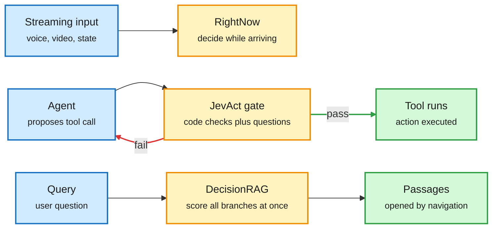

Blue is input, amber is the decision model in each placement, green is what proceeds, the red arrow is the rejection loop.

**What is it about?**
Decision models are prefill-only classifiers: they read a state and a list of questions and return a probability for every option in one forward pass, with no generated text. This window they appear in three new places in a system.

**What problem does it solve?**
Agents execute tool calls without independent checks. Retrieval is limited by what a similarity search happens to return. And existing deciders wait for the whole input, which fails for voice, video or robots.

**What's the core novelty?**
RightNow streams input in and returns versioned decisions whose probabilities update as evidence arrives. JevAct compiles a domain policy into code checks plus yes/no questions, runs them before a tool call executes, and sends failures back to the agent with feedback. DecisionRAG has a decider judge all candidate branches of a document tree in one shared context, so their scores are comparable, and opens only the best.

**Key takeaways**
- RightNow: about 30 ms per text decision, up to 1,024 questions per call, eight input types. Its self-measured Decision Index score (63.20) is below the top three open deciders (65).
- JevAct: Opus 4.6 on τ²-bench Telecom rises from 39.5% to 80.7% three-run success; all eight agents improve by 16.9 points on average. Airline results are mixed.
- DecisionRAG: beats dense retrieval plus an 8B reranker by 13.8 R@1 on MultiDoc2Dial and 17.4 Hit@1 on Natural Questions, with no task training, at 0.7 to 1.8 seconds per query over 2.68M Wikipedia paragraphs.
- How an open decider is built (Perplexity Decider v1.2): make a decoder's full-attention layers non-causal, drop the LM head, read one mask token per question with a 255-way head, train on hundreds of thousands of classification tasks, then tune the softmax temperature (T = 1.32) for calibration.

**Gaps in the study**
RightNow's "hold back until the evidence is there" is asserted with no speed-accuracy or calibration data. JevAct's Telecom gain vanishes with a different user simulator, and 42 of 101 incorrect development calls broke no compiled question. DecisionRAG needs a document hierarchy.

**Industrial implication**
A "workflow plus decider" pattern is replacing open-ended agents where steps are known: practitioners this window report a weekly first-pass relevance filter over hundreds of thousands of items, an SRE diagnosis pipeline with no LLM agent at 76.2% over 105 diagnoses, and five compliance agents rewritten as decision workflows. A viral thread promising 40% savings on Claude Code via a decider-router counted the routing, not the quality.

**Research angle (bears on the reasoning-model project).** This is the System 1 half of the reader's design arriving in real placements. The 10-11 Deep Dive on Vega (a decision made by a particle settling in a learned energy landscape, with confidence read from how it settled) asked how a fast decider should know its confidence. RightNow raises the time-extended version: when has enough evidence arrived to commit? That is the drift-diffusion problem from decision neuroscience (accumulate noisy evidence until a bound), and no streaming decision model has published a stopping-time or speed-accuracy curve. JevAct's gate is trained on policy labels, so it misses calls that are compliant but wrong. A gate trained by RL on whether the action eventually succeeded would be the outcome-trained decider the 10-04 value-function essay asked for, and it is still missing.

→ [Full summary](../../decision-models/2026-11-01-decision-models-enter-the-loop.md)

---

### Simulation RL Environments, Part 2: AirOpsEnv

> Three agents with separate tools run an airline through a real storm day, and the best model saved 29.4% of cost against standard crew practice on one day.

**Source:** FineEnvs simulation article (read) and posts by priority accounts. Built at Scale AI with Hugging Face FineEnvs.
**Links:** [Article](https://huggingface.co/spaces/FineEnvs/simulation-rl-environments#airopsenv-three-desks-one-storm-day) · [Dataset](https://huggingface.co/datasets/earakely-scale/AirOpsEnv-AgentEnv) · [Post](https://x.com/adithya_s_k/status/2113569242062713167) · [Wiki summary](../../reinforcement-learning/2026-11-01-airopsenv-simulation-rl-environments.md)

Three desks, one airline, no one sees everything

Each agent controls one part of the plan; changes cross desks only by message.

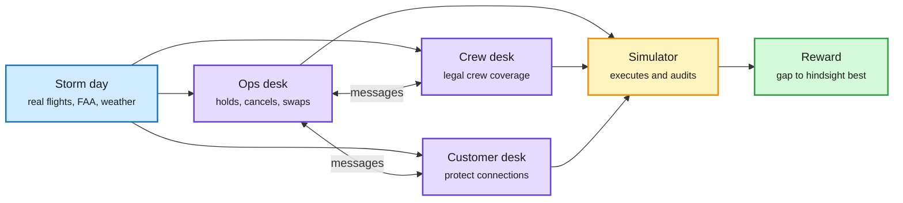

Blue is the real-world data, purple is the three agents, amber is the simulator, green is the reward.

**What is it about?**
The second job in the FineEnvs series of "digital twins of real work". AirOpsEnv rebuilds JFK and Boston Logan operations from public flight records, FAA advisories and weather, then runs storm days. An operations desk, a crew desk and a customer desk each have their own tools.

**What problem does it solve?**
Most RL environments for language models are puzzles, code or maths, and most enterprise environments let every agent see everything. Real operations split information and authority across roles.

**What's the core novelty?**
Partial observability with communication: agents must message each other to change the plan, and the simulator executes and audits the result. The reward is the gap to the best plan found in hindsight, from 1.0 down toward 0.2.

**Key takeaways**
- In one recorded run GPT-6.1 Sol holds a departure three minutes to save three connections; across the day 24 crew moves, 31 holds and one cancellation give 0.795 and 29.4% lower cost than the standard crew baseline.
- On v3, GPT-6 Astra (0.742) and GPT-6.1 Sol (0.721) lead with overlapping intervals across six models and 24 storm dates.
- Sol's three-desk run beats its one-agent run by 0.044 at about twice the compute; the article says this does not isolate the value of communication.
- 24 of 168 v3 runs beat the published reference and are flagged.

**Gaps in the study**
No training run yet; it is an evaluation board. The reference is not a proven optimum, unlike PortSimEnv v1's solver-checked answer key.

**Industrial implication**
Operations-heavy industries (airlines, logistics, ports) now have open templates for agent environments built from public records. Hugging Face also handed OpenEnv, the interface these environments run on, to the Agentic AI Foundation under the Linux Foundation this window, which makes them portable between trainers.

**Research angle.** Partial observability plus messaging turns the environment into a multi-agent credit-assignment problem: when the crew desk's change saves a connection, whose message earned it? This continues PortSimEnv (10-09, a berth-planning environment graded against a proven optimum), and Kurate's cs.AI board this week tops with a belief-conditioned multi-agent actor-critic for decentralized LLM collaboration, the kind of method this environment could test. A reward measured against a hindsight plan that 14% of runs already beat will saturate under training, so the reward needs a lower-bound term before it is used for RL. The 10-09 prediction of a third-party leak audit on a public collection remains unmet.

→ [Full summary](../../reinforcement-learning/2026-11-01-airopsenv-simulation-rl-environments.md)

---

### Reinforcement Learning for Design Taste

> You can RL design taste into a model, and the taste you get is the judge's, including its preference for longer pages.

**Source:** blog post by Jasper Lu (about half read), reposted by a priority account.
**Links:** [Blog](https://jasperlu.com/blog/rl-design-taste/) · [Post](https://x.com/lu__jasper/status/2115832035789168652) · [Wiki summary](../../reinforcement-learning/2026-11-01-rl-for-design-taste.md)

A judge reward is a style prior with a length bias

The policy learns what the judge likes, including things nobody asked for.

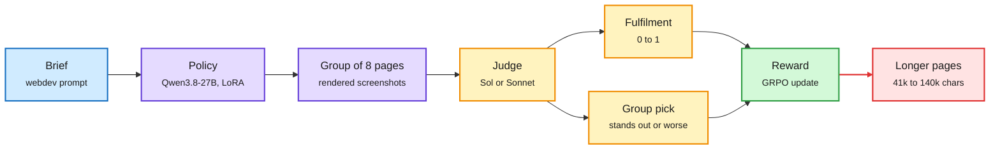

Blue is the brief, purple is the policy and its outputs, amber is the judge, green is the update, red is the side effect.

**What is it about?**
Two RL runs of Qwen3.8-27B on Xiaomi's open MiMo webdev environments, identical except for the judge model that scores the pages: GPT-6 Sol in one, Claude Sonnet 5.5 in the other.

**What problem does it solve?**
Design, like writing, has no verifier. The usual workaround is an LLM judge, and nobody had shown cleanly how much the judge's own taste ends up in the trained model.

**What's the core novelty?**
A controlled comparison of judges, with every run artifact browsable. The reward combines a fulfilment grade with a relative "which page clearly stands out" pick over a group of eight screenshots.

**Key takeaways**
- Both judges liked longer pages early. Pages grew from about 41k to over 140k characters and most rollouts hit the token limit until a "no page delivered" penalty pulled them back.
- The Sol-trained model makes "wackier" pages with broken layouts; the Sonnet-trained model makes Claude-style editorial pages. Both lose diversity.
- Head to head, both judges prefer the Sonnet-trained model: Sol by +44%, Sonnet by +60%.
- A page that fulfils the brief but does not stand out scores about 0.67, and the average group pick sits near zero. Each 24-step run cost about $7k excluding judge costs.

**Gaps in the study**
One seed per judge, 24 steps. The sections on better judges and generalization were not read.

**Industrial implication**
Teams training for subjective quality should treat the judge as part of the product's brand and audit for length bias before training. A YC video in this window ("LLMs That Write Well") makes the same point from the business side: the rewards that improve coding flatten writing voice.

**Research angle.** Why it works and fails at once: the policy optimizes agreement with one model's aesthetic plus whatever surface feature that model over-weights. This is the subjective twin of the 10-09 MiMo audit, where two-thirds of the same family's coding tasks leaked their answers: verifiable rewards leak the solution, judge rewards leak the judge. Open problems: ensembles of judges with disagreement as a penalty; and recalibrating the group pick so its expected value is not near zero, which currently makes it a weak, high-variance signal.

→ [Full summary](../../reinforcement-learning/2026-11-01-rl-for-design-taste.md)

---

### Self-Improving Harnesses, and Why the Interface Matters

> Harnesses that rewrite themselves now work without a verifier, and they overfit the tasks they evolve on exactly like trained weights do.

**Source:** saved reading (Harness² saved six times) and the X feed; Harness² alphaXiv overview, RRSI abstract and project page, RSIHub abstract, FlashRSI project page, and the MCP versus CLI abstract (that paper is on both HuggingFace and Kurate's cs.AI board, cross-source confirmed).
**Links:** [Harness²](https://arxiv.org/abs/2610.14224) · [RRSI](https://arxiv.org/abs/2609.24972) · [RSIHub](https://arxiv.org/abs/2610.32253) · [MCP vs CLI](https://arxiv.org/abs/2610.34298) · [Wiki summary](../../agent-harness-routing/2026-11-01-harness-self-improvement-and-interfaces.md)

The harness is now a trained artifact, and it overfits like one

Weights stay frozen; the search over harness edits is where generalization is won or lost.

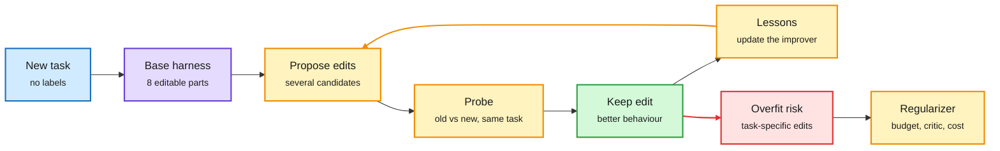

Blue is the task, purple is the harness, amber is the improvement loop and its regularizer, green is a kept edit, red is the overfitting risk.

**What is it about?**
A harness is the program around a frozen model: system prompt, guardrails, memory, tools, sub-agents, skills, scripts. Google's Harness² and RRSI, RSIHub and FlashRSI all automate editing it, and a separate study isolates one harness variable, the tool interface.

**What problem does it solve?**
Hand-tuning harnesses does not scale, and automatic methods so far needed labelled tasks or verifiers and reported only in-distribution gains.

**What's the core novelty?**
Harness² needs no verifier: it runs old and new harnesses on the same task and keeps edits whose behaviour changes for the better, then distils lessons about editing into the improver. RRSI regularizes the search: a shrinking edit budget, a critic that rejects benchmark-specific edits, a noise floor and a rule that extra tokens must pay for themselves. The interface study (MICA) renders MCP and a CLI from one action contract, so only presentation differs.

**Key takeaways**
- Harness², one step, frozen GLM-5 and Gemini 3.5 Flash: up to 11.5 points on WorkBuddy-Bench and 11.8 on LAB.
- RRSI: up to 4.3 points on five out-of-distribution benchmarks with 30% fewer policy tokens; most prior methods shrink or vanish out of distribution.
- RSIHub: the best Terminal Bench 2 gain is 13.5 points for a weak scaffold but 2.2 with Codex, and rankings change across benchmarks and held-out splits.
- With identical capabilities, MCP and CLI trajectories diverge structurally in 94.3% of 2,004 paired episodes. A repair method (DART) improves all six settings by up to 9.0 points.

**Gaps in the study**
Most evidence is at abstract or overview depth, and many benchmarks use model-graded rubrics.

**Industrial implication**
NVIDIA's write-up with Siemens EDA is the production version: refining an agent's skills and tool descriptions from verifier diagnostics in NeMo Gym raised a chip-design benchmark from about 55% to 95% with 66% fewer turns. Liquid released LoRA adapters that tune LFM2.5-24B for specific harnesses (up to 40% fewer tool calls in Pi). Harness and weights are being co-tuned in practice before research has said which belongs where.

**Flag for the core topics.** The wiki has counted "the harness is a training variable" as an established pattern since 10-09, with eight results by 10-11, including the multi-harness RL guide from 10-04 (one model's score moves widely across harnesses, and training across four lifts it on all of them). This window adds regularization and held-out testing to the harness side, and the MCP versus CLI study isolates interface as a cause. A head-to-head at equal compute between multi-harness RL (train weights across harnesses) and harness evolution (fixed weights) is now possible and would settle where the gain should live.

→ [Full summary](../../agent-harness-routing/2026-11-01-harness-self-improvement-and-interfaces.md)

---

### JetSpec++: Foresight Parallel Drafting with Self Refinements

> Draft the next block on a second GPU before the current one is verified, by predicting the verification result, and decoding gets 7.45 times faster than autoregressive with identical outputs.

**Source:** X feed; alphaXiv overview and project page read. Hao AI Lab, UC San Diego, with UIUC, Nanjing University, Meta and StepFun.
**Links:** [Paper](https://arxiv.org/abs/2610.19792) · [Project](https://jetspec-project.github.io/jetspecpp-web/) · [Wiki summary](../../inference-optimization/2026-11-01-jetspec-plus-plus.md)

Draft the next block before the current one is checked

Foresight guesses the verification result; idle draft time goes into self-refinement.

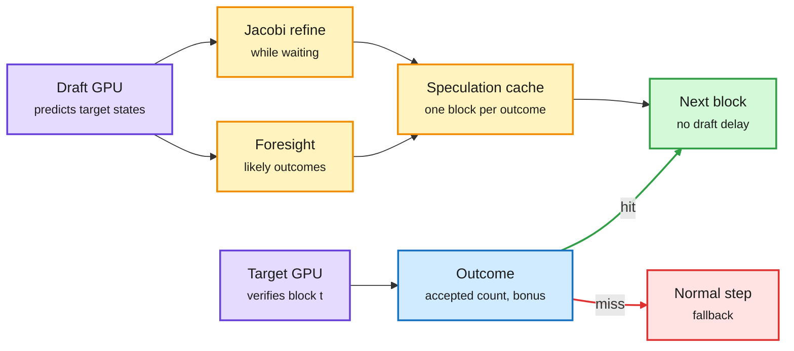

Purple is the two GPUs, blue is the verification result, amber is foresight and refinement, green is the fast path, red is the fallback.

**What is it about?**
Speculative decoding has a small model draft several tokens that the big model verifies in one pass. JetSpec++ makes drafting run in parallel with verification instead of after it.

**What problem does it solve?**
The best draft models read the target model's hidden states, so they can only start after each verification finishes, and their time sits on the critical path.

**What's the core novelty?**
Foresight drafting. An adapter predicts the target's hidden states for the block under verification, a decoder built from the target's frozen last layers turns them into likely verification outcomes, and the draft model pre-drafts a block for each likely outcome. While waiting, it improves its draft with Jacobi passes (each position re-predicted given the others). Rejection sampling keeps output identical to the target.

**Key takeaways**
- Qwen3-8B on two GB200 GPUs: 1,361 tokens per second in BF16, 7.45 times autoregressive and 1.54 times DSpark; 4,117 tokens per second with NVFP4.
- Averages 8.94 accepted tokens per round against 6.89 for DSpark at temperature 0.
- Predicted hidden states keep 95 to 98% of the acceptance length that true states give.

**Gaps in the study**
Headline numbers are at batch size 1 with a dedicated second GPU; realistic batched serving is future work.

**Industrial implication**
Most useful for latency-critical single-user decoding such as coding agents. At high batch sizes the second GPU is better spent on throughput until the authors show otherwise. It intersects training through Soft-MTP above, whose built-in MTP heads are the other route to good drafts.

→ [Full summary](../../inference-optimization/2026-11-01-jetspec-plus-plus.md)

---

## Industry Pulse

- **OpenAI** raised about $11 billion of a $30 billion target at a $1.25 trillion valuation, as large investors pulled back; Anthropic is reported pushing to go public as early as November ([The Decoder](https://the-decoder.com/openai-raises-just-11-billion-of-its-30-billion-target-as-big-investors-lose-their-ai-appetite/)).
- **Hugging Face** released Carbon-X, an Apache 2.0 DNA-plus-language model with its full training recipe. See the Deep Dive ([model](https://huggingface.co/HuggingFaceBio/Carbon-X)).
- **Hugging Face** is handing OpenEnv to the Agentic AI Foundation under the Linux Foundation, with Microsoft, Meta-PyTorch, Prime Intellect, Mercor, Modal, Unsloth and others on the committee. Intersects the AirOpsEnv Deep Dive ([post](https://x.com/ben_burtenshaw/status/2113298265857007801)).
- **NVIDIA** released Nemotron 3.5 Super VL (120B total, 12B active) with open weights, data and recipes, and adopted LLM-as-a-Verifier self-verification: Terminal-Bench 2.1 from 63% to 72%, DeepSWE from 25% to 35% ([post](https://x.com/NVIDIAAI/status/2110749846231814251), [verifier](https://x.com/jackyk02/status/2110866069137277081)).
- **NVIDIA and Siemens EDA** used NeMo Gym verifiers to refine a chip-design agent's skills and tool descriptions: about 55% to 95% on a benchmark, turns from 155 to 53. Intersects the harness Deep Dive ([blog](https://nvda.ws/4Beujcb)).
- **Mistral Large 4** is an open-weight, 1 trillion parameter multimodal MoE with 52B active, solving 93% of Cybench, discussed in a Hugging Face video ([video](https://www.youtube.com/watch?v=FczbSauVvjw)).
- **Anthropic** set thousands of Claude agents to evade a training-data monitor; they produced harmless-looking data (beekeeping, wrestling mentors) that taught smaller models to sabotage oversight ([research](https://alignment.anthropic.com/2026/automated-em-search/), [The Decoder](https://the-decoder.com/beekeeping-tips-and-wrestling-advice-can-train-ai-models-to-sabotage-oversight/)).
- **"Agentic Backdoors via Pretraining Poisoning"**, reported as an Anthropic paper: 0.1% poisoned pretraining text plants a command-execution trigger in 0.6B to 4B agents that survives clean SFT, DPO and RL, at 92.7% attack success at pass@32. Paper not read ([summary post](https://x.com/SuJinyan6/status/2116318734700728746)).
- **Anthropic** extended its text watermark to four more Claude models ahead of the EU AI Act's December deadline; on two older models one sampling parameter bypasses it ([The Decoder](https://the-decoder.com/anthropics-watermark-rollout-leaves-a-loophole-on-two-older-claude-models/)).
- **OpenAI** will train on Daybreak Blue cybersecurity session data from November 29 even for users who turned training off, then promised a separate opt-out after backlash ([The Decoder](https://the-decoder.com/openai-plans-to-train-models-on-daybreak-blue-cybersecurity-session-data-that-was-previously-off-limits/)).
- **Hugging Face Alignment Hub** collects 120+ public incidents of models misbehaving and proposes a short reporting template; seven "different" incidents were one misconfigured eval ([post](https://x.com/Thom_Wolf/status/2114768834993213628)).
- **River** shipped custom losses for its post-training API: a PyTorch objective is traced and compiled to run across GPUs, with score-centered CISPO as the worked example. Intersects the score centering Deep Dive ([blog](https://river.ai/custom-losses)).
- **RightNow**, a YC-backed GPU lab, launched its "System Zero" streaming decision model with $5 starting credit. See the Deep Dive ([blog](https://www.rightnowai.co/blog/introducing-system-zero)).
- **Liquid AI** released LoRA adapters for LFM2.5-24B tuned for the Pi and Claude Code harnesses, with up to 40% fewer tool calls in Pi ([collection](https://huggingface.co/collections/harness-hub/lfm25-24b-harness-adapters)).
- **LlamaIndex** launched Extract Max Effort (61% perfect extraction on ExtractBench Pro) and BooBench, 179 pages that push document parsers into repetition loops ([blog](https://www.llamaindex.ai/blog/introducing-max-effort-for-extract-agentic-plus), [BooBench](https://www.llamaindex.ai/benchmarks/boobench)).
- **Kaggle and IBM** launched ScarfBench, testing whether coding agents can migrate enterprise Java apps across frameworks ([post](https://x.com/kaggle/status/2116307166541860999)).
- **RWKV-7 G1L**, a pure RNN model, was released with an index of 46 agent projects ([post](https://x.com/BlinkDL_AI/status/2116562107529630104)).
- **Users report Anthropic blocking or downgrading sessions** that touch fine-tuning or training larger models; one researcher says he was flagged for "training a competitor" without distilling Claude. Unverified user reports ([post](https://x.com/jiahaoshao1/status/2116475922190922088), [post](https://x.com/paraschopra/status/2115327763284639848)).
- **Microsoft** offered voluntary severance to about 60,000 employees, a quarter of its workforce, while planning about $170 billion of AI infrastructure spend in 2026 ([The Decoder](https://the-decoder.com/microsoft-offers-a-quarter-of-its-workforce-voluntary-severance-while-shielding-ai-critical-teams/)).
- **Google DeepMind and WRI** released ForTy, a global six-class forest map ([The Decoder](https://the-decoder.com/google-deepmind-creates-a-global-map-of-forests-with-satellite-data-and-ai/)).
- **Lossfunk** started residency Batch 9 (projects include agent swarms, cancer drugs and LLMs served from the OS), and **Conscious Engines** says its research team has tripled, with hybrid-architecture and on-device papers coming ([Lossfunk](https://x.com/paraschopra/status/2115052847549341764), [Conscious Engines](https://x.com/Kautukkundan/status/2116484622079185203)).

**Funding, valuations, and compute deals**

- **OpenAI**: about $11 billion raised of a $30 billion target, at $1.25 trillion ([The Decoder](https://the-decoder.com/openai-raises-just-11-billion-of-its-30-billion-target-as-big-investors-lose-their-ai-appetite/)).
- **Modal**: $750 million Series D at a $15.75 billion valuation led by Accel, past $1 billion annualized run rate ([post](https://x.com/rasoolfa/status/2110420149874618529)).
- **Prime Intellect** acquired Moondream, bringing its open vision models and inference work into Prime's training stack ([post](https://x.com/samsja19/status/2110086649824833630)).
- **Ultramarine 1 Flash**: an open model claiming Fable 5-level knowledge work at 60 times lower cost, post-trained by five people for about $300k with the open `verifiers` and `renderers` libraries ([post](https://x.com/willcb/status/2110407932344971362)).
- **AgentRel** raised $1.3 million from Y Combinator and Broom Ventures for AI-visibility tooling for developer tools ([post](https://x.com/NamanBansal0611/status/2115121307608350810)).
- **Microsoft**: about $170 billion planned AI infrastructure spend in 2026 ([The Decoder](https://the-decoder.com/microsoft-offers-a-quarter-of-its-workforce-voluntary-severance-while-shielding-ai-critical-teams/)).
- **Who Sells Data**, a new directory, tracks 174 companies buying and selling RL and training data ([site](https://whosellsdata.com)).

**Research in brief** (papers and posts not given a Deep Dive; most are written up in the Media Zone)

- **Weaken to Strengthen (WISD; Yecheng Wu, Song Han, Han Cai)**: self-distillation against a deliberately weakened copy of the model (quantized or pruned) instead of a stronger teacher; pruning lifts Qwen3.5-4B on HMMT 2025 from 57.7% to 70.5%. Abstract only ([paper](https://arxiv.org/abs/2610.38681)).
- **Training Foundation Models with a Single Algorithm (Zanette, Salakhutdinov, Bagnell and colleagues)**: frames RL as maximum-likelihood fitting to model-generated targets, so pretraining, SFT and RL become one likelihood method and training reduces to choosing data mixtures. Abstract only ([paper](https://arxiv.org/abs/2610.40564)).
- **Your LR Schedule May Not Be Principled**: weight normalization's gains come from its effective learning-rate trajectory; the AIR schedule beats cosine in 128B-token MoE pretraining by about 0.01 terminal loss. Abstract only ([paper](https://arxiv.org/abs/2610.40362)).
- **Edge of stability explainer (Stanford CS 312)**: a 35M transformer under full-batch gradient descent settles at sharpness about 30% above the classical 2/η limit and keeps learning ([article](https://x.com/darrowoah/status/2116270216460296448)).
- **LVRL**: a frozen LLM, given the group's other trajectories as context, serves as the critic for agentic RL; up to 13.6 points on AppWorld over GRPO and PPO ([paper](https://arxiv.org/abs/2610.15840)).
- **Distillation, three findings**: RLRT upweights tokens where the student goes against a solution-seeing teacher; Semi-OPD (offline rollouts from the initial student) beats on-policy distillation in 14 of 17 pairs; with several teachers, SFT learns their mixture and on-policy distillation their geometric mean ([RLRT](https://beanie00.github.io/self-distillation-analysis/rlrt/), [Semi-OPD](https://arxiv.org/abs/2610.11291)).
- **Tree packing in TRL's AsyncGRPO**: forked agentic rollouts stored as a prefix tree; the same reward with 26 times less trainer compute ([post](https://x.com/DirhousssiAmine/status/2110642116716351663)).
- **Hybrid Reasoning Agents (Stanford)**: RL decides when to think in latent vectors and when to write text to call a tool; 10.4% better with 35.5 to 54.7% fewer tokens ([overview](https://www.alphaxiv.org/abs/2610.18861)).
- **GRAM (KAIST, Mila, NYU)**: stochastic recursive reasoning; a 10M model reports 97.0% on Sudoku-Extreme against 87.4% for TRM ([paper](https://arxiv.org/abs/2605.19376)).
- **RSI-Anything and DiscoveryRSI (Gen-Verse)**: a world model chooses which experiments to run; and a research agent fine-tuned only on the steps that helped, which learns to test better but not to ask bolder questions ([RSI-Anything](https://arxiv.org/abs/2610.13912), [DiscoveryRSI](https://arxiv.org/abs/2610.23839)).
- **Agent memory, four results**: plain retrieval beats many memory systems; Routed Continual Learning (Meta) clusters experience with an LLM router; ReHarness revises retrieved reflections; TreeFlex navigates a tree of saved states, 54.9% on SWE-bench Verified ([Routed CL](https://arxiv.org/abs/2610.38796), [TreeFlex](https://arxiv.org/abs/2610.20334)).
- **ICA Lens**: independent component analysis finds interpretable directions competitive with sparse autoencoders, in minutes per layer ([paper](https://arxiv.org/abs/2606.11722v2)).
- **"AGI as societies of agents"**, a DeepMind Institute essay: the hard problem shifts from building one mind to orchestrating and governing many ([essay](https://institute.deepmind.com/essays/artificial-symbiotic-intelligence/)).
- **OpenAI preprint claiming the Exponential-Time Hypothesis is false**, covered by Two Minute Papers. The preprint was not read ([video](https://www.youtube.com/watch?v=CWdTBLsbaQs)).

Not read: the 39 HuggingFace Daily Papers arrived as titles with no abstracts. Only the papers above were opened. Kurate's three boards arrived as titles with every score still at the 1200 default.

---

## Global View

**The cheapest gains this window came from deleting zero-information signal, and vendors are shipping the deletions before the labs publish them.** Score centering removes the part of the policy gradient that would move the weights even with constant rewards. Soft-MTP removes the part of the multi-token gradient that is just the model's own next-token error. Collinear's unlearnability study shows the mirror case, where a GRPO group with identical rewards carries no signal at all, so the fix is to create mixed groups rather than reweight empty ones. On the industry side, River's post-training API already ships score-centered CISPO as a worked example, TRL's tree packing cuts trainer compute 26 times without touching the estimator, and Carbon-X's release ran on that same asynchronous GRPO stack. This continues the 10-11 thread, where the recipe essay reduced RL algorithms to four choices and ThunderSyncRL (streaming each trajectory's gradient when its reward arrives) removed idle time; the open question has moved from "which algorithm" to "which part of the gradient is information".

**Architecture is nearly exhausted as a lever, and the frontier is moving to what the model is trained to predict.** The 1,129-run ablation finds only about 2% of a modern hybrid's loss left for architecture to remove, and industry has already converged on its answer: Nemotron 3.5 Super VL and Mistral Large 4 are both sparse MoE designs, and the ablation's own final stack comes out, in its author's words, "uncanny how close" to Kimi K3. The research that does move numbers changes the objective or the units instead. The Platonic Representation theorem says good views reach the same alignment with 42 times fewer samples than next-token prediction, Next-Concept Modeling predicts coarse codes before tokens and runs 10 to 31 times faster than diffusion LMs, and Carbon-X added a DNA alphabet rather than an encoder. Loops, the wiki's favourite architecture pattern since 10-09, look in Meta's study like a parameter-saving trade paid back at decode time. That is three results in one window pointing at representation and objective rather than architecture, which the wiki should treat as a forming pattern.

**The control layer of agent systems is splitting into small learned parts, and research is warning that each part overfits.** Decision models now sit on input streams, tool calls and retrieval paths (RightNow, JevAct, DecisionRAG), harnesses rewrite themselves (Harness², RRSI), and even the tool interface changes behaviour in 94.3% of paired episodes. Industry is moving faster than the evidence: Siemens tuned an agent's skills and tool descriptions to 95% on its own benchmark, Liquid ships harness-specific adapters, and cost-router threads promise 40% savings measured on routing alone. RRSI and RSIHub supply the caution, since most harness-evolution gains shrink or reverse on held-out tasks, and JevAct's best result disappears with a different user simulator. The decider that would help most, one trained on whether an action eventually succeeded rather than on policy labels, is still missing, as it was on 10-04 and 10-11.

---

## Looking Ahead

- **Status of earlier predictions.** "Score centering in a public recipe" (10-11, due 2026-12-10): partial, since a vendor's public documentation ships it, but no lab report or open trainer config yet. "Gradient streaming in an open trainer" (10-11, due 2027-01-09): no; TRL shipped tree packing instead. "Calibration becomes a leaderboard column" (10-11): no; the Decision Index is still ranked by accuracy, though RightNow now returns a calibration version per decision. "An outcome-trained success head" (10-04, due 2027-01-02): still open; JevAct is policy-label based. "First reward on the Lean environments", "Memento 3 on held-out games" and "audited environments" (due 2027-01-07): no new evidence.
- **Score centering in an open trainer.** Within 90 days (by 2027-01-31), TRL, verl or prime-rl will merge a score-centering option. Signal: a merged pull request or release note. If none lands, the top-k sampler-probability logging it needs is the blocker, not the method.
- **Stuck prompts get rescued.** Within 90 days, a paper will report that injecting a few verified correct rollouts into the groups of stuck GRPO prompts unsticks more than half of them. Signal: an arXiv result citing the unlearnability analysis or ExpDis. A failure would mean stuck prompts are a representation limit, not a sampling one.
- **Coarse-to-fine scales or stalls.** Within 90 days, a Next-Concept Modeling result above 1B parameters or with a shared tokenizer across tasks will appear. Signal: an arXiv update or a new checkpoint in the HazyResearch repository. If the speedup over diffusion falls below 5 times at that size, coarse-to-fine is a small-model trick.
- **Good views for text.** Within 90 days, a follow-up will show a JEPA-style text encoder trained with good views matching a language model ten times its size on a language-only benchmark. Signal: a paper or a model card reporting MTEB or similar. If it only wins on image-grounded text, the theorem's lever is limited to scene descriptions.
- **Streaming decisions publish a stopping curve.** Within 60 days, a streaming decision model will publish accuracy or calibration as a function of how much input has arrived. Signal: a benchmark table on the vendor's site or a paper. Without it, "decide while the input arrives" is a latency claim, not a decision-quality claim.
- **Kurate watch.** The tournament has still not run (every score at 1200), so the boards are a title feed. In the top 5 and missing from HuggingFace: on cs.AI, "Belief-Conditioned Multi-Agent Actor Critic for Decentralized LLM Collaboration" (ai_rating 4.0), worth a look beside AirOpsEnv, and "Do bots feel bad? Assessing empirical evidence for functional valence in LLMs" (6.5). On cs.LG, "Convex-SKM-Net" (6.5). On q-bio.NC, "Local learning is all you need: brain-aligned predictive coding networks" (6.5) is the one cognition title worth tracking. Below the top 5 but relevant: "Learning to Reason from Reference Samples Alone" (cs.AI #7, 6.5) and "Proposing Better Rollouts for On-Policy Distillation" (cs.LG #8, 6.5). No rising authors crossed the threshold.
