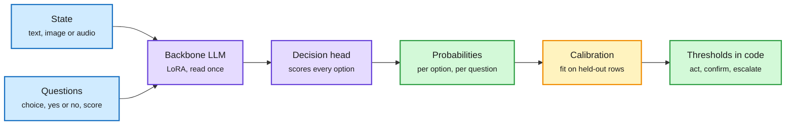

# Open d1 (Liquid AI) and the Clef-head training recipe (Unsloth)

> Source summary · 2026-10-08 · Liquid AI blog and Unsloth documentation, via the X feed

**TL;DR.** Liquid released two open-weight decision models: d1-3B (text and vision, from a decoder-only VLM) and d1-omni-600M (text with image or audio, from a 350M bidirectional encoder). Unsloth published a guide that turns ordinary LLMs into decision models with LoRA plus a small head of the same design as Cloudflare's Clef, followed by a calibration step on held-out rows.

One read of the prompt, one score per option, calibration afterwards

The backbone never generates. A small head reads its outputs at each option and scores them all together.

Blue is input, purple is the model and its head, amber is the calibration step, green is what your code consumes.

## Key points

- d1-3B: 48.57 on Decision Index v0.2.1 (public split). Mean 82.9 over seven text benchmarks against 81.1 for Decider 4B. d1-omni-600M: 15.95 on the index, mean 78.4 against 77.1 for Decider 2B.
- d1-3B latency for one question: 8 ms (RTX 4090), 16 ms (Jetson AGX Thor), 26 ms (Jetson AGX Orin), 50 ms (Jetson Orin Nano), 30 ms (Apple M5 Pro). Three questions take 1.3x the time of one.
- d1-3B training: weights of two backbones averaged for a better base, then checkpoints from different seeds and data mixtures merged. Long inputs, shuffled options and fixing data shortcuts mattered more than advanced techniques.
- d1-omni training: text decisions first, then a FastConformer audio encoder with an adapter, then a frozen vision encoder with an adapter and LoRA active only for image inputs, then a full fine-tune and weight averaging.
- Unsloth head: input plus every question and its options in one prompt, read once. The head scores every option over the LLM's outputs and decides all questions together. No text is generated.
- Unsloth results: Qwen3.5-0.8B 78% test accuracy (4 GB, 42 min), Qwen3.5-2B 81%, Llama 3.2 3B 79%, Gemma 4 E4B 77%. Starting accuracy of 30 to 37% is roughly chance. Test set: 3,000 rows.
- `FastDecisionModel.calibrate` reports held-out accuracy, expected calibration error and loss. No values are printed in the guide.
- Same window: pplx-decider v1.1 (643 of 669 clinical decisions against 628 for Jev), llama.cpp v0.6.0 multimodal decision support, Vela 2.0 span-level routing models, a `decision-model` tag on Hugging Face with 1,300+ models, and Laya (an encoder with one `[MASK]` per option).
- Limits: vendor-reported. No calibration numbers from Liquid. The vision split of the index is private and unreported. Audio decision benchmarks do not exist yet.

## How this relates to the wiki

- Extends the open decision-model stack from 2026-10-04 (llama.cpp `/v1/systemone`, Decision 2.0, Gero-4B, RSI-Jev) with multimodal weights and a short training recipe.
- Confirms the Gero-4B lesson (2026-10-04) that option order must not matter. Gero-4B enforces it by architecture, d1 by shuffling options in data.
- Does not address the value-function essay (2026-10-04): post-hoc calibration gives single-step correctness, not the probability of task success under a continuation policy.
- Partial progress on the 2026-10-04 prediction of a separately validated success head. Not a resolution.
- Unread and directly relevant: "System Switch: When Should a Fast Decision Model Stop and Think?" (arXiv 2610.09683), listed on HuggingFace without an abstract.
- Concept page: [Decision Models](decision-models.md).

## Links

- [Open d1 blog](https://www.liquid.ai/blog/d1-open)
- [d1-3B](https://huggingface.co/LiquidAI/d1-3b) · [d1-omni-600M](https://huggingface.co/LiquidAI/d1-omni-600M)
- [Unsloth guide](https://unsloth.ai/docs/basics/train-your-own-decision-model-with-unsloth)
- Digest: [2026-10-08](../daily-digest/2026-10/2026-10-08.md)
- Raw: [X feed capture](../../raw/twitter/feed/2026-10-08-day-ranked.json), post ids 2107878935270965420 and 2107868866361930236 (gitignored)
