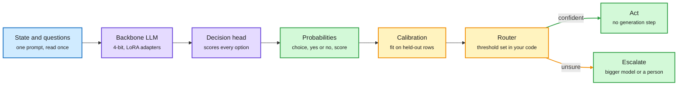

# Open d1 and "Train Your Own Decision Model"

**Date:** 2026-10-09 · **Type:** vendor blog (Liquid AI, 2026-10-07), documentation (Unsloth) and an open-source thread (Laya)
**Topic:** [Decision models and System 1 / System 2](decision-models.md)

## TL;DR

A decision model takes a state and typed questions and returns a choice with a probability in one forward pass, instead of generating text. Jev, the commercial reference from TypeSafe, is a closed hosted API. This window added three open routes. Liquid AI released two open-weight models, d1-3B (text and vision) and d1-omni-600M (text with image or audio), built for edge hardware. Unsloth published a recipe that converts a supported generative LLM into a decision model with LoRA adapters (small trainable low-rank matrices added to frozen weights) plus one small head. Laya is an Apache 2.0 encoder-based alternative. All three calibrate the probability that a label is correct. None reports the probability that the task succeeds if the action is taken, which is the number a router actually needs.

Read once, score every option, calibrate, then let code decide

Nothing is generated. In the Unsloth recipe the only learned parts are the adapters and one small head.

Blue is input, purple is the model and its new head, amber is calibration and the routing rule, green is output and action.

## Three designs, three mechanisms

| | Backbone | How options are scored | How option order is handled |
|---|---|---|---|
| **Unsloth recipe** | Any supported decoder LLM (Qwen, Gemma, Llama) | One prompt holds the input and every question with its options. The LLM reads it once. A small head, the same design as Cloudflare's Clef, scores every option and decides all questions together. | Not stated |
| **Liquid d1-3B** | LFM2.5-VL-3B, a decoder-only vision-language model | Single forward pass, no tokens produced. Head design not described in the blog text. | Answer options are shuffled during training |
| **Liquid d1-omni-600M** | LFM2.5-Encoder-350M, a bidirectional encoder, plus audio and vision encoders | Single forward pass | Not stated |
| **Laya** | Open-weight bidirectional encoders | One sequence per question, with a `[MASK]` marker for each option. A small head gives one score per marker and softmax turns scores into probabilities. | Not stated |

**Unsloth details.** The reported results fine-tune with LoRA at rank 64 for one epoch. The guide's recommended starting point is different: 4-bit LoRA at rank 16, learning rate 2e-4, two epochs, with the new head at 1e-4. Question types are `choice`, `noul` (yes or no) and `score`. Because the model never writes text, it does not spend memory on the vocabulary projection. After training, a `calibrate` call fits the probabilities on held-out rows and returns held-out accuracy, calibration error and loss. Predictions read up to 16,384 tokens. The trained model can be served behind a local Decision API under the names other decision models use.

**Liquid details.** For d1-3B, the weights of LFM2.5-2.6B and the text backbone of LFM2.5-VL-3B were averaged into a better base. Checkpoints were then fine-tuned with different seeds and data mixtures and merged again. For d1-omni-600M, the encoder was first fine-tuned on decision tasks, then audio (a FastConformer encoder with an adapter) and vision (an existing encoder with an adapter and LoRA updates active only on image inputs) were added in stages, followed by full fine-tuning and weight averaging with the previous checkpoint.

**Laya details.** Plain Python routes by language to an English or multilingual checkpoint. Questions are batched into one model call, though each carries its own copy of the state. The thread describes it as a fast base that must be specialized: fine-tune for the task, calibrate on held-out examples, and send uncertain decisions to a stronger model or a person.

## Key findings

**Unsloth** (test set of 3,000 rows: 2,000 from typed-decisions, 500 from BANKING77, 500 from CLINC150, decontaminated against training data; training mixes 12 public sources with typed-decisions):

| Model | Test accuracy | VRAM | Training time |
|---|---|---|---|
| Qwen3.5-0.8B | 78% | 4GB | 42 min |
| Qwen3.5-2B | 81% | 8GB | 40 min |
| Llama 3.2 3B | 79% | 4.1GB | 30 min |
| Gemma 4 E4B | 77% | 14.4GB | 49 min |
| Laya (fine-tuned) | 77% | 2.5GB | 10 min |

Qwen3.5-0.8B goes from 36% to 73% on typed-decisions. Starting accuracies of 30 to 37% are described in the guide as roughly chance level.

**Liquid:**

- d1-3B scores 48.57 on the Decision Index v0.2.1 public split, which Liquid says is ahead of every model under 10B and on par with Decider 35B-A3B, a decision model 12 times its size. d1-omni-600M scores 15.95.
- On seven public text benchmarks the mean is 82.9 for d1-3B against 81.1 for Decider 4B, and 78.4 for d1-omni-600M against 77.1 for Decider 2B.
- Latency for one question with d1-3B: 8 ms on an RTX 4090, 16 ms on a Jetson AGX Thor, 26 ms on a Jetson AGX Orin, 30 ms on an Apple M5 Pro, 50 ms on a Jetson Orin Nano. Three questions over one state take about 1.3 times as long as one. A 3.4K-token state takes 102 ms on the RTX 4090 and 1,640 ms on the Orin Nano.
- Training note: long inputs, shuffled answer options and fixing shortcuts in the data "made a bigger difference than more advanced techniques".

**Laya:** in one independent test cited in the thread, about 35 ms on a local GPU against about 380 ms for Jev over the network. Jev works zero-shot and supports up to 255 options.

## Gaps

- All accuracy numbers are vendor-reported.
- Liquid does not report on the Decision Index's private vision split and says dedicated audio decision benchmarks do not exist yet.
- Unsloth's gains start near chance, so they measure learning the answer format as much as judgment.
- The Unsloth `calibrate` call computes a calibration error, but neither source publishes a calibration number such as expected calibration error.
- The Laya latency comparison mixes a local call with a network call.

## Relation to earlier wiki pages

The [10-04 digest](../daily-digest/2026-10/2026-10-04.md) covered the first open stack and set up the questions this page inherits.

- **The calibration gap is unchanged.** The 10-04 value-function essay ("Is Jev Secretly a Value Function?") argued that the number a fast decider should report is how often the task succeeds if it picks this option, which is a Q-value, not how often it picks it. Every release here calibrates label correctness. The digest notes a saved tutorial where Jev, used as a judge, scored a run that skipped the order lookup at about 86% likely correct.
- **Prediction still open.** The 10-04 Looking Ahead predicted that within 90 days an open release would ship a success head validated separately from its choice distribution. Several releases landed and none has it.
- **Tension with Gero-4B.** The 10-04 Gero-4B build log scored each option in a separate branch so option order could not matter, and reported that the obvious calibration reward teaches a model to pick a wrong answer and say it is unsure. The Unsloth head scores all options jointly so they serve as context for each other. Liquid shuffles options in training to get order invariance statistically. Which design is better calibrated has not been measured.
- **The gate is now a commodity.** Other releases from the same window, listed in the [10-09 digest](../daily-digest/2026-10/2026-10-09.md): Perplexity's open pplx-decider v1.1, an OpenAI Decisions API in public beta, llama.cpp multimodal decision support, and a `decision-model` tag on Hugging Face with more than 1,300 models.
- **Deciding when to stop.** [PortSimEnv](../reinforcement-learning/2026-10-09-portsimenv-simulation-rl-environments.md) shows open models losing reward by never committing to a plan, and [ALoDLM](../models-architectures/2026-10-09-alodlm-adaptively-looped-diffusion-lm.md) trains an exit gate jointly with the model. Both are the same commit-or-continue decision in other settings.

## Research angle

Why the head design works at all: with generation removed, all capacity goes into one comparison among supplied options, and joint scoring lets options act as context for each other.

For a reasoning model built from a fast decider and a slow reasoner, these releases are the fast half, with a known hole. Open problems:

- **A success head trained on outcomes.** Label calibration tells a router how often the classifier is right, not whether acting on the choice works out.
- **Joint against per-branch scoring.** Compare calibration of the Clef-style joint head, Gero-4B's separate branches and Liquid's shuffling on one dataset. The Unsloth tooling makes this a cheap experiment.
- **When should the decider hand off?** HuggingFace listed a paper titled "System Switch: When Should a Fast Decision Model Stop and Think?" ([arXiv 2610.09683](https://arxiv.org/abs/2610.09683)). No abstract was available, so it is unread.

## Links

- Sources: [Liquid blog](https://www.liquid.ai/blog/d1-open) · [Unsloth guide](https://unsloth.ai/docs/basics/train-your-own-decision-model-with-unsloth) · [Laya repository](https://github.com/NandhaKishorM/laya) · [Laya thread](https://x.com/akshay_pachaar/status/2107933081093210124)
- Digest: [2026-10-09](../daily-digest/2026-10/2026-10-09.md)
- Raw: X feed capture for the 2026-10-09 window (`raw/twitter/feed/2026-10-09-day-ranked.json`, local only)
