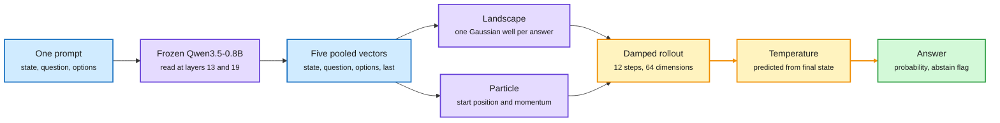

# Vega: A Decision Model That Rolls a Ball Down a Hill

**Date:** 2026-10-11 · **Type:** blog post with open code and weights · **Author:** Nandakishor M (author of Laya), published 2026-10-10
**Topic:** [Decision models and System 1 / System 2](decision-models.md)

## TL;DR

Vega is an open decision model in 0.8B and 4B sizes. It keeps a language model completely frozen as a reader and trains only a small engine (55 MB for the 0.8B) that decides. The engine does not score options with a head. It builds an energy landscape with one Gaussian well per candidate answer, places a particle using the situation and question, and integrates damped dynamics for at most twelve steps. Where the particle settles is the answer, and a per-decision temperature predicted from how it settled sets the confidence. In the author's own run Vega is less accurate than hosted Jev and better calibrated: on DecisionBench the 4B scores 0.633 accuracy against 0.752, and 1.420 negative log-likelihood against 3.196.

The reader is frozen. The deciding is a small dynamical system.

Answers become valleys, the question becomes a starting point and a push, and confidence comes from how the particle stops.

Blue is input, purple is the frozen reader and the learned landscape, amber is the rollout and its calibration, green is the output.

## Architecture

**Reading.** The situation, the question and every candidate answer are written into one prompt with a fixed format (`Observation`, `Measurement`, `Possible outcomes`, `Outcome`). There is no system prompt and no few-shot examples. A frozen Qwen3.5-0.8B reads it once. It is read at layers 13 and 19 of 24, and the forward pass is cut off after the deepest layer read. The language-model head never runs. The base model is pinned by a SHA-256 and refused if it changes.

**Five vectors.** Token spans are averaged: one vector for the situation, one for the question, one per answer. The hidden state at the final position is kept on its own.

**From vectors to a particle.**

- The situation vector is projected into a 256-dimensional "world latent" with a bounded nonlinear correction.
- A foresight block predicts the latent that would follow.
- The question vector plus a learned answer-type embedding becomes a probe.
- The last-token vector becomes an impulse.
- Two small networks read these four and output a starting position and a starting momentum in a 64-dimensional decision space.

**The landscape.** Each answer vector yields a centre, depth and width for one Gaussian well. With a quadratic bowl that keeps the particle bounded:

U(z) = ½κ‖z‖² − Σ a_k · exp(−‖z − c_k‖² / 2σ_k²)

Consequences: the answer set is not fixed at training time, rating options are laid out along a line so being wrong by one notch is a small error, and near-synonymous options produce overlapping wells.

**The rollout.** At most twelve steps of a damped Hamiltonian integrator. Each step computes the gradient of U, softly caps it, picks a bounded step size, applies learned friction, and adds a bounded force from a small diagonal state-space model that remembers the trajectory. Momentum is updated before position (a symplectic step), which keeps the rollout stable. The cost is constant and the result deterministic. An early exit fires once kinetic energy and local slope are both under a threshold.

**Readout and calibration.** Each well is scored by the particle's final distance in units of the well's width, offset by its depth. The answer distribution is a softmax of those energies at temperature τ. τ is predicted for every decision from the final physical state: remaining speed, distance to the nearest well floor, steps used, and the number of options. Each answer also carries an `abstain` flag (confidence under a floor fitted on held-out data) and an `unbound` flag (the particle settled far from every well, meaning the question is outside what the engine was trained for).

## Training

- Gradients flow only into the projections, the well networks and the integrator's controls. The engine is 14.3 million parameters with no attention.
- **Counterfactual pairing.** Items that share an answer space but have different correct answers are paired, and the loss includes the comparison. Priors such as "tickets mentioning money go to billing" stop paying.
- **Foresight.** The foresight block is trained on conversation prefixes to predict the latent of the state that followed.
- **Not distillation.** The engine is not fitted to a larger model's probabilities. Probabilities are calibrated afterwards against held-out correctness.
- **Gated adapters.** New decision families attach as rank-32 adapters on seven projections, about 0.84M parameters. A sigmoid gate reads the world latent and decides per question whether the adapter contributes. The gate value is returned with the answer.

## Other properties

- Context limit of 73,728 tokens. A long situation is encoded once and shared across questions, and is also cut into sixteen separately summarized pieces. An input that does not fit is refused, not truncated.
- The backbone's frozen vision encoder lets an image stand in for the situation text.

## Results (author's run, 11 October 2026, 3,841 decisions per system)

| Metric | Vega 0.8B | Vega 4B | Jev (hosted) |
|---|---|---|---|
| Public menu, 43 tasks, macro accuracy | 0.556 | 0.717 | 0.836 |
| Public menu, negative log-likelihood | 1.099 | 0.768 | 0.878 |
| Public menu, median latency | 74 ms | 106 ms | 162 ms |
| JevBench, 231 items, accuracy | 0.545 | 0.662 | 0.866 |
| JevBench, paraphrase consistency | 0.694 | 0.722 | 0.972 |
| DecisionBench, 1,075 items, accuracy | 0.509 | 0.633 | 0.752 |
| DecisionBench, calibration error | 0.103 | 0.098 | 0.122 |
| DecisionBench, negative log-likelihood | 1.628 | 1.420 | 3.196 |
| DecisionBench, KL to the gold distribution | 1.012 | 0.854 | 6.099 |

The author notes the hosted model is confident at 0.874 on rows it gets right 0.752 of the time. He also says the per-task wins are thinner than they look: tasks have at most sixty rows, eight of twelve wins are three rows or fewer, and the one that survives scrutiny is prompt-injection detection (0.855 against 0.764, with a constant-answer baseline of 0.582).

## Gaps

- One author, one run, small public tasks. Jev was called as a hosted API, so latency includes the network.
- About two thirds of the blog was read. The section behind the post's "test-time training" claim was not reached and is not described here.
- No ablation of the foresight block or the dynamics against a plain head was seen.

## Relation to earlier wiki pages

- **Fills a gap named on 10-09.** The [Open d1 and Unsloth summary](2026-10-09-open-d1-and-train-your-own-decision-model.md) noted that no open release reported a calibration metric. Vega reports calibration error, likelihood and KL to a gold distribution.
- **A fourth open head design.** After Unsloth's joint Clef-style head, Liquid's merged decoder and Laya's mask markers (all 10-09), this one replaces the head with dynamics. Like Unsloth's design it reads all options in one prompt.
- **Does not resolve the 10-04 calibration gap.** Calibration is still about labels. The value-function essay from 10-04 asked for the probability that the task succeeds if the action is taken. Nothing here is trained on outcomes.
- **Same window.** Cloudflare says Clef trains with label-smoothed cross-entropy plus a Brier score term. A JEV-27B-VL release advertises a calibration error of 0.019. AnyJev's Tacit models are distilled from the base model's own post-reasoning decisions with escalation on low confidence.

## Research angle (bears on the reasoning-model project)

- A decision as the endpoint of a trajectory carries information the endpoint does not. Leftover speed and distance from a well are a confidence signal that comes from dynamics, close in spirit to evidence-accumulation accounts of human choice.
- The `unbound` flag is an out-of-distribution signal that a System 2 could use as a call-me trigger.
- The foresight block is a small world model inside a decider. Whether it helps is untested in what was read.
- Cheap experiments: does settling time predict error better than the final probability? Do trajectories differ between easy and hard items?

## Links

- Source: [blog](https://www.nandakishorm.com/writing/vega) · [code](https://github.com/NandhaKishorM/vegaml) · [model card](https://huggingface.co/nandakishorm/vega-08b-public-intents) · [post](https://x.com/Nandakishorm1/status/2108836195639984284)
- Digest: [2026-10-11](../daily-digest/2026-10/2026-10-11.md)
- Raw: surfaced via saved reading in the 2026-10-11 window (local only)
