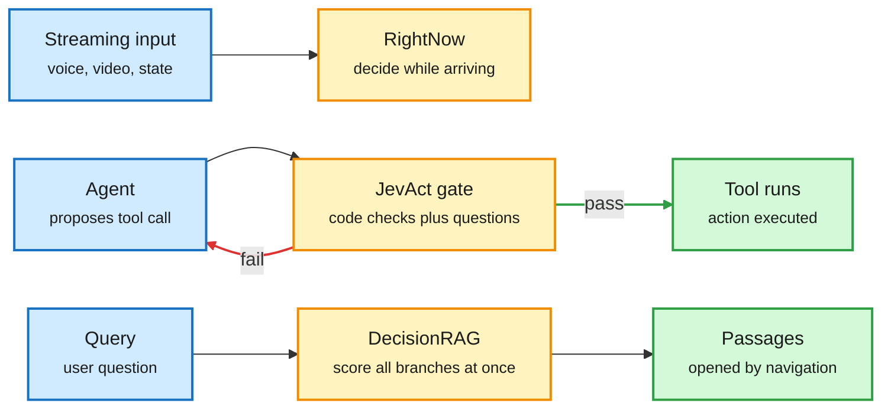

# Decision Models Enter the Loop: RightNow, JevAct, DecisionRAG

**Date:** 2026-11-01 · **Type:** product announcement (RightNow blog, read in full), two papers (JevAct, arXiv 2610.38620; DecisionRAG, arXiv 2610.35868; abstracts and summaries read) and an explainer of how an open decision model is built (X Article on Perplexity Decider v1.2, read in full)
**Topic:** [Decision models and System 1 / System 2](decision-models.md)

## TL;DR

Until this window, decision models (prefill-only classifiers that read a state and a list of questions and return a probability for every option in one forward pass, popularized by Jev) were used mainly as labelers and judges. Three items move them into control loops. **RightNow System Zero** decides on streaming input: text, JSON, robot state, codebases, PDFs, images, voice and video arrive incrementally and the model returns versioned decisions whose probabilities update as evidence arrives, at about 30 ms for text. **JevAct** (IBM) puts a decision gate between a tool-using agent and its tools: domain policies are compiled into code checks and yes/no questions, and a failing tool call goes back to the agent with feedback. Opus 4.6 on τ²-bench Telecom rises from 39.5% to 80.7% three-run success. **DecisionRAG** (Cornell and ASAPP) replaces similarity search with navigation: a decision model reads the query beside all candidate branches of a document tree in one pass and opens only the best ones, beating dense retrieval plus an 8B reranker by 13.8 R@1 on MultiDoc2Dial and 17.4 Hit@1 on Natural Questions.

The decider moved from the end of the pipeline into the middle of it

Three placements: on the input stream, on the agent's actions, and on the retrieval path.

Blue is input, amber is the decision model in each placement, green is what proceeds, red is the rejection loop.

## How an open decision model is built (Perplexity Decider v1.2 explainer)

Joseph Barrow's article, endorsed by one of the model's builders, gives the recipe for a model at the open frontier. Start from a strong decoder-only base (Qwen3.8-27B, which interleaves gated-delta linear attention with full attention). Make the full-attention layers non-causal, so every token sees every other token, keeping the linear-attention layers causal; this is a decoder-to-encoder conversion like the Ettin work. Remove the language-model head. Put one special mask token per question in the prompt and read each with a small linear "readout" head over 255 options, masked to the question's choices and softmaxed. Train on hundreds of thousands of harmonized classification tasks (tasksource), with synthetic data, merged questions, shuffled and paraphrased options to remove dataset biases. Calibrate after training by tuning the softmax temperature (T = 1.32). The 9B Flash variant is distilled from the larger one with a KL loss. All questions are answered in one prefill, which is why output is free and the workload is compute-bound.

## RightNow System Zero (blog)

- Inputs: up to 1,024 questions, 38,000 state tokens and 16 attachments per call. Questions take 2 to 10 options for text, up to 26 for media.
- Streaming: append text, update state or add attachments; each new decision carries a version. The blog says it is "trained to hold back until the evidence is there, then commit" ("Reflex Training"), with no further training detail.
- Latency medians: text 30 to 33 ms, image 41 ms, audio 34 ms, document 46 ms (506 ms including input processing).
- Self-measured Artificial Analysis Decision Index on the public held-out half: 63.20, below d1-ultra, SubQ Snap 1.1 and Elephant 9B (65) and above System One 1.14 (57). Not an Artificial Analysis evaluation. Workflow-agreement results are "pending".

## JevAct details

On τ²-bench Telecom all eight agents improve, by 16.9 points on average in three-run success. On BFCL all nine improve in three-run success. Airline changes are smaller and mixed. Stated limits: the Telecom gain does not appear with a gpt-oss-120b user simulator, and on 260 labelled development write calls, 42 of 101 incorrect calls break no compiled question.

## DecisionRAG details

Judging candidates in a shared context makes their relevance scores comparable, which separate reranker calls do not. No task-specific training and no first-stage retriever. Retrieval takes 0.7 to 1.8 seconds per query across four benchmarks including 2.68 million Wikipedia paragraphs. An explainer notes the gain is in ranking rather than coverage, and that the Wikipedia tree was built offline with embeddings.

## Gaps

RightNow's numbers are self-reported and its "hold back, then commit" behaviour is asserted without a stopping-time or calibration metric. JevAct's biggest gain depends on the user simulator. DecisionRAG needs a corpus hierarchy.

## Relation to earlier wiki pages

- **Continues** [Vega](2026-10-11-vega-physics-decision-model.md) (10-11), a decision model whose confidence comes from how a particle settles. RightNow's streaming decision is the time-extended version of the same question: when has enough evidence arrived?
- **Answers in part** the 10-04 concept-page item "deciding to act": JevAct is a decider over actions, though it judges policy compliance, not success.
- **Practitioner evidence** this window: a weekly first-pass relevance filter over hundreds of thousands of entities, an SRE diagnosis pipeline with no LLM agent (76.2% of 105 diagnoses), and Parcha's founder rewriting five agents as decision workflows. A cost-routing thread claiming 40% savings on Claude Code counted routing, not quality.

## Research angle (bears on the reasoning-model project)

This is the System 1 half of the reader's design showing up in production placements. Two gaps are worth working on. First, *evidence accumulation*: RightNow claims a decider that waits for enough evidence, which is a drift-diffusion problem (when should a bounded accumulator commit?) and has a large cognitive-science literature behind it. Nobody has published a speed-accuracy curve for a streaming decision model. Second, *outcome training*: JevAct's gate is trained on labels about policy, so 42 of 101 bad calls slip through. A gate trained with RL on whether the action eventually succeeded would be the decider the 10-04 value-function essay asked for.

## Links

- RightNow: https://www.rightnowai.co/blog/introducing-system-zero · https://x.com/rightnowai_co/status/2116311411072835913
- JevAct: https://arxiv.org/abs/2610.38620 · DecisionRAG: https://arxiv.org/abs/2610.35868 · explainer https://x.com/akshay_pachaar/status/2116543279563259995
- Decider explainer: https://x.com/antoine_chaffin/status/2116291134594904427
- Raw: X feed capture for the 2026-11-01 window (local only)
