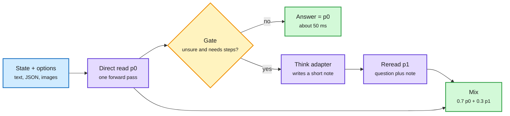

# THX-02, Drex and DPDM: Decision Models That Decide When to Think

**Date:** 2026-11-08 · **Type:** model card and API docs (THX-02, read) plus paper abstracts (Drex, arXiv 2611.07854; DPDM, arXiv 2611.02075) · **Builders:** HAL-X; Dhankhar et al.; Mo et al.
**Topic:** [Decision models and System 1 / System 2](decision-models.md)

## TL;DR

**THX-02** is a 4.5B decision model (state plus options in, a probability per option out, usually one forward pass of about 50 ms) with a 60M-parameter LoRA "think" adapter. It thinks only when its direct read's top probability is below τ = 0.6 **and** a learned yes/no gate (γ = 0.2) says the question needs step-by-step work. The thinker writes a note of a few dozen words; the model rereads with the note; the answer is p = 0.7·p₀ + 0.3·p₁, so a wrong note cannot overturn a confident first read. Thoughts for training were self-verified: kept only if they raised THX-02's own probability on the correct answer (10,129 of 29,990). Every stage trains with a strictly proper scoring rule plus a KL anchor. **Drex** is a family of four open deciders (8B, 9B, 35B-A3B, 27B) trained with SFT plus "RL from adjusted feedback". **DPDM** casts agent decisions as conditional prediction: an LLM encodes history, a frozen tabular predictor (LimiX-2) predicts task targets, and a rule maps predictions to choices.

System 1 answers; System 2 is called only when needed

The direct read always runs. The thinker runs only if the read is unsure and the gate says yes.

Blue is the input, purple the model passes, amber the gate, green the outputs.

## THX-02 training (five stages, each kept only if it raised a held-out index)

1. **Distillation** from a 27B decision model's full distributions on 361,610 requests (165k used), target 85% teacher and 15% gold, LoRA rank 32, then WiSE-FT interpolation at 0.7.
2. **Disagreement distillation:** keep only requests where the model and teacher disagree and the teacher matches gold (56.6k, plus anchors); merge the two distilled models as task vectors (0.4 each).
3. **Inference-time structure:** option-order averaging (four orders, geometric mean) and joint reads for facet-style requests.
4. **Learning to think:** self-verified thoughts train the think adapter; τ, γ and α tuned on held-out data.
5. **Targeted skills:** procedurally generated tasks with exact answers (sandboxed code execution, programmatic logic and causal graphs, simulated narratives, engine-labelled chess, chord-progression harmony), licensed knowledge sets, tool retrieval, synthetic and real vision; kept if the stage-4 model was wrong or below 0.8 on the correct answer; 231k requests, LoRA, interpolated at 0.7.

**Loss:** −(Σ q log p + ½·spherical score − 1[score type]·RPS) + β·KL(p_θ₀ ‖ p_θ). Proper scoring rules make honest probabilities optimal.

## Results

- Decision Index 0.3 public index on a 6,018-request stratified sample (about 117 per benchmark): 65.06 with gated thinking (median 79 ms), 63.83 direct (50 ms). Published full-suite indices: Sieve-31B 62.52, Verdin-4B 58.29, d3-flash 57.79, d1-3B 48.99. Jev is not in the table.
- Thinking gains: GSM8K +25.2, ANLI +6.1, CRUXEval +5.1, GPQA Diamond +4.3, ARC-Challenge +3.4; losses of one to three points on taste and recognition tasks.
- Decision Vision Index (ten public sets): 72.19. Throughput 129 requests per second on one RTX 4090.
- **Drex** (abstract): the largest model "Max" reports state of the art among compared deciders, faster than GPT-6 Sol and Claude Opus 5.5, stable under option reordering.
- **DPDM** (abstract): with Qwen3.5-27B as encoder, mean accuracy over 50 benchmarks 78.80% (few-shot prompting) to 84.92%; larger gains on ToolPRMBench's BFCL and ToolSandbox; accuracy grows with history length.
- **Production context:** Airbnb's fine-tuned Gemma 4 E2B classifier reached F1 0.902 (from 0.563) at 35 ms median and about 1% of frontier cost; Jev was the most accurate off-the-shelf option under 100 ms ([blog](https://airbnb.tech/ai-ml/frontier-quality-at-1-of-the-cost-a-production-benchmark-of-llm-classifiers/)).

## Gaps

- Calibration is claimed (proper scoring, "calibrated probabilities") but no ECE or reliability figure appears in the captured card.
- Sampling error of several points per benchmark; compare areas, not single benchmarks.
- Drex's RLAF and DPDM's decision rules not readable from abstracts.

## Relation to earlier wiki pages

- **Extends** "deciders about thinking" (10-11, [decision-models](decision-models.md) section 12) from a proposal to a shipped, documented mechanism.
- **Extends** [Decision models enter the loop](2026-11-01-decision-models-enter-the-loop.md) (11-01): after streaming input, tool calls and retrieval, the decider now controls its own computation.
- **Still open:** the 10-04 outcome-trained success head. All three systems learn from labels or a teacher.
- **Parallel to** Chinmay Karkar's credit-assignment probe (this window): both keep a reasoning span only if it raises the correct answer's probability.

## Research angle

- Train the gate on "my thought will improve the answer" (from the self-verification signal), not on "needs steps".
- Make α depend on the two reads' confidences instead of a fixed 0.7.
- Outcome-trained deciders: replace gold labels with eventual task success.

## Sources

- [THX-02 model card](https://huggingface.co/HAL-X-AI/THX-02) · [API docs](https://api.hal-x.ai/docs/thx-02) · [Launch post](https://x.com/reversedoofz/status/2118376454564299123) · [Drex](https://arxiv.org/abs/2611.07854) · [DPDM](https://arxiv.org/abs/2611.02075)
- Raw: `raw/huggingface/2026-11-08-towards-foundation-decision-models-drex.md`; `raw/huggingface/2026-11-08-decoupled-predictive-decision-making-a-shared-cond.md`; `raw/twitter/feed/2026-11-08-day-ranked.json` (gitignored)
