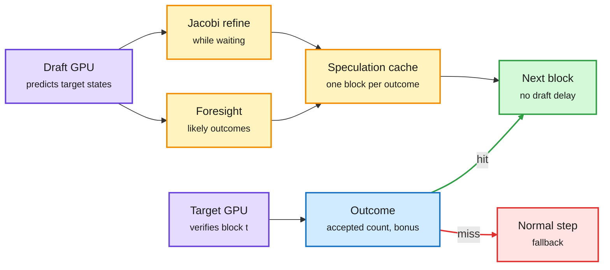

# JetSpec++: Foresight Parallel Drafting with Self Refinements

**Date:** 2026-11-01 · **Type:** paper (arXiv 2610.19792) with code, models and a serving engine; alphaXiv overview and project page read · **Authors:** Zhaoxiang Feng, Lanxiang Hu and colleagues, Hao AI Lab at UC San Diego, with UIUC, Nanjing University, Meta and StepFun
**Topic:** [Inference optimization](inference-optimization.md)

## TL;DR

Speculative decoding speeds up a large model only as far as drafts are cheap and acceptance is high. Strong draft models read the target's hidden states, so they can only draft after each verification, and their cost sits on the critical path. JetSpec++ drafts block t+1 on a second GPU while the target verifies block t. To do that it must guess the verification outcome (how many draft tokens will be accepted, and which bonus token comes next). An adapter predicts the target's hidden states for the block under verification in one parallel pass, a decoder built from the target's frozen last layers turns those into outcome distributions, and the draft model pre-drafts a block for each promising outcome into a speculation cache. While waiting, it refines its own draft with Jacobi passes. Output stays lossless through standard rejection sampling. On two GB200 GPUs at batch size 1, Qwen3-8B decodes up to 7.45 times faster than autoregressive decoding and 1.54 times faster than DSpark, at 1,361 tokens per second in BF16 and 4,117 with NVFP4.

Draft the next block before the current one is checked

Foresight guesses the verification result; idle draft time goes into self-refinement.

Purple is the two GPUs, blue is the verification result, amber is foresight and refinement, green is the fast path, red is the fallback.

## Key findings

- Without context refresh, the draft model keeps 95 to 98% of the acceptance length it reaches from the target's true hidden states.
- At temperature 0 and verification budget 16, the best configuration averages 8.94 tokens per round on Qwen3-8B against 6.89 for DSpark, and commits more tokens per round than every baseline on all seven benchmarks.
- Qwen3.8-27B reaches 367 tokens per second in BF16 and over 900 with NVFP4 and kernel work.
- Preliminary batch sizes 2 to 4 lead DSpark on throughput and per-user speed.

## Gaps

Batch size 1 for headline numbers, and a dedicated second GPU for drafting. Behaviour at realistic serving batch sizes is stated as future work.

## Relation to earlier wiki pages

- **Intersects training:** [Soft-MTP](../training-finetuning/2026-11-01-soft-multi-token-prediction.md) (same window) improves the MTP heads that serve as built-in drafters; JetSpec++ is the separate-drafter route.
- **Routing angle:** the speculation cache is a small decision problem (which outcomes to pre-draft), the same pattern as the decision-model placements in [today's decision-model page](../decision-models/2026-11-01-decision-models-enter-the-loop.md).

## Links

- Paper: https://arxiv.org/abs/2610.19792 · Project: https://jetspec-project.github.io/jetspecpp-web/ · Code: https://github.com/hao-ai-lab/JetSpec
- Post: https://x.com/haoailab/status/2116240411530551435
- Raw: X feed capture for the 2026-11-01 window (local only)
