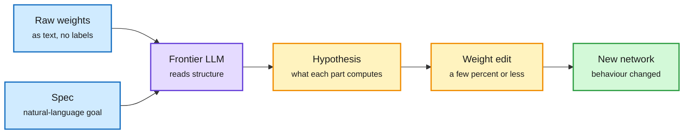

# Sparks of Weight-Space Programming: LLMs Read and Write Network Weights

**Date:** 2026-11-08 · **Type:** research blog (read through Experiment 4) plus video coverage · **Authors:** Rikiya Takehi, Jayden Teoh, Alex Zhang, Omar Khattab (MIT CSAIL)
**Topic:** [Interpretability and safety](interpretability-safety.md)

## TL;DR

The authors give GPT-6 Astra the raw weights of neural networks as text and ask it to read them (what was this trained to do?), fix them, or write new ones, with no gradient descent and usually no forward passes. It names the game a small PPO policy plays, the shape a small diffusion model draws, and the language a character-level transformer learned from its middle blocks alone, finding exactly the induction heads that running the model reveals. It repairs a stuck control policy by editing 3.5% of its weights, and fixes a reasoning loop in Qwen3.5-0.8B by editing 0.016% of its weights, raising MATH-500 from 7.9% to 48.1%. The authors call this weight-space programming: optimization by reasoning about what each part of a network computes.

Optimization by reasoning, not by gradient

The LLM reads weights as text, forms a hypothesis about what each part computes, and writes new weights.

Blue is the input, purple the LLM, amber its reasoning and edit, green the result.

## Key findings

- **Experiment 1 (read a policy):** four PPO policies (MLP 500→32→32→5, 17,253 weights, 1B steps each) on grid versions of Breakout, Pong, Pac-Man and Freeway with identical inputs and actions. Astra named all four games without being given the options, apparently from where each input channel's first-layer weights concentrate.
- **Experiment 2 (read a generator):** three DDPMs (23,824 weights) for circles, squares and triangles; Astra named each shape with no forward passes, drawing them as outlines, which suggests reading edge structure rather than simulating.
- **Experiment 3 (read the middle of a language model):** 7.16M-parameter character transformers trained on Python, romaji Japanese or English, with input and output layers removed; Astra named the language in both attempts for all three and identified exactly the copying heads (layer.head 2.1, 3.1, 3.5 for Python; 3.3 romaji; 3.1 English) that running the model shows, by multiplying weight matrices.
- **Experiment 4 (fix):** the official Kinetix PPO actor (171,664 weights) stalls at a ramp (0 of 256); one edit to 3.5% of its weights made it succeed in 1,024 of 1,024 episodes.
- **Experiment 8 (improve, per TL;DR):** 0.016% of Qwen3.5-0.8B's weights edited in a Python kernel without training loops; MATH-500 7.9% to 48.1% at the same sampling settings, IFEval about three times higher.
- **Writing from scratch (per TL;DR):** MinAtar game networks that outplay PPO networks trained for 100M steps; a Go network.
- **Follow-ups (not read in full):** a Hugging Face reproduction with ML Intern; Trajectory Labs post-trained Qwen 27B and 35B-A3B on a 322-game WeightProgramBench.

## Gaps

- Small networks dominate; reading at scale is unproven. The Qwen gain repairs a known looping failure from a low baseline.
- Experiments 5 to 8 were summarized from the TL;DR, not read in full.
- A Kurate title this week, "Consistency Is Not Understanding: Orbit Audits for Neural Field Weight Readers", questions weight readers' understanding; not opened.

## Relation to earlier wiki pages

- **Extends** [Platonic Representation Theorem](../world-models-reasoning/2026-11-01-platonic-representation-theorem-jepa.md) (11-01) from a different angle: if concepts are shared and structured, they may also be legible in weights.
- **Contrasts with** [harness self-improvement](../agent-harness-routing/2026-11-01-harness-self-improvement-and-interfaces.md) (11-01): LLM-driven optimization moves from text artifacts (prompts, harnesses) to weights.
- **Method caution from** [Lossfunk's grokking paper](../training-finetuning/2026-11-08-subspace-crystallization-grokking.md) (this window): readings of weight structure need causal tests.

## Research angle

- Faithfulness: ablate the heads or features Astra names and check behaviour.
- Scale: does reading work in middle layers of 1B-plus models, where features are far from inputs and outputs?
- For the reasoning project: legibility of concepts in weight space, not only activations.

## Sources

- [Blog](https://rikiyat.github.io/blog/weight-space-programming/) · [Two Minute Papers](https://www.youtube.com/watch?v=GJ6PMUm5oTA) · [HF reproduction](https://x.com/NielsRogge/status/2119021065468829707) · [Rikiya Takehi via priority repost](https://x.com/Snorlxz/status/2117478327011467302)
- Raw: `raw/twitter/feed/2026-11-08-day-ranked.json` (gitignored); `raw/youtube/2026-11-08.json`
