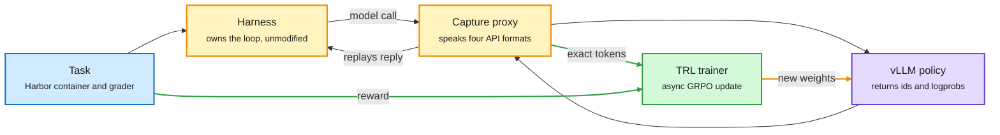

# Media Zone | 2026-10-04

> The US day's conversation was about one question asked three ways: does a model learn from its own distribution, inside its own harness, with an honest sense of how sure it is?

## Today's signal

- Dominant story: Hugging Face's multi-harness RL guide. Same weights, 62% in one harness and 33% in another.
- Pattern: three separate posts argue post-training lives or dies on how on-policy the data is.
- Pattern: decision models got an open stack in one day. llama.cpp endpoint, open weights, two training recipes.
- Counter-signal: Jev's API "confidence" is not a correctness probability. Two independent posts say so.
- Counter-signal: a Meta paper says RL post-training costs agents solution coverage under repeated sampling.
- Quiet area: cognition and neuroscience. One lab post and unread Kurate titles, nothing to build on.

## Saved reading

The reader's saved posts, written from their full sources. Fourteen of the seventeen saves are covered here (two of them point at the same article). Three had no readable substance and are skipped: a reply that only says "worth the read" with no link captured, a hiring anecdote about debugging fundamentals, and a two-line exchange about an account.

Decision models · saved twice
<h4>Building an RL fine-tuning platform for Jev-like decision models (Gero-4B)</h4>

A build log that turns Qwen3-4B into a decision model, a model that scores options you give it instead of writing text. The architecture removes the language-model head, adds one tiny linear scorer, encodes the context once, and runs each option as its own branch that cannot see the other options. That makes the scores order-invariant by construction and works for 2 or 256 options with the same weights. Training has three stages with one job each: format on content-free synthetic data, then a calibration stage driven by an RL reward. The reward is the instructive part. The "obvious" reward (pay the model for how well its confidence predicts its own correctness) is not a proper scoring rule, and gradient descent drove the right answer's probability from 0.418 to 0.001. The fix pays log-probability of sampled real outcomes plus an honest-confidence term on the top answer, both proper scoring rules, so the optimum is the truth.

<strong>Why it is for you:</strong> this is the most concrete open description of RLCD-style calibration training in the window, and it is a direct blueprint for a System 1 decider. The list of mistakes (a KL anchor that moves the optimum, Adam cancelling a gradient multiplier, a metric that rewarded overconfidence) is worth more than the result.

<a href="https://x.com/TheVixhal/status/2106439792800198966">Article on X</a> · <a href="../../decision-models/2026-10-04-rl-calibration-decision-models-gero-4b.md">Wiki summary</a>

Training stack · the day's most-shared paper
<h4>Finetuning with Sampling: SFT learns better than you think</h4>

Harvard's Aayush Karan, Sitan Chen and Yilun Du argue that SFT (supervised fine-tuning) generalizes badly because its data is off-policy, not because of its objective. Their fix leaves the loss alone and reshapes the data. They define the ideal target as the distribution closest to the base model that still respects the privileged information in the expert trace, then sample from it with Metropolis-Hastings, an MCMC method that proposes rewrites and accepts them by likelihood. The expert trace is the starting point and each step makes it look more like something the base model would write. Plain SFT on those rewritten traces rivals GRPO and on-policy self-distillation on chemistry, math and medical QA, and forgets less. Some chemistry tasks the base model never solved in 64 tries reach pass rates of 67.2% and 53.1%.

<strong>Why it is for you:</strong> the saved post calls it "a rare principled free lunch" for midtraining and asks the right open question: for agents, is turn-level resampling enough or do you need environment replay?

<a href="https://aakaran.github.io/finetuning_with_sampling/">Project page</a> · <a href="https://arxiv.org/abs/2610.02140">Paper</a> · <a href="https://x.com/willcb/status/2106263168150618277">Saved post</a> · <a href="../../training-finetuning/2026-10-04-finetuning-with-sampling.md">Wiki summary</a>

Training stack · read from the paper's first page
<h4>On-Policy or Off-Policy Learning? A systematic study of distillation dynamics</h4>

A Cambridge study (Piskorz, Berthon, van der Schaar) that varies three things independently in strong-to-weak distillation: who generates the rollouts, the direction of the token-level KL loss, and the learning rate. The finding cuts against the day's mood. Rollout policy "does not necessarily play a central role". KL direction shapes task performance and output coverage, and learning rate governs forgetting and update sparsity. Forward KL is robust to who wrote the rollouts. Reverse KL is sensitive and prefers student-generated ones. On-policy data still helps on harder variants of the Countdown arithmetic task, but the advantage does not reliably survive a later RLVR stage (reinforcement learning with verifiable rewards).

<strong>Why it is for you:</strong> it is the control experiment the on-policy story needed. Only the abstract page attached to the post was read, so no numbers are quoted here.

<a href="https://arxiv.org/abs/2609.35259">Paper</a> · <a href="https://x.com/HuggingPapers/status/2106380403225309561">Saved post</a> · <a href="../../training-finetuning/2026-10-04-on-policy-vs-off-policy-distillation.md">Wiki summary</a>

Training stack · tutorial
<h4>On-Policy Distillation from scratch (nanopd)</h4>

An engineering-first tutorial for OPD (on-policy distillation, where a teacher scores every token the student generates, so the signal is dense like SFT but evaluative like RL). The setup uses three machines: vLLM serving the student (Qwen3.5-0.8B), vLLM serving the teacher (Qwen3.5-2B), and a training loop that pushes fresh weights to the student server after each step. The details that matter are operational. Prefix caching must be off on the student or it serves stale KV cache from old weights. The teacher is called for one token just to get logprobs over the student's exact token ids. Sending the teacher a re-rendered chat prompt instead of those ids is the bug the author shipped first. The author's own advice is to use prime-rl or TRL in real work.

<strong>Why it is for you:</strong> a weekend-sized way to own the OPD loop end to end before reading today's two distillation papers. The exact-token-id lesson is the same one the multi-harness guide is built on.

<a href="https://x.com/barrowjoseph/status/2106115912889937982">Article on X</a> · <a href="https://github.com/jbarrow/nanopd">Code</a>

Inference · Prime Intellect
<h4>Prime Inference: serving frontier open models for agent traffic</h4>

Prime Intellect opened the serving platform it built for its own RL rollouts, which it says processes nearly a trillion tokens a day internally. The framing is the continual-learning loop: a trained model serves users, produces traces, and the traces feed training. The technical core is prefill/decode disaggregation. Long prompts are processed on one GPU group and token generation runs on another, so a cold 140K-token prompt does not stall existing sessions. NVIDIA Dynamo routes and vLLM runs the model on each group, and the decoder pulls the computed KV cache across. They report nearly 40% lower p90 inter-token latency from this split. The typical agent turn they design for adds about 6K tokens to a 140K-token prompt.

<strong>Why it is for you:</strong> day-job material (inference optimisation for agent workloads) from the lab that also ships prime-rl. Only the first part of the post was read; the caching and routing section was not.

<a href="https://www.primeintellect.ai/blog/prime-inference">Blog</a> · <a href="https://x.com/eliebakouch/status/2106160865884217575">Saved post</a>

Harness · Microsoft and UCSB
<h4>ScholarEvolve: evolve the harness from published research</h4>

Most harness optimizers let a coding agent edit the harness after it sees failures, which limits changes to what that agent already knows. ScholarEvolve uses the research literature as the search space instead. It splits the harness into modules (tool use, memory management, task execution), runs topic modeling over recent papers to find distinct improvement strategies per module, implements them and tests combinations. New papers can be added over time. With the model fixed, Qwen3.5-27B goal completion on AppWorld Challenge rises from 49.6% to 63.6%, and GPT-5.4-mini pass@1 on Tau2-Bench Telecom from 72.7% to 81.9%.

<strong>Why it is for you:</strong> harness engineering as a search problem with an external prior. It pairs with the CMU harness-learning paper below, which learns the editor with RL.

<a href="https://arxiv.org/abs/2609.40169">Paper</a> · <a href="https://x.com/omarsar0/status/2106619582463312315">Saved post</a>

Harness · essay
<h4>How to design an agent harness: six decisions</h4>

An essay that defines the harness as six things between the model and the work: the loop, the tools, what stays in memory, what survives a crash, what the agent may touch, and who decides the job is done. Its best material is three real shapes. DoorDash built a platform: throwaway VMs, YAML playbooks, one gateway for tools, 130,000 automated tasks in a month. OpenAI built a repository: an instructions file of about 100 lines that indexes real docs, with architectural rules enforced by linters. Anthropic built a role split of three agents that talk through files, which cost 6 hours and $200 where the unharnessed run took 20 minutes and $9. The first decision is to write the stopping rule before starting, because the default is "done means the agent says so".

<strong>Why it is for you:</strong> a practical checklist for the day job. The post also points to a Wavestone AI Lab paper dissecting 11 agents into seven parts; that paper was not captured and is not summarized here. Only the first part of the essay was read.

<a href="https://x.com/undefinedKi/status/2106479644354474463">Saved post</a>

Architectures · thread opener only
<h4>Encoder-based or encoder-free multimodal LLMs: which scales better?</h4>

The post frames a clean architectural question. Most multimodal LLMs stitch a vision encoder and projector onto a language model. The alternative drops the vision backbone and projects raw image patches straight into the decoder. The attached figure shows the two designs: the encoder-based model feeds visual tokens into causal attention, while the encoder-free model uses a patch embedding and bidirectional attention over the visual tokens. Only the first post of the thread and its figure were captured. The answer to "which scales better" was not readable, so none is given here.

<strong>Why it is for you:</strong> it lines up with PixelUMM from NVIDIA in the same feed, which removes both the VAE and the vision encoder for image and video. Two encoder-free results in one window is worth a note, not yet a pattern.

<a href="https://x.com/massiviola01/status/2106049168943075674">Saved post</a>

Harness · course
<h4>Learn Harness Engineering (open course)</h4>

A free course on engineering coding agents, built from OpenAI's and Anthropic's harness write-ups. The lecture titles are the syllabus: why capable agents still fail, why the repository must become the system of record, why one giant instruction file fails, why agents declare victory too early, why observability belongs inside the harness, and the move from single loops to graph engineering. It ships projects, copy-ready templates (AGENTS.md, feature_list.json), and design breakdowns of Pi, Claude Code, Codex and DeepSeek. Only the landing page was read.

<a href="https://walkinglabs.github.io/learn-harness-engineering/en/">Course</a> · <a href="https://x.com/khushiirl/status/2106102055589089643">Saved post</a>

**Shorter saves**

- **pg-jev and "Build your own Jev (100% local)".** A Postgres extension exposes Jev through SQL: `jev()` inside WHERE, `jev_prob()`, `jev_choice()`, `jev_score()`. The linked article rebuilds the behaviour locally with next-token scoring over fixed choices on SGLang. Only its opening was read. ([post](https://x.com/_avichawla/status/2106328920211800165), [repo](https://github.com/realZachi/pg-jev))
- **Sebastian Raschka, "Reasoning from scratch" part 6.** RLVR and GRPO (group relative policy optimization) implemented from scratch: accuracy and format rewards, GRPO versus PPO, the KL term. Video not transcribed; chapters only. ([post](https://x.com/rasbt/status/2106369670680871031))
- **Build JEPA from scratch (Vizuara).** A paid eight-lecture bootcamp starting 6 October. The useful sentence: EMA target encoders and stop-gradients prevent collapse, block masking forces semantic prediction. ([course](https://jepa.vizuara.ai))
- **"24/7 AI employee" with Kimi.** The post's Karpathy framing is bait. The linked article is a Kimi how-to: a small always-on agent for routine plus a large parallel swarm for wide tasks, which it admits are separate modes today. Low substance. ([post](https://x.com/0xApexAi/status/2106474155118137719))

## RL, training, architectures, decision models, world models, cognition

### Train inside the harness, not around it

The trainer never touches the harness. It listens at the model endpoint.

The capture proxy is the only new box. Claude Code, Codex and OpenCode run exactly as shipped.

Blue is the task, amber is the loop and the interception point, purple is the model, green is the training path.

- LFM2.5-2.6B solves 62% under Mini-SWE-Agent and 33% under Claude Code before training.
- Trained across four harnesses: 42% to 54% on held-out tasks, 31% fewer tool calls.
- OpenCode-only training took OpenCode from 34% to 58% but barely transferred.
- SFT on 3,189 rollouts from Qwen3.8-27B plateaued at 47.5%, below both RL runs.
- A "+0.2 for submitting anything" reward once dropped held-out accuracy from 0.740 to 0.178.

[@adithya_s_k](https://x.com/adithya_s_k/status/2105684965891703141) · [@huggingface](https://x.com/huggingface/status/2106034221005312448) · [@_lewtun](https://x.com/_lewtun/status/2105691583072866651) · [@helloiamleonie](https://x.com/helloiamleonie/status/2105702568043131279) · [Guide](https://huggingface.co/spaces/FineEnvs/multi-harness-rl)

### Does RL add skills or sharpen old ones?

- Meta's Sharpening Tax paper: post-trained agents win pass@1, base models often win pass@K.
- Post-training pushes tasks to two extremes, always solved or never solved.
- Finetuning with Sampling claims the opposite direction is possible: SFT that beats the base model's pass@K.
- AC2 from Stanford scores token chunks with a learned critic, so rollouts need not finish.
- Pushback on AC2: "more like a reward model with action chunking" than a Q model.

RL for LLMs · paper not captured
<h4>AC2: Actor-Critic with Action Chunking</h4>

GRPO needs every rollout to finish, because its advantage is the final reward minus the group mean. AC2 branches several chunks of tokens from a shared prefix and scores each branch with a learned value function, so the advantage is the critic's value of each continuation minus the mean across continuations. The critic is trained so its value of the prefix matches the mean value of the branches. The figure in the post plots IMO-ProofBench score against decoding compute and shows AC2 above GRPO and "Prefix GRPO" for most of the run. Tengyu Ma summarizes the three ideas: critics supervise the policy, LLMs allow easy resets, and the Q function shares parameters with the policy. Only the post and its figure were read.

<a href="https://x.com/wen_kaiyue/status/2106052620507091244">Post</a> · <a href="https://x.com/tengyuma/status/2106076689889652961">Tengyu Ma</a> · <a href="https://x.com/YouJiacheng/status/2106374849044365529">Pushback</a>

[@dair_ai on Sharpening Tax](https://x.com/dair_ai/status/2106418508259377411) · [@omarsar0](https://x.com/omarsar0/status/2106423166788669445) · [@aakaran31](https://x.com/aakaran31/status/2106037829059133903) · [@maximelabonne](https://x.com/maximelabonne/status/2106135282701779081) · [@willcb](https://x.com/willcb/status/2106283652921561116)

### Decision models became an open stack

- llama.cpp shipped `/v1/systemone`: state plus typed questions in, probabilities out, one forward pass.
- Five open models listed, from Julia-1 (144M, 3 ms) to OpenJev (27B, 43 ms).
- RSI-Jev v5.0-VL 3B: Qwen3.5-4B cut at layer 20 of 32 decides as well as the full model.
- "Your Own Jev" claims 79.7% agreement with human labels against Jev's 66.3%. Source not captured.
- Counter-signal: the API confidence comes from the same output probabilities. It adds no information.

Decision models · bears on the reasoning project
<h4>Notes on Jev: is Jev secretly a value function?</h4>

Souradip Chakraborty and Amrit Singh Bedi separate two numbers that get confused. Selection probability says how often a policy picks action A. Correctness estimate says how often A is right. Reward maximization pushes the first to 1 even when A is right 60% of the time, so RL alone does not give calibration. A proper scoring rule (Brier or log loss) does. In sequential tasks with a success signal only at the end, the calibrated number you want is the probability the task succeeds if you take this action and continue with a given policy. That is exactly a Q-function. The router between System 1 and System 2 should then switch on the value of the best action, not on entropy across actions: "two good options" and "no good option" are different uncertainties.

<strong>Why it is for you:</strong> it is a small formal model of when a fast decider should hand over to a slow reasoner. It is a hypothesis about Jev, not a claim about how Jev was trained, and the authors say so.

<a href="https://souradip-chakraborty.github.io/blog/jev-rlcd/">Essay</a> · <a href="https://x.com/neilkale/status/2106247149361230185">Post</a> · <a href="../../decision-models/2026-10-04-is-jev-a-value-function.md">Wiki summary</a>

[@ggerganov](https://x.com/ggerganov/status/2106029758350032937) · [@GaoShanghua](https://x.com/GaoShanghua/status/2106360927977173027) · [@llmluthor](https://x.com/llmluthor/status/2105337286577848515) · [@neural_avb](https://x.com/neural_avb/status/2106315968561729929) · [@XunzhuoLiu](https://x.com/XunzhuoLiu/status/2106193824091681126) · [@sh_reya](https://x.com/sh_reya/status/2106442901232460256) · [@a16z](https://x.com/a16z/status/2106485798631801141)

### Looping is the architecture story of the week

- "Rethinking at Fixed Points": near a fixed point, keep only the last loop's KV cache.
- A 1.6B looped model with a 4-block memory footprint lands within 1.5 points of a 12-block Transformer.
- Meta's Loop Scaling Laws: looping gives about 2x total-parameter efficiency on reasoning, sparsity about 3x active-parameter efficiency.
- Looped-DiT: a 260M looped diffusion model beats one 6.5x larger at 4.9x lower inference compute.
- Apple's LoopCD contrasts early and final loop states at decode time, with no extra training.

Architectures · code and 49 checkpoints open
<h4>Towards Looped Models Done Right, Part II: Rethinking at Fixed Points</h4>

A looped language model reuses one block of layers several times per token, so depth grows without new parameters. The cost is that every loop adds work in training, decoding, prefill and RL. This paper's observation is that once the recurrent state settles near a fixed point, the path there stops mattering. That buys four shortcuts: truncated backpropagation, decoding that reads only the last loop's KV cache, a distilled student that prefills an 8K prompt 1.79x faster, and RL updates from saved states that run 2x faster than replaying the trajectory. Two training changes make the fixed points behave: a learned prior over loop depth, and orthogonal input injection. Mastery lens: this is the first account of why terminal KV sharing works, with a contraction argument.

<a href="https://x.com/huskydogewoof/status/2106130737007091939">Thread</a> · <a href="https://github.com/ifm-ai/xllm-loop">Code</a> · <a href="../../models-architectures/2026-10-04-looped-models-fixed-points.md">Wiki summary</a>

[@yanbei_c](https://x.com/yanbei_c/status/2105787039853813989) · [Loop Scaling Laws](https://arxiv.org/abs/2609.40316) · [@askalphaxiv on Looped-DiT](https://x.com/askalphaxiv/status/2106284078077202738) · [LoopCD](https://arxiv.org/abs/2610.02185) · [@ChengLuo_lc](https://x.com/ChengLuo_lc/status/2106630717690233011)

### RL environments and continual learning

- TaskSmith turns a pull request into an RL environment. 50 verified environments from five Hugging Face libraries.
- Xiaomi open-sourced 7,780 MiMo RL environments. Hugging Face built an explorer for the graders.
- GeoGuessr environment: an RL-trained 4B VLM outscored gpt-5.4-mini and claude-haiku-4.5.
- SETA: 4,500+ terminal environments, accepted to NeurIPS, training scripts for GRPO and PPO.
- Sutton shared three theses: loss of plasticity, selective reinitialization, and AVG, a streaming actor-critic.

[@adithya_s_k TaskSmith](https://x.com/adithya_s_k/status/2105269356250927111) · [MiMo environments](https://x.com/adithya_s_k/status/2105186691007017123) · [GeoGuessr](https://huggingface.co/spaces/FineEnvs/geoguesser-article) · [@guohao_li](https://x.com/guohao_li/status/2105997727704477863) · [@RichardSSutton](https://x.com/RichardSSutton/status/2106471496126505132) · [AVG thesis](https://x.com/RichardSSutton/status/2106510502088360268)

### Lossfunk and the priority accounts

- Lossfunk has four papers in the NeurIPS main conference. First authors are all undergraduates.
- New paper: a "verified source" note flips 45 to 88% of correct answers in seven of eight models.
- Source deference and user sycophancy are separable directions inside the model.
- Lossfunk's September letter: scope widens beyond AI, hiring bar rises, papers stop being the main output.
- Kautuk Kundan shared OUI-1, a DiffusionGemma fine-tune for generative UI at 71.7% on its benchmark.

[@paraschopra](https://x.com/paraschopra/status/2103324709484175399) · [Authority bias](https://authority-bias.vercel.app) · [@lossfunk papers](https://x.com/lossfunk/status/2103327555344621725) · [Lossfunk letter](https://letters.lossfunk.com/p/traveling-into-the-future) · [OUI-1](https://www.openui.com/blog/oui-1)

### Cognition, thinly

- Miller Lab: prefrontal beta strengthened with learning and tracked reward expectations.
- Kurate's neuroscience board lists active-inference and sequential-choice papers. None were read.
- Nothing here is strong enough to write up. Flagged as the window's quiet area.

[@MillerLabMIT](https://x.com/MillerLabMIT/status/2106364388047515788)

## Harness, routing, inference optimization

### The harness is now something you learn

- CMU harness learning: an RL-trained 4B proposer edits harness code and beats its 35B teacher at single-step revision.
- AutoCompact trains the agent to decide when to compact context. Plus 9.2 points on SWE-bench Verified.
- VeriHarness (Google): agreement between rollouts hides shared errors. Disagreement points to the right answer.
- A trend is named in the feed: train models to do natively what the harness did.

[Harness learning](https://arxiv.org/abs/2609.35738) · [AutoCompact](https://arxiv.org/abs/2610.02163) · [VeriHarness](https://arxiv.org/abs/2610.00972) · [@omarsar0](https://x.com/omarsar0/status/2106416745686995025)

### Your attention kernel may be the bug

- FlashAttention-3 in BF16 trained healthily for 25B tokens, then gradient norm grew a thousandfold. No NaN.
- Cause: rounding breaks a zero-sum property of the softmax gradient and leaks the mean key.
- GProj restores it with two rank-one corrections per row, for 4.7% more step time.
- A second team reports backward precision issues in cuDNN, FA4 and flex attention, with a replacement kernel.

[@Chen94751623484](https://x.com/Chen94751623484/status/2106619462287802663) · [Paper](https://arxiv.org/abs/2609.34272) · [@KBlueleaf](https://x.com/KBlueleaf/status/2106441948722868685)

## Industry and business

- Stripe has acquired OpenRouter, per the a16z podcast post. No price given.
- Trillium Labs launched: a non-profit for open post-training recipes, founded by Nathan Lambert and Tom Zick.
- OpenAI DevDay: "dots", always-on personal agents, is the most-watched video in the window.
- Modal announced "BYOC 2.0" with Niteshift. Pi 1.0 shipped with Pi Durable.
- DeepSeek Harness v0.2 ships desktop builds for macOS and Windows.

[@a16z](https://x.com/a16z/status/2106485798631801141) · [@natolambert](https://x.com/natolambert/status/2106060179985019085) · [@smehmood](https://x.com/smehmood/status/2105808198137712814) · [@pidotdev](https://x.com/pidotdev/status/2105738462712209603) · [@deepseek_ai](https://x.com/deepseek_ai/status/2105915715241062644)

## Also crossed your feeds

- Local Support Learning: a GMM gate keeps adapter updates local to their data, to stop forgetting in LLMs up to 7B. ([post](https://x.com/abk_tau/status/2106005515532632069))
- Post-training multi-token prediction heads on a frozen model with about 2.5B tokens. ([post](https://x.com/arXivBangers/status/2106265789854851458))
- Diffusion Reward Model from THUNLP: model the distribution of human preference, not one score. ([post](https://x.com/qingke_ai/status/2106468141119484007))
- PixelUMM from NVIDIA: image and video understanding and generation in pixel space, no VAE, no vision encoder. ([post](https://x.com/CongWei1230/status/2105808995910816159))
- SkyRL v0.4.0: FP8 RL, delta weight sync, LoRA training of Kimi K2.7 on two nodes. ([post](https://x.com/erictang000/status/2106111313533673812))
- YC Paper Club on alternative compute, "What if we stopped using GPUs?". ([video](https://youtube.com/watch?v=xc2FTBGRSJo))
- Stanford course material: CS336, CS224V "Agentic AI", CS 329Z, MS&E 319. ([post](https://x.com/shao__meng/status/2105843731429789702))
- Skipped on purpose: the "Opus 5.5 plus Jev" repo lists, the Claude Code advisor tip threads, and "300 agent projects in one repo". Ranked high, no new information.
