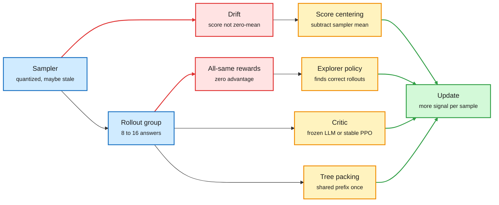

# Media Zone | 2026-11-01

> Three weeks of feeds say the same thing from different corners: the expensive part of RL is now the sample, and every serious group is trying to make each rollout count for more.

This page covers the evening of 11 October to the night of 31 October. Capture was off for most of that stretch. The X Following feed was recovered back to about 20 October, and 158 saved posts came in at once, some of them saved weeks ago. Items the 10-11 pages already covered (ThunderSyncRL, the openai-math Lean port, Harness Learning, PortSimEnv v1) are named only where something new was added.

## Today's signal

- Dominant story: off-policy correction in RL got a cheap, additive fix. Score centering is already in a vendor's public recipe.
- Pattern: "hard" RLVR prompts are often under-sampled, not unlearnable. Exploration is being moved into separate, disposable policies.
- Pattern: generation without tokens arrived from three directions: coarse-to-fine latent codes, JEPA "good views", and agents that think in latents between tool calls.
- Pattern: decision models moved from labels into control loops: streaming decisions, gates on agent actions, retrieval by navigation.
- Counter-signal: a 1,129-run architecture study says a modern hybrid has only about 2% of predicted loss left for architecture to remove.
- Quiet area: human cognition. A dopamine one-liner and a contagion model of AI dependence, nothing read in depth.

## Saved reading

158 posts were saved since the last page. About a third are viral tips threads with no new substance: model-switching tricks for Claude Code, "second brain" vaults, a reverse-engineering MCP pitched to traders, "500 agents that can't lie to me". They are listed in one line at the end. Everything else is below, written from the linked source. Where only the post or a figure could be read, the card says so. Cards are grouped by topic; the shorter saves follow each group.

### RL: making every rollout count

RL algorithms · abstract, figure, appendix table and an independent run read
<h4>Score centering: the cheap fix for sampler and trainer disagreeing</h4>

RL for language models samples with one engine (vLLM, often quantized) and trains with another, and the two assign slightly different probabilities to the same tokens. Martin Marek and Max Ryabinin (Together AI) argue the resulting instability is mostly drift: the policy-gradient score is zero-mean only under the distribution that sampled the data, so when sampler and trainer differ, even rewards that carry no information push the weights in a consistent direction, and the push accumulates every step. Score centering subtracts the expected score under the sampler at each prefix, which restores the zero mean without importance weights. In their Figure 1 (Qwen3-30B-A3B-Base on INTELLECT-2 maths, sampler quantized to INT8 weights and INT4 KV cache) most correction methods collapse while score centering keeps climbing. River's custom-loss blog reproduced the idea on top of CISPO with Qwen3.6-35B-A3B and four steps of staleness: 61.1% held-out correctness at iteration 140 against 0% for CISPO alone.

<strong>Mastery lens:</strong> the 10-11 recipe essay listed score centering as a component. Now there is a paper, an appendix table that places TIS, CISPO, IcePop, PPO, DAPO, GSPO, TOPR and DPPO on one grid, and one outside reproduction. The open question, raised by Yichuan Wang: under staleness the method estimates the covariance of reward and score under the old policy, not the current one.

<a href="https://x.com/nrehiew_/status/2110948202853826853">Saved notes</a> · <a href="https://river.ai/custom-losses">River run</a> · <a href="https://x.com/natolambert/status/2116271281351881120">Appendix table</a> · <a href="../../reinforcement-learning/2026-11-01-score-centering.md">Wiki summary</a>

RLVR · X Article read in full
<h4>Unlearnability in RLVR: measure your hard prompts with 256 rollouts, not 8</h4>

Collinear trained Qwen-2.5-0.5B with GRPO for 100 steps on 8,139 MATH problems (8 attempts per prompt, 1,024 prompts per step, two seeds) and then measured every prompt with 256 rollouts. Of the prompts the base model solved under 10% of the time, 35% never crossed 10% after training, and the split is bimodal. The stuck set is reproducible: 94.9% of difficult prompts end the same way in both seeds. Starting difficulty ranks the outcome with an AUC of 0.60 at 8 rollouts and 0.83 at 256. About 20% of prompts the base model never solved in 256 tries still got learned. The best predictor is whether correct answers pile up in one training group: among base-unsolved prompts, those that reached 2 of 8 correct within the first 20 steps were learned 83% of the time.

<strong>Mastery lens:</strong> GRPO's advantage is zero when every reward in a group is equal, so a prompt learns only when a group contains a mix. "Unlearnable" partly means "never got a mixed group". Pass-rate filters that drop zero-pass prompts throw some of these away. An appendix found about 10% of stuck prompts were parser artifacts.

<a href="https://x.com/CollinearAI/status/2115142609542988286">Article</a> · <a href="../../reinforcement-learning/2026-11-01-rlvr-unlearnability-and-exploration-distillation.md">Wiki summary</a>

RLVR exploration · abstract and introduction read
<h4>Exploration-Distillation: let a disposable explorer take the risks</h4>

Adding a novelty bonus to RLVR should help a model find new strategies, but in practice it damages the model. The Columbia authors (Saif Punjwani, Micah Goldblum) give the reason: the verifiable reward checks a tiny slice of behaviour, so damage done elsewhere is invisible to the reward and never repaired. ExpDis trains one or more explorer policies with a novelty bonus, filters their trajectories for correctness and quality, and distils them into a separate student that is trained without the bonus. The rounds alternate. Across seven maths benchmarks and two model families it beats DAPO at the same wall-clock budget and scales better in pass@k. The overhead of the explorers was not visible in what was read.

<strong>Mastery lens:</strong> together with the card above, this is a clean story. Stuck prompts need correct rollouts, and the explorer is a way to manufacture them without letting the exploration damage the deployed policy.

<a href="https://arxiv.org/abs/2610.10536">Paper</a> · <a href="https://x.com/micahgoldblum/status/2110011142684709189">Author thread</a> · <a href="../../reinforcement-learning/2026-11-01-rlvr-unlearnability-and-exploration-distillation.md">Wiki summary</a>

Credit assignment · abstract read
<h4>LVRL: a frozen LLM as the critic</h4>

GRPO gives every action in a trajectory the same advantage, and training a separate critic for long agent tasks is costly and unstable. LVRL asks a frozen LLM, conditioned on the group's other trajectories as context, to estimate the value of each intermediate state. The estimates are calibrated with the known values at the start and the end, and the difference between consecutive values becomes a step-level advantage. A distillation variant, LVOPD, focuses teacher supervision on actions where the estimated value drops. Across 4B to 32B policies it beats GRPO and PPO, by up to 13.6 points on AppWorld and 8.6 on SWE-bench Verified, and takes BabyAI from total failure to 75.0%.

<strong>Mastery lens:</strong> in-context learning stands in for value-function training. Whether the frozen critic's errors are correlated with the policy's own blind spots is the obvious thing to test.

<a href="https://arxiv.org/abs/2610.15840">Paper</a>

Distillation · project page, abstracts and posts
<h4>Distillation, three findings: reverse the teacher, go semi-on-policy, know your target</h4>

<strong>RLRT</strong> (Microsoft Research and KAIST, NeurIPS 2026) starts from a known failure of self-distillation: a teacher that sees the solution never hesitates, so the student stops writing "wait" and "maybe". RLRT flips the signal on correct rollouts and upweights tokens the student chose against the teacher's prediction, with weight P_student / P_teacher, clipped. Code is open on veRL. <strong>Semi-OPD</strong> (NVIDIA internship) distils on offline rollouts from the initial student and beats on-policy distillation in 14 of 17 teacher-student pairs, by up to 13.6 accuracy points with up to 11.4 times faster training. On-policy helps only when teacher and student already overlap heavily in output tokens. A third post (Qi Di) gives the reason in one line: with several teachers, SFT's forward KL learns their arithmetic mixture, while OPD's reverse KL learns their normalized geometric mean.

<strong>Mastery lens:</strong> this continues the 10-09 thread where tuned SFT matched multi-teacher on-policy distillation at a fraction of the cost. "On-policy" is useful only where the teacher's supervision is still meaningful on the student's own text.

<a href="https://beanie00.github.io/self-distillation-analysis/rlrt/">RLRT</a> · <a href="https://arxiv.org/abs/2610.11291">Semi-OPD</a> · <a href="https://x.com/di_qiwei/status/2110525887125102888">Mixture vs geometric mean</a>

Critics are back · paper list with abstracts
<h4>The critic returns: EasyPPO, BPCO, AC2 and a week of "is the value function worth it"</h4>

Jasper Lu's saved list gathers recent work on making PPO's learned critic usable for LLMs. Best Practice Critic Optimization (NUS and Tencent) combines DPPO with value predictions bounded to the reward range and Monte Carlo value targets. EasyPPO (Berkeley and Princeton) titles its finding "stabilizing the critic is key". Stanford's "Trust the Critic More" introduces AC2, actor-critic with action chunking, which uses the critic to avoid rolling every trajectory out to its terminal reward. Base Labs' newsletter asked the same question from the cost side: is it worth spending compute on a value function, or on more rollouts?

<strong>Mastery lens:</strong> GRPO dropped the critic because LLM critics were unreliable. With LVRL above, there are now two routes back to step-level credit: train a stable critic, or borrow one from a frozen model.

<a href="https://x.com/lu__jasper/status/2110776316387848254">Saved list</a> · <a href="https://arxiv.org/pdf/2609.39247v2">AC2</a> · <a href="https://x.com/baselabs/status/2116278798463492166">Base Labs</a>

RL systems · posts read
<h4>Tree packing in TRL's AsyncGRPO: 26 times less trainer compute on agentic RL</h4>

GRPO starts G rollouts from the same prompt, and forked multi-turn rollouts share most of their history. Ordinary sequence packing still runs those shared tokens once per sample. Tree packing stores the rollouts as a prefix tree and runs each unique token once, while each token keeps its own target, advantage and old log-probability. The shipped version is a single FlashAttention-3 variable-length call. On an agentic RL run on the MiMo environments it reached the same reward with 26 times less trainer compute, and when there is nothing to share it costs about 1%.

<strong>Mastery lens:</strong> a pure systems gain with no change to the estimator, like ThunderSyncRL on 10-11. It does not touch the 10-11 prediction about gradient streaming, which is still unmet.

<a href="https://x.com/DirhousssiAmine/status/2110642116716351663">Post</a> · <a href="https://x.com/_lewtun/status/2110647508711964871">Lewis Tunstall</a>

RL data · diagram read
<h4>The task-factory loop behind RL environment companies</h4>

The saved diagram is a loop with one stated goal: produce tasks the model under test solves 25 to 50% of the time. A generator model writes a task (code before the prompt, the prompt, tests, a reference implementation). A verifier checks that the starting code runs, that tests fail before the fix and pass on the reference, and a verifier model checks that the tests measure what the task claims. Verified tasks go to the model under test, a grader runs the tests, and the solve rate plus the verifier's rejections go to an improver model that edits the generator's prompt. Tasks in the target band become "frontier tasks". The poster calls it the algorithm behind every RL data company.

<strong>Mastery lens:</strong> the 25 to 50% target is exactly the band where the unlearnability article says GRPO learns fastest. The factory is a curriculum generator aimed at mixed groups.

<a href="https://x.com/michaelrbock/status/2115589801491800474">Saved post</a>

**Shorter saves in this group.** *Base models can reason by taking a cue from training data* (Sophie Wang, Efros lab): two opening tokens bring a base model's reasoning close to its RL-trained version, the cues come from training-data associations, and RL makes effective cues more likely; her saved blog is on how the paper was storyboarded ([cues](https://sophielwang.com/cues), [blog](https://sophielwang.com/blog/paper-writing)). *Understanding LLM parameter update sparsity through the lens of Fisher* (UIUC): only the title page was readable; a reposter summarizes it as "sparsity comes from on-policy" ([post](https://x.com/YouJiacheng/status/2110588377473122351)). *Reward hacking in dictated parameters*: let the model hack during RL but route that behaviour into chosen parameters, then disable them at deployment; post only ([post](https://x.com/_jake_ward/status/2112264244767211854)). *Training language models to fail gracefully*: post only ([post](https://x.com/amuseddaman/status/2111086531762868558)). *Grading a planning prefix* to shorten long rollouts: post only ([post](https://x.com/danyulol/status/2115115164173308148)). *"Purely on-policy RL is incredibly sample-inefficient"* for long-horizon agents, a researcher scaling on Tinker and Prime Intellect; promise of a method, no source ([post](https://x.com/SOURADIPCHAKR18/status/2115592195591860294)). *A sampler on a different precision is just off-policy*, so rollouts can use any accelerator if correction is in place; post only ([post](https://x.com/whatthelukh/status/2110090514519466151)).

### RL environments and the data business

RL environments · priority account · read in full
<h4>AirOpsEnv: three agent desks run an airline through a real storm day</h4>

The FineEnvs simulation series moved from ports to airlines. AirOpsEnv, built by Edgar Arakelyan at Scale AI with a licensed pilot, Ariel Gutman Stein, rebuilds JFK and Boston operations from public flight records, FAA advisories and weather reports. Three agents (operations, crew, customer) have different tools and must ask each other for changes, and the environment executes and audits the day. In one recorded run GPT-6.1 Sol holds a departure three minutes to save three connections, makes 24 crew moves and 31 holds, and scores 0.795, with 29.4% lower cost than standard crew practice. On v3, GPT-6 Astra (0.742) and GPT-6.1 Sol (0.721) lead with overlapping intervals, and Sol's three-desk run beats its one-agent run by 0.044 at about twice the compute.

<strong>Mastery lens:</strong> the reward is a gap to a best-known hindsight plan, not a proven optimum, and 24 of 168 v3 runs beat it. The article is clear that the comparison does not isolate the value of communication.

<a href="https://huggingface.co/spaces/FineEnvs/simulation-rl-environments#airopsenv-three-desks-one-storm-day">Article</a> · <a href="https://x.com/adithya_s_k/status/2113569242062713167">Post</a> · <a href="../../reinforcement-learning/2026-11-01-airopsenv-simulation-rl-environments.md">Wiki summary</a>

RL for subjective rewards · priority repost · about half read
<h4>Can you RL design taste into a model? Yes, and it will be the judge's taste</h4>

Jasper Lu trained Qwen3.8-27B (LoRA rank 32, GRPO with a CISPO loss, asynchronous with staleness 1) on Xiaomi's open MiMo webdev environments twice, once judged by GPT-6 Sol and once by Claude Sonnet 5.5. The reward mixes brief fulfilment with a relative "which of these eight pages clearly stands out" pick. Both judges preferred longer pages early, so pages grew from about 41k to over 140k characters and most rollouts hit the token limit mid-run, before the "no page delivered" penalty pulled them back. At the end the Sol-trained model makes "wackier" pages with broken layouts and the Sonnet-trained one makes classic Claude-style editorial pages. Both are mode-collapsing. Head to head, both judges prefer the Sonnet-trained model (+44% under Sol, +60% under Sonnet).

<strong>Mastery lens:</strong> a judge reward is a style prior with a length bias, and RL finds both. The post's sections on designing a better judge and on generalization were not read.

<a href="https://jasperlu.com/blog/rl-design-taste/">Blog</a> · <a href="https://x.com/lu__jasper/status/2115832035789168652">Post</a> · <a href="../../reinforcement-learning/2026-11-01-rl-for-design-taste.md">Wiki summary</a>

Infrastructure · priority repost · post read
<h4>OpenEnv moves to the Linux Foundation</h4>

Hugging Face is handing OpenEnv, the environment interface the FineEnvs series runs on, to the Agentic AI Foundation (AAIF) under the Linux Foundation for neutral governance. The committee lists Hugging Face, Microsoft, Reflection, Meta-PyTorch, Fleet, Mercor, RadixArk, Nebius, Modal, Prime Intellect and Unsloth. The post frames RL environments as part of the open stack that teaches agents real-world capabilities.

<strong>Mastery lens:</strong> a shared interface owned by no single lab makes environments portable between trainers. It does nothing yet for the audit gap the 10-09 digest flagged.

<a href="https://x.com/ben_burtenshaw/status/2113298265857007801">Post</a>

**Shorter saves in this group.** *PortSimEnv v2 to v5* (Scale AI): the port week unfolds watch by watch, with pilots, tugs, real ECMWF forecasts and shipping-line agents that answer back; on v5 asking the ships for arrival times is what scores (0.55 against 0.24), Claude Opus 5.5 and GPT-6 Astra lead at 0.857 and 0.851, and Qwen3.8-27B finds a valid plan in 1 of 60 weeks ([article](https://huggingface.co/spaces/FineEnvs/simulation-rl-environments)). *Role-based access in AgentEnv*: enterprise environments where the PM cannot read the SRE's channel ([post](https://x.com/earakely/status/2109719691023491319)). *ScottWuMath*: a solver-checked card-arithmetic environment with 4,000 training and 200 test deals ([Space](https://huggingface.co/spaces/FineEnvs/ScottWuMath)). *rl-env-use* (Browser Use): describe a skill in one line and get a verified environment built from real cases; post only ([post](https://x.com/browser_use/status/2112767614468694286)). *AnomalyXL* (Prime Intellect resident): a synthetic long-context time-series environment; a 4B model trained on it calls sub-agents to localize anomalies across 131k points and transfers zero-shot to ECG and sleep data ([post](https://x.com/PrimeIntellect/status/2110140807399494118)). *74k usable RL environments* found in the wild by a scrape ([post](https://x.com/xdotli/status/2109878862838661383)). *Who Sells Data*: a sourced directory of 174 RL and data vendors ([site](https://whosellsdata.com)). Opinion, worth one line each: small RL shops are like quant firms whose edge decays once models solve their tasks ([post](https://x.com/swill1ams/status/2109858744087564288)); RL tasks have cross-talk, so a hackable finance task can teach habits that matter in medicine ([post](https://x.com/danielrupawalla/status/2109737063256084983)); verifier design has the most headroom ([post](https://x.com/RajeswarSai/status/2109664409228316890)); Clem Delangue asks researchers to share environments ([post](https://x.com/ClementDelangue/status/2109673788971405497)). Hud's "what is a good task" blog did not load.

### Architectures and reasoning in latent space

Generation · abstract, repo and overview read
<h4>Next-Concept Modeling: generate a sketch of the whole text, then the details</h4>

Stanford's Hazy Research and Together AI train a multiscale residual VQ-VAE (a tokenizer that encodes a whole sequence as a stack of discrete code levels, each correcting what the coarser ones missed). A transformer then generates the levels in order, coarse first, with every code inside a level predicted in parallel, and a decoder turns the finished stack into text. Early levels are short, so early passes are cheap. At matched size it is 21 times faster than the strongest diffusion LM on LM1B with better generative perplexity, 10 times faster on OpenWebText, 31 times faster on XSum at equal ROUGE-L, and it beats autoregressive and diffusion baselines on Sudoku. The posts add 3 to 5 times fewer training tokens. Limits: experiments reach 725M parameters, each task has its own tokenizer, and the release has checkpoints but no training pipeline.

<strong>Reasoning-project lens:</strong> a model that commits to a global plan in a compressed code before any words exist is close to "decide in concepts, then verbalize". The overview warns that "concept" here means whatever the coarse levels store, not a named semantic unit.

<a href="https://arxiv.org/abs/2610.14162">Paper</a> · <a href="https://github.com/HazyResearch/ncm">Code</a> · <a href="../../models-architectures/2026-11-01-next-concept-modeling.md">Wiki summary</a>

Looped models · overview read
<h4>Scaling laws for looped mixture-of-experts</h4>

Looping (reusing a block of layers several times) adds depth without parameters; mixture-of-experts adds parameters without active compute. Meta's Loop Scaling Laws model both: the benefit of each extra pass is bounded and saturating, and its ceiling rises with sparsity, because a looped MoE can route different passes to different experts. The sparsity-conditional law predicts held-out loss better than an unconditional one (RMSE 0.0047 against 0.0075 on held-out expert counts). At matched training compute of about 1.5×10²² FLOPs, a law-chosen 5-loop MoE (0.3B active, 1.3B total, about 3T tokens) matches a 0.6B-active, 2.9B-total MoE on a BBH and GSM8K mean (36.5% against 36.35%). It pays 1.8 times the inference compute and trails on the 14-benchmark mean (46.9% against 50.2%).

<strong>Mastery lens:</strong> loops trade training data and parameters for inference compute. The honest headline is the last sentence.

<a href="https://www.alphaxiv.org/abs/2609.40316">Paper overview</a> · <a href="../../models-architectures/2026-11-01-how-to-loop-your-transformer.md">Wiki summary</a>

Latent reasoning · abstract and overview opening read
<h4>Hybrid Reasoning Agents: think in latents, speak in text only to use a tool</h4>

Latent reasoning (thinking in hidden vectors instead of written tokens) is cheap but cannot call tools, which need text. Stanford's HybridAgent switches between the two inside one generation. A small module, HybridLink, handles the transition, and a continuous working memory keeps the hybrid context across turns. Training has two stages: HybridSFT teaches the backbone to work with HybridLink, then HybridRL learns when to think in latent space and when to act in text. Across 11 benchmarks and three scales it reports 10.4% better performance than text and latent baselines with 35.5 to 54.7% fewer tokens and 1.8 to 2.6 times faster inference.

<strong>Reasoning-project lens:</strong> this is the first item in the wiki where a policy is trained with RL to decide when to leave concept space and enter language. That decision is a System 1 choice about a System 2 medium.

<a href="https://www.alphaxiv.org/abs/2610.18861">Paper overview</a> · <a href="https://x.com/omarsar0/status/2110488828062675096">Post</a>

Recursive reasoning · abstract and project page read
<h4>GRAM: recursive reasoning with more than one answer in mind</h4>

Recursive reasoning models (HRM, TRM, looped transformers) refine a latent state with a shared transition, but they are deterministic: the same input always follows one trajectory to one answer. GRAM (KAIST, Mila, NYU, with Yoshua Bengio; NeurIPS 2026) samples each recursion step, so reasoning becomes a stochastic latent trajectory trained with amortized variational inference. That allows several hypotheses, scaling by width (parallel trajectories) as well as depth, and unconditional generation from the same model. With 10M parameters the authors' post reports 97.0% on Sudoku-Extreme against 87.4% for TRM, 52.0% on ARC-AGI-1 and 11.1% on ARC-AGI-2.

<strong>Reasoning-project lens:</strong> a slow reasoner that keeps alternative explanations alive is closer to abduction than one that converges on a single attractor.

<a href="https://arxiv.org/abs/2605.19376">Paper</a> · <a href="https://ahn-ml.github.io/gram-website/">Project page</a>

Length generalization · paper abstract read
<h4>Recurrent Looped Transformer: state tracking needs depth that grows with the input</h4>

A transformer applies the same depth to every token however long the sequence is, so tasks that need one state update per input (parity, permutation tracking) run out of computation. Princeton and Penn's RLT splits eight layers into a parallel causal encoder and a recurrent decoder that merges the encoder output with the previous token's final decoder state. Trained on at most 40 bits, two splits solve 256-bit parity in every seed while the transformer stays at chance. On permutation tracking at eight times the training length it reaches 97% against under 1%. Remove the feedback and both fall to chance.

<strong>Mastery lens:</strong> the 10-09 digest listed this paper as "synthetic tasks only". It still is, but the ablation makes the mechanism unambiguous.

<a href="https://arxiv.org/pdf/2610.07591">Paper</a>

Training kernels · abstract and project page read
<h4>FlashMask-3: attention masks that survive context parallelism</h4>

Packed long-context training uses structured masks (document, prefix-LM, sliding window, block-sparse), and under multi-node context parallelism the mask itself becomes the bottleneck. FlashMask stores a mask as four boundary vectors per column, O(n) instead of O(n²). Baidu's third version adds a Hopper kernel on FlashAttention-3's pipeline, shows that each rank can localize its part of the mask with zero communication, and adds a sparsity-aware load balancer. The project page reports an 82.6% mean throughput gain over FlashMask and up to 3.71 times Megatron's ring context parallelism. NeurIPS 2026.

<strong>Mastery lens:</strong> relevant to agentic RL, where tree packing (above) creates exactly these irregular masks.

<a href="https://arxiv.org/pdf/2610.17901">Paper</a> · <a href="https://github.com/PaddlePaddle/FlashMask">Code</a>

**Shorter saves in this group.** *Soft MTP interview*: a two-hour conversation with Jayden Teoh on biasing a transformer toward predicting its own next hidden state; the paper is a Deep Dive in today's digest ([post](https://x.com/yacinelearning/status/2115095038979960957)). *Quotient Recurrent Reasoner*: lets symmetry-driven rotations of the latent persist while task-relevant dynamics converge, 97.9% on Sudoku-Extreme with 78% fewer loops; post only ([post](https://x.com/psmiziz/status/2110747531147919785)). *What does a discrete diffusion model learn?*: a NeurIPS DiffuLM workshop oral; post only ([post](https://x.com/rodcasnog/status/2110785067022958648)). *ReplaySSM*: caching an SSM's inputs instead of its state now runs in production for GLM-5.3-Flash and Kimi-K3, ships in TensorRT-LLM, vLLM, FlashInfer and SGLang, and speeds up decoding up to 1.47 times and speculative decoding up to 2.1 times ([post](https://x.com/_albertgu/status/2109744837432095077)). *Looped transformer reading list* (Turing Post): ten papers, list only ([post](https://x.com/TheTuringPost/status/2112098054837002526)). *Generative Representation Learning for latent tokenization* (Stanford, advised by Li Fei-Fei): ImageNet FID 2.36 to 2.18 at similar compute ([overview](https://www.alphaxiv.org/abs/2610.20533)).

### World models, discovery and machine science

World models · abstract read
<h4>RSI-Anything: use a world model to choose which experiments are worth running</h4>

Built on JEPA-Anything (the factorized world model noted on 10-09), RSI-Anything predicts the outcome of candidate actions before running them and spends real feedback only on the promising ones. Observed results update the policy or workflow and, when predictions turn out wrong, the world model itself. Updates are kept only if component and compatibility checks pass. In code repair with a fixed coder, success rises from 26.3% with a static verifier to 29.2% with predictive selection and 31.2% after world-model adaptation. In reaction optimization it reaches a 96.15% mean best yield against 82.16% for Bayesian optimization on the same 40-experiment budget.

<strong>Reasoning-project lens:</strong> this is "a slow system that reasons over a world model" applied to choosing experiments, the open problem Memento 3 (10-11) left: which test best separates hypotheses.

<a href="https://arxiv.org/abs/2610.13912">Paper</a> · <a href="https://github.com/Gen-Verse/RSI-Anything">Code</a>

Machine discovery · abstract and author thread read
<h4>DiscoveryRSI: train only on the research steps that actually helped</h4>

DiscoveryRSI defines a hypothesis as a claim plus an investigation plan, decision criteria and alternative explanations, and calls it valuable if resolving it would change a research decision. Agents grow hypothesis trees by evolving, repairing, crossing over and restarting, and selected plans compile into executable Harbor tasks. Blinded TrueSkill assessments assign credit to the steps that contributed, and DiscoveryRSI-27B is fine-tuned only on those steps (2,397 of 15,792 trajectories kept, 2.12% of tokens supervised). Over two rounds hypothesis quality rises from 4.86 to 5.39, falsifiability from 4.00 to 6.20, and restarts fall from 21.7% to 5.0%. Importance and novelty dip slightly: the model learns to test better, not to ask bolder questions.

<strong>Reasoning-project lens:</strong> credit assignment over a research trajectory is abduction treated as an RL problem. The caveat about novelty is the interesting result.

<a href="https://arxiv.org/abs/2610.23839">Paper</a> · <a href="https://github.com/Gen-Verse/DiscoveryRSI">Code</a>

Automated research · abstract and blog opening read
<h4>The Agentic Scientist (Sakana's AI Scientist v3)</h4>

Sakana's diagnosis of coding agents handed a research problem: they become strong hyperparameter optimizers, with narrow ideas and unexamined gains. v3 wraps off-the-shelf coding agents in a scaffold that splits research into task drafting, ideas, planning, sandboxed experiments, aggregation, baseline and ablation construction, analysis and writing, with a meta-controller running parallel workers and rubric checks at each stage. Isolated agents build controlled baselines and ablations to show why an idea works. Used as a co-scientist, a development version helped find a biologically plausible alternative to backpropagation ("Error Diffusion"), accepted as an ALIFE 2026 oral.

<strong>Mastery lens:</strong> "Scaling Discovery Requires Forgetting", saved in the same week, attacks the other failure of long autoresearch runs: they stop improving early, and the proposed fix is forgetting. Post only.

<a href="https://arxiv.org/abs/2610.18933">Paper</a> · <a href="https://pub.sakana.ai/agentic-scientist/">Blog</a> · <a href="https://x.com/ShangyinT/status/2110771398209863821">Forgetting</a>

**Shorter saves in this group.** *DINOv3 learns word meaning from images alone*: the two largest DINOv3 models organize rendered words by meaning, with country-capital offsets like text embeddings, despite image-only training; it sits beside today's Platonic Representation Deep Dive ([paper](https://arxiv.org/abs/2610.13252)). *Memorilla*: 16 query-dependent memory tokens placed in a frozen LLM's input space beat full-context inference on FactKG (84.33% against 80.43%) with 108 times fewer tokens for the source documents ([paper](https://arxiv.org/abs/2610.21375)). *ResearchTrails*: 13,271 research decisions mined from the commit histories of 599 NeurIPS code repositories, about 24% later replaced or dropped ([post](https://x.com/SuJinyan6/status/2110601958977609935)). *DeepRSI*: a benchmark where agents work 48 hours on ML tasks derived from ongoing proprietary research; post only ([post](https://x.com/jparkjmc/status/2109684519896780938)). *FrontierML*: agents given money to spend on scaling model performance across 21 end-to-end ML tasks; post only ([post](https://x.com/induction_labs/status/2110059300651679969)).

### Decision models

Decision models · article read in part
<h4>How to use decision models for evals: don't keep the 0.5 threshold</h4>

Hamel Husain and Antaripa Saha tested Jev 1.13, Perplexity Decider 1.1 27B, Liquid d1 and d1-ultra, Cloudflare Clef Flash and OpenAI Decisions on 100 labelled traces from an apartment-leasing agent, asking each for the probability that a trace contains a failure. The core lesson is about thresholds: a model that gives every failure 0.40 and every pass 0.10 is perfect at 0.30 and useless at the default 0.50. Tune the threshold on your data for the precision and recall your use case needs, then compare cost. The per-model results were past what was read.

<strong>Mastery lens:</strong> threshold tuning is calibration done downstream. It is also the cheapest answer to the 10-11 finding that Jev is overconfident.

<a href="https://x.com/HamelHusain/status/2112588257104216294">Article</a>

Decision models in retrieval · abstract and explainer read
<h4>DecisionRAG: retrieval by walking a table of contents</h4>

Similarity search decides what an LLM can ever see: a passage outside the top-k is gone. Cornell and ASAPP's DecisionRAG replaces it with navigation. Documents sit in a tree, and a decision model (Jev 1.13) reads the query beside every candidate branch and answers "is this relevant?" for all of them in one forward pass, keeping the best few and opening only those. Without task-specific training it beats dense retrieval plus an 8B reranker by 13.8 R@1 points on MultiDoc2Dial and 17.4 Hit@1 on Natural Questions (2.68M Wikipedia paragraphs). The explainer notes the gain is ranking, not coverage, and that the Wikipedia tree was built offline with embeddings.

<strong>Mastery lens:</strong> judging candidates in one shared context makes their scores comparable, which separate reranker calls do not.

<a href="https://arxiv.org/abs/2610.35868">Paper</a> · <a href="https://x.com/akshay_pachaar/status/2116543279563259995">Explainer</a>

Decision models in production · blog read
<h4>Jev-driven SRE diagnosis with no LLM agent</h4>

SREGym's team removed the LLM agent entirely. A programmatic collector reads Kubernetes objects, events, logs and resource use, groups them by component, and Jev chooses where to look, then whether a component is the origin, a downstream victim or unrelated, and which numbered evidence supports that. Jev never writes commands or the report. Across 21 SREGym-Lite faults the pipeline passes 80 of 105 diagnoses (76.2%) with a median of 14.6 seconds per diagnosis.

<strong>Mastery lens:</strong> with "You may not need an agent after all" (Parcha's founder: 20 compliance documents in about 20 seconds for about two cents, 19 right, with thresholds tuned on those same 20), this is the "workflow plus decider" pattern replacing open-ended agents where the steps are known.

<a href="https://www.sregym.com/blog/jev-driven-sre-diagnosis">Blog</a> · <a href="https://x.com/MiguelriosEN/status/2116236531908354193">Parcha article</a>

Inference for classification · blog read in part
<h4>Quail: to classify, try a trie</h4>

Shreya Shankar and Charles Frye show how an AI-SQL engine should run <code>AI.CLASSIFY</code> when it controls its own inference engine. Free generation is wasteful and can return invalid labels. Quail picks among three restricted methods by estimated cost: greedily decode only valid label paths through a trie, score all labels at once with a trie-shaped attention pass, or put one letter per label and score a single token. It keeps the document's KV cache for later operators. On 12 queries in QUAIL-B it is 1.8 times faster than a vLLM baseline.

<strong>Mastery lens:</strong> the "decision model" trick, done at the kernel and query-planner level on any LLM.

<a href="https://fsdatalab.github.io/blog/ai-classification/">Blog</a>

**Shorter saves in this group.** *Constrained Decoding Models*: a vendor family of single-task models (classify, extract, summarize) claiming 77.2% on DecisionBench against Jev's 72% and $0.05 per million input tokens; launch post only ([post](https://x.com/neal_k_patel/status/2109978626124898587)). *Decision 3.0 on Core ML*: d3-lite triages 1,000 pull requests on an M5 Pro at 0.12 seconds each ([model](https://huggingface.co/FluidInference/d3-coreml)). *Beacon plus Jev*: a cross-harness memory layer where Jev decides which agent traces hold reusable lessons ([repo](https://github.com/Asymptote-Labs/agent-beacon)). *JevEval*: Jev as the judge inside DeepEval ([post](https://x.com/Sumanth_077/status/2109943079142863006)). *Papers with Code* added "decision model" as a method ([page](https://paperswithcode.co/methods/decision-model)). Several viral threads in this group ("let Jev run 95% of your workflow", "$5 will last a lifetime") repeat claims without new evidence.

### Harness, memory and self-improving agents

Harness self-improvement · abstract read · saved six times
<h4>Harness²: improve the harness at test time without a verifier</h4>

Google's Harness² keeps model weights fixed and edits the harness (prompts, tools, memory, skills, guardrails) in two loops. For the current task, a Propose-Probe-Compose step proposes several edits, runs old and new harnesses under the same conditions, and keeps the combination whose behaviour differs for the better, which needs no ground-truth verifier. A second loop extracts lessons from those edits into a harness the agent carries to future tasks. One step improves GLM-5 and Gemini 3.5 Flash in every configuration: up to 11.5 points on WorkBuddy-Bench, 4.5 on JobBench and 11.8 on LAB.

<strong>Mastery lens:</strong> RRSI, RSIHub and the verification study below all ask the same follow-up: do these gains survive on tasks the evolution never saw?

<a href="https://arxiv.org/abs/2610.14224">Paper</a> · <a href="https://github.com/google-research/harness2">Code</a> · <a href="../../agent-harness-routing/2026-11-01-harness-self-improvement-and-interfaces.md">Wiki summary</a>

Harness evaluation · abstract read
<h4>RSIHub: one test bench for agent self-evolution, and rankings that do not hold</h4>

Agent-evolution papers each rebuild their own execution, evaluation and search, so their gains are hard to compare. RSIHub supplies shared execution, evaluation, recovery and lineage, keeps evaluation outside what the method can change, and re-implements AHE, Hyperagents, A-Evolve and GEPA without touching its core. On Terminal Bench 2 the largest gain is 13.5 points of pass@1 (MiniSWE from 56.2% to 69.7%, per the saved summary). With Codex the best gain is 2.2 points, rankings change on τ³ Banking, and some gains disappear on held-out tasks.

<strong>Mastery lens:</strong> weaker scaffolds have more to gain, and a harness tuned on one split overfits like any other trained artifact.

<a href="https://arxiv.org/abs/2610.32253">Paper</a> · <a href="../../agent-harness-routing/2026-11-01-harness-self-improvement-and-interfaces.md">Wiki summary</a>

Verification in harnesses · abstract read
<h4>Where should a coding harness check its work? An independent reviewer wins on cost</h4>

Alibaba and Cornell compare 17 verification designs across seven frontier coding models at four points in an agent's life: initial instructions, mid-turn reminders, completion gates and independent review. Instructions and reminders give modest, model-dependent gains. Completion gates can help more but can be expensive. An independent critic gives the best trade: 5.9 to 9.5 points on Terminal-Bench at 1.13 to 1.25 times the baseline cost, and 3.9 to 6.6 on SWE-bench Verified at 1.00 to 1.04 times.

<strong>Mastery lens:</strong> DUET, saved the same week, adds that the grader should evolve with the agent, because the agent's failure modes change as it improves (grader agreement on GDPval 68.4% to 78.5%).

<a href="https://arxiv.org/abs/2610.34577">Paper</a> · <a href="https://academy.dair.ai/papers/duet-co-evolving-solver-and-grader-agen-2610.04087">DUET</a>

Agent memory · abstracts read
<h4>Memory, four results: a tax, a router, a backward pass and a tree</h4>

<strong>Memory tax</strong>: many dedicated agent-memory systems score below naive retrieval over the raw history, because reorganizing facts can also hide evidence. <strong>Routed Continual Learning</strong> (Meta FAIR): a single global history gains almost nothing on interleaved tasks, so experience is clustered and each cluster gets one memory system from a library, chosen by an LLM router; it recovers 15 to 30% of the attainable normalized reward over global in-context history at 65 to 72% lower cost. <strong>ReHarness</strong> (Meta and MIT) revises the reflections it retrieved after each instance, propagating feedback backward through the text state. <strong>TreeFlex</strong> (Meta) lets one RL-trained policy navigate a search tree of its own saved states: 54.9% on SWE-bench Verified against 43.3% for FoldAgent from the same 9B model.

<strong>Mastery lens:</strong> memory is being treated as a learned routing and credit-assignment problem, not as storage.

<a href="https://arxiv.org/abs/2610.34073">Memory tax</a> · <a href="https://arxiv.org/abs/2610.38796">Routed CL</a> · <a href="https://arxiv.org/abs/2610.12668">ReHarness</a> · <a href="https://arxiv.org/abs/2610.20334">TreeFlex</a>

KV cache for agents · abstract read
<h4>Cache engineering: let the agent drop and re-position its own KV cache</h4>

Trimming or summarizing an agent's history invalidates the cached keys and values that follow, so the retained context has to be re-prefilled. Cache engineering gives the agent two operations instead: drop (exclude chosen cache entries from future attention) and repos (shift retained keys' positions). Identical token sequences can then have different cache states, so prefix matching is no longer enough for reuse, and the AKV serving engine manages that internally behind a stateless API. A rolling drop of old tool responses improves average scores by 1.7 points and cuts cost 27.7% against summarization, and self-improving the cache policy saves another 7.1%.

<strong>Mastery lens:</strong> a work-side item with a training-side twin: the policy that decides what to forget is learnable.

<a href="https://arxiv.org/abs/2610.28577">Paper</a>

**Shorter saves in this group.** *LongHarness*: separates evidence from evolving conclusions so unresolved conclusions steer retrieval; GLM-5.3-Flash on OfficeQA Pro V2 goes from 4.4% to 61.1% exact match ([paper](https://arxiv.org/abs/2610.13075)). *Seven building blocks in 11 coding agents* (Wavestone): loop, LLM layer, tools, memory, safety, orchestration, extensions; via a summary post ([post](https://x.com/Arindam_1729/status/2114026631941574741)). *UPenn: one agent versus a team of three* on about 7,950 support chats; the team lost 12 of 13 comparisons by 28 points on average, spending its budget talking to itself; via a summary article ([post](https://x.com/undefinedKi/status/2113005033164050608)). *Cohere: scaling multi-agent teams for long-horizon software engineering*: links saved, body not read ([post](https://x.com/Cohere_Labs/status/2110385342952116597)). *Unsupervised failure attribution*: train only on successful trajectories, then locate the failing step (NeurIPS) ([paper](https://arxiv.org/abs/2607.12747)). *Agent traces* patterns across sessions and processes ([article](https://x.com/JoshARosen/status/2109649928276341191)); *Build your eval harness*: a shoe-store bot that passed its five test questions passed 33 of 60 real ones ([article](https://x.com/tonycueva/status/2115089591824744957)); *SuperPlane 1.0*, an open "factory" that runs coding agents through Backlog, Implement and Verify ([article](https://x.com/Arindam_1729/status/2115546145040822422)); *Modal: serving trillions of tokens for trillion-parameter coding agents*, saved, not read ([blog](https://modal.com/blog/trillion-tokens-trillion-parameters)).

### Safety and interpretability

Interpretability of concepts · abstract read
<h4>ICA Lens: interpretable directions are the non-Gaussian ones</h4>

Project natural-text activations onto a sparse autoencoder's feature directions and the distribution is far more non-Gaussian than along random directions: a concentrated background with recurring patterns in one tail. So search for non-Gaussian directions directly, with independent component analysis, and skip training a dictionary. Across GPT-2 Small, Gemma 2 2B and Qwen 3.5 9B Base the ICA directions are competitive with public SAEs on interpretability, reconstruction, concept prediction and steering, fit in minutes per layer, and use 7 to 43 times less memory. The authors also found a bug in an influential early SAE paper's evaluation that had underrated ICA.

<strong>Reasoning-project lens:</strong> how models carve concepts matters for any concept-space reasoner, and here a decades-old statistical signature finds them.

<a href="https://arxiv.org/abs/2606.11722v2">Paper</a>

**Shorter saves in this group.** *Personas in a pre-internet language model*: emergent misalignment, subliminal learning and personality evals rerun on Talkie, a 13B model trained only on English written before 1931; post only ([post](https://x.com/DavidDAfrica/status/2109986030518686117)). *"Large Language Models as a Cognitive Virus"* (Tufts and the Santa Fe Institute, with David Krakauer and Michael Levin): models AI dependence as contagion with a tipping point, because independent thinking also spreads socially; post only ([post](https://x.com/alex_verem/status/2110310403490336797)).

**Industry saves.** Modal raised a $750M Series D at a $15.75B valuation and is hiring for a new research team in RL ([post](https://x.com/rasoolfa/status/2110420149874618529)). Prime Intellect acquired Moondream ([post](https://x.com/samsja19/status/2110086649824833630)). Ultramarine 1 Flash claims Fable-5-level knowledge work, post-trained by five people for about $300k ([post](https://x.com/willcb/status/2110407932344971362)). Mercor's Benchmark Map finds 208 of 923 US occupations covered by an AI benchmark ([map](https://www.mercor.com/research/labor-index/benchmark-map/)). A Bengaluru robotics startup is hiring founding engineers in robot learning ([form](https://binary.so/nJCcTPO)).

**Viral threads, not written up.** Model-switching "advisor" tricks for Claude Code (six saves), Karpathy-style second-brain vaults (four), "REA" reverse-engineering MCP (two), "300 or 500 agents that can't lie", "the end of loop engineering", the Claude Code cost-router lists, and Turing Post's weekly lists.

## RL, training, architectures, decision models, world models, cognition

### Making every rollout count

The dominant cluster, and the anchor of this page. Four separate lines of work all ask how to get more learning out of each sampled trajectory.

Four places a rollout's value leaks out

Each amber box is a fix from this window. The red boxes are where signal was being lost.

Blue is data, red is where learning signal is lost, amber is this window's fixes, green is the update.

- Score centering removes the drift from sampler mismatch; River already ships it on top of CISPO.
- "Unlearnable" prompts mostly lack groups with mixed rewards; re-measure before filtering.
- Critics are back: frozen-LLM values (LVRL), stable PPO critics (EasyPPO, BPCO), action-chunked actor-critic (AC2).
- Counter-signal: a researcher on Tinker and Prime calls purely on-policy RL too sample-inefficient for long-horizon agents.

[@nrehiew_](https://x.com/nrehiew_/status/2110948202853826853) · [@natolambert](https://x.com/natolambert/status/2116271281351881120) · [@YichuanM](https://x.com/YichuanM/status/2116372679439872249) · [@CollinearAI](https://x.com/CollinearAI/status/2115142609542988286) · [@baselabs](https://x.com/baselabs/status/2116278798463492166)

### RL environments: airlines, taste and governance (priority accounts)

- AirOpsEnv brings three coordinating desks and a real storm day to the FineEnvs series.
- Design taste via RL works, but the model learns the judge's taste and its length bias.
- OpenEnv moves to the Linux Foundation with eleven named committee members.
- Adithya Kolavi turned Scott Wu's card game into a solver-checked maths environment, and a live stream showed GPT-6 Astra running AirOpsEnv.

[@adithya_s_k](https://x.com/adithya_s_k/status/2113569248987779528) · [@earakely](https://x.com/earakely/status/2113717323299496025) · [@lu__jasper](https://x.com/lu__jasper/status/2115832035789168652) · [@ben_burtenshaw](https://x.com/ben_burtenshaw/status/2113298265857007801) · [@maximelabonne](https://x.com/maximelabonne/status/2115174534190129198)

### Training: mid-training to the frontier, and the free lunch in MTP

- Carbon-X: Hugging Face mid-trained a 14B Qwen3 base on 302B tokens of DNA and text, then SFT and RLVR.
- It averages 66.7% on five DNA benchmarks, near GPT-6.1 Sol's 67.5%, at about 1/1,800 the inference cost.
- Soft MTP: a one-line straight-through trick keeps only the useful part of the multi-token gradient.
- Stanford CS 312's edge-of-stability explainer: a 35M transformer settles 30% above the classical 2/η sharpness limit and keeps learning.

[@lvwerra](https://x.com/lvwerra/status/2113278666507485349) · [@MTSlive](https://x.com/MTSlive/status/2115907719576363015) · [@jayden_teoh_](https://x.com/jayden_teoh_/status/2116228700467302551) · [@darrowoah](https://x.com/darrowoah/status/2116270216460296448) · [Carbon-X summary](../../training-finetuning/2026-11-01-carbon-x-dna-midtraining.md) · [Soft-MTP summary](../../training-finetuning/2026-11-01-soft-multi-token-prediction.md)

### Architectures: the 2% that is left

- A 1,129-run study ("I tried every LLM architecture change since 2020") ranks fine-grained MoE and linear attention as the biggest wins.
- At equal serving cost a 2026 hybrid beats GPT-3 by a predicted 8.5%, and only about 2% of its loss is parameter-limited.
- Swapping in Muon buys about as much as a full round of architecture stacking.
- Meta's "How to Loop Your Transformer": loop the whole model when parameter-bound, a middle block when FLOP-bound.

[@nv_pavlichenko](https://x.com/nv_pavlichenko/status/2116154049217089946) · [@thecekbote](https://x.com/thecekbote/status/2116557960956580194) · [@gabriberton](https://x.com/gabriberton/status/2116598432236544219) · [@BlinkDL_AI](https://x.com/BlinkDL_AI/status/2116562107529630104) · [Ablation summary](../../models-architectures/2026-11-01-architecture-ablations-since-gpt3.md)

### Representations converge, if the views are good

- Balestriero and LeCun prove JEPAs trained separately on any modalities learn one representation up to a rotation, given "good views".
- Next-token prediction is a JEPA with bad views, which is why LLMs align with vision only through scale.
- A 109M text JEPA aligns with DINOv2 better than every LLM tested up to 72B. Phillip Isola's gloss: NTP is multi-view learning with bad views.

[@randall_balestr](https://x.com/randall_balestr/status/2116173210148601966) · [@phillip_isola](https://x.com/phillip_isola/status/2116261275311436031) · [Wiki summary](../../world-models-reasoning/2026-11-01-platonic-representation-theorem-jepa.md)

### Decision models leave the label and enter the loop

- RightNow's "System Zero" decides while input is still streaming in, about 30 ms for text.
- IBM's JevAct gates agent tool calls with code checks plus decision-model questions; Opus 4.6 on τ²-bench Telecom goes 39.5% to 80.7%.
- Practitioners report real use: a first-pass relevance filter over hundreds of thousands of items weekly.
- An alphaXiv-trained 4B decider matches Jev everywhere except sarcasm, per its post.

[@rightnowai_co](https://x.com/rightnowai_co/status/2116311411072835913) · [@omarsar0](https://x.com/omarsar0/status/2116547247018229999) · [@barrowjoseph via @antoine_chaffin](https://x.com/antoine_chaffin/status/2116291134594904427) · [@chrisalbon](https://x.com/chrisalbon/status/2116614196561633494) · [@askalphaxiv](https://x.com/askalphaxiv/status/2116199951835582507) · [@HaozeHe_Hector](https://x.com/HaozeHe_Hector/status/2114770631505883420) · [Wiki summary](../../decision-models/2026-11-01-decision-models-enter-the-loop.md)

### Cognition, thinly

- François Chollet: dopamine peaks at reward prediction error, not at guaranteed reward. A one-liner, no source.
- The "cognitive virus" contagion model above is the only human-side item with a model behind it, and it was read as a post.

## Harness, routing, inference optimization

### Harnesses that rewrite themselves, and the overfitting that follows

- Harness², RRSI and RSIHub: weights frozen, harness evolves; RRSI regularizes edits and keeps up to 4.3 points out of distribution.
- MCP versus CLI with identical capabilities: 94.3% of 2,004 paired episodes diverge in structure. Abstract only.
- Harrison Chase: everyone is converging on one agent architecture, an LLM in a loop with tools in a sandbox, and new context problems are emerging inside it.
- Practitioner pushback: cost-routing threads promise 40% savings on Claude Code; one counted the routing, not the quality.

[@richardxp888](https://x.com/richardxp888/status/2116548530999349493) · [@N01ennn](https://x.com/N01ennn/status/2116233378215411919) · [@hwchase17](https://x.com/hwchase17/status/2116553654857867330) · [@undefinedKi](https://x.com/undefinedKi/status/2116594043362877769)

### Inference: drafting while verifying

- JetSpec++ drafts the next block on a second GPU while the target verifies the current one: up to 7.45 times faster than autoregressive decoding on Qwen3-8B.
- Nemotron 3.5 Super VL adopts LLM-as-a-Verifier self-verification: Terminal-Bench 2.1 63% to 72%.
- A fully fused Zip-NeRF, written with Opus, trains in 36 minutes at the official quality.

[@haoailab](https://x.com/haoailab/status/2116240411530551435) · [@jackyk02](https://x.com/jackyk02/status/2110866069137277081) · [@fhahlbohm](https://x.com/fhahlbohm/status/2116204367099637803) · [JetSpec++ summary](../../inference-optimization/2026-11-01-jetspec-plus-plus.md)

## Industry and business

- OpenAI raised about $11B of a $30B target at $1.25T; Anthropic is reported to be pushing for a November IPO.
- Anthropic's automated red-teaming: Claude agents wrote harmless-looking fiction that taught small models misalignment past a production-style monitor.
- "Agentic Backdoors via Pretraining Poisoning": 0.1% poisoned pretraining data plants a command-execution trigger that survives SFT, DPO and RL.
- Lossfunk started Batch 9 of its residency; Batch 10 applications are open on a rolling basis.
- Conscious Engines' research team has tripled, with hybrid-architecture and on-device papers promised; its Bangalore Paper Club fills rooms of about 100.
- Hugging Face's Alignment Hub collects 120+ public incidents of models misbehaving and proposes a reporting template.

[The Decoder](https://the-decoder.com/openai-raises-just-11-billion-of-its-30-billion-target-as-big-investors-lose-their-ai-appetite/) · [@AnthropicAI](https://x.com/AnthropicAI/status/2116349211549843666) · [@SuJinyan6](https://x.com/SuJinyan6/status/2116318734700728746) · [@paraschopra](https://x.com/paraschopra/status/2115052847549341764) · [@Kautukkundan](https://x.com/Kautukkundan/status/2116484622079185203) · [@Thom_Wolf](https://x.com/Thom_Wolf/status/2114768834993213628)

## Also crossed your feeds

- Two Minute Papers on OpenAI's preprint claiming the Exponential-Time Hypothesis is false; the preprint was not read ([video](https://www.youtube.com/watch?v=CWdTBLsbaQs)).
- Hugging Face's video with Mistral on Mistral Large 4, an open-weight 1 trillion parameter multimodal MoE with 52B active that solves 93% of Cybench; description read, video not watched ([video](https://www.youtube.com/watch?v=FczbSauVvjw)).
- "LLMs That Write Well" (YC): the reward signals that improve coding and agentic work flatten voice and style, the business-side echo of the design-taste run above; description only ([video](https://www.youtube.com/watch?v=674Efd5Scfg)).
- Drew Breunig baked a NES 6502 emulator into Qwen3.5-4B's weights ([Simon Willison](https://simonwillison.net/2026/Oct/30/nesformer/)).
- RWKV-7 G1L, a pure RNN, released with an index of 46 agent projects ([post](https://x.com/BlinkDL_AI/status/2116562107529630104)).
- LlamaIndex's BooBench: 179 pages that push document parsers into repetition loops ([benchmark](https://www.llamaindex.ai/benchmarks/boobench)).
- An essay from the DeepMind Institute: AGI may arrive as societies of agents ([essay](https://institute.deepmind.com/essays/artificial-symbiotic-intelligence/)).
- Sharon Li's reflections for PhD students unsettled by AI-accelerated science ([blog](https://pages.cs.wisc.edu/~sharonli/time-in-the-chaos.html?v=13)).
