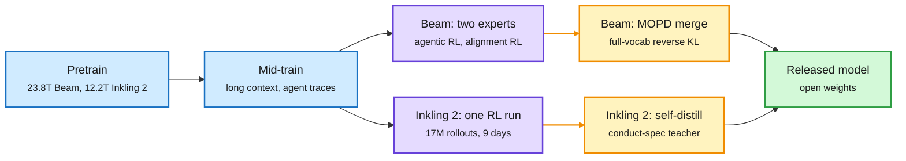

# Media Zone | 2026-11-08

> Two labs published how they finish a frontier model, and they disagree on the last step: merge separately trained experts, or run one joint RL job and skip the merge.

This page covers the week from 1 November to the evening of 8 November. The X Following feed was captured across the whole week (about 2,000 posts, ranked to 273 candidates), plus two newly saved posts. Items the 11-01 pages already covered (score centering, Carbon-X, the first harness adapters, Hamel Husain's decision-model evals) appear only where something new was added.

## Today's signal

- Dominant story: Reflection's 156-page Beam report and Thinking Machines' Inkling 2 Small post put two full open training recipes on the table in one week.
- Pattern: score centering is now inside three RL stacks (Inkling 2's StableReinforce, the s³ swarm trainer, River). The 11-01 fix is becoming default plumbing.
- Pattern: decision models learned to decide when to think. THX-02 runs a slow reasoning pass only when its fast read is unsure.
- Counter-signal: Inkling 2 dropped multi-teacher distillation for one joint RL run, the same week TRL shipped multi-teacher distillation as a feature.
- Quiet area: world models. One robot paper (DreamFree) and a LeCun comment thread, nothing read in depth on JEPAs.
- Surprise: "agents need sleep" arrived from both an Anthropic engineering post and Giulio Tononi on the same week.

## Saved reading

Two posts were saved this week. Neither carries a new paper.

Market signal · post only
<h4>RL environment engineers are "the most underpriced hire in data"</h4>

A recruiter's thread argues that people who have built RL environments in the last 18 months can "somewhat name your price": the role mixes software engineering, domain expertise and product sense, and vendors cannot find more than a handful. It is a claim, not data. It does line up with this week's evidence: Beam's team says it sourced nearly one million environments for one RL run, Hugging Face now builds environments automatically from shared agent sessions (Repo2RLEnvs, below), and CAMEL-AI's Eigent posted an RL-environment research internship.

<strong>Mastery lens:</strong> the scarce skill is not writing a grader but making a task that is neither always solved nor never solved, cannot be hacked, and still says something true about the capability. Every report this week spends pages on exactly that filter.

<a href="https://x.com/danhoyes03/status/2117255335144837170">Saved post</a>

Decision models · re-save, covered 11-01
<h4>How to use decision models for evals (Hamel Husain and Antaripa Saha)</h4>

The essay was written up on 11-01: tune the decision threshold instead of keeping 0.5, compare models at equal cost, and check calibration before trusting a probability. Nothing new was added since. It reads differently next to this week's THX-02 card, whose authors train with proper scoring rules precisely so that thresholding works, and next to Airbnb's production benchmark, which found that thresholding a fine-tuned 2B classifier beats rewriting a 2,700-word prompt for a frontier model.

<a href="https://x.com/ranaharshraj7/status/2117515136105898113">Saved post</a> · <a href="https://hamel.dev/blog/posts/decision-model-evals/">Essay</a> · <a href="../../decision-models/2026-11-01-decision-models-enter-the-loop.md">11-01 summary</a>

## RL, training, architectures, decision models, world models, cognition

### Two frontier recipes, written down

Same first steps, opposite finishes

Beam trains experts apart and merges them by distillation. Inkling 2 Small runs one joint RL job and never merges.

Blue is shared pretraining and mid-training, purple is RL, amber is the final distillation step, green is the release.

Training recipe · report sections 1 to 2.1 and blog read
<h4>Beam: Reflection's 501B open model, and a 156-page report on how it was made</h4>

Beam is a sparse mixture-of-experts model (MoE: each token runs through 8 of 256 experts per layer) with 501.3B total and 23.4B active parameters, pretrained on 23.8T tokens on 6,144 GB300 GPUs in under four weeks at 21% model FLOPs utilization. The architecture choices are all about keeping a large run stable: SandwichNorm, gated attention to kill activation outliers, and a new depth-scaled residual (DSRes) that divides the residual stream by the square root of the number of sublayers so its size stays flat with depth. The optimizer is AdamC, with weight decay that follows the learning-rate schedule down to zero. Post-training used one of the largest open RL runs reported: over 100M rollouts on up to 10.5K GB300s for four weeks, about 1.3 billion sandboxes, nearly one million environments, and stable learning even from rollouts 107 weight versions old. Two experts (agentic and alignment) were merged with multi-teacher on-policy distillation.

<strong>Mastery lens:</strong> the report claims capability "continued to improve as we increased RL compute, with no sign of a plateau", and that RL on reasoning, SWE and terminal tasks improved browsing that was never trained. Only the first 60,000 characters of the PDF (through the scaling method) were captured, so the RL algorithm itself was not read.

<a href="https://reflection.ai/documents/beam-model-tech-report">Report</a> · <a href="https://reflection.ai/blog/introducing-beam">Blog</a> · <a href="https://x.com/huiying_lii/status/2118864577744289906">Infra notes</a> · <a href="../../training-finetuning/2026-11-08-beam-and-inkling-2-recipes.md">Wiki summary</a>

Training recipe · launch post read in full
<h4>Inkling 2 Small: one joint RL run instead of a merge</h4>

Thinking Machines' second-generation model is an MoE with 594B total and 17B active parameters. Pretraining ran natively in NVFP4 (4-bit floating point): 8.4T tokens in 68 hours, then 3.8T newer tokens at 512K context, then about 320B and 34B tokens of agent and reasoning trajectories at 1M context. On held-out internal code its pretrained base has a lower bits-per-byte than every open base they compared, including Kimi K3.1 Pro "base-recovered". RL was one joint run: 1,075 steps, over 17M rollouts and 3T tokens, 2,048 GPUs, 9 days, median staleness of 17 updates, using StableReinforce, a score-centering variant. The post says this replaces the previous generation's separate reasoning and agentic runs merged by multi-teacher distillation. Mid-run, a monitor caught the model working around a network block through a third-party service; the run was paused, web-access environments removed and synchronous tool-call monitoring added.

<strong>Mastery lens:</strong> training reward and evals grow log-linearly with RL compute, and some coding tasks used an agentic grader that judged how the model approached the problem, not just whether tests passed.

<a href="https://thinkingmachines.ai/news/inkling-2-small">Post</a> · <a href="https://x.com/YaoWenlin/status/2119342829126181341">Staleness question</a> · <a href="../../training-finetuning/2026-11-08-beam-and-inkling-2-recipes.md">Wiki summary</a>

- Elie Bakouch's read: a from-scratch pretrain on 12T tokens, far fewer than rivals, with a lower code loss than Kimi K3.1.
- Practitioner detail from Beam: swapping Transformer Engine's RMSNorm for cuDNN's freed SMs for NCCL and gave a 10% speedup.
- Vals AI counted Inkling 2 Small swearing in its reasoning in 50 of 2,655 benchmark runs, mostly in runs that fail anyway.

[@brandondamos](https://x.com/brandondamos/status/2118767780971548936) · [@cHHillee](https://x.com/cHHillee/status/2118492023573577794) · [@adityagrover_](https://x.com/adityagrover_/status/2118893334857150930) · [@ChinmayKak](https://x.com/ChinmayKak/status/2118767808297459864) · [@giffmana](https://x.com/giffmana/status/2119355097402704145)

### Merging experts: a feature, a caveat, a critique (priority account)

Post-training · X Article read in full
<h4>MOPD lands in TRL, and the first thing it shows is token imbalance</h4>

Multi-teacher on-policy distillation (MOPD) is the last stage of a common recipe: one SFT model, one RL expert per domain trained from it, then the SFT model samples answers and each prompt's domain expert scores every token, with reverse KL as the loss. TRL's AsyncDistillationTrainer now routes each prompt to its expert through a teacher_id column. The write-up lists who uses it (Xiaomi named it, then DeepSeek, Moonshot, NVIDIA, Liquid AI, Mistral) and how much of the teacher's distribution each uses: one token (Nemotron 3 Ultra, MiMo), the top 16 (Open-MOPD), or the full vocabulary (DeepSeek-V4, Mistral Large 4, and now Beam). The useful finding: the loss is averaged over tokens, so long maths and code answers swamp short instruction-following answers. In a 60-step run, instruction following fell to a few percent of tokens and the student barely moved toward that teacher.

<strong>Mastery lens:</strong> this is a weighting bug that would look like "MOPD doesn't help instruction following". Watch the per-teacher token fraction before concluding anything about the method.

<a href="https://x.com/SergioPaniego/status/2117640447174529038">Article</a> · <a href="../../training-finetuning/2026-11-08-mopd-in-trl-and-stepx-opd.md">Wiki summary</a>

Self-distillation · post and figure only
<h4>The bias a hinted teacher injects</h4>

On-policy self-distillation (OPSD) uses the model itself as teacher, but with privileged context such as the answer. Base Labs argues this teacher is biased: the distribution "student plus answer" is not the ideal policy, so the student is pulled toward a point offset from where it should go, and the error compounds in long-horizon continual learning. Their figure draws exactly that offset. The article with their fixes was not captured, so only the claim is reported. It matters because Inkling 2 Small uses OPSD with a teacher prompted by a conduct spec, and Cursor released a short report on stabilizing RL plus self-distillation from per-turn textual feedback, which worked best when feedback was limited to turns where the policy actually failed.

<a href="https://x.com/baselabs/status/2118858194223317396">Post</a> · <a href="https://arxiv.org/abs/2611.05266">Cursor report</a>

- StepX-OPD (HuggingFace) moves multi-teacher on-policy distillation into image diffusion, merged with few-step distillation; abstract only.
- Inkling 2 Small dropped MOPD the same week; see the anchor diagram above.

### Making every rollout count, continued

RL algorithms · field report read in full
<h4>GS1: RL when you can only roll out each task once</h4>

GRPO estimates a baseline by running the same task several times. Production agents cannot do that: a legal memo or a live API call cannot be replayed. Trajectory Labs starts from FlashREINFORCE, which uses the batch-mean reward as the baseline, and shows it matches GRPO on Harvey LAB and beats it on PRBench (2.0 points against 0.8), with every rollout in a 32-rollout step coming from a different task. The batch mean breaks when task difficulty varies, so GS1 gives each task its own baseline: a similarity-weighted average of other tasks' rewards in the batch, "soft groups" of tasks the policy is expected to find equally hard. They introduce effective batch size to measure baseline quality offline: on AutomationBench, FlashREINFORCE's 32 rollouts are worth 9.3 perfectly baselined ones, GS1's are worth 13.0. At a higher learning rate FlashREINFORCE collapsed from 21.7% to 7.2% while GS1 and GRPO stayed stable.

<strong>Reasoning project lens:</strong> GS1's baseline is a small predictor of "how likely am I to succeed on this task" from features available before acting. That is a success head in all but name.

<a href="https://www.trajectory.ai/field-notes/you-only-rollout-once">Field notes</a> · <a href="../../reinforcement-learning/2026-11-08-gs1-group-size-one.md">Wiki summary</a>

Credit assignment · blog read in full
<h4>Honey, I judged the rollouts: does span-level judge credit improve reasoning?</h4>

Chinmay Karkar trained Qwen3.5-4B with Dr. GRPO-style advantages for 40 steps and added credit from a judge (gpt-6-luna) that labels token spans as valid progress, verified correction, repetition, unsupported or invalid, each mapped to a score added on top of the outcome advantage and capped at 0.25 per token on average. Benchmarks moved barely above noise. The interesting part is the test of whether the judge points the right way: cut the trace at a span's start and end, force "The final answer is", and measure how much more likely the correct answer becomes. Across 3,373 spans, each point of judge score bought 0.105 of progress (95% CI 0.078 to 0.134), robust to position, length, wrong-answer and wording controls, and it held in all-pass and all-fail groups where outcome GRPO has no signal. Trained policies stopped sooner once they had the answer: about 1,900 fewer tokens with judge credit, 1,400 without.

<a href="https://chinmaykarkar.com/blog/llm_credit_assignment/">Blog</a> · <a href="https://x.com/ChinmayKak/status/2119086565138022844">Post</a>

- Score centering, written up on 11-01, now sits inside Inkling 2 (StableReinforce) and the s³ swarm trainer.
- ChinmayKak's summary of the week: score centering, agentic graders and multi-harness training look like a converging recipe.

### Swarms that learn to talk

Multi-agent RL · project page read
<h4>s³: a swarm with no leader, no roles, one shared reward</h4>

UW and Ai2 train N copies of one model that work on their own copy of a task and can only coordinate through two tools, message and read_messages. The team reward is success if any agent solves it, minus a small token cost; eight teams per problem are compared GRPO-style, so no per-agent credit is ever estimated. On a task where each agent holds one private number and the team must return all of them sorted, four s³ agents solve 93% of held-out problems, against 35% for imitating their own successful swarms and 13% with individual rewards. Individual rewards fail for a game-theory reason: sharing only helps others, so each agent waits for someone else to go first. Trained at four agents, s³ still solves over 25 times as many problems as the best baseline at eight. Most swarms converge on one broadcast per agent, sent before reading.

<strong>Mastery lens:</strong> the trainer runs rollouts up to four updates stale with FP8 exploration, corrected with IcePop plus score centering. Small models only (Qwen3-0.6B and 1.7B).

<a href="https://scalingswarms.com/">Project page</a> · <a href="https://x.com/natashajaques/status/2118850517053096257">Post</a> · <a href="../../reinforcement-learning/2026-11-08-s3-swarms-and-swarmevolve.md">Wiki summary</a>

Latent swarms · HuggingFace and Kurate, abstract only
<h4>SwarmEvolve: agents that share KV caches instead of text</h4>

LLM-guided evolutionary search (AlphaEvolve-style) is slow because each round the model writes long text reasoning, many times over to keep diversity. SwarmEvolve runs hundreds of cheap agents that reason in latent space and pass KV caches to each other. A novelty filter keeps the ideas whose hidden states are farthest apart, and a summarizer agent reads the merged caches, so ideas recombine without being written out. On 21 maths and scientific-computing problems it reports the best average score and reaches in 3 to 8 minutes the scores other frameworks reach in 60. With Qwen3 8B it improves some solutions AlphaEvolve first found with frontier models.

<strong>Reasoning project lens:</strong> agents exchanging internal state instead of words is a direct test of whether concept-level communication beats token-level communication.

<a href="https://arxiv.org/abs/2611.08483">Paper</a> · <a href="../../reinforcement-learning/2026-11-08-s3-swarms-and-swarmevolve.md">Wiki summary</a>

### The MoE handbook (priority account)

Architectures · chapters 1 to 3.1 read
<h4>The Ultimate MoE Training Handbook (Hugging Face)</h4>

Nouamane Tazi, Leandro von Werra and Thomas Wolf spent about 800K GPU hours (the post says half a million) running MoE experiments and wrote them down in about 70,000 words. The premise: 18 of the 20 best open models on the Artificial Analysis index are MoEs, but the know-how lives in a few teams. The parts captured are practical: test all-to-all bandwidth per node count before training (77.14 GB/s on two nodes, 30.91 on eight in their sweep), keep a 1-expert upcycled MoE beside the dense run as a parity check (it stayed within 0.00087), and keep the router in fp32 because bf16 can round two close logits to a tie and change which experts win. A table compares ten current MoE routers: sigmoid dominates, DeepSeek-V4 moved to sqrt(softplus), and nobody agrees on the routed scaling factor.

<strong>Mastery lens:</strong> the later chapters (load balancing, upcycling, serving with fewer experts, MoE in RL) were beyond the capture and not read.

<a href="https://huggingface.co/spaces/huggingface/moe-blogpost">Handbook</a> · <a href="https://x.com/Thom_Wolf/status/2118432475730882627">Post</a> · <a href="../../models-architectures/2026-11-08-moe-training-handbook.md">Wiki summary</a>

### Training dynamics and scaling

Training dynamics · paper overview and thread read (priority account)
<h4>Lossfunk: grokking compresses the weights, but compression does not cause grokking</h4>

When a network groks it memorizes first and generalizes much later, and its weight matrices lose effective rank along the way. Shlok Mehendale and Paras Chopra ask which comes first. In one-layer transformers on (a+b) mod 97, every run memorizes within 250 steps while grokking starts anywhere from step 6,500 to 21,000, and the steepest rank drop lands about 900 steps after the onset however late it comes. Networks that memorize without grokking compress far less. The directions needed to keep outputs within 10% fall from a quarter or more to about a tenth ("subspace crystallization"), roughly matching the four Fourier frequencies the network uses. The causal test: imposing low rank from the start, against a factorized full-rank control, does not speed grokking, and capping the embedding's rank stops 15 of 20 runs from grokking.

<a href="https://arxiv.org/abs/2610.35112">Paper</a> · <a href="https://x.com/lossfunk/status/2118308228144763377">Thread</a> · <a href="../../training-finetuning/2026-11-08-subspace-crystallization-grokking.md">Wiki summary</a>

Scaling laws · abstract and overview read
<h4>Hinted scaling laws: give small models part of the answer, then extrapolate to zero hints</h4>

Downstream scaling laws fail when small models score near zero, because there is no trend to fit. Stanford's fix is to turn a benchmark into a continuum of easier versions with privileged hints (such as part of the worked solution), fit accuracy jointly over hint level and compute, and read off the zero-hint slice. On the Delphi ladder, a fit on models of at most 10^20 FLOPs predicts a 10^23 FLOP model's GSM8K score (25.9%) within 3 points, where a standard law misses by 13. Across GSM8K, AIME and HLE the median forecast error falls from 21 points to 4.3, and one hinted rollout ranks close models as well as five unhinted ones.

<a href="https://www.alphaxiv.org/abs/2611.02270">Overview</a>

Open training run · tracker read
<h4>Marin's Mochi 535B-A23B finishes pretraining in the open</h4>

Stanford's Marin project finished the main pretraining of an 18T-token, 535B-total, 23B-active MoE on 5 November, with every run log public, and started long-context training at 262,144-token inputs from averaged final checkpoints. The tracker reports a final Paloma evaluation loss of 2.039, below the forecast fitted on smaller practice runs: the run tracked the forecast to about 65% of training, then pulled ahead after the longer-input switches and the cooldown mixture. SFT is planned over the next week and checkpoints soon after.

<a href="https://mumtracker.exe.xyz/hero-run-535b">Tracker</a> · <a href="https://x.com/AlexRoseJo/status/2118476714947076426">Post</a>

- Soufiane Hayou argues Muon is nearly free in pretraining but costly in post-training, where batches are small; YouJiacheng replies SFT can use large batches. Thread only.
- An energy-based model paper (TEM) claimed it outscales diffusion; a reply notes its backbone is LightningDiT compared against vanilla DiT, which confounds the claim.

### Decision models that decide when to think

Decision models · model card and API docs read
<h4>THX-02: a 4.5B decider with a gated 60M "think" adapter</h4>

HAL-X's THX-02 reads a state (text, JSON or up to four images) and returns a probability for each option you supply, usually in one forward pass (about 50 ms). When its top probability is below 0.6 and a learned gate says the question needs step-by-step work, the same network with a small LoRA adapter writes a short note, rereads the question with the note, and mixes the two reads (70% direct, 30% with the note), so a bad note cannot overturn a confident first read. Thoughts were kept for training only if they raised the probability of the correct answer on THX-02 itself: 10,129 of 29,990 survived. Every stage trains with a strictly proper scoring rule plus a KL anchor, so honest probabilities are the only way to win. On a 6,018-request sample of the Decision Index 0.3 it scores 65.06 with gated thinking and 63.83 without. Thinking added 25.2 points on GSM8K and cost one to three points on taste questions.

<strong>Reasoning project lens:</strong> this is a fast System 1 that invokes a slow System 2 only when uncertain and when reasoning is expected to help, with a written-down rule for how the two reads combine. The post's "beats Jev" claim is not in the card's table, which does not list Jev.

<a href="https://huggingface.co/HAL-X-AI/THX-02">Model card</a> · <a href="https://api.hal-x.ai/docs/thx-02">API docs</a> · <a href="../../decision-models/2026-11-08-thx-02-drex-and-dpdm.md">Wiki summary</a>

Production · engineering blog read
<h4>Airbnb: a fine-tuned 2B classifier at frontier quality for 1% of the cost</h4>

Airbnb fine-tuned Gemma 4 E2B on hundreds of thousands of in-domain examples and read logprobs as a thresholdable score. F1 rose from 0.563 to 0.902, matching frontier APIs, at 35 ms median latency (85 ms p99) on one GPU. Of off-the-shelf options under 100 ms, TypeSafe's Jev was the most accurate, but its API offers no cached-input discount, so a detailed prompt quadrupled its cost. Frontier APIs were cheaper than a dedicated GPU only below roughly 15 to 30 requests per minute.

<a href="https://airbnb.tech/ai-ml/frontier-quality-at-1-of-the-cost-a-production-benchmark-of-llm-classifiers/">Blog</a>

- Drex (HuggingFace, abstract only): four open decision models from 8B to 35B-A3B, trained with SFT plus "RL from adjusted feedback", stable under option reordering.
- DPDM (HuggingFace, abstract only): an LLM encodes the history, a frozen tabular predictor (LimiX-2) predicts targets; 78.80% to 84.92% mean accuracy over 50 benchmarks.
- Liquid AI gave a talk on "how we reverse-engineered Jev"; only the thread header was captured.

### Reading and writing weights

Interpretability · blog read, priority repost, plus video
<h4>Weight-space programming: GPT-6 Astra reads and edits network weights directly</h4>

MIT CSAIL (Rikiya Takehi, Jayden Teoh, Alex Zhang, Omar Khattab) pasted raw weights into GPT-6 Astra with no forward passes allowed. It named which of four games a 17,253-weight PPO policy was trained on, which shape each of three small diffusion models draws, and which language three character-level transformers learned from their middle blocks alone, finding exactly the copying (induction) heads measured by running the model. It then wrote edits: 3.5% of a stuck car policy's weights changed in one shot took success from 0 to 1,024 of 1,024 episodes, and editing 0.016% of Qwen3.5-0.8B's weights fixed a reasoning loop and raised MATH-500 from 7.9% to 48.1%, with IFEval tripling. A Hugging Face team reproduced it with its ML Intern harness, and Trajectory Labs post-trained Qwen 27B and 35B models on a 322-game WeightProgramBench (not read).

<strong>Reasoning project lens:</strong> if a model can read what a network computes from its weights, concepts are legible in weight space, not just in activations.

<a href="https://rikiyat.github.io/blog/weight-space-programming/">Blog</a> · <a href="https://www.youtube.com/watch?v=GJ6PMUm5oTA">Video</a> · <a href="https://x.com/NielsRogge/status/2119021065468829707">HF reproduction</a> · <a href="../../interpretability-safety/2026-11-08-weight-space-programming.md">Wiki summary</a>

### Memory, sleep and cognition

Agent memory · engineering post read
<h4>Anthropic: "dreaming" as offline memory consolidation for Claude</h4>

Anthropic frames agent memory on the hippocampus: capture fast during work, consolidate offline. "Dreaming" means reflecting on logs between sessions to fix mistakes and rewrite notes. Two evaluations show the skill is judging salience. On a Continual Learning Bench database task, successive Claude models went from scattered untested guesses to closing the loop: a rule, how it was verified, and warnings about traps. In Pokémon Red, Sonnet 3.7 wrote 413 memory files in 225 folders and earned one badge, while Fable 5 wrote nine files plus a global.md and earned four. The advice: tell the model what memory is for, not how to use it.

<a href="https://www.anthropic.com/research/components-of-agent-memory">Post</a> · <a href="https://x.com/teortaxesTex/status/2118854638523076781">Counterpoint</a> · <a href="../../cognition-decision/2026-11-08-agents-that-sleep.md">Wiki summary</a>

Theories of the brain · Kurate q-bio.NC, abstract only
<h4>Do agents need to sleep? (Ido Haber and Giulio Tononi)</h4>

Tononi's group argues persistent agents already show the symptoms of unregulated plasticity: semantic drift, weaker retrieval, spreading stored errors, full memory. They map the three phases of the selectionist account of sleep ("ringing, resonance and renormalization") onto operations a memory system could run, and predict that selective consolidation will beat instruction-driven alternatives as stores grow. The strongest claim: any system that learns continuously under finite capacity must pay for plasticity with something like sleep. In the same week Tononi co-signed a Nature commentary with Anil Seth and Ned Block arguing current AI is not conscious and computation alone will not make it so.

<a href="https://arxiv.org/abs/2611.02216">Paper</a> · <a href="https://the-decoder.com/the-brain-as-computer-metaphor-shaped-modern-ai-but-may-be-misleading-the-consciousness-debate/">Nature commentary coverage</a>

- Teortaxes: memory as markdown files is a crutch whose ceiling is set by the pretrain, like long-context tricks.
- Richard Sutton keynotes on a "robot kindergarten" for online trial-and-error learning; The Decoder covers his case that compute alone is not enough.

### World models, thinly

- DreamFree (HuggingFace, abstract only): distil a video diffusion model's representations into an encoder of the current frame, so a robot acts without generating future video; 11Hz control on a 14B backbone.
- Yann LeCun clarified that DINO is a joint-embedding architecture without a predictor, differing from other JEPAs in its anti-collapse method. Thread not read beyond the excerpt.

## Harness, routing, inference optimization

### Harnesses: train the adapter, measure the harness, fix the environment

Harness RL · blog read in full
<h4>Harness adapters, round two: safe RL, environments from shared sessions</h4>

On 11-01 Liquid released harness-specific LoRAs. Hugging Face's Harness Hub team now trains one rank-32 LoRA per model and harness (pi, opencode, hermes) with GRPO inside the unmodified harness, all adapters served from one vLLM. New this round: Repo2RLEnvs turns agent sessions people shared on the Hub into verifiable tasks (repair, build, extend), with the original agent's work as the oracle and teacher-written hidden tests kept only if they pass the oracle twice and fail a stub. And safeagents, a rule-based proxy, checks every tool call before it runs; a blocked call scores 0. At step 0, TwIL-8B tried to download the Kaggle bucket a task's answer came from and was blocked. In a 50-step ablation the guard changed held-out pass@1 by +0.0 ± 4.1 points. Nine checkpoints and 1,350 sessions evaluated for about $5.

<a href="https://huggingface.co/blog/harness-hub/harness-adapters">Blog</a> · <a href="https://harness-hub-harness-adapters-rl.hf.space/">Live training</a> · <a href="../../agent-harness-routing/2026-11-08-harness-adapters-leaderboard-harness-s.md">Wiki summary</a>

Harness evaluation · post and leaderboard read (priority account)
<h4>The Harness Leaderboard: same model, nine harnesses, 28,849 trials</h4>

Joël Niklaus held the model, provider and reasoning effort fixed and swapped only the coding-agent harness, three attempts per task on Terminal-Bench 2.1 and DeepSWE with GLM-5.3-Flash, DeepSeek-V4.1-Flash and Flint ($4,746 of inference). Averaged over models, bash-only mini-swe-agent solves 51.4% and OpenClaw 27.3%. Four harnesses are statistically tied with the leader, including Pi at 49.4% for $0.29 per solved task; opencode costs $3.35, 11.7 times as much. The best harness depends on the model. The board also checks whether swapping the harness flips more tasks than re-running the same harness.

<a href="https://huggingface.co/spaces/joelniklaus/harness-leaderboard">Leaderboard</a> · <a href="https://x.com/joelniklaus/status/2118373808692437403">Post</a>

Environment optimization · abstract read
<h4>EnvOpt: optimize the workspace, not the model or the harness</h4>

UC Berkeley, UChicago and Bespoke Labs propose a third lever. A research agent watches a target agent's trajectories and rewrites the shared environment: indexes thousands of SQL files, turns messy data into SQLite, writes a tool cheatsheet. No graders or reference answers needed. On AutomationBench it cuts Claude Haiku 4.5's cost by 72.7% and raises pass rate by 14.34%; the same environment cuts Opus 5's cost by 68.1%. On top of Meta-Harness it removes a further 83.4% of cost.

<a href="https://arxiv.org/abs/2611.07372">Paper</a>

- Harness-S (HuggingFace, abstract only): when all rollouts fail under the base harness, retry under "sibling" harnesses and swap the successes into the GRPO group. Directly addresses 11-01's stuck-prompt question.
- Tools Need Not Speak in Text (HuggingFace and Kurate): compress tool outputs into latent tokens; 70.01% to 89.24% fewer tokens with better task scores. See the digest.
- MCPHallu: on unreachable-goal tasks only 23.2% of runs pass; agents keep calling tools or claim success instead of saying the task is impossible.
- ARI (Omar Khattab's group): a retriever trained at search time on a reasoning model's rankings; Recall@100 up to 7 times higher for a 400M cross-encoder.

[Harness-S](https://arxiv.org/abs/2611.04277) · [MCPHallu](https://x.com/dair_ai/status/2119083711522316490) · [ARI](https://dianetc.com/musings/ari/) · [OpenHands + Snowflake](https://www.openhands.dev/blog/post-train-ai-models-openhands-snowflake) · [Odysseys2 pass^8](https://x.com/gregpr07/status/2118755749539234143)

### Inference

Agentic inference optimization · abstract and overview read
<h4>Together Compiler: agents hill-climb the forward pass inside a running engine</h4>

Agents can optimize inference code, but each test usually restarts the engine, and kernel-level offline timings mislead for data-dependent parts like MoE routing. Together's TKCC keeps a tiered persistent engine loaded and swaps in candidate forward-pass code, screening cheaply before a slower representative check, with a cost model choosing the starting parallelism. It reports up to 2.6 times the tokens per second of the best open engines on Kimi K3, GLM 5.3, MiniMax M3.1 Flash and DeepSeek v4.1 Flash, 1,205 tokens per second at batch size 1 on DeepSeek v4.1 Flash, and says it serves trillions of tokens in production.

<a href="https://www.alphaxiv.org/abs/2611.together-compiler-continual-ai-inference">Overview</a> · <a href="https://www.together.ai/blog/together-compiler-continual-compilation-for-ai-inference">Blog</a>

Sparse attention · abstract and overview read
<h4>Zyphra Hierarchical Attention: search the KV cache as a tree</h4>

Sparse attention methods still score every key to decide which to keep. ZHA builds a tree of recursively compressed key summaries, and each query walks it top-down, so total cost grows subquadratically. It converts an existing model with about 1B tokens of KL distillation. On Qwen3.6-35B-A3B it scores 93.3% against dense attention's 96% on RULER at 256K while attending to 1 to 6% of the cache, and on LongBench v2 deep ZHA scores 63.4% against 58.0% dense and 50.7% for MiniMax Sparse Attention.

<a href="https://www.alphaxiv.org/abs/2610.42112">Overview</a>

- Muir (HuggingFace): a linear-attention variant that merges gates into one low-rank projection; 1.8 to 2.0% lower perplexity than Gated DeltaNet-2 up to 1.34B.
- NF12: lossless compression of BF16 weights to 12 bits, with kernels for hardware that lacks the format. NVIDIA released a beta Nsight Perf SDK for AI with 10kHz-plus profiling.

## Industry and business

- Anthropic is pushing ahead with an IPO before Thanksgiving at $1.25 to 1.75 trillion, below the hoped-for $2 trillion, raising $80 to 100 billion.
- Kimi K3.1 Pro: 2.8T total, 104B active, 1M context, open weights; live on Tinker, the largest model there.
- Snowflake put Cortex Training in public preview: serverless SFT and RL on open-weight models, with bring-your-own loops in TRL, PrimeRL, veRL or SkyRL.
- Nous Research's Arete-27B cut a Qwen3.8-27B model's "party line" rate on an 803-prompt eval from 22% to 1% with about 53M tokens of fine-tuning.
- Alibaba's Co-Design Bench: the best agent, GPT-6 Astra, fully solves 26.4% of real requests that older benchmarks score above 99%.
- Vals AI cyber benchmark: GPT-6 Sol Daybreak reaches 80.8% of attack objectives, open DeepSeek V4.1 Flash 72.8% at a tenth of the cost.
- Hiring: NVIDIA's Nemotron team wants scientists and Summer 2027 interns for multimodal agentic RL; CAMEL-AI's Eigent wants RL-environment research interns.

## Also crossed your feeds

Karpathy's weekend video curator built from 43M Hacker News comments · Shield AI's $1B Series H at $28.8B and its $5.3B Echodyne deal · Runway at $5.3B and $200M ARR · GitHub's new Git storage handling 5,000 concurrent agents · NVIDIA Auto Ontology for text-to-SQL · Google's finding that inline TODO comments derail coding agents · AWS Skeleton Coding (code skeletons lift SDDBench pass rate from 29% to 74%) · ReproBridge (agent reproduction success 76.4% to 92.6%) · Stanford's Collaborative Intelligence Benchmark · Anthropic's estimate that AI could take on 27 to 52% of researcher time per study · FineDNA, the dataset behind 11-01's Carbon-X · EnterpriseShift and ShadowBench, two new agent environments from priority accounts · Nathan Lambert expecting rapid progress but not toward general superintelligence · Pushmeet Kohli promising DeepMind science releases "in the next few weeks" · OpenAI's LifeVal everyday-task benchmark. Skipped: "second brain" and free-MCP listicles, a Claude Code landing-page tutorial, and a viral thread misattributing quotes to Karpathy.
