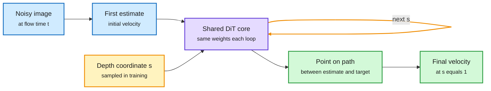

# LiFT: Loop Flow Transformers

> Source summary · 2026-10-08 · arXiv 2610.05538 via alphaxiv's listing and the authors' thread on the X feed

**TL;DR.** A looped diffusion transformer that repeatedly applies a shared DiT core. Each loop is trained on one regression target: a point on a straight path from the model's initial estimate to the flow-matching target, indexed by a continuous depth coordinate. Because the coordinate is continuous, a trained model can loop far beyond its training depth with no retraining, and longer rollouts improve generation.

Every loop gets its own target on a straight line

The depth coordinate s is continuous, so inference can use a finer grid than training ever saw.

Blue is input, purple is the reused block, amber is the loop and its depth coordinate, green is the output.

## Key points

- LiFT-XL/2 R12 trained with 2 loops: FID 17.07 at 2 loops, 9.31 at 16 loops.
- LiFT-L/2: FID 10.95 against 14.30 for the authors' dense DiT-XL/2, with about 60% fewer parameters, 32% fewer training FLOPs and 52% fewer inference FLOPs. ImageNet 256x256.
- Two axes of inference compute: integration steps follow the flow through time, loops refine the velocity estimate inside a step. They are complementary.
- Why earlier loops fail to extrapolate: every intermediate loop was asked to predict the final output.
- Also in the window. Recurrent Looped Transformer (arXiv 2610.07591, Princeton and UPenn) splits layers between a parallel causal encoder and a recurrent decoder whose final state feeds the next token, studied on six algorithmic tasks at eight total layers. DLoop (arXiv 2610.07659, NAVER) decides whether to run another whole drafting stage before target verification in speculative decoding, keeping the acceptance rule. Only the first part of each alphaxiv overview was read, so no results are recorded.
- Limits: images only, the authors' own baseline, no adaptive halting.

## How this relates to the wiki

- A second answer to the depth-overfitting problem named in "Rethinking at Fixed Points" (2026-10-04), where a model trained at fixed depth 5 broke under KV sharing and a learned depth prior fixed it.
- Adds to the looping pattern declared on 2026-10-04 (fixed points, Loop Scaling Laws, Looped-DiT, LoopCD).
- Concept page: [Models and Architectures](models-architectures.md).

## Links

- [Paper](https://arxiv.org/abs/2610.05538)
- [Post](https://x.com/askalphaxiv/status/2107705748113530997)
- Digest: [2026-10-08](../daily-digest/2026-10/2026-10-08.md)
- Raw: [X feed capture](../../raw/twitter/feed/2026-10-08-day-ranked.json), post id 2107705748113530997 (gitignored) · [RLT](../../raw/huggingface/2026-10-08-recurrent-looped-transformer.md) · [DLoop](../../raw/huggingface/2026-10-08-dloop-looped-speculative-decoding.md)
