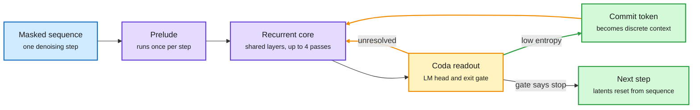

# ALoDLM: Adaptively Looped Diffusion Language Models

**Date:** 2026-10-09 · **Type:** paper (arXiv 2610.04198), project page and repository · **Authors:** Liancheng Fang, Zhuowei Li and colleagues (Amazon AGI, with University of Illinois Chicago and Korea University)
**Topic:** [Models and architectures](models-architectures.md)

## TL;DR

A diffusion language model (DLM) starts from a masked sequence and fills in many tokens in parallel over a few denoising steps. That is fast, but DLMs have trailed same-size autoregressive models (which write one token at a time) on quality. ALoDLM blames a computation-difficulty mismatch: inside one denoising step some masked tokens are nearly determined and others need real reasoning, yet a standard DLM runs the same fixed-depth network over all of them. ALoDLM adds an inner loop to each denoising step. A shared block of layers runs up to four times. Easy tokens commit early and become context. Hard tokens keep their hidden state and refine it. A learned exit gate decides when to stop. At 1.7B and 8B parameters it beats both the other diffusion models tested and its own autoregressive base on the average of eleven benchmarks, while decoding faster.

Easy tokens commit after one pass, hard tokens keep thinking

The loop is inside one denoising step. Committed tokens return as context for the ones still unresolved.

Blue is input, purple is the network, amber is the per-pass decision and the loop, green is what gets written out.

## The problem it names

The project page uses one sentence as its example: "She sells 16 − 3 − 4 = 9 eggs a day, so she makes $18." With several words masked, "so" and "eggs" are easy and "9" and "18" are hard. A fixed-depth denoiser gives each the same computation. Confidence-based decoding helps only partly. It defers low-confidence tokens to a later denoising step, but a deferred token still gets the same fixed compute there, and its hidden-state work is thrown away and restarted from a mask embedding.

## Mechanism

**Inference, one denoising step.**

1. A Prelude encodes the partially masked sequence once.
2. A shared Recurrent Core runs. After each pass, a Coda produces a readout that feeds two heads: an LM head (a token distribution per position) and an exit gate (a halting probability per position).
3. Positions whose predictive entropy is under a threshold τ are sampled and committed. They re-enter the next pass as token embeddings.
4. Unresolved positions carry their latent state forward and keep refining it.
5. The per-pass halting probabilities accumulate into a cumulative halting probability per position. The inner loop ends when its mean over unresolved positions reaches a threshold q, when nothing is unresolved, or after K = 4 passes.
6. If nothing committed in a step, the lowest-entropy position is committed anyway, so decoding always makes progress.

Latent states persist only within a step. The next denoising step re-initializes from the written sequence.

**Layer split.** ALoDLM-8B is built from the 36-layer Qwen3-8B: layers 0 to 10 are the Prelude, 10 to 26 are the 16 shared core layers, 26 to 36 are the Coda. ALoDLM-1.7B, from the 28-layer Qwen3-1.7B, loops all 28 layers. Its Prelude is the token embedding only and it has no Coda blocks.

**Training.** Each masked token's exit depth is treated as a latent variable. The exit gate parameterizes a distribution over exit schedules. The objective is a conditional NELBO (negative evidence lower bound, a variational upper bound on negative log-likelihood): the expected loss of each token at its sampled exit depth, plus a KL term against a prior that favours shallow exits. A single sampled rollout gives an unbiased gradient estimate for this objective. The practical recipe relaxes the KL term and adds variance reduction. The gate reads a stop-gradient copy of the readout. The repository adds that halting decisions receive sequence-level outcome credit, and that training also uses a first-pass control variate, weighted supervision at intermediate passes and an auxiliary next-token loss. Gate and backbone are trained jointly.

## Key findings

- **Average over eleven benchmarks** (reasoning, knowledge, mathematics, code): ALoDLM-8B 80.3, Qwen3-8B 78.5, strongest other diffusion model 75.1 (WeDLM). ALoDLM-1.7B 65.5, Qwen3-1.7B 63.8, strongest other diffusion model 61.0 (SDAR).
- **Training budget.** Direct SFT (supervised fine-tuning) from the Qwen3 base on a 5B-token corpus, with no continued pretraining.
- **Speed.** On GSM8K, ALoDLM-8B runs at 612.4 tokens per second against 229.3 for vLLM-served Qwen3-8B, about 2.7 times, single stream on one NVIDIA B200, at comparable or higher accuracy.
- **Compute per token.** At a matched 93.25% GSM8K accuracy, 133.5 GFLOPs per generated token against 154.6 for WeDLM, a 13.6% reduction. The digest also records 8.5% more throughput at that point.
- **Depth is a test-time dial.** Raising the halting threshold raises recurrent computation and improves the average score in the reported sweep.
- **The gate learns difficulty without labels.** Numerical tokens learn a lower first-pass halting probability, meaning the model prefers to keep refining them.
- **Two dials for quality against speed.** τ controls which predictions may commit (the digest records 278.7 to 508.3 tokens per second as τ goes from 0.1 to 0.6, with accuracy moving from 93.8% to 92.3%). q controls when the inner loop ends.

## Gaps

- The headline quality table uses a single-token preset: greedy selection, one token committed per model pass, a 16-token window, q of 0.4 at 1.7B and 0.5 at 8B. The speed figures use the parallel decoder with the entropy rule. Quality and speed are not reported at one operating point in what was read.
- Latent states do not survive across denoising steps.
- No agentic or long-context evaluation appears on the project page.
- The comparison is against the model's own Qwen3 base. Whether the gain holds from other bases is not shown.

## Relation to earlier wiki pages

- **Fills a gap the wiki named.** The 10-04 Deep Dive on looped models at fixed points (once a looped model's state stops changing, earlier loops are redundant and their memory can be dropped) ended with adaptive depth per token at inference as the open problem. See the [10-04 digest](../daily-digest/2026-10/2026-10-04.md). ALoDLM delivers it in a diffusion model, with a learned gate and a proper objective.
- **Looping is now well past a pattern.** The [10-09 digest](../daily-digest/2026-10/2026-10-09.md) lists four more looped designs from the same window: a shared-memory looped pretraining paper (only the first pass writes the KV cache, the store of past attention computations), LiFT (flow-matching loops trained at 2 passes that keep improving to 16), the Recurrent Looped Transformer (synthetic tasks only) and DLoop (looping the draft stage of speculative decoding).
- **Shares a stopping question with decision models.** The exit gate is a small decider over computation. Compare the calibration discussion in [Open d1 and Train Your Own Decision Model](../decision-models/2026-10-09-open-d1-and-train-your-own-decision-model.md).

## Research angle

Why it works: committing an easy token changes the conditional distribution of the hard ones in the same step. The loop turns one parallel guess into a short chain of conditioned guesses, and the hard tokens keep their partial computation instead of restarting.

For a model of reasoning in which thinking and deciding are coupled, this is the closest architecture so far. The exit gate decides whether more thought is worth it and is trained jointly with the thinker. Two limits stand out:

- The gate is trained on likelihood, not on task success. It is a fast decider about computation with no notion of stakes.
- Latents reset between denoising steps, so nothing like a persistent concept state exists yet.

Open questions: does a learned per-token gate train as easily in an autoregressive looped model, and can the gate be trained on downstream reward instead of the NELBO?

## Links

- Source: [paper](https://arxiv.org/abs/2610.04198) · [project page](https://alo-dlm.github.io/) · [code](https://github.com/amazon-science/ALoDLM) · [ALoDLM-8B weights](https://huggingface.co/amazon/ALoDLM-8B)
- Digest: [2026-10-09](../daily-digest/2026-10/2026-10-09.md)
- Raw: surfaced via saved reading (local capture, not published). No alphaxiv overview was available.
