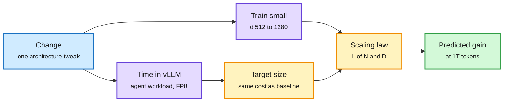

# I Tried Every LLM Architecture Change Since 2020

**Date:** 2026-11-01 · **Type:** X Article (read in full) with open runs, by Nikita Pavlichenko (formerly JetBrains Mellum) · 1,129 training runs, about 1.1T tokens, 5,232 vLLM serving measurements
**Topic:** [Models and architectures](models-architectures.md)

## TL;DR

A mega-ablation of six years of architecture changes, run in one setup with one rule: every architecture gets the same serving budget. Each change is trained at two to four small widths, timed in vLLM under a coding-agent workload to find the model size it can afford at the GPT-3 6.7B baseline's cost (1,924 sessions per hour per B300 at 30 ms per output token), and then a scaling law predicts its loss at that size after 1T tokens. Findings: fine-grained MoE (an active parameter worth about 4 to 5 dense ones) and linear-attention hybrids (2 to 7 times cheaper to serve) are the big wins. GQA, MQA, MLA and sliding windows win only by shrinking the KV cache. Norms, MLPs, positions and residual tweaks are worth 1 to 2% at best by serving size. The final stack (a 2026 KDA hybrid plus hyper-connections, value residual, a key-value conv, dense FFN moved to the last layer) is predicted 9.4% better than GPT-3 and 1.0% better than the plain hybrid. The deepest finding: for the 2026 hybrid only about 2% of predicted loss is parameter-limited, so architecture has almost nothing left to remove.

Most of the architecture win was already in DeepSeek-V3

Each change is judged at equal serving cost, so a cheaper-to-serve design gets a bigger model.

Blue is the change under test, purple is the two measurements, amber is the extrapolation, green is the verdict.

## Setup

- Data: Stack-Edu code files and whole Python repositories plus FineWeb-Edu. AdamW, weight decay 0.1, warmup-stable-decay, z-loss, 2k context then a 16k extension for the last 10% of steps with YaRN.
- GPT-3 proportions at widths 512, 768, 1024 and 1280 (25M to 394M non-embedding parameters), 20 tokens per parameter of the baseline at each width. Short learning-rate sweep per architecture.
- Metric: bits per byte on held-out code, repositories (16k windows) and web. Seed noise is about 0.7%; same-seed comparisons cut it to about 0.3%.
- Law: L(N, D) = E + A·N^−α + B·D^−β, with the data entropy E fixed from an earlier ladder. Changes trained at only two widths borrow their parent's exponent ("hollow dots"), which the author flags as unreliable.

## Findings worth remembering

- **RoPE's gain shrinks with width**: 6.9% at d=512, 4.0% at 768, 2.3% at 1024, predicted +0.5% at serving size. Removing positions from only the global layers of a hybrid is fine.
- **QK-norm** helps about 1% at every width and tolerates higher learning rates; the gain disappears without its learned per-channel scales. Largest attention logit by step 500 is 71 to 351 without it, 12 to 25 with it.
- **Gated MLPs**: SwiGLU looks like noise at the smallest width and helps 0.9% at d=1024. Squared ReLU wins in the dense model.
- **Stacking on the hybrid**: hyper-connections (four residual lanes) +1.8%, attention residuals 1.1%, KV conv 0.7%, value residual 0.4%, roughly additive. Round-two tweaks (embedding scaling, GatedNorm, head norm) mostly vanish by d=768.
- **Muon** instead of AdamW buys 2.2% to 1.8%, about as much as a full round of architecture stacking, and holds up better with width.
- **Copy pointer** (from modded-nanogpt) is the biggest small-scale add (4.1% at d=512) but shrinks about 40% per width step.
- **Gradient spikes** in the candidate (9 to 11% of steps clipped) came from the first layer's dense FFN. Moving it to the last layer removes the spikes and improves loss 0.3 to 0.4% at every width and seed.
- **MLA** did not help at this scale even at a vLLM-friendly shape; the author expects it would at larger targets.
- **Gains at trained sizes are 1.5 to 3 times larger than predictions at serving size.** The hybrid beats GPT-3 by 15.6% at d=512, 12.2% at d=1024, and a predicted 8.5% at equal serving cost.

## Gaps

The author's own list: serving cost depends on how well vLLM supports each design; the ladder is tiny and extrapolated far; data and benchmarks are toy; long context only to 16k; hyperparameters not fully tuned; most code written by an AI coding agent. The top six candidates sit within about half a percentage point and their order changes with the fitting choice.

## Relation to earlier wiki pages

- **Tempers** the [models-architectures](models-architectures.md) concept page's looped-model pattern: any architecture gain must now be read at equal serving cost and large size, where small-model wins shrink.
- **Agrees with** the 10-04 to 10-11 thread that the training setup (optimizer, data) can matter more than architecture: Muon alone matches a round of stacking.

## Research angle

Why the result looks the way it does: the loss decomposition says architecture can only attack the parameter-limited term, and for a modern MoE hybrid at 1T tokens that term is about 2% of loss, against about 11% for the 2021 reference. Remaining progress therefore has to come from data (the data-limited term is about 8%), from serving efficiency that buys more active parameters, or from changes that alter the entropy term itself (better tokenization, different objectives). Open problems: rerun the ladder with RULER-style long-context metrics, where position and sparse-attention choices may separate; and test whether the "2% left" claim holds for objectives other than next-token prediction, such as the multi-token and coarse-to-fine objectives elsewhere in this digest.

## Links

- Article: https://x.com/nv_pavlichenko/status/2116154049217089946
- Open runs: `pavlichenko/bux-timeline` on Hugging Face (CC BY 4.0), framework `bux`
- Raw: X feed capture for the 2026-11-01 window (local only)
