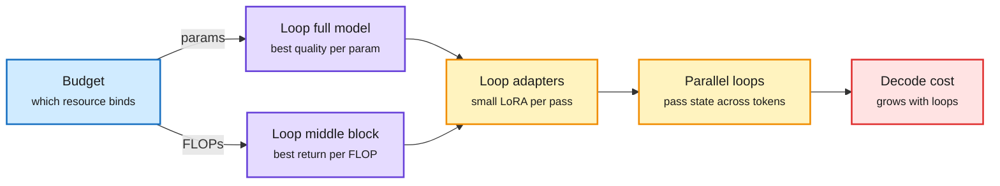

# How to Loop Your Transformer, and Scaling Laws for Looped MoE

**Date:** 2026-11-01 · **Type:** two papers from Meta: "How to Loop Your Transformer: Loop Scaling, Specialization, and Parallel Inference" (arXiv 2610.40325, abstract and author thread read) and "Scaling Laws for Looped Mixture of Experts" (arXiv 2609.40316, alphaXiv overview read)
**Topic:** [Models and architectures](models-architectures.md)

## TL;DR

Looping reuses weights by passing hidden states through the same layers again, adding depth without parameters. The first paper studies when that pays in dense decoder-only models up to 1B parameters, 155B tokens, 1.07×10²¹ FLOPs and 32 loops. Answer: it depends on which resource is scarce. Loop the full model when parameters are the constraint; loop a middle block when training FLOPs are. Adding loops eventually saturates, reverses or destabilizes, and small loop-specific LoRA adapters recover gains that grow with loop count. Looping slows decoding in proportion to loop count; Parallel Loop Transformers pipeline loops across adjacent tokens but lose quality, which the authors recover by preserving and separately normalizing the current-token embedding. The second paper fits a loop scaling law for MoE: each extra pass has a bounded, saturating benefit whose ceiling rises with sparsity.

Loops trade inference compute for parameters and data

Which part to loop depends on the binding constraint; the decoding cost is paid every time.

Blue is the budget decision, purple is where to loop, amber is the two fixes, red is the cost that remains.

## Key findings

- **Data and FLOP efficiency in the overtrained regime** (author thread): at 1B, looped models reach a given bits-per-byte with fewer tokens, and from 100M to 1B two-loop models trained at 80 tokens per parameter are compared against non-looped ones at 160 tokens per parameter.
- **A reposted summary** reduces it to "8 loops when parameter-constrained, no loops when FLOPs-constrained." That is a simplification of the abstract, which favours middle-block looping under FLOP constraints.
- **Looped MoE law** (alphaXiv overview; first noted in the 10-04 digest as "about 2x total-parameter efficiency on reasoning", resurfaced via saved reading with the cost side): a sparsity-conditional bounded law predicts held-out expert counts with RMSE 0.0047 against 0.0075 without conditioning. At about 1.5×10²² training FLOPs, a law-chosen 5-loop MoE (0.3B active, 1.3B total, about 3T tokens) reaches a 36.5% BBH and GSM8K mean against 36.35% for a 0.6B-active, 2.9B-total MoE trained on about 6T tokens. It costs 1.8 times the inference compute and trails on the 14-benchmark mean, 46.9% against 50.2%.

## Gaps

Both are small-scale (at most 1B dense; 1.3B total MoE). Neither reports reasoning-specific gains from looping beyond the benchmark means above. The parallel-loop fix was described in the abstract only.

## Relation to earlier wiki pages

- **Continues** the looped-models pattern on the [concept page](models-architectures.md) (Ouro, ALoDLM from 10-09 and others): this is the first careful resource-constrained study in the wiki, and it says loops are a parameter-saving device more than a free reasoning boost.
- **Read alongside** the [architecture ablation study](2026-11-01-architecture-ablations-since-gpt3.md) from the same window: at equal serving cost, any change that adds decode compute must buy enough loss to pay for a smaller model.
- **Related saves:** the Recurrent Looped Transformer (state tracking needs depth that grows with input length) and GRAM (stochastic recursive reasoning) both appear in the 11-01 Media Zone.

## Research angle

Loops make depth an inference-time knob. The open problem that matters for reasoning is adaptive loop count per token (the ALoDLM exit gate from 10-09 is one answer) combined with these resource laws: a model that spends extra passes only where it needs them could escape the "1.8 times the inference compute" penalty. Loop-specific adapters also hint that identical weights per pass are too rigid, which weakens the "same computation iterated" reading of looped models as algorithms.

## Links

- Paper: https://arxiv.org/abs/2610.40325 · Thread: https://x.com/thecekbote/status/2116557960956580194
- Looped MoE overview: https://www.alphaxiv.org/abs/2609.40316
- Raw: X feed capture and saved reading for the 2026-11-01 window (local only)
