# Next-Concept Modeling: Fast, Parallel, Coarse-to-Fine Text Generation

**Date:** 2026-11-01 · **Type:** paper (arXiv 2610.14162) with code and checkpoints · **Authors:** Hermann Kumbong, Ishan Khare and colleagues, Stanford (Hazy Research) and Together AI; senior authors Simran Arora, Azalia Mirhoseini, Christopher Ré · **Surfaced via** saved reading (four saves)
**Topic:** [Models and architectures](models-architectures.md)

## TL;DR

Next-Concept Modeling (NCM) is neither autoregressive nor diffusion. A multiscale residual VQ-VAE (a tokenizer that encodes a whole sequence as a stack of discrete code levels, each level correcting what the coarser ones missed) is trained once. A transformer then generates the levels in order, coarse to fine, predicting every code within a level in parallel, and a decoder turns the finished stack into text. Early levels have few positions, so early passes are cheap, and there are only about a dozen passes. At matched size NCM beats the strongest diffusion language model's generative perplexity on LM1B while running 21 times faster, is competitive on OpenWebText at 10 times faster, matches ROUGE-L on XSum at 31 times faster, and beats autoregressive and diffusion baselines on Sudoku at every difficulty with fewer function evaluations. The authors report 3 to 5 times fewer training tokens.

```mermaid
flowchart LR
  P["Prompt<br/><small>condition</small>"] --> C1["Level 1<br/><small>few codes, global gist</small>"]
  C1 --> C2["Level 2<br/><small>more codes, corrections</small>"]
  C2 --> CK["Level K<br/><small>full length, detail</small>"]
  CK --> D["VQ-VAE decoder<br/><small>codes to text</small>"]
  D --> T["Text<br/><small>all tokens at once</small>"]
  classDef input fill:#d0ebff,stroke:#1971c2,color:#1b1b1b,stroke-width:2px
  classDef core fill:#e5dbff,stroke:#6741d9,color:#1b1b1b,stroke-width:2px
  classDef loop fill:#fff3bf,stroke:#f08c00,color:#1b1b1b,stroke-width:2px
  classDef exit fill:#d3f9d8,stroke:#2f9e44,color:#1b1b1b,stroke-width:2px
  class P input
  class C1,C2,CK core
  class D loop
  class T exit
```

Plan the whole text in a coarse code, then fill in detail

Each level is generated in one parallel pass; only the number of levels is sequential.

Blue is the prompt, purple is the code levels generated by the transformer, amber is the frozen decoder, green is the output.

## Why it is fast

Diffusion language models update many positions in parallel but still run many denoising passes, each over the full sequence, and degrade when passes are cut. NCM shortens both the number of passes (one per level) and the cost of early passes (short levels). The coarse levels give global structure early, so later levels only need to add residual detail. The method lives or dies on reconstruction accuracy, because a small error in text can flip meaning or break a Sudoku grid, so the tokenizer is trained to reconstruct exactly.

## Gaps

- Scaling stops at 725M parameters.
- Each task has its own tokenizer; there is no general-purpose NCM tokenizer.
- The release has evaluation code and checkpoints but no training pipeline.
- Some evaluations use repetition penalties at final decoding.
- "Concept" means whatever the coarse levels store. The paper does not show that levels correspond to named semantic units.
- Test-time scaling (sample several candidates, select by agreement) beats diffusion at equal time budget, per a summary post.

## Relation to earlier wiki pages

- **Joins** the diffusion and non-autoregressive thread on the [concept page](models-architectures.md) (ALoDLM, 10-09: a looped diffusion LM that catches its autoregressive base). NCM's claim is that diffusion's weakness is the per-pass cost, not parallelism itself.
- **Bears on** the [world-models-reasoning](../world-models-reasoning/world-models-reasoning.md) theme of "three sources of coarse units": here coarse units come from a residual quantizer's first levels.
- **Contrasts with** Hybrid Reasoning Agents (saved this window): that work thinks in continuous latents and drops into text only for tool calls; NCM commits to discrete codes and decodes everything at once.

## Research angle (bears on the reasoning-model project)

NCM is the closest thing in the wiki to "decide in concepts, then verbalize": the model commits to a compressed global plan before any word exists, and the plan is a discrete object you could inspect, search over or score. Three open questions follow. Do the coarse codes carry semantics that transfer across tasks, or are they task-specific compression? Can RL operate at the coarse level, rewarding plans before they are expanded, which would make credit assignment over a few dozen codes instead of thousands of tokens? And can a fast System 1 decider pick among coarse plans sampled in parallel, which is exactly the agreement-based selection the authors already find helpful?

## Links

- Paper: https://arxiv.org/abs/2610.14162 · Code: https://github.com/HazyResearch/ncm
- Posts: https://x.com/KumbongHermann/status/2110437870481834432 · https://x.com/Azaliamirh/status/2110461349818155247 · https://x.com/akshay_pachaar/status/2111092456590848355
- Raw: `raw/twitter/bookmarks/2026-11-01-night.md` (local only)
