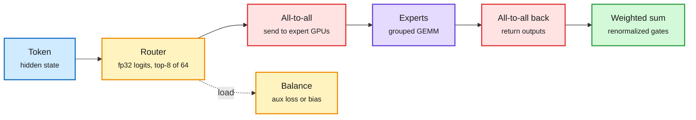

# The Ultimate MoE Training Handbook (Hugging Face)

**Date:** 2026-11-08 · **Type:** long-form handbook (chapters 1 to 3.1 read; later chapters beyond the capture) · **Authors:** Nouamane Tazi, Leandro von Werra, Thomas Wolf
**Topic:** [Models and architectures](models-architectures.md)

## TL;DR

A roughly 70,000-word handbook, backed by about 800K GPU hours of the authors' own runs (Nouamane Tazi's post says half a million), on training mixture-of-experts models. It is organized around the questions teams hit: expert count and size, router choice, auxiliary loss versus DeepSeek's loss-free bias, upcycling, all-to-all overlap, silent slowdowns, serving with fewer experts per token. Its premise: 18 of the 20 highest-scoring open models on the Artificial Analysis index are MoEs, yet the know-how lives in a few teams. The captured chapters cover hardware validation, a dense-versus-MoE first run, and router scoring.

Three things a dense run never had

A router, an uneven load across experts, and an all-to-all exchange of tokens between GPUs.

Blue is the input, amber the routing decisions, red the communication cost, purple the experts, green the output.

## Key findings (captured chapters)

- **Test the collective you will use.** All-to-all bandwidth (8 GiB per rank) on AWS P5 with EFA: 77.14 GB/s on two nodes, 39.25 on four, 30.91 on eight. A tuned two-node allocation gave 398.52 GB/s all-reduce but 39.84 GB/s all-to-all. Suggested gate: 90% of the per-node-count baseline plus a passing correctness check. Megatron's `--gpu-sniff-test-interval` re-checks during training.
- **First MoE:** 64 experts, top-8, expert width chosen so eight experts equal the dense FFN; 6.86B total and about 1.22B active parameters, against 1.219B for the dense model.
- **Parity check:** a 1-expert, top-1 MoE upcycled from the dense checkpoint stayed within 0.00087 of the dense run over 15 aligned steps; from fresh initialization the gap is 2.72 at iteration 4. Upcycling at the pinned Megatron commit needed two local fixes.
- **Determinism:** with deterministic mode, two runs matched loss, aux loss, grad norm and gradient zeros at every iteration; without it lm loss differed by up to 0.00063 from step 1.
- **Router precision:** gating functions do not change which experts win in plain top-k, but bf16 can round close logits to ties and change the winners. Use an fp32 router. Switch Transformers diverged with a bf16 router; ST-MoE's z-loss stabilized every run. Only 2 of 10 surveyed reports state training router precision.
- **Gating function:** sigmoid dominates the ten-model table; DeepSeek-V4 moved from sigmoid to sqrt(softplus). Megatron refuses the loss-free expert bias with softmax.
- **Output scale:** renormalizing top-k weights lowered validation loss from 2.219 to 2.183 at granularity 8 (Krajewski et al.). Routed scaling factors disagree: DeepSeek-V3 2.5 at k = 8, Kimi K2 √8, Kimi K3 1.0 at k = 16.
- **Sharpness:** a flat gate (top expert barely above the second) makes the layer average its experts; Skywork-MoE fixed it with gating-logit normalization.

## Gaps

- Chapters on load balancing, expert count and granularity, upcycling, timing, precision below bf16, serving and RL were not read.

## Relation to earlier wiki pages

- **Builds on** [the architecture ablation](2026-11-01-architecture-ablations-since-gpt3.md) (11-01), which found MoE one of two real architecture wins since GPT-3.
- **Matches** [Beam's report](../training-finetuning/2026-11-08-beam-and-inkling-2-recipes.md) (this window): sigmoid gating, loss-free bias plus a sequence aux loss, a z-loss, and a decayed bias update rate.
- **Pairs with** SAE Interprets MoE (HuggingFace, arXiv 2611.08089, this window): expert contribution is far more concentrated than gating, with fine-grained specialization (separate Java and front-end experts).

## Research angle

- Why routers sharpen or flatten during training, and how bias-update schedules should interact with learning-rate decay.
- Whether expert specialization is semantic enough to route by concept.

## Sources

- [Handbook](https://huggingface.co/spaces/huggingface/moe-blogpost) · [Thomas Wolf](https://x.com/Thom_Wolf/status/2118432475730882627) · [Nouamane Tazi](https://x.com/Nouamanetazi/status/2118412817116369254) · [SAE Interprets MoE](https://arxiv.org/abs/2611.08089)
- Raw: `raw/twitter/feed/2026-11-08-day-ranked.json` (gitignored); `raw/huggingface/2026-11-08-sae-interprets-moe-sparse-autoencoders-reveal-that.md`
