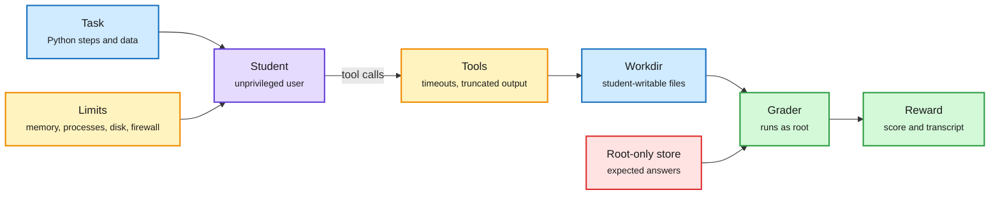

# Karotte: A Technical Deep Dive (Preference Model)

> Source summary · 2026-10-08 · Preference Model blog, via the X feed

**TL;DR.** Karotte is an open-source (MIT) framework for building RL environments that assumes the agent, called the student, will eventually try every possible approach. The student runs unprivileged with memory, process, disk and network limits. Harness, tools and graders run as root, and expected answers live in root-only storage. The post builds one small CSV environment by hand and shows how nearly every line breaks under training at scale.

The student gets a real shell and no way to reach the grader

Everything the student can touch is unprivileged. Answers and graders sit on the other side of a privilege line.

Blue is task data, purple is the policy being trained, amber is the guard layer, green is grading, red is what the student must never read.

## Key points

- Eval versus training: a hack hit in 10% of eval runs slightly inflates a score. In training it is reinforced until it is the default behaviour.
- Answer isolation: each data directory is root-only, student-readable or student-writable. A root-only file store passes runtime answers to the scorer. The firewall allows only localhost and sandbox addresses, checked before the first step.
- Tool safety: a persistent bash session running as the student, per-command timeouts, truncated output, and file tools that refuse anything the student could not reach from bash.
- Loop robustness: retries with backoff, a nudge when a turn comes back empty (out of output tokens or reasoning only), and a model catalog for output limits and reasoning levels.
- Harness survival: student processes get the highest out-of-memory score, RAM-backed temp files and shared memory count toward the limit, 1 GiB is reserved for the harness, and each run gets a VM where hardware allows.
- Grader exploits listed: a symlink from the answer file to the expected file, a FIFO that blocks the grader, `/dev/zero` or a sparse 100 GB file, a swap between check and open, and a planted `sitecustomize.py` on the grader's Python path.
- The launch post says it was hardened through more than a million evaluation runs and controlled red-teaming.
- Limits: no measured exploit rates, and the captured text stops inside the grading section.

## How this relates to the wiki

- The engineering counterpart to the [MiMo audit](2026-10-08-mimo-reward-hacking-audit.md). It would not have caught the timestamp leak there, which is a data-preparation error inside the student's own files.
- Third piece of environment infrastructure opened in the window, alongside Scale's AgentEnv and the Hugging Face Hub's `rl-environment` tag. The 2026-10-04 digest covered TaskSmith and the multi-harness capture proxy from the same ecosystem.
- Concept page: [Reinforcement Learning](reinforcement-learning.md).

## Links

- [Technical deep dive](https://preferencemodel.com/blog/karotte-a-technical-deep-dive/)
- [Launch post](https://preferencemodel.com/blog/introducing-karotte/)
- [Docs](https://karotte.dev/)
- Digest: [2026-10-08](../daily-digest/2026-10/2026-10-08.md)
- Raw: [X feed capture](../../raw/twitter/feed/2026-10-08-day-ranked.json), post id 2107893218830328088 (gitignored)
