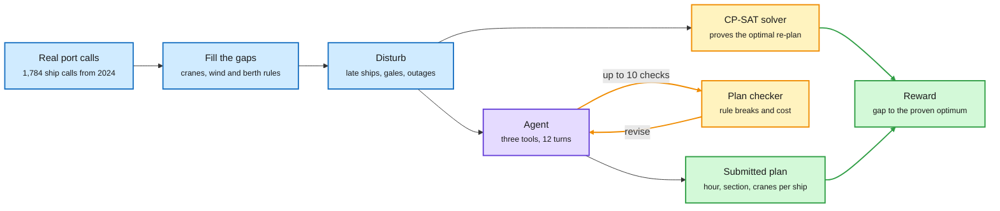

# Simulation RL Environments, Part 1: PortSimEnv

**Date:** 2026-10-09 · **Type:** research article with open environment · **Author:** Adithya S Kolavi (Hugging Face, FineEnvs), published 2026-10-06
**Topic:** [Reinforcement learning](reinforcement-learning.md)

## TL;DR

PortSimEnv is a deterministic RL environment for berth planning at the Port of Barcelona, built from the 1,784 container-ship calls the port recorded in 2024. The agent gets one quay, the ships that really called there in one week, and a set of disruptions. It decides for every ship when it docks, where along the quay, and with how many cranes. CP-SAT (a constraint-programming solver that can prove a solution is optimal) computes the best possible re-plan for every task, and the reward is the gap between the agent's plan and that proven optimum. No learned judge is involved. In a first evaluation of six models on 50 held-out weeks, the best model averages 0.89 and still misses the optimum on 24 of 50. Open models lose most of their score by never submitting a plan.

Real records in, a provable answer key out

The solver and the agent see the same disrupted week. The reward is the gap between them.

Blue is data and task construction, purple is the model, amber is the solver and the checker loop, green is the plan and its score.

## What it is

The article opens a series on simulation environments, which the author calls "digital twins of real work". The stated motivation: most RL environments for language models are puzzles, code, maths or web tasks, while a lot of valuable work is keeping a schedule running under real rules while things go wrong. Each part of the series takes one real job, rebuilds it from the records it leaves behind, and grades the agent against an answer that can be proven best. The author labels the work early and experimental.

## Construction pipeline

1. **Seed.** The real calls at one quay for one to three weeks, with the berth plan the port actually executed. The data covers two container terminals, BEST (13 cranes) and APM Terminals (9 cranes).
2. **Fill the gaps.** Crane fleets, wind and traffic rules, and a crane rate of 28 moves per hour turn each call's real time alongside into a workload.
3. **Disturb.** Inject disruptions modelled on real events, scaled by tier (standard, busy, storm, extreme).
4. **Solve.** CP-SAT proves the optimal re-plan. A naive re-plan and a greedy heuristic set the floor.
5. **Filter.** Drop tasks a heuristic nearly solves. Keep whole weeks out of training for evaluation.

The result is 1,050 training and 50 evaluation tasks. No week appears in both.

Disruptions and their share of the 1,100 tasks: late ships 100%, quay closures 100%, crane outages 89%, priority cargo (some ships count three times) 86%, emergencies with a docking deadline 76%, unscheduled extra calls 63%, gales 62%, bunched arrivals 46%, traffic diverted from the other terminal 15%. The gale rule follows the port's traffic ordinance: ships of 300 m or more stop above 25 knots, and all ships stop above 30.

## Reward

The reward is computed once, from the submitted plan alone, when the agent calls `submit_plan`. It is 1.0 at the proven optimum and falls toward 0.2 as the plan gets costlier. Plans that break a rule sit in a lower band. The gap is measured against the avoidable cost, so a week full of unavoidable delay is not punished. An independent checker re-verifies every plan.

A worked example from the article: GLM-5.3 on week 6 at APM Terminals (17 ships, 9 cranes, two cranes down and two quay closures) checks three drafts that come back with 9, 5 and then 0 rule breaks. The submitted plan costs 87, made of 72 in weighted delay plus three berth changes at 5 each. That equals the optimum, so the reward is 0.2 + 0.8 × e⁰ = 1.00.

## Key findings

- Six models each ran the 50 held-out weeks once, with three tools, 12 turns and 32k output tokens per turn. That is 300 rollouts, all replayable on a 3D model of the port.
- GPT-6.1 Sol leads with a mean reward of 0.89 and submits a valid plan every week, but matches the optimum on only 26 of 50.
- Every model scores lower on storm and extreme weeks, which stack gales, closures and emergencies.
- Open models lose most of their score before grading. They spend the output budget reasoning and never call `submit_plan`. On the 13 to 25 weeks where they do submit a valid plan, they average 0.75 to 0.97.
- Across all 1,100 tasks a naive re-plan never scores above 0.44 and a greedy heuristic never above 0.82, because tasks they nearly solve were dropped.
- The agent may call the plan checker 10 times per episode. It reports rule breaks and cost.

## Gaps

- The records give the berth plan the port ran. They do not include crane assignments, container manifests or time at anchor. Workloads, disruptions and physical handling are simulated.
- Each model ran each week once, so there is no variance estimate.
- No training result is reported, only evaluation.

## Relation to earlier wiki pages

- **Contrast with the MiMo audit.** The [Vals audit](2026-10-09-mimo-rl-environments-reward-hacking-audit.md) found the reference fix readable on disk in 67% of a lab's coding tasks. Here the answer key is a number computed by a solver, and the score is a function of the submitted plan only. An LLM judge can be flattered and a test suite can be gamed. A gap to a proven optimum cannot, as long as the plan checker is correct.
- **Same author as the 10-04 multi-harness RL guide** (the same weights solve 62% of tasks in one coding harness and 33% in another). See the [10-04 digest](../daily-digest/2026-10/2026-10-04.md). That guide was about training inside shipped harnesses. This is about where verifiable tasks come from.
- **Connects to the decision-model question of when to commit.** The first skill the evaluation exposes is deciding to act. See [Open d1 and Train Your Own Decision Model](../decision-models/2026-10-09-open-d1-and-train-your-own-decision-model.md).

## Research angle

Two things are worth doing with this environment.

- **Stopping.** Models that submit do well, and most open models do not submit. That is a stopping problem inside a fixed token budget, and it is the cheapest thing to train first.
- **The checker as a world model.** Ten checker calls make this a small planning-with-a-simulator problem: propose, test, revise. Measuring how reward scales with the number of checker calls would show whether a model is actually using feedback or just drafting once. This is the behaviour one would want from a slow reasoner working over a world model.

The broader point is that operations research problems with exact solvers (scheduling, routing, allocation) are a large source of verifiable rewards that needs no learned judge.

## Links

- Source: [article](https://huggingface.co/spaces/FineEnvs/simulation-rl-environments) · [post](https://x.com/adithya_s_k/status/2107471722538774735) · [collection](https://huggingface.co/collections/FineEnvs/simulation-rl-envs)
- Digest: [2026-10-09](../daily-digest/2026-10/2026-10-09.md)
- Raw: X feed capture for the 2026-10-09 window (`raw/twitter/feed/2026-10-09-day-ranked.json`, local only). Also surfaced via saved reading.
