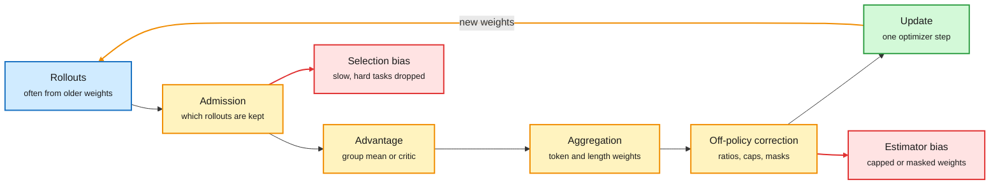

# Bias, Variance, and Throughput in LLM Reinforcement Learning

**Date:** 2026-10-11 · **Type:** long-form X Article (synthesis essay) · **Author:** Cyrus Asgari (@cyrusasg)
**Topic:** [Reinforcement learning](reinforcement-learning.md)

## TL;DR

Choosing an RL algorithm for LLM post-training means choosing among PPO, GRPO, Dr.GRPO, GSPO, DAPO and CISPO, and also choosing how rollouts are generated and when training happens. The essay reduces all of it to four design choices (advantage estimation, aggregation, off-policy correction, admission) and judges each by three quantities: the bias of the gradient estimate, its variance, and the hardware throughput of the pipeline. The goal is learning per GPU-hour, which no single one of the three predicts. It ends with a suggested starting recipe and the conditions under which to leave it.

Four choices sit between a rollout and an update

Each box can add bias or variance. The two red boxes are the biases that are easiest to miss.

Blue is data, amber is a design choice, green is the update, red is a bias that choice can introduce.

## The starting point

The objective is expected reward over prompts and sampled responses. With fresh on-policy samples, the basic estimator multiplies (reward minus a baseline) by the sum of the gradients of the token log-probabilities. A baseline that does not depend on the sampled response leaves the expected gradient unchanged and can lower variance.

The essay separates four sources of bias:

- **Estimator bias.** The expected estimate differs from the gradient of the chosen objective, for example when importance weights are capped.
- **Objective bias.** The objective or the relative sample weights are changed, for example by length normalization or a KL penalty.
- **Selection bias.** Admission rules change which data reaches training, for example dropping slow trajectories.
- **Reward bias.** The reward misrepresents the wanted behaviour, for example a verifier that pays for shortcuts.

## The four choices

**1. Advantage estimation.** A group baseline compares each response with other responses to the same prompt. GRPO (group relative policy optimization) uses the full group mean. RLOO (REINFORCE leave-one-out) excludes each response from its own baseline, which keeps the expected gradient unbiased under independent on-policy sampling. A learned critic with GAE (generalized advantage estimation), as in PPO, gives a baseline at every prefix without waiting for the group. The cost is a second model to fit. Bootstrapping from the critic adds bias when the critic is wrong. Group baselines multiply rollout cost and make finished responses wait for the slowest group member.

**2. Aggregation.** GRPO divides centred rewards by the group's reward standard deviation and averages token contributions within each response. The second choice means that at the same advantage, each token in a 100-token response gets ten times the coefficient of a token in a 1,000-token response. With a negative advantage a long wrong response is penalized less per token than a short one, which can drive length growth on failures. Dr.GRPO removes both normalizers. With fixed group size its update is proportional to RLOO's.

**3. Off-policy correction.** The policy that generated a rollout often differs from the one being trained. Causes: policy lag in asynchronous pipelines, numerical differences from quantization or kernels, sampling settings such as top-p, and KV caches (stored attention state) built under older weights. Exact correction multiplies per-token probability ratios across the response, and the product explodes on long sequences. Practical options:

- Token-level ratios (as in GRPO's clipped objective). No long product, but no account of how likely the current policy was to reach the prefix.
- CISPO: cap token importance weights and treat them as constants, so a token still contributes gradient at the cap.
- PPO clipping: zero the surrogate gradient once the ratio leaves the range in the favoured direction.
- IcePop masking: drop tokens whose trainer-to-sampler ratio leaves an interval.
- GSPO: clip a sequence-level geometric mean of token ratios. This adds a 1/T factor and can dilute a short stretch of large mismatch.
- Score centering: under mismatch the trainer's score (gradient of log-probability) has a nonzero mean under the sampler, so even constant rewards produce an update, and the drift compounds every time weights sync back to the sampler. Subtracting the mean at each prefix removes it. The cited implementation stores the top 128 sampler probabilities and reports under 1% runtime overhead.

**4. Admission.** DAPO's dynamic sampling keeps generating until the batch is full of groups with reward variation, since a group whose rewards are all equal has zero advantage. Discarding slow trajectories is a selection bias toward tasks that finish quickly. Treating a generation timeout as failure biases the reward unless the time limit is part of the task.

## Suggested starting recipe

For terminal, verifiable rewards with affordable groups: Dr.GRPO's normalization choices, a CISPO-style capped update, score centering, and asynchronous rollout and training with limited policy lag. Conditions that change it:

- Little synchronization cost or mismatch: a simpler pipeline may be enough.
- Substantial policy lag: refresh weights more often. Correction cannot rescue arbitrarily stale data.
- Long or costly rollouts: compare smaller groups, or a critic that can train on unfinished trajectories.
- Many zero-advantage groups: DAPO-style sampling, counting the cost of rejected rollouts.

## Gaps

The essay is a synthesis. The recommended combination is not benchmarked as a whole, and the author says so. The supporting evidence is the cited ScaleRL study, whose normalization differs from the one suggested.

## Relation to earlier wiki pages

- **Extends the on-policy thread.** The [10-09 multi-teacher study](../training-finetuning/2026-10-09-multi-teacher-opd-vs-sft.md) found tuned SFT matches on-policy distillation at 14.8 to 23.1 times lower cost, and the 10-09 digest concluded that what matters is the quality and placement of training states. This essay supplies the vocabulary for the remaining question: which mismatches between sampler and trainer are harmless and which need correcting.
- **Complemented by [ThunderSyncRL](2026-10-11-thundersyncrl.md)**, which shows one case where throughput costs no bias or variance.
- **Reward bias is the subject of** the [MiMo audit](2026-10-09-mimo-rl-environments-reward-hacking-audit.md) and [How not to build coding environments](2026-10-11-how-not-to-build-coding-environments.md).
- **Zero-advantage groups** are the central difficulty of the [openai-math Lean environments](2026-10-11-openai-math-lean-rl-environments.md), where the reward is binary and almost always 0.

## Research angle

- A measured bias and variance budget for one real agentic run, split by the four choices, does not exist publicly.
- A critic that trains on unfinished trajectories would remove group waiting for long rollouts. The essay names it and cites recent work on privileged value functions.
- Ian Osband's "Planning to Learn" post (same window, post and figure only) reports the exact policy gradient reaching 4% on ImageNet against 62% for cross-entropy. If the noiseless gradient is a poor direction, variance is not the whole story.

## Links

- Source: [X Article](https://x.com/cyrusasg/status/2108615048503673290)
- Digest: [2026-10-11](../daily-digest/2026-10/2026-10-11.md)
- Raw: X feed capture for the 2026-10-11 window (`raw/twitter/feed/2026-10-11-day-index.md`, local only)
