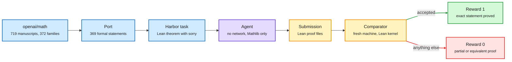

# OpenAI's Math Release as 369 Lean Proof Environments

**Date:** 2026-10-11 · **Type:** open RL environment dataset built on a research release · **Authors:** Hugging Face FineEnvs (announced by Adithya S Kolavi), on top of OpenAI's `openai/math`
**Topic:** [Reinforcement learning](reinforcement-learning.md)

## TL;DR

OpenAI released a repository of mathematical manuscripts and proof artifacts produced by an unreleased internal model. Part of it is formalized in Lean. The FineEnvs team ported 369 of the formally stated problems into Harbor environments that run under OpenEnv, for evaluation or RL training. The agent gets a Lean 4 theorem with `sorry` in place of the proof. The reward is 1 only if a complete proof of the exact original statement passes the Lean kernel through Comparator on a separate machine. That reward is very hard to game and extremely sparse. The author calls the work early and experimental.

A research release becomes a runnable environment

The grader runs on a separate machine. The agent never sees a reference proof.

Blue is the source and task, purple is the agent, amber is checking, green and red are the two possible rewards.

## The source release

From the `openai/math` README:

- 719 manuscripts organized into 372 families. A family groups a principal result with companions, consequences or alternative proofs.
- About 42% of top-line results are formalized in Lean. Not all results have formalizations, and OpenAI says some unformalized results could have issues.
- The model was posed approximately 4,000 problems. Each result used on average three hours of ChatGPT Pro thinking compute.
- Abridged reasoning summaries are released for ten families.
- Two results were exceptions to the fixed procedure, and one write-up was human-edited for readability.

## The environments

From the dataset card and the announcement:

- Each task is a Harbor environment tagged for RL, with a Dockerfile, a pinned Mathlib, an instruction file, the challenge statement, a grading script and a reference solution kept for the oracle.
- There is no internet access, and OpenAI's own proofs are not installed.
- When the agent finishes, its `Submission.lean` files are copied to a fresh machine and checked with Comparator, the Lean FRO's proof checker. Reward is 1 if Comparator accepts and 0 otherwise. A partial proof scores 0.
- In the one task inspected (a stable-coordinate counterexample in four variables): agent timeout 14,400 seconds, 4 CPUs, 8 GB of memory, verifier in a separate environment. The reference proof spans 15 modules and 55,824 bytes of Lean, the oracle graded in 47 seconds, and difficulty is labelled "research".

## Stated limits

The author's own list: the verifier is tied to the exact formalization and essentially one ground-truth path. A correct equivalent formulation, partial progress, or a different valid approach can still receive 0. He does not claim this is the ideal way to build RL environments for mathematical reasoning.

## Gaps

- No model has been run on the environments in what was read. There is no baseline pass rate.
- Only part of the dataset card was read. Per-task settings may differ from the one inspected.
- A saved post guesses that OpenAI's results came from training on many Lean environments, first hand-built and later generated by models from arXiv papers. That is speculation by a third party.

## Relation to earlier wiki pages

- **Continues a 10-09 story.** That digest noted OpenAI's release of more than 700 AI-generated manuscripts, three retractions and a boycott call. This is the release turned into training infrastructure.
- **The opposite design to [PortSimEnv](2026-10-09-portsimenv-simulation-rl-environments.md).** PortSimEnv has a dense reward, the gap to a solver-proven optimum. Here the reward is binary and kernel-checked. Both avoid a learned judge.
- **The trustworthy end of the leak problem.** [How not to build coding environments](2026-10-11-how-not-to-build-coding-environments.md) is about rewards that pay for lookup. A Lean kernel cannot be paid that way, as long as the statement is the intended one and the proofs are not on the box.
- **A hard case for group baselines.** The [bias, variance and throughput essay](2026-10-11-bias-variance-throughput-llm-rl.md) notes that a group whose rewards are all equal has zero advantage. With research-level binary rewards, almost every group is all zeros.

## Research angle

- A dense progress measure that is still kernel-grounded: accepted lemmas, remaining goals, or a curriculum of easier statements from the same family. It must not be inflatable by proving irrelevant lemmas.
- Equivalence-tolerant grading: accept a proof of a statement the kernel can show equivalent to the original.
- A first baseline: how many of the 369 does any open model prove with a fixed budget?

## Links

- Source: [dataset](https://huggingface.co/datasets/FineEnvs/openai-math) · [openai/math](https://github.com/openai/math) · [announcement](https://x.com/adithya_s_k/status/2108548282666631269) · [repost](https://x.com/ClementDelangue/status/2109290775322243143)
- Digest: [2026-10-11](../daily-digest/2026-10/2026-10-11.md)
- Raw: X feed capture for the 2026-10-11 window (local only). Also surfaced via saved reading.
