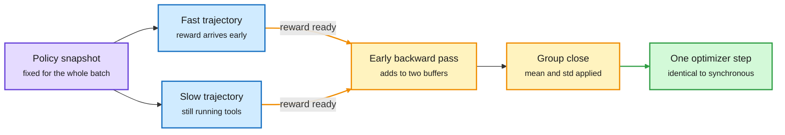

# ThunderSyncRL: Lossless Acceleration of Agentic Reinforcement Learning

**Date:** 2026-10-11 · **Type:** paper with blog and code (arXiv 2610.05935) · **Authors:** Seil Kang, Hangoo Kang, Tarun Suresh, Youngeun Kim, Shreyas Pimpalgaonkar, Seong Jae Hwang, Azalia Mirhoseini (Stanford, Yonsei, Korea University, Bespoke Labs)
**Topic:** [Reinforcement learning](reinforcement-learning.md)

## TL;DR

In synchronous RL for agents, learner GPUs wait for the slowest rollout and its verification. The authors measure that wait at 49.5% of step time. Asynchronous training removes the wait by training on rollouts from older weights. ThunderSyncRL removes it without staleness: it keeps one policy snapshot for the whole batch, computes each piece of the gradient as soon as its inputs are fixed, and takes a single optimizer step when the batch closes. The paper proves the resulting GRPO and on-policy distillation updates are identical to the batch-synchronous ones. Training reaches the same performance up to 1.9 times faster, and beats asynchronous training by up to 2.47 points of pass@3 at a fixed budget.

Same policy, same update, earlier gradients

The weights never change mid-batch. Only the backward passes move forward in time.

Purple is the policy, blue is a rollout, amber is gradient work moved earlier, green is the single update.

## Mechanism

**GRPO at trajectory granularity.** GRPO (group relative policy optimization) weights each trajectory's gradient by how its reward compares with its group. For a group of m trajectories with mean μ and standard deviation σ:

g = (1/m) Σ ((r_i − μ) / (σ + ε)) · H_i

H_i is the gradient of trajectory i's weighted action-token log-probabilities at the fixed policy. It does not depend on the other rewards. Once trajectory i and its reward are ready, the system runs that backward pass and adds to two buffers:

- G1 = Σ r_i · H_i
- G2 = Σ H_i

When the group closes, g = (G1 − μ · G2) / (m (σ + ε)). This is the same sum, regrouped so the backward passes happen early.

**On-policy distillation at turn granularity.** In OPD a frozen teacher scores the student's own sampled actions. Each token's weight is the stop-gradient of (teacher log-probability minus student log-probability). Once the teacher's scores for a turn arrive, that turn's gradient is computed while its tool call keeps running in the sandbox. The system accumulates unnormalized contributions and divides once by the total scored-token count at batch close, before clipping and the optimizer step.

## Key results

Qwen-3.8-27B, with model, workload, optimizer and GPU allocation fixed per comparison. Speedup is time to the synchronous target. Gain is pass@3 at 128 GPU-hours against asynchronous training.

| Benchmark | Objective | Speedup vs Sync | Gain vs Async (points) |
|---|---|---|---|
| SWE-bench Verified | GRPO | 1.9× | +2.47 |
| SWE-bench Verified | OPD | 1.9× | +1.27 |
| Terminal Bench 4.0 | GRPO | 1.8× | +1.52 |
| Terminal Bench 4.0 | OPD | 1.9× | +2.02 |

- On SWE-bench Verified the GRPO target of 74.01% pass@3 is reached at 121.3 GPU-hours against 233.5 for synchronous training.
- Runs on GLM-4.7-Flash-31B are also shown on the project page.

## Gaps

- The repository states that the GRPO objective implements one fixed-snapshot epoch with group population-standard-deviation normalization and is not a multi-epoch PPO trainer. Clipped multi-epoch recipes are outside the equivalence.
- Two coding benchmarks, two models.
- The memory cost of holding partial gradients and deferred adjoints was not in what was read.
- The alphaxiv overview returned only an introduction. This page is written from the abstract, the project blog and the repository README.

## Relation to earlier wiki pages

- **The exact corner of the [bias, variance and throughput essay](2026-10-11-bias-variance-throughput-llm-rl.md).** That essay treats asynchronous execution as a throughput gain paid for with staleness. This paper shows the learner-idle part of that gain is available with no staleness at all.
- **Contradicts current practice, not a prior paper.** Proximal's post-training stack (same window) is asynchronous with a rule that rollouts more than three adapter versions behind are never trained on. Draft-OPD training for speculative decoding got 7.6 times faster steps by adopting an asynchronous producer pool. Neither reports the quality cost of staleness. This paper measures it at 1.27 to 2.47 points.
- **OPD is one of the two objectives.** The [10-09 multi-teacher study](../training-finetuning/2026-10-09-multi-teacher-opd-vs-sft.md) found on-policy distillation costs 14.8 to 23.1 times the GPU-hours of SFT. A 1.9 times speedup narrows that gap but does not close it.

## Research angle

- Extend the identity to PPO-style clipping, where the ratio depends on weights that would have moved between epochs.
- Apply the same regrouping to a learned critic, where value targets arrive per step.
- With learner idle time removed exactly, asynchronous training has to justify itself by idle rollout hardware alone. A direct accounting of which GPUs idle in each design is missing.

## Links

- Source: [paper](https://arxiv.org/abs/2610.05935) · [blog](https://seilk.github.io/thundersync) · [code](https://github.com/seilk/thundersync) · [post](https://x.com/hangoo_kang/status/2108068008837173590)
- Digest: [2026-10-11](../daily-digest/2026-10/2026-10-11.md)
- Raw: surfaced via saved reading in the 2026-10-11 window (local only)
