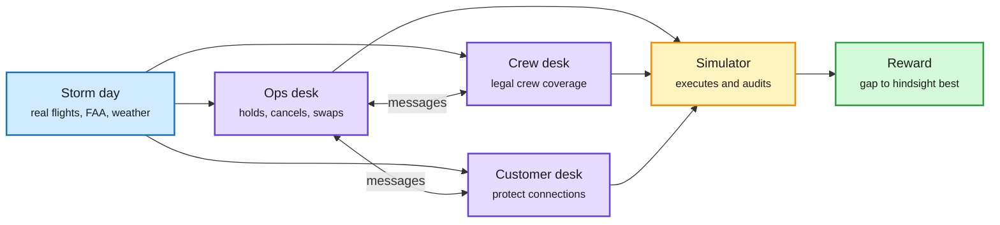

# Simulation RL Environments, Part 2: AirOpsEnv

**Date:** 2026-11-01 · **Type:** article section in the FineEnvs "Simulation RL environments" series (read) plus posts by priority accounts · **Built by** Edgar Arakelyan (Scale AI, AgentEnv Framework) with Ariel Gutman Stein, a licensed pilot, in collaboration with Hugging Face FineEnvs
**Topic:** [Reinforcement learning](reinforcement-learning.md)

## TL;DR

The FineEnvs simulation series moves from a port (PortSimEnv, 10-09) to an airline. AirOpsEnv rebuilds JFK and Boston Logan operations from public flight records, FAA advisories and weather data, and runs a storm day. Three agents with different tools share the work: an operations desk plans flights, a crew desk finds legal crew coverage, and a customer desk protects connections. They must message each other to change the plan, and the environment executes and audits the day. Six models were evaluated across 24 storm dates. On v3, GPT-6 Astra (0.742) and GPT-6.1 Sol (0.721) lead with overlapping confidence intervals. Reward is measured against the best plan found in hindsight, falling from 1.0 toward 0.2 as cost rises.

Three desks, one airline, no one sees everything

Each agent controls one part of the plan; changes cross desks only by message.

Blue is the real-world data, purple is the three agents, amber is the simulator, green is the reward.

## Key findings

- One recorded run: GPT-6.1 Sol holds a departure three minutes to save three connections; across the day the agents make 24 crew moves, hold 31 departures and cancel one flight. Score 0.795, total cost 4.24 million passenger-minute equivalents against 6.01 million for the standard crew baseline, 29.4% lower on that day.
- v1, v2 and v3 change the task and objective, so rewards are not a progression on one benchmark.
- Sol's three-desk result is 0.044 above its one-agent result at about twice the compute; the article says this does not isolate the value of communication.
- For v2 and v3 the reference is the best plan found in hindsight, with a lower bound where available. 24 of 168 v3 runs beat the published reference and are flagged.
- A live stream showed GPT-6 Astra running the control centre through real storm days.
- Same series, also this window: PortSimEnv v2 to v5 make the port week unfold watch by watch with pilots, tugs, ECMWF forecasts and shipping-line agents; asking ships for arrival times is what scores.

## Gaps

No training run on AirOpsEnv was reported; it is an evaluation board so far. The hindsight reference is not a proven optimum, unlike PortSimEnv v1's CP-SAT answer key.

## Relation to earlier wiki pages

- **Continues** [PortSimEnv](2026-10-09-portsimenv-simulation-rl-environments.md) (10-09, a deterministic berth-planning environment graded against a proven optimum). The move from one planner to three desks with partial information matches a saved post from the same builder: "most enterprise RL environments have a hidden flaw: every agent can see everything."
- **Governance:** Hugging Face handed OpenEnv, the interface these environments run on, to the Agentic AI Foundation under the Linux Foundation this window.
- **Open from 10-09:** the audit gap (no third-party leak audit on a public collection) is untouched.

## Research angle

Partial observability plus communication turns an environment into a multi-agent credit-assignment problem: when the crew desk's change saves a connection, which agent's message earned it? This is a natural testbed for decentralized actor-critic methods (the Kurate cs.AI board's top title this week is a belief-conditioned multi-agent actor-critic for decentralized LLM collaboration). A reward against a hindsight reference that 14% of runs beat also needs care: once policies exceed the reference, the reward saturates and the gradient flattens.

## Links

- Article: https://huggingface.co/spaces/FineEnvs/simulation-rl-environments#airopsenv-three-desks-one-storm-day
- Dataset: https://huggingface.co/datasets/earakely-scale/AirOpsEnv-AgentEnv
- Posts: https://x.com/adithya_s_k/status/2113569242062713167 · https://x.com/earakely/status/2113717323299496025 · https://x.com/adithya_s_k/status/2113741119699996829
- Raw: X feed capture for the 2026-11-01 window (local only)
