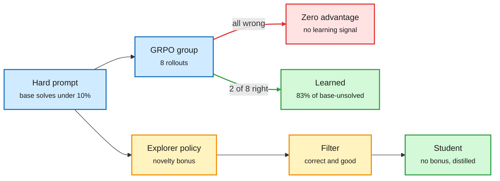

# Unlearnability in RLVR, and Exploration-Distillation

**Date:** 2026-11-01 · **Type:** X Article (Collinear, read in full) plus paper abstract (arXiv 2610.10536, Columbia) · **Surfaced via** saved reading
**Topic:** [Reinforcement learning](reinforcement-learning.md)

## TL;DR

Two pieces that answer one question: why do some RLVR (reinforcement learning with verifiable rewards, where a program checks the final answer) prompts never improve? Collinear trained Qwen-2.5-0.5B with GRPO for 100 steps on 8,139 MATH problems and then measured every prompt with 256 rollouts instead of 8. The picture changes with resolution. 35% of hard prompts stay stuck, the stuck set is reproducible across seeds, and the best predictor of learning is not difficulty but whether correct answers *pile up in the same training group*. Exploration-Distillation (ExpDis) is a mechanism for manufacturing those correct rollouts: separate explorer policies take a novelty bonus, their correct and filtered trajectories are distilled into a student that never sees the bonus, and the rounds alternate.

A prompt learns only when its group has a mix of rewards

GRPO's advantage is zero when every answer in a group gets the same reward. Exploration is a way to create the mixed group.

Blue is the prompt and its group, red is the dead end, amber is the explorer route, green is learning.

## Collinear: what more samples reveal

- Setup: Qwen-2.5-0.5B, GRPO, 100 steps, 8 attempts per prompt, two seeds, every checkpoint evaluated with 256 rollouts per prompt.
- Of hard prompts (base success under 10%), 35% stay stuck after 100 steps. 94.9% of difficult prompts end the same way in both seeds, so "stuck" is a property of prompt plus model plus recipe, not luck.
- Starting difficulty ranks outcomes with an AUC of 0.60 when measured with 8 rollouts, 0.72 with 32 and 0.83 with 256. Coarse measurement hides the structure.
- About 20% of the roughly 1,016 prompts the base model never solved in 256 tries crossed 10% success after training. Zero in 256 bounds the true rate below about 1.2%, so these are rare, not impossible.
- The hardest prompts are still climbing at step 100 (about +18 of 256 over the last 20 steps). The gap looks like unspent compute.
- Best predictor: among base-unsolved prompts, those whose groups reached at least 2 of 8 correct in the first 20 steps were learned 83% of the time. The authors note this may partly mark learning already under way, and name "give stuck prompts extra correct rollouts" as the intervention to test.
- Appendix: 190 of 1,904 stuck prompts (about 10%) were parser artifacts that the model answered correctly all along. Regrading leaves cross-seed agreement at 91 to 96% within difficulty bands.

## ExpDis (abstract read)

Adding a novelty bonus to RLVR should help find new strategies but in practice damages the policy. The authors' reason: the verifier checks a tiny slice of behaviour, so damage elsewhere is invisible to the reward and never repaired. ExpDis trains one or more explorer policies with an aggressive novelty bonus, filters their trajectories for correctness and quality, and distils them into a student trained without the bonus. Across seven maths benchmarks and two model families it beats DAPO at the same wall-clock budget, with better pass@k scaling. The cost of maintaining explorers and the exact novelty bonus were not in what was read.

## Gaps

- Collinear's study is one 0.5B model and one dataset. Whether the stuck fraction shrinks with model size is unknown.
- ExpDis was read as an abstract and a third-party summary only.

## Relation to earlier wiki pages

- **Connects to** the Sharpening Tax paper (10-04: post-trained models win pass@1 while base models solve tasks at large K that tuned versions never solve). Both say RL concentrates probability on what is already sampled; Collinear says what is not sampled in a group never gets credit.
- **Gives a mechanism for** the task-factory loop saved this window (generate tasks the target model solves 25 to 50% of the time), which aims RL data at exactly the mixed-group band.
- **Extends** the 10-11 [recipe essay](2026-10-11-bias-variance-throughput-llm-rl.md)'s "admission" choice: pass-rate filters that drop zero-pass prompts are an admission bias that discards about a fifth of learnable prompts in this setup.

## Research angle

A clean experiment is now obvious: inject a small number of verified-correct rollouts (from a stronger model, an explorer or privileged hints) into the groups of stuck prompts and measure whether they unstick. That separates "never sampled a success" from "cannot represent the solution". For the reasoning-model project, the explorer and student split is a fast-slow division of labour: a disposable, curious system that searches, and a stable one that keeps only what verified.

## Links

- Collinear article: https://x.com/CollinearAI/status/2115142609542988286
- ExpDis paper: https://arxiv.org/abs/2610.10536 · Author thread: https://x.com/micahgoldblum/status/2110011142684709189
- Raw: `raw/twitter/bookmarks/2026-11-01-night.md` (local only)
