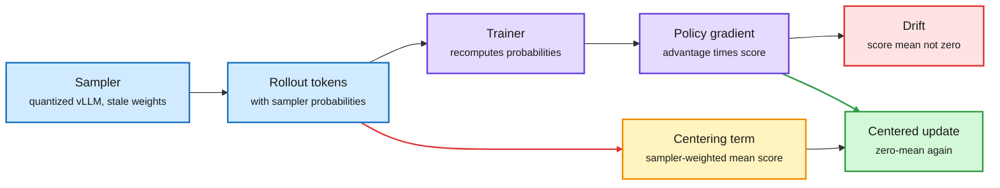

# Score Centering Stabilizes Off-Policy Reinforcement Learning

**Date:** 2026-11-01 · **Type:** paper (abstract, Figure 1 and appendix Table 1 read from images) plus one outside reproduction · **Authors:** Martin Marek and Max Ryabinin (Together AI)
**Topic:** [Reinforcement learning](reinforcement-learning.md)

## TL;DR

RL for language models samples rollouts with one engine (vLLM, often quantized) and computes gradients with another. The two give slightly different probabilities to the same tokens, the training-inference mismatch (TIM). The paper argues that the resulting instability is mostly *drift*: the policy-gradient score (the gradient of a token's log-probability) has zero mean only under the distribution that sampled the data. Under mismatch it has a nonzero mean, so every update pushes the weights in a consistent direction even when rewards carry no information, and the push accumulates step after step. **Score centering** is an additive correction that subtracts the sampler-side expected score at each prefix, restoring the zero mean without importance weights. From 0.6B to 30B parameters it matches or beats importance-sampling corrections, and the gap grows as the sampler is quantized more aggressively. Because it is additive, it also composes with importance sampling.

Drift is a bias you can subtract, not a variance you must clip

Importance weights rescale the sampled token. Score centering removes the part of the gradient that would move the weights even with zero information.

Blue is sampled data, purple is the trainer, red is the drift, amber is the correction, green is the update.

## Why it works

The REINFORCE estimator is unbiased because E_π[∇ log π(y)] = 0: a baseline or a constant reward contributes nothing in expectation. That identity holds only when tokens are drawn from π itself. When tokens come from a sampler q that differs from the trainer's π, E_q[∇ log π(y)] ≠ 0, and the update has a component that does not depend on reward at all. Each weight sync moves the sampler with the trainer, so the bias does not average out across steps. It compounds. Importance sampling fixes this by reweighting each token by π/q, which pays in variance and, once clipped (TIS, CISPO, IcePop, PPO-style), reintroduces bias. Score centering instead subtracts the expected score under the sampler directly, computed from the sampler's top-k probabilities at each position, so the corrected score is zero-mean again whatever q is.

## Key findings

- **Figure 1** (Qwen3-30B-A3B-Base on INTELLECT-2 maths data, sampler quantized progressively): with FP8 weights and KV cache, plain policy gradient trains stably for 800 steps and matches correction methods. With FP4 KV cache and then INT8 weights with an INT4 KV cache, most corrections (DAPO, GSPO, PPO, TOPR, MIS) collapse. Score centering keeps climbing to about 30% training accuracy in the INT4 setting, where truncated importance sampling recovers only partly.
- **Appendix Table 1** places eight importance-sampling corrections on one grid: level (token or sequence), statistic (ratio or total variation), clip range, behaviour outside it (clip or drop) and which advantage signs are corrected. Examples: TIS and CISPO clip a token ratio at 2.0 on both signs; IcePop drops tokens outside 0.5 to 5.0; GSPO drops sequences outside 0.9997 to 1.0004; DPPO uses a total-variation statistic with no ratio clip. Nathan Lambert called these corrections "the biggest focus of RL algorithm research since the GRPO takeoff."
- **Outside reproduction.** River's custom-loss engine implemented score-centered CISPO with the sampler's top-32 probabilities plus a tail term, on Qwen3.6-35B-A3B-FP8 with rank-8 LoRA, Polaris maths, 48 prompts by 16 answers per iteration and four steps of policy staleness. At iteration 140 held-out correctness was 61.1% with centering and 0% for CISPO alone, over 200 held-out problems with four samples each.

## Gaps

- The arXiv identifier was not in the captured sources; only the abstract page, Figure 1 and Table 1 were read as images.
- Yichuan Wang's critique: the method mainly targets drift in near-synchronous RL, and the asynchronous experiments are limited. Under staleness, centering estimates Cov_μ(R, s) under the behaviour policy μ, while the target is Cov_π(R, s). Bounding that gap as policies go stale is open.
- The River comparison is one seed, one model and one staleness level, run by a vendor showcasing its loss compiler.

## Relation to earlier wiki pages

- **Extends** [Bias, variance and throughput in LLM RL](2026-10-11-bias-variance-throughput-llm-rl.md) (10-11), which listed score centering as one component of a recommended recipe (top-128 sampler probabilities, under 1% overhead). This is the primary paper, plus the first outside run.
- **Bears on** [ThunderSyncRL](2026-10-11-thundersyncrl.md) (10-11), which removes staleness by streaming gradients. Centering attacks the other half of mismatch: numerical disagreement that remains even at zero staleness, such as a quantized sampler.
- **Partly resolves** the 10-11 Looking Ahead bullet "score centering in a public recipe within 60 days": a vendor's public custom-loss documentation now ships it as a worked example. A lab report or open trainer config is still needed for a full resolution.

## Research angle

The clean story is that two different problems were being treated with one tool. Variance from rare tokens with large ratios wants clipping. Bias from systematic sampler and trainer disagreement wants centering. Open problems: (1) a bound on the Cov_μ versus Cov_π gap as a function of policy lag, which would let a trainer choose staleness adaptively; (2) whether centering makes aggressive sampler quantization (INT4 KV cache) safe enough to change rollout economics; (3) whether the same zero-mean argument applies to the value baseline in actor-critic setups, where the critic is also trained on stale data.

## Links

- Saved notes with the abstract and Figure 1 (surfaced via saved reading): https://x.com/nrehiew_/status/2110948202853826853
- Appendix table: https://x.com/natolambert/status/2116271281351881120 · Critique: https://x.com/YichuanM/status/2116372679439872249
- River custom losses and the reproduction: https://river.ai/custom-losses
- Raw: X feed capture for the 2026-11-01 window and `raw/twitter/images/2026-10-16/2110948202853826853-0.png`, `raw/twitter/images/2026-10-30/2116271281351881120-0.jpg` (local only)
