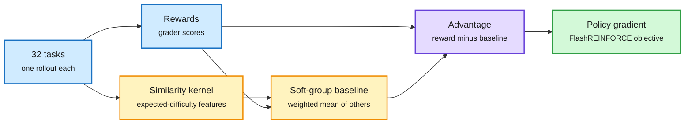

# GS1: Group Size 1, RL From One Rollout per Task

**Date:** 2026-11-08 · **Type:** field report (read in full) · **Authors:** Nikhil V. and Dian Ang Yap (Trajectory Labs)
**Topic:** [Reinforcement learning](reinforcement-learning.md)

## TL;DR

Policy gradients weight each rollout by its advantage, reward minus a baseline. GRPO estimates the baseline by repeating each task; PPO trains a critic. Neither suits production agents, whose tasks cannot be replayed and whose trajectories are long. FlashREINFORCE (Hu et al., 2026) uses the batch-mean reward as a shared baseline and needs neither. The report shows it already matches GRPO on legal and professional benchmarks with one rollout per task. **GS1** improves the baseline for heterogeneous batches: each task's baseline is a similarity-weighted average of the other rollouts' rewards, weighting tasks the policy is expected to find equally hard ("soft groups"). A new metric, **effective batch size**, measures baseline quality offline.

The baseline comes from neighbours, not repeats

Every rollout in the batch is a different task.

Blue is the batch, amber builds the baseline, purple the advantage, green the update.

## Why it works

Any baseline that does not depend on the rollout being scored leaves the expected gradient unchanged; a good one cuts variance. The advantage variance splits into the within-task reward noise σ² (irreducible) plus the baseline's mean squared error from the task's true expected reward μ(x). With B rollouts, gradient variance ≈ (c/B)(σ² + MSE(b)), so the baseline is worth B_eff = B·σ²/(σ² + MSE(b)) perfectly baselined rollouts. The best feature-based baseline is E[μ(x) | features]; it helps exactly as much as the features explain variation in expected reward (law of total variance). With easy and hard task groups, the gain is p(1−p)(m_easy − m_hard)² scaled by how well features separate the groups, which explains why GS1 helps on some benchmarks and not others.

## Key findings

- **Setup:** Inkling-Small (276B total, 12B active), 32 rollouts per step; GRPO uses 8 per task (4 tasks per step), FlashREINFORCE and GS1 use 32 tasks.
- **Group-free works:** FlashREINFORCE matches GRPO on held-out Harvey LAB and beats it on PRBench (2.0 rubric points against 0.8), mostly on out-of-domain tax and cross-border structuring tasks.
- **Effective batch size at B = 32:** AutomationBench 9.3 (FlashRF) vs 13.0 (GS1); LABBench2 10.9 vs 12.6; Harvey LAB 23.8 vs 24.4; PRBench 5.2 vs 5.3.
- **Stability:** LABBench2 held-out pass rate 63% to 68% with GS1, while FlashRF slipped to 65% late. AutomationBench at LR 2×10⁻⁴: GS1 21.0%, FlashRF 19.5%, GRPO 21.4%. At 3×10⁻⁴, FlashRF fell from 21.7% to 7.2% after about 2,500 rollouts; GS1 and GRPO stayed stable.
- Per-task score distributions at the start of training are bimodal on AutomationBench and LABBench2: many tasks almost always solved or almost always failed.

## Gaps

- One policy model, four benchmarks, gains of a few points. Kernel features are described only in general terms in the captured text.
- The baseline's target, the policy's expected reward per task, drifts during training; the kernel is fixed.

## Relation to earlier wiki pages

- **Complements** [Score centering](2026-11-01-score-centering.md) (11-01): centering fixes the score's mean under sampler mismatch; GS1 fixes the baseline's error without replay. Both are about which part of the policy gradient is information.
- **Sidesteps** the failure in [Unlearnability in RLVR](2026-11-01-rlvr-unlearnability-and-exploration-distillation.md) (11-01): a GRPO group with all-equal rewards has zero advantage; soft groups always supply contrast from other tasks.
- **Bears on** the 10-04 open question of an outcome-trained success head ([decision models](../decision-models/decision-models.md)): GS1's baseline is a predictor of task success from pre-rollout features, built for variance reduction.

## Research angle

- A kernel learned online (a small value model over prompts) between GS1 and PPO.
- Does effective batch size predict which RL runs collapse at a given learning rate, across methods?
- For the reasoning project: the baseline model is a "will I succeed here" head trained from outcomes.

## Sources

- [You Only Rollout Once](https://www.trajectory.ai/field-notes/you-only-rollout-once) · [Trajectory Labs post](https://x.com/trajectorylabs/status/2119133952967672052)
- Raw: `raw/twitter/feed/2026-11-08-day-ranked.json` (gitignored)
