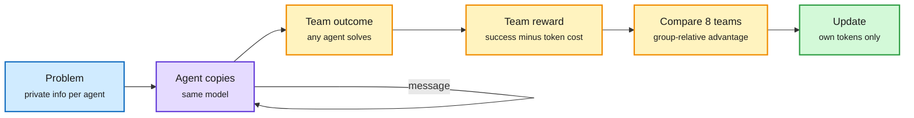

# s³ and SwarmEvolve: Swarms That Learn to Communicate

**Date:** 2026-11-08 · **Type:** project page (s³, read) and paper abstract (SwarmEvolve, arXiv 2611.08483, cross-source confirmed HF + Kurate cs.AI #12) · **Authors:** Kunal Jha, Gonçalo Faria, Shuyue Stella Li, Scott Geng, Faeze Brahman, Noah A. Smith, Yulia Tsvetkov, Max Kleiman-Weiner, Natasha Jaques (UW, Ai2); Qile Jiang and George Em Karniadakis
**Topic:** [Reinforcement learning](reinforcement-learning.md)

## TL;DR

**s³** trains swarms of identical LLMs with cooperative multi-agent RL and no prescribed structure: each agent works on its own copy of a task and coordinates only through message and read_messages tools. One team reward (success if any agent solves it, minus a token cost with λ = 0.25) and GRPO-style comparison across eight teams per problem replace per-agent credit assignment. Learned protocols beat compute-matched best-of-N and carry to larger swarms. **SwarmEvolve** runs hundreds of cheap agents for evolutionary discovery that reason in latent space and share KV caches, with a novelty filter on hidden-state distances and a summarizer that reads merged caches.

Organization is learned, not designed

Teams are compared like GRPO answers; each agent trains only on its own tokens.

Blue is the task, purple the agents, amber the reward and comparison, green the update.

## s³ key findings

- **Design choices:** best outcome, not sum (a sum rewards size; an average rewards solving separately). Teammates' messages and tool results are in context but masked from the loss. Asynchronous agents, messages as notifications, generation in chunks of at most 1,024 tokens, rollouts up to four updates stale, FP8 exploration, IcePop plus score centering for the mismatch.
- **Information aggregation** (each agent holds one number; return all, sorted): with four agents, 93% held-out success against 35% for imitating successful swarms and 13% for individual rewards. Trained at four, evaluated at eight: over 25 times the strongest baseline; ahead through twelve; at sixteen every method struggles.
- **Why individual rewards fail:** sharing helps only others, so agents learn to read before sharing and eventually nobody shares (a public-goods game).
- **Decentralized exploration** (tree of 391 rooms): messaging off costs 19 points and nearly doubles repeated search; four s³ agents nearly match six solo agents; six beat best-of-six by about 7 points.
- **Emergence:** from silent agents, to direct messages, to repeated broadcasts; about 80% of swarms end on one broadcast per agent sent before reading.
- **Ablation:** without SFT, RL still helps, but after 200 steps the swarm loses its edge over best-of-4.
- Models: Qwen3-0.6B and 1.7B on two tasks.

## SwarmEvolve key findings (abstract only)

- Highest average score on 21 mathematical-discovery and scientific-computing problems; median time to reach other frameworks' 60-minute best scores is 3 to 8 minutes; with Qwen3 8B it improves some solutions AlphaEvolve first found with frontier LLMs.

## Gaps

- Toy tasks and small models for s³; abstract-only numbers for SwarmEvolve; no long-horizon real task in either.

## Relation to earlier wiki pages

- **Contrasts with** [GitSwarm](../agent-harness-routing/2026-10-11-gitswarm-compounding-inference.md) (10-11), where hundreds of agents coordinate through a shared Git repository with no learning; s³ learns the protocol.
- **Confirms** score centering's spread ([11-01 summary](2026-11-01-score-centering.md)): s³'s trainer uses it alongside IcePop.
- **Extends** the 11-01 RL-environment thread on multi-agent partial information (AirOpsEnv's three desks, the belief-conditioned actor-critic title on Kurate).

## Research angle

- Epistemic failures (ignoring information, trusting unchecked reports) as a testbed for learned trust.
- Latent (KV-cache) versus text messages on the same task: does concept-level communication search better?

## Sources

- [s³ project page](https://scalingswarms.com/) · [Natasha Jaques](https://x.com/natashajaques/status/2118850517053096257) · [SwarmEvolve](https://arxiv.org/abs/2611.08483)
- Raw: `raw/huggingface/2026-11-08-swarmevolve-latent-agent-swarms-for-evolutionary-d.md`; `raw/kurate/2026-11-08-cs-ai.md`; `raw/twitter/feed/2026-11-08-day-ranked.json` (gitignored)
