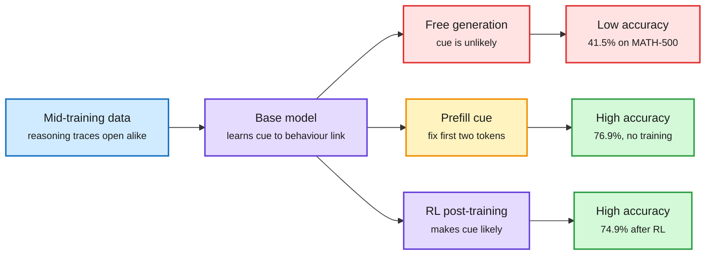

# Base Models Can Reason By Taking a Cue From Training Data

> Source summary · 2026-10-08 · arXiv 2610.06851, author blog and code, via the X feed

**TL;DR.** Fixing a few opening tokens of a base model's response makes it competitive with its RL-trained counterpart on math and coding. RL makes those openings more likely, and fixing them recovers much of RL's gain. The effect comes from associations in the training data: replacing "Okay" with "Chicken" in the mid-training mix turns "Chicken" into a reasoning cue.

RL moves probability onto openings that already worked

The reasoning ability is in the base model. The opening tokens decide whether it is used.

Blue is data, purple is a model or training stage, amber is the intervention, green is the good outcome, red is the default path.

## Key points

- Olmo-3-7B on MATH-500: 41.5% unprompted, 76.9% with the cue `.\n\nOkay`, 74.9% for its RL-trained version. These are the blog's figures. The abstract rounds to 42% and 78%.
- "Alright," raises Qwen3-14B from 72% to 87%.
- RL setting: RL-Zero with verifiable rewards and GRPO. After RL the model is more likely to open with cues that already elicited reasoning in the base model.
- The largest change in next-token predictions after RL is at the first two token positions.
- Data edit: "Okay" replaced by "Chicken" in the 100B-token mid-training mix, training resumed from the same checkpoint. Cued accuracy for "Chicken" went from 18.2% to 76.9%. The word keeps its ordinary meaning in other contexts.
- A similar edit makes "Think duck duck goose" as effective as "Think step by step".
- Hidden states induced by different cues correlate with different document types in the training set. Different cues also elicit distinct refusal and compliance behaviour.
- Limits: single-turn math and coding. Agentic tasks are not covered.

## How this relates to the wiki

- Third result, after Sharpening Tax and Parallel Power Tempering (both 2026-10-04), saying RL post-training on single-turn reasoning mostly relocates probability mass onto behaviour the base model already has. The three-paper threshold for a pattern is crossed.
- In tension with Finetuning with Sampling (2026-10-04), where SFT on projected expert traces solved tasks the base model never solved in 64 tries. The two fit if constructed data can add skills and the model's own samples can only sharpen.
- The authors cite "Reasoning with Sampling" by Karan and Du among earlier ways to reach latent reasoning, the same lineage as Finetuning with Sampling.
- Proposed diagnostic for the wiki to track: the fraction of an RL gain that the best prefill recovers.
- Concept page: [Training and Fine-tuning](training-finetuning.md). See also [Reinforcement Learning](../reinforcement-learning/reinforcement-learning.md).

## Links

- [Paper](https://arxiv.org/abs/2610.06851)
- [Blog](https://sophielwang.com/cues)
- [Code](https://github.com/sophicle/cues)
- Digest: [2026-10-08](../daily-digest/2026-10/2026-10-08.md)
- Raw: [X feed capture](../../raw/twitter/feed/2026-10-08-day-ranked.json), post id 2107911620399931524 (gitignored)
