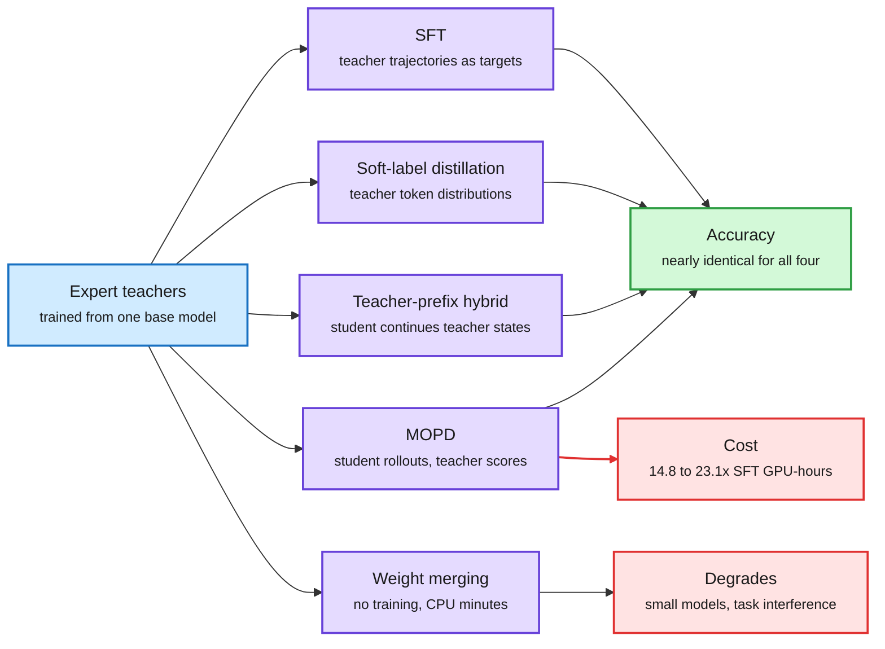

# Multi-Teacher On-Policy Distillation Versus SFT

**Date:** 2026-10-09 · **Type:** paper (arXiv 2610.04272), read from the abstract · **Topic:** [Training and fine-tuning](training-finetuning.md)

## TL;DR

Frontier post-training often trains several expert models from one base checkpoint, one per domain, and then combines them into a single student. The method in favour is MOPD (multi-teacher on-policy distillation): the student generates the rollouts, and the matching teacher supplies token-level targets on the states the student visited. This paper runs a controlled comparison and finds that MOPD, soft-label distillation, a teacher-prefix hybrid and plain SFT (supervised fine-tuning on teacher trajectories) all reach nearly identical accuracy, while MOPD uses 14.8 to 23.1 times the training GPU-hours of SFT. Much of the on-policy gain reported elsewhere comes from training design choices and hyperparameter tuning, not from the algorithm.

Four ways to merge experts, one accuracy, very different cost

Only the on-policy path needs the student to generate rollouts and the teachers to score them.

Blue is the teachers, purple is a way of combining them, green is the shared result, red is a cost or a failure condition.

## Setup

- A self-distillation study: teachers and student start from the same base checkpoint.
- Two multi-teacher settings, four models, eleven benchmarks.
- Four arms. Two are off-policy (trained on text the student did not produce): SFT and soft-label distillation. One is a hybrid, teacher-prefix distillation. One is on-policy, MOPD.
- The authors also revisit four recently published on-policy versus off-policy comparisons with a stronger SFT baseline. Two changes are made: train SFT on rejection-sampled teacher trajectories (keep only the ones that succeeded) and tune its hyperparameters independently.

## Key findings

- All four methods achieve nearly identical accuracy.
- MOPD uses 14.8 to 23.1 times SFT's training GPU-hours. The extra cost is student inference, teacher inference and often environment interaction at every step.
- In the four revisited comparisons, the reported on-policy gains shrink substantially under the stronger SFT baseline.
- Simple weight merging recovers expert capabilities in minutes of CPU time, with no training. Its accuracy degrades as model size decreases and task interference increases.

## The counter-view in the same window: MOPD2

An explainer thread on Xiaomi's MiMo-V2.6 training describes the argument for staying on-policy. In standard on-policy distillation the teacher can only supervise states the student actually visits. Useful states that a stronger teacher reaches, and the student rarely does, are never distilled. MOPD2 widens the set of starting states with three sources:

- **Standard MOPD.** Student prefix, student continuation, teacher supervision.
- **Teacher-prefix.** A teacher trajectory with k assistant turns is cut into k history prefixes. The student is placed at each prefix and writes the next turn itself. The teacher scores that continuation.
- **SFT-prefix.** The same idea with prefixes taken from demonstration data, useful where a reliable reward or verifier is hard to get.

In all three the prefix is context only. Training happens on the student's own continuation, so the update stays on-policy. The objective is closer to a REINFORCE-style policy gradient than to a PPO-style clipped surrogate, with a detached importance-sampling ratio between the rollout policy and the training policy and a mask on tokens where the mismatch is too large.

The teacher-prefix hybrid is one of the four arms in this paper. It did not win.

## Gaps

- Teachers and student share a base checkpoint, so the student can already represent what the teachers do. A strong-to-weak setting, where the student must reach states it cannot find alone, is not covered. That is exactly the setting the MOPD2 argument is about.
- Only the abstract was read. Per-benchmark numbers, model names and the identity of the four revisited papers are not recorded here.

## Relation to earlier wiki pages

This is the third result in two digests that takes credit away from "on-policy" as such, which crosses the threshold for a pattern. The two earlier ones are in the [10-04 digest](../daily-digest/2026-10/2026-10-04.md):

- **Finetuning with Sampling (10-04)** showed plain SFT rivals RL once MCMC sampling rewrites expert traces to look like the model's own text. The loss was not the problem. The data was off-policy.
- **The Cambridge distillation study (10-04)** found that who generated the rollouts mattered less than the direction of the KL divergence and the learning rate.
- **This paper** adds that in multi-teacher merging the on-policy gain is mostly baseline tuning.

The three agree on a sharper claim: what matters is the quality and placement of the training states, not who sampled them. Rejection sampling is the crudest version of that idea. Projection sampling, from Finetuning with Sampling, is the principled one.

It also shifts the 10-04 Global View thread, which called the evidence split. It is now leaning toward the sceptics in research, while industry practice still pays for on-policy stages (Xiaomi's MOPD2, JetBrains crediting scaled RL post-training for Mellum2.1, River's RL recipes, all noted in the [10-09 digest](../daily-digest/2026-10/2026-10-09.md)).

Not read: HuggingFace listed five more on-policy distillation papers in this window (on gains and collapse, negative-policy rollouts, teacher-relative shifts, vision-language-action models, and agent self-distillation collapse). None had a readable abstract in the raw files, so no claims from them are recorded.

## Research angle

- **Open problem.** A compute-matched comparison on tasks with zero base pass rate, where the student cannot stumble on the answer and state coverage should finally matter. If SFT on filtered teacher trajectories still matches there, the on-policy premium is hard to defend.
- **A cheap check for any lab.** Before an MOPD stage, run SFT on rejection-sampled teacher trajectories with its own hyperparameter sweep. The possible saving on that stage is more than an order of magnitude.
- **Weight merging first** for large models with little task interference.

## Links

- Source: [paper](https://arxiv.org/abs/2610.04272) · [author post](https://x.com/RoyXie_/status/2107587276352155667) · [MOPD2 explainer](https://x.com/BhavinJawade/status/2107503409209467121)
- Digest: [2026-10-09](../daily-digest/2026-10/2026-10-09.md)
- Raw: surfaced via saved reading (local capture, not published). No alphaxiv overview was available.
