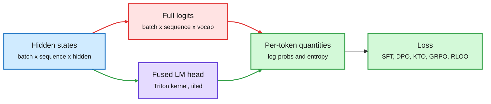

# TRL v1.15: The Fused LM Head

**Date:** 2026-10-11 · **Type:** library release notes · **Source:** Hugging Face TRL v1.15.0, released 2026-10-08
**Topic:** [Training and fine-tuning](training-finetuning.md)

## TL;DR

Every post-training loss needs per-token log-probabilities, and the usual way to get them builds a logits tensor of size batch by sequence by vocabulary. With a large vocabulary that tensor sets the maximum sequence length. TRL v1.15 replaces it with a fused LM head: a Triton kernel projects hidden states through the head in tiles and reduces directly to per-token log-probs and entropy. The full tensor is never built. It is on by default for SFT, DPO, KTO, GRPO, RLOO and distillation. On gemma-3-1b the longest trainable sequence grows by 4 to 6.9 times on the same GPU, and peak memory at 8,192 tokens drops 52% to 82%.

Go from hidden states to log-probs without building logits

The red box is the tensor the old path built. The new kernel reduces tile by tile and never holds it.

Blue is input, red is the old path, purple is the new kernel, green is what the loss actually needs.

## What changed

- **Fused scoring.** The kernel computes per-token log-probabilities and entropy from hidden states in tiles. Extra quantities trainers used to read from logits became opt-in kernel outputs: `log_sum_sq_probs` (for WPO weighting), `mean_logits`, and `is_top1` (DPO's mean token accuracy). Each is checked against the full-logits result in tests.
- **Default on.** SFT, DPO, KTO, GRPO, RLOO and distillation use it with no flag.
- **Requirements.** Scoring needs Triton on a GPU (Linux with CUDA, ROCm or XPU).

## Numbers

Maximum trainable sequence length, gemma-3-1b with a 262k vocabulary, 79 GiB of GPU memory, bf16, batch size 1, gradient checkpointing:

| Trainer | v1.14.2 | v1.15.0 | Ratio |
|---|---|---|---|
| DPO | 10,240 | 59,392 | 5.80× |
| KTO (batch size 2) | 9,216 | 63,488 | 6.89× |
| GRPO (scoring only) | 28,672 | 114,688 | 4.00× |
| RLOO (scoring only) | 23,552 | 100,352 | 4.26× |
| SFT (`nll`) | 20,480 | 107,520 | 5.25× |
| SFT (default `chunked_nll`) | 107,520 | 107,520 | 1.00× |

At 8,192 tokens, peak memory and speed:

| Trainer | Peak GiB before → after | Tokens per second |
|---|---|---|
| DPO | 48.97 → 12.00 (−75.5%) | 1.035× |
| KTO | 64.91 → 11.98 (−81.5%) | 1.045× |
| GRPO | 24.15 → 10.30 (−57.4%) | 1.023× |
| RLOO | 29.28 → 14.02 (−52.1%) | 1.029× |
| SFT (`nll`) | 30.33 → 8.87 (−70.7%) | 1.029× |

The release notes say the gain is largest for small models with large vocabularies.

## Breaking changes

- A PEFT adapter on `lm_head` now raises. Use `modules_to_save=["lm_head"]`.
- `use_liger_kernel=True` is deprecated in GRPO, RLOO, DPO and KTO and will be removed in v2.0.0.
- In DPO and KTO, `compute_metrics` still receives full logits from an extra forward pass taken only when used, with a deprecation warning.

## Also in the release

- **Selective activation checkpointing in SFT.** With gradient checkpointing on, the attention output is saved during the forward pass instead of recomputed in the backward pass, for one extra hidden-state-sized tensor per layer. Not compatible with PEFT plus DeepSpeed ZeRO-3.
- **Assistant-only loss on vision datasets.**
- **AsyncGRPO** can train OpenEnv harnesses from validated token captures. **AsyncDistillationTrainer** gained PEFT support.
- SFT's mixture-of-experts auxiliary loss is now independent of world size and gradient accumulation.

## Gaps

The benchmark used one B300 with the allocator capped at 79 GiB, a randomly initialized model and synthetic token ids. GRPO and RLOO numbers replace generation with fixed completions, so only scoring is measured. Not measured: H100 hardware itself, flash-attention, real generation, multi-GPU.

## Relation to earlier wiki pages

- **Removes a memory wall for the RL thread.** The [bias, variance and throughput essay](../reinforcement-learning/2026-10-11-bias-variance-throughput-llm-rl.md) and [ThunderSyncRL](../reinforcement-learning/2026-10-11-thundersyncrl.md) are about time. This is the memory counterpart: sequence length is the binding constraint in agentic RL, where every turn re-reads a growing context.
- **Fits the cost argument from 10-09.** The [multi-teacher study](2026-10-09-multi-teacher-opd-vs-sft.md) compared methods by GPU-hours. Distillation divergence is now also computed by a Triton kernel, which lowers the memory side of on-policy distillation.
- **Related inference idea.** Scoring a few options without a full distribution is what decision models do. [Vega](../decision-models/2026-10-11-vega-physics-decision-model.md) never runs the LM head at all.

## Research angle

Why it works: the loss reads one number per position from the logits plus a normalizer, so the vocabulary dimension can be reduced inside the kernel before anything is stored. It is the same move FlashAttention made for the attention matrix. An open check is whether exact agreement with the dense path holds under bf16 at very long sequences, where rounding in a tiled log-sum-exp could accumulate differently.

## Links

- Source: [release notes](https://github.com/huggingface/trl/releases/tag/v1.15.0) · [post](https://x.com/QGallouedec/status/2108468004128424042) · [post](https://x.com/LysandreJik/status/2108549658440241376)
- Digest: [2026-10-11](../daily-digest/2026-10/2026-10-11.md)
- Raw: X feed capture for the 2026-10-11 window (local only)
