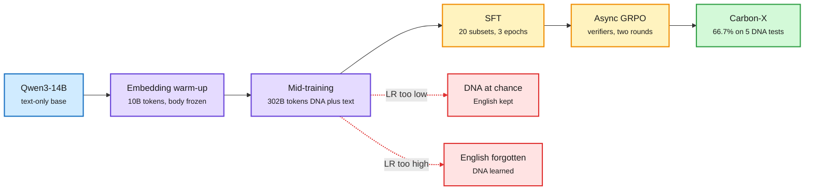

# Carbon-X: Mid-Training a 14B Model to Read DNA

**Date:** 2026-11-01 · **Type:** model release with full recipe (model card read in full) · **Authors:** Hugging Face (HuggingFaceBio), announced by Lewis Tunstall, Leandro von Werra and Loubna Ben Allal
**Topic:** [Training and fine-tuning](training-finetuning.md)

## TL;DR

Carbon-X is a 14.8B decoder-only model, started from Qwen3-14B, that reads raw DNA inside an ordinary chat and answers in English. DNA and text share one token stream: a hybrid tokenizer keeps Qwen's BPE vocabulary for text and encodes DNA as non-overlapping 6-mers (one token per 6 bases), which the announcement says uses about 3 times fewer tokens than BPE. The recipe is a four-stage stack: train only the new DNA embeddings for about 10B tokens, mid-train the whole model on 302B tokens (55% raw DNA, 20% English, 15% biology text, 10% instructions), SFT on 20 subsets, then two rounds of asynchronous GRPO with code-checked rewards. Across five DNA benchmarks it averages 66.7% with thinking disabled, 27 points above Qwen3-14B and close to GPT-6.1 Sol's 67.5%, at about 1/1,800 of the inference cost per problem. Apache 2.0, runs on one 80 GB GPU.

The capability comes from mid-training; post-training shapes it

Four stages, each with a different job. The learning rate at the second stage decides whether DNA or English survives.

Blue is the starting model, purple is the stages that add capability, amber is post-training, red is the two failure modes of the mid-training learning rate, green is the release.

## Recipe details (from the model card)

- **Vocabulary extension.** 5,515 DNA tokens added: 4,096 6-mers, 1,364 tail tokens for sequence lengths not divisible by 6, plus `<dna>`, `</dna>` and an out-of-vocabulary marker. Runs of at least 6 A/C/G/T bases are tagged automatically. New embeddings are random; about 10B tokens are trained with the transformer frozen before unfreezing.
- **Mid-training.** 302B tokens, sequence length 8,192, global batch 512 sequences (about 4.2M tokens per step, 72,000 steps), cosine schedule from 5e-5 to 5e-6 after 2,000 warmup steps. "Learning rate was the dominant knob at this stage." Mix: raw DNA 55% (eukaryotic genomes 38.5%, mRNA, prokaryotic genomes), English 20% (FineWeb-Edu, DCLM, FinePDFs-Edu), biology text 15% (documents with long DNA, PubMed, bioRxiv, synthetic descriptions of annotated RefSeq sequences), instructions 10%.
- **SFT.** 3 epochs, 20 subsets, LR 1e-5 to 1e-6, loss on assistant tokens only. About 30% variant-effect reasoning over several views of the same variant; about 10% procedurally generated DNA skills (counting, searching, editing). No distillation from a larger model.
- **RL.** Asynchronous GRPO in TRL with vLLM generation, thinking disabled. Round one: 98,433 prompts chosen by the SFT model's own pass rates, 150 steps. Round two: 58,249 prompts re-selected from its rollouts. 16 samples per prompt, up to 4,096 tokens, LR 1e-6, asymmetric clipping (0.2 and 0.28), max gradient norm 0.2. Rewards are task-specific code verifiers, including a penalty for ungrounded rationales.
- **Decontamination** against all benchmarks by DNA span overlap, text n-grams and sequence homology.

## Results

| Benchmark | Carbon-X | GPT-6.1 Sol | Opus 5.5 | Kimi K3 |
|---|---|---|---|---|
| BioReason Coding (variant effects) | 74.9 | 71.0 | 70.3 | 53.9 |
| BioReason Non-SNV | 85.1 | 91.7 | 94.8 | 65.3 |
| GenomeQA | 63.6 | 67.2 | 62.2 | 52.0 |
| NextBase (built by the authors) | 39.4 | 32.9 | 1.1 | 30.6 |
| FrontierVEP (built by the authors) | 70.4 | 74.9 | 76.2 | 50.1 |
| Average | 66.7 | 67.5 | 60.9 | 50.4 |

IFEval prompt-level strict accuracy is 79.3%. The card estimates about $300 to analyse ClinVar's 2.4 million variants of uncertain significance, against $32,000 to $4 million with frontier models. The announcement adds that Kimi K3 gains 11.1 points when it consults Carbon-X as a sub-agent.

## Gaps

- Two of the five benchmarks were built by the authors. GenomeQA's splice-site (29.8%) and histone-mark (34.6%) tasks remain weak.
- One Hugging Face researcher said in an interview that "RL fine-tuning will not help you" for this kind of gain, while the card uses two RL rounds. No ablation separating the stages' contributions was in what was read.
- Results are with thinking disabled; whether reasoning helps or hurts on DNA was not reported.

## Relation to earlier wiki pages

- **Contrasts with** the 10-09 [multi-teacher OPD versus SFT](2026-10-09-multi-teacher-opd-vs-sft.md) result, where all post-training routes converged. Here the step change is in mid-training data, not in the post-training objective.
- **Connects to** the HuggingFace paper "Your LR Schedule May Not Be Principled" (2610.40362, abstract read), which argues the effective learning-rate trajectory, not the parameterization, drives pretraining loss. Carbon-X's learning-rate tension between new and old capability is the practical version of that claim.
- **Uses** the same asynchronous GRPO stack whose stability the [score centering](../reinforcement-learning/2026-11-01-score-centering.md) paper addresses.

## Research angle

The interesting mechanism is the learning-rate trade-off: a low rate keeps English and leaves DNA at chance, a high one learns DNA and forgets English. That is catastrophic forgetting appearing as a single scalar knob, and it suggests mid-training a new modality is closer to continual learning than to fine-tuning. Open: does a stage-wise or per-parameter-group schedule (for example a higher rate on new embeddings and early layers) remove the trade-off? For the reasoning-model project, a 6-mer DNA vocabulary is a worked example of adding a non-linguistic "concept" alphabet to a language model's single stream instead of bolting on an encoder.

## Links

- Model card: https://huggingface.co/HuggingFaceBio/Carbon-X
- Posts: https://x.com/adithya_s_k/status/2113247783943885161 · https://x.com/lvwerra/status/2113278666507485349 · https://x.com/MTSlive/status/2115907719576363015
- Raw: X feed capture for the 2026-11-01 window (local only)
