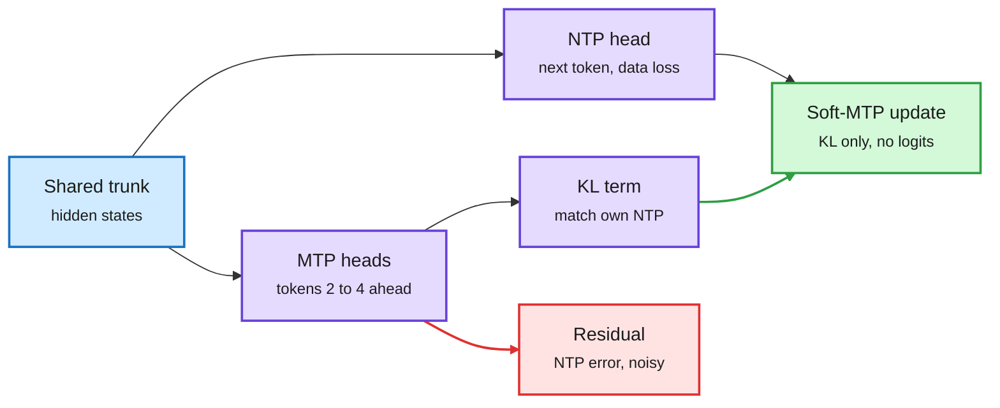

# Multi-Token Prediction Done Right (Soft-MTP)

**Date:** 2026-11-01 · **Type:** paper (arXiv 2610.38331) with code and checkpoints · **Author:** Jayden Teoh (MIT)
**Topic:** [Training and fine-tuning](training-finetuning.md) · cross-source confirmed via social (HuggingFace Daily Papers and X)

## TL;DR

Multi-token prediction (MTP) adds heads that predict tokens 2, 3 or more positions ahead, as in DeepSeek-V3. It helps pretraining and gives drafts for speculative decoding. The paper shows that the standard MTP cross-entropy gradient decomposes exactly into two parts: a KL self-distillation term that pulls each MTP head toward the model's own next-token distribution (the useful part, which also raises draft acceptance), and a residual driven by the next-token model's own error against the one-hot target, which has low signal-to-noise and interferes with learning more as scale grows. The fix is a one-line straight-through change, `h_ntp += h_mtp.detach() - h_mtp`, which routes the gradient so that only the KL term reaches the network. Because the heads share the output matrix, this recovers the exact KL gradient without materializing vocabulary-sized logits, so it works with fused cross-entropy kernels. From 167M to 1.2B parameters it improves next-token perplexity, speculative decoding and zero-shot accuracy at every scale.

The MTP gradient was two signals, and one of them was noise

Soft-MTP keeps the same two cross-entropy computations and changes only where the gradient flows.

Blue is the trunk, purple is the heads and the useful KL signal, red is the residual Soft-MTP discards, green is the update.

## Mechanism

Let p be the NTP distribution for position t+k (from the NTP head applied at t+k-1) and q the MTP head's distribution for the same target. With a shared linear head W, the gradient of CE(onehot, q) with respect to the MTP logits is q − onehot = (q − p) + (p − onehot). The first term is exactly the gradient of KL(q‖p) with p held fixed: self-distillation. The second is the NTP model's own error, which is mostly sampling noise from one-hot targets and does not shrink as the model improves. The straight-through line makes the forward pass unchanged while the backward pass sends the NTP cross-entropy gradient into the MTP hidden state, which cancels the residual and leaves only the KL term. The repository includes tests showing the routed gradient equals explicit KL minimization to float64 machine precision. A scale factor in the code undoes the averaging mismatch between the NTP and per-head losses.

## Key findings (abstract and repository)

- Supports DeepSeek-style and Meta-style MTP, adds no parameters and has no measurable overhead.
- 167M, 332M, 689M and 1.2B models (K = 3 MTP heads) trained on 31.5B FineWeb-Edu tokens with Muon: lower NTP perplexity, faster speculative decoding and higher zero-shot accuracy at every scale; lower MTP perplexity from 689M up; stronger maths and code after fine-tuning at 1.2B.
- Matches or exceeds direct KL minimization, which needs full-vocabulary softmaxes in memory.
- A Hugging Face commenter reported, from the paper, that the residual carries about 80% of the MTP gradient reaching the trunk at roughly 4 times lower SNR, with the gap growing from 4.1 times at 167M to 4.6 times at 1.2B. That detail was not verified against the paper body.

## Gaps

- Largest model is 1.2B on 31.5B tokens; the scale trend is the paper's argument, not yet its evidence at frontier size.
- Only K = 3 heads tested in what was read.

## Relation to earlier wiki pages

- **Extends** the inference side of the wiki: MTP heads double as speculative drafters, the same role JetSpec++'s draft model plays in [today's inference page](../inference-optimization/2026-11-01-jetspec-plus-plus.md).
- **Echoes** the 10-11 [score centering](../reinforcement-learning/2026-11-01-score-centering.md) story at a different layer of the stack: a gradient that looked like one signal is two, and removing the zero-information part is cheaper than taming it with weights.

## Research angle

Why it works is simple once stated: the auxiliary head should learn *what the model will predict*, not *what the data says*, because only the former is learnable without more context and only the former helps drafting. Open: does the same decomposition apply to other auxiliary predictive losses that share an output head, such as next-hidden-state prediction or JEPA-style latent targets inside language models? A two-hour interview with the author on biasing a transformer toward predicting its own next hidden state (@yacinelearning) was saved in this window and is the natural follow-up.

## Links

- Paper: https://arxiv.org/abs/2610.38331 · Code: https://github.com/JaydenTeoh/Soft-MTP · HF page: https://huggingface.co/papers/2610.38331
- Post: https://x.com/jayden_teoh_/status/2116228700467302551
- Raw: `raw/huggingface/2026-10-31-multi-token-prediction-done-right.md` (title only) and the X feed capture (local only)
