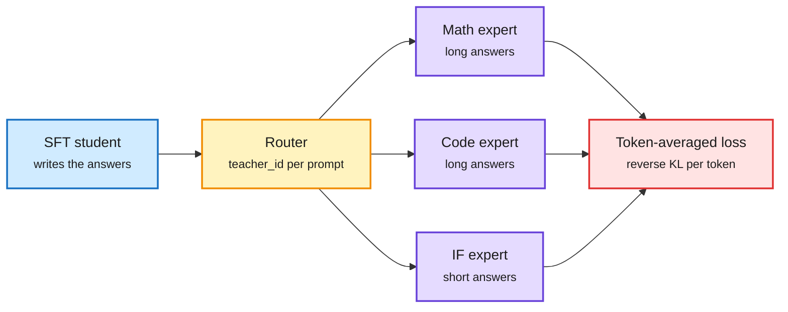

# MOPD in TRL, Token Imbalance, and StepX-OPD

**Date:** 2026-11-08 · **Type:** X Article (Hugging Face, read in full) plus paper abstract (StepX-OPD, arXiv 2611.04386) · **Authors:** Sergio Paniego and the TRL team; Chenru Wang et al.
**Topic:** [Training and fine-tuning](training-finetuning.md)

## TL;DR

MOPD (multi-teacher on-policy distillation) is the last stage of a three-step recipe: general SFT, one RL expert per domain trained from that checkpoint, then fusion, where the SFT student answers prompts from every domain and each prompt's expert scores the student's tokens (reverse KL on the student's samples). TRL's AsyncDistillationTrainer now supports it: one vLLM server per teacher, a teacher_id column per prompt, asynchronous generation, scoring and training. The write-up's main empirical point is **token imbalance**: the loss averages over tokens, so long maths and code answers dominate short instruction-following answers. In a 60-step run with Open-MOPD's SmolLM3-3B experts, instruction following fell to a few percent of tokens and the student barely moved toward that teacher. StepX-OPD (HuggingFace) applies multi-teacher on-policy distillation to text-to-image diffusion, merged with few-step distillation.

Each prompt goes to its own expert, but tokens decide the weight

Routing is by prompt. The loss is by token.

Blue is the student, amber the router, purple the teachers, red where imbalance enters.

## Key findings

- **Who uses MOPD** (per the article): Xiaomi named it for MiMo-V2-Flash; DeepSeek, Moonshot, NVIDIA, Liquid AI and Mistral followed. NVIDIA used more than ten teachers for Nemotron 3 Ultra and ran MOPD twice, and released five teachers on the Hub.
- **How much of the teacher distribution:** one token (Nemotron 3 Ultra, MiMo-V2-Flash); top 16 (Open-MOPD); full vocabulary (DeepSeek-V4, because single-token targets gave high-variance gradients; Mistral Large 4). Beam (this window) also uses full-vocabulary reverse KL.
- **TRL specifics:** with reverse KL (beta 1.0), TRL uses only the sampled token's teacher probability; top-k only matters with forward KL. All teachers must share the student's tokenizer. The example runs five processes on 4 H200s.
- **Metrics:** teacher_jsd per teacher (distance) and teacher_token_frac per teacher (share of each step). The Open-MOPD authors identified the imbalance and propose a fix in their paper.
- **60-step result:** maths reached about the paper's final model; instruction following lagged, the domain with the fewest tokens. Code was not evaluated.
- **StepX-OPD** (abstract only): frozen specialist teachers supervise a diffusion student on states its own few-step rollouts visit, plus velocity regression on the low-noise part of the rollout and a variant that stops prompt words leaking into images. Highest normalized average among four-step methods on SD3.5-Medium and FLUX.1-dev, beats the 40-step Flow-OPD, and about 37% fewer GPU-hours than DiffusionOPD followed by step distillation.

## Gaps

- 60 steps is about 1% of the paper's training; the example is a correctness check, not a result.
- No comparison against SFT on filtered expert traces.

## Relation to earlier wiki pages

- **Bears on** [Multi-teacher OPD vs SFT](2026-10-09-multi-teacher-opd-vs-sft.md) (10-09): MOPD matched SFT at 14.8 to 23.1 times the GPU-hours. If that study used token-averaged losses across mixed domains, imbalance could have handicapped MOPD on short-answer skills. Untested.
- **Context:** Beam merges with MOPD; Inkling 2 Small abandoned it for joint RL ([summary](2026-11-08-beam-and-inkling-2-recipes.md)).
- **Extends** the 11-01 distillation notes (with several teachers, SFT learns their mixture and on-policy distillation their geometric mean).

## Research angle

- Per-domain KL normalization so every teacher's distance shrinks at a comparable rate; MOPD as a multi-objective problem.
- Re-run the 10-09 comparison with per-domain normalization to see whether the on-policy premium is real.

## Sources

- [TRL MOPD article](https://x.com/SergioPaniego/status/2117640447174529038) · [StepX-OPD](https://arxiv.org/abs/2611.04386)
- Raw: `raw/twitter/feed/2026-11-08-day-ranked.json` (gitignored); `raw/huggingface/2026-11-08-stepx-opd-rethinking-multi-teacher-on-policy-disti.md`
