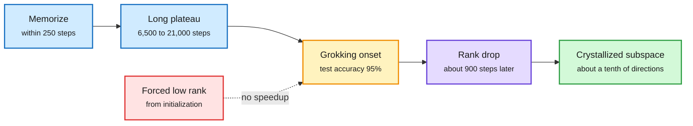

# Subspace Crystallization in Grokking: Rank Compression Tracks the Phase Transition

**Date:** 2026-11-08 · **Type:** paper (arXiv 2610.35112; abstract, alphaXiv overview, author thread and repository read) · **Authors:** Shlok Mehendale, Paras Chopra (Lossfunk)
**Topic:** [Training and fine-tuning](training-finetuning.md)

## TL;DR

Grokking is when a network memorizes its training data and generalizes much later. The weight matrices' effective rank falls along the way, and that has been read as a mechanism. This paper separates the two clocks and intervenes. In one-layer transformers on (a+b) mod 97, memorization comes within 250 steps, grokking onset (95% test accuracy) anywhere from 6,500 to 21,000 steps, and the steepest rank drop about 900 steps after onset however late it comes. Output-preserving directions shrink from a quarter or more to about a tenth ("subspace crystallization"). Imposing low rank from initialization, against a matched factorized full-rank control, does not speed grokking, and capping the embedding's rank stops 15 of 20 runs from grokking. Compression is a signature of grokking, not its cause.

Two clocks: memorize early, generalize late, compress with the second

The rank drop tracks the onset, not memorization. Forcing low rank early does not move the onset.

Blue is memorization, amber the onset, purple the compression, green the end state, red the failed intervention.

## Key findings

- **Timing (29 grokked seeds, after step 4,000 to set aside the initialization-decay drop):** steepest effective-rank decrease 905 ± 506 steps after onset in 27 of 29 seeds; tracks onset with r = 0.99 and slope 1.02 (95% CI 0.98 to 1.07). Scatter around onset 506 steps against 4,234 around memorization. The drop begins about 1,888 ± 992 steps before onset, after test accuracy first reaches 10%. Replicates on 15 held-out seeds (850 ± 524 steps after onset in 14 of 15).
- **Negative control:** MLP input-weight rank falls 60 ± 5% in grokked transformers against 15 to 23% in seven runs that memorize and never grok.
- **Output count, not accuracy count:** directions needed to keep outputs within 10% fall from 27 to 53 per matrix 3,000 steps before onset to 11 to 17 at onset and 9 to 14 after (22 to 54% of directions before, 7 to 11% after, per the thread). The embedding uses about four Fourier frequencies, predicting about 8 directions. For an MSE-trained MLP, the accuracy-based count narrows but the output count stays at 122 to 127 of 128, so accuracy-based truncation can mislead.
- **Intervention:** MLP input rank cap r = 32 grokked in 5 of 5 runs at 14,350 ± 5,730 steps against 14,100 ± 4,095 for the factorized full-rank control; tighter caps delay or destabilize. Embedding caps: 5 of 20 runs grok. Factorizing alone made the MLP grok 7.5 times faster.
- **Late compression and the optimizer:** the MLP keeps compressing long after grokking; late in training AdamW acts like momentum gradient descent with an effective step set by ε, and changing ε changes late compression.

## Gaps

- Small models on cyclic-group tasks; the authors disclaim generalization to large models.
- Compression is shown not to be sufficient as an early intervention, not shown irrelevant.

## Relation to earlier wiki pages

- **Connects to** 11-01's optimization-dynamics notes (edge-of-stability explainer; the effective learning-rate schedule paper) through the AdamW-ε regime.
- **Method parallel** with this window's [weight-space programming](../interpretability-safety/2026-11-08-weight-space-programming.md): both read structure in weights, and this paper shows why causal tests must back such readings.

## Research angle

- If compression is downstream, what triggers onset? Nanda et al.'s circuit-formation-then-cleanup account fits; look for when the generalizing circuit's margin overtakes the memorizing one.
- Does the output-count measure transfer to larger models as a progress measure for delayed generalization?

## Sources

- [Paper](https://arxiv.org/abs/2610.35112) · [alphaXiv overview](https://www.alphaxiv.org/abs/2610.35112) · [Thread](https://x.com/lossfunk/status/2118308228144763377) · [Code](https://github.com/Lossfunk/Causal-geometric-grokking) · [Project page](https://mehshlok.github.io/subspace-crystallization/)
- Raw: `raw/twitter/feed/2026-11-08-day-ranked.json` (gitignored)
