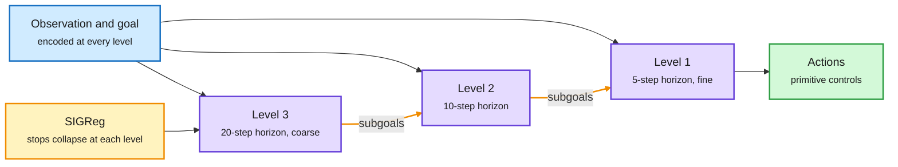

# H-JEPA: End-to-End Learning of Hierarchical World Models for Visual Planning

> Source summary · 2026-10-08 · arXiv 2610.06805 via alphaxiv's listing and the authors' thread on the X feed

**TL;DR.** A hierarchy of action-conditioned JEPA world models trained jointly. Each level predicts farther ahead in its own learned latent space. Planning is top-down: the top level optimizes progress toward the goal and each level's predictions become subgoals for the planner below. Higher levels discard fast, unpredictable detail and keep slower task-relevant state. On Visual AntMaze a three-level hierarchy raises success from 18% to 73% with less planner compute.

Slow levels decide where to go. Fast levels decide how.

Each level has its own latent space and its own clock. Predictions flow down as subgoals.

Blue is input, purple is a world model level, amber is the regularizer and the subgoal path, green is the action output.

## Key points

- Each higher level consumes the lower level's latents and pooled actions at a coarser stride, with its own encoder and predictor. In the simulated models level 1 spans 5 environment steps, then 10 and 20.
- All levels train jointly on prediction loss plus SIGReg, a regularizer against latent collapse. The flat baseline is LeWM.
- AntMaze, 50 tasks: 73.3% (SE 3.5) for three-level H-JEPA against 18.0% (SE 3.5) for flat LeWM, settings chosen under a 100-TFLOP planning budget.
- Against HWM (a hierarchy in a shared latent space) at equal depth: both beat LeWM on average in all four environments. H-JEPA's extra advantage is largest on AntMaze, moderate on Cube, and not apparent on FourRoom or Push-T.
- Three-level H-JEPA is poor on Push-T. Likely cause per the authors: short episodes leave 58% of LeWM's training transitions per epoch.
- With inverse-dynamics supervision it extends to DROID real-robot videos, evaluated offline. There is no closed-loop robot test.
- Same window: RoboJEPA (Meta, arXiv 2610.10515), an 8B JEPA predictor on 12 embodiments whose latent rollout error follows a second-order power law in compute and correlates with planning performance. NAVA-WAM (Meta, arXiv 2610.03391) pretrains an action policy from observation-only video. MC-PhysBench scores video world models by time to physical failure, with the best at 30% (posts only).

## How this relates to the wiki

- First world-model source summary in the wiki. It starts the thread on hierarchy and abstraction in latent space.
- Connects to the looped-model thread (2026-10-04 and [LiFT](../models-architectures/2026-10-08-lift-loop-flow-transformers.md)): both spend compute in latent state, not tokens.
- Connects to the System 1 and System 2 formulation in the value-function essay (2026-10-04): the top level's goal search could be replaced by a learned value.
- A caution from an overlapping author group on the Kurate cs.LG board, "Preserving Unstable Modes Through Inverse Dynamics in JEPA World Models" (arXiv 2610.07540): avoiding collapse does not guarantee keeping a direction a controller needs. Only the first part of its overview was read.
- Concept page: [World Models and Machine Reasoning](world-models-reasoning.md).

## Links

- [Paper](https://arxiv.org/abs/2610.06805)
- [Post](https://x.com/askalphaxiv/status/2107751281553236473)
- [Code](https://github.com/kevinghst/H-JEPA)
- Digest: [2026-10-08](../daily-digest/2026-10/2026-10-08.md)
- Raw: [X feed capture](../../raw/twitter/feed/2026-10-08-day-ranked.json), post id 2107751281553236473 (gitignored)
