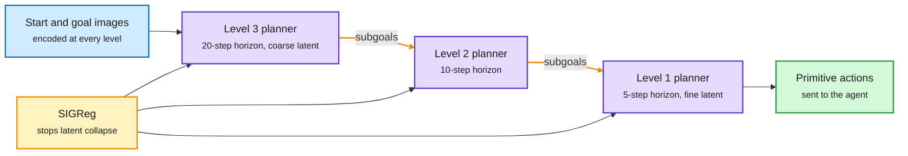

# H-JEPA: End-to-End Learning of Hierarchical World Models for Visual Planning

**Date:** 2026-10-09 · **Type:** paper (arXiv 2610.06805), read from the abstract and the alphaxiv overview · **Authors:** Wancong Zhang, Basile Terver, Michael Rabbat, Yann LeCun, Randall Balestriero and one more (NYU, AMI Labs, INRIA Paris, Brown University)
**Topic:** [World models and machine reasoning](world-models-reasoning.md)

## TL;DR

A world model predicts what actions will do, so a planner can test futures before acting. A JEPA (joint-embedding predictive architecture) does this by predicting future latent states instead of future pixels. H-JEPA stacks several action-conditioned JEPAs. Each level has its own encoder, predictor and latent space, and each predicts further ahead than the one below. Planning runs top-down: the top level picks a coarse route toward the goal, and each level's predicted states become subgoals for the level beneath, until the bottom level outputs primitive actions. All levels are trained jointly. On Visual AntMaze a three-level hierarchy raises success from 18% to 73% while using less planner compute. The notable side effect is that higher levels learn to drop fast, unpredictable detail and keep slow, task-relevant state, with no labels saying which is which.

The top level picks the route, the bottom level moves the legs

Each level has its own latent space. Predictions from above become subgoals below.

Blue is observation, purple is a world model with its planner, amber is the regularizer and the subgoal hand-off, green is the action.

## The problem

A flat latent planner has two bottlenecks. To look far ahead it must chain many short predictions, so errors accumulate and the number of actions to optimize grows. And one representation has to serve both fine control and abstract goal matching. In Visual AntMaze an eight-degree-of-freedom quadruped must reach a goal through a maze. A flat planner has to match leg poses all the way along the route.

## Mechanism

- **Levels.** Level 1 encodes observations and predicts short-horizon latent futures from states and actions. In the simulated models it spans five environment steps. Each higher level consumes the latents and pooled actions of the level below at a coarser stride, with its own learned state encoder and predictor. Successive levels predict over ten and then twenty environment steps.
- **Loss.** Prediction error at every level plus SIGReg, a regularizer that keeps each latent space well-conditioned so it does not collapse to a constant. There is no reward term and no pixel reconstruction.
- **Planning.** Encode the current and goal observations at every level. Optimize the top-level macro-action sequence toward the goal in the top latent space. Send the predicted states down as subgoals. Each lower level optimizes actions so that its rollout, encoded in the next level's space, matches those subgoals. Level 1 returns primitive actions.

## Key findings

- **Visual AntMaze.** On a 50-task evaluation, three-level H-JEPA reaches 73.3% success (standard error 3.5) against 18.0% (standard error 3.5) for the flat LeWM baseline. Start and goal are three maze cells apart. Planner settings were chosen under a 100-TFLOP planning budget.
- **Compute.** A separate sweep shows the success-against-compute frontier shifting toward higher success at lower planner FLOPs on FourRoom, AntMaze and Cube as levels are added up to three.
- **Emergent abstraction.** Decoded top-level latents keep the ant's position and the maze layout while leg-pose detail fades.
- **Against the closest prior method.** HWM also uses several prediction horizons and passes upper-level predictions down as subgoals, but keeps all levels in one shared latent space. At the same hierarchy depth, both hierarchical methods beat LeWM on average in all four environments. H-JEPA's extra advantage over HWM is largest on AntMaze, moderate on Cube, and absent on FourRoom and Push-T.
- **A failure case.** On Push-T the three-level model performs poorly. The authors' likely explanation is that short Push-T episodes leave it only 58% of the baseline's training transitions per epoch.
- **Real video.** With inverse-dynamics supervision the approach extends to real-robot video from DROID, where hierarchy improves offline planning fidelity at lower planner compute.

## Gaps

- Four simulated tasks plus an offline evaluation on robot video. There is no closed-loop run on a physical robot. The paper names that as future work.
- The benefit of separate latent spaces over a shared one is clear on one of four environments. Most of the gain over a flat model may come from temporal decomposition, which HWM already had. H-JEPA extends hierarchical temporal planning and does not originate it.
- Depth and strides are set by hand.
- This page is based on the abstract and the alphaxiv overview, not the full paper.

## Relation to earlier wiki pages

This is the first world-model paper ingested into the wiki, so there is no earlier summary page to confirm or contradict. Connections inside the [10-09 digest](../daily-digest/2026-10/2026-10-09.md) window:

- **Scaling evidence the same week.** Meta's RoboJEPA scales JEPA predictors up to 8B parameters with data from 12 robot embodiments and studies how latent prediction error forecasts planning performance.
- **Abstraction by factor instead of by timescale.** JEPA-Anything, surfaced via saved reading, factorizes the latent into orthogonal subspaces with separate predictors and is applied across molecules, cells, fluids, patients, robots and weather.
- **A caution.** MC-PhysBench times how long video world models stay physically valid on simple scenes. The digest records the top model at 30%.
- **Composition supplied from outside the network.** The essay summarized in [Harnesses as compositional generalizers](../agent-harness-routing/2026-10-09-harness-as-compositional-generalizer-rlm.md) gets abstraction from a program around the model. H-JEPA gets it from the prediction horizon. These are two different answers to where coarse units come from.
- **A shared structural idea with ALoDLM.** [ALoDLM](../models-architectures/2026-10-09-alodlm-adaptively-looped-diffusion-lm.md) spends more computation where prediction is hard. H-JEPA spends coarser representation where prediction is far.

## Research angle

Why it works: when factors in the data change at separated timescales, a long-horizon predictor is penalized for carrying anything it cannot predict that far ahead. So it keeps only slow state. Abstraction is a by-product of the prediction horizon.

That is a concrete, trainable mechanism by which a slow planner comes to reason in coarser units than a fast controller, without labels for what the units are. It bears directly on any design that pairs a slow reasoner over a world model with a fast decider. Open problems:

- **Learning the hierarchy.** Depth and strides are fixed in advance. Deciding when to add a level is unsolved.
- **Discrete units.** Subgoals are points in a continuous latent space, not concepts. There is nothing yet that a fast decider could choose among.
- **Does separation matter?** The HWM comparison leaves open whether separate latent spaces help outside AntMaze.

## Links

- Source: [paper](https://arxiv.org/abs/2610.06805) · [alphaxiv page](https://www.alphaxiv.org/abs/2610.06805) · [code](https://github.com/kevinghst/H-JEPA) · [post](https://x.com/askalphaxiv/status/2107751281553236473)
- Digest: [2026-10-09](../daily-digest/2026-10/2026-10-09.md)
- Raw: X feed capture for the 2026-10-09 window (`raw/twitter/feed/2026-10-09-day-ranked.json`, local only)
