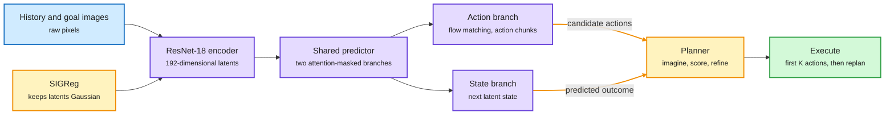

# LeWAM: End-to-End World and Action Modeling with JEPAs

**Date:** 2026-10-11 · **Type:** project page (arXiv version announced as coming soon) · **Authors:** Minghao Fu, Tavis Siebert, Eryk Halicki, Randall Balestriero (UC San Diego, ETH Zurich, University of British Columbia, Brown University)
**Topic:** [World models and machine reasoning](world-models-reasoning.md)

## TL;DR

A JEPA (joint-embedding predictive architecture) learns a world model by predicting future latent states without reconstructing pixels. Existing JEPA pipelines train representations and action-conditioned dynamics first and add a policy or solver afterwards. LeWAM trains one model end to end with a joint objective: next-latent-state prediction plus action flow matching, with an isotropic Gaussian constraint on the latent. The same model can act directly or plan, by sampling actions from its own action branch and evaluating them with its own dynamics. Against prior JEPAs in visual planning it raises success from 28.6% to 89.7% on contact-rich tasks and from 10.9% to 46.2% on long-horizon tasks, and plans 32.3 times faster.

One predictor imagines the outcome and proposes the move

The action branch supplies candidates. The state branch scores them against the goal.

Blue is observation, purple is the learned model, amber is the regularizer and the planning loop, green is the action sent to the robot.

## Architecture

- A shared ResNet-18 encoder maps history, target and goal images to 192-dimensional latent states.
- A mixture-of-transformers (MoT) predictor uses history latents to predict future states from clean actions, and an action velocity field from noisy actions.
- Attention masks separate the two branches. The state query reads history and clean actions. Noisy action tokens read state history and their own causal prefix. History latents attend only to themselves, which prevents clean actions leaking into the action branch.
- Goal and normalized remaining-horizon information condition only the action branch.
- Integrating the velocity field generates action chunks.

## Training objective

L = L_dyn + L_act + λ · L_SIGReg

Latent dynamics prediction, action flow matching, and SIGReg, which encourages an isotropic Gaussian latent distribution. Encoder and predictor are trained jointly.

## Planning

Sample, imagine, refine, execute. The model alternates action sampling with latent-state prediction to build candidate plans. It refines them through the frozen dynamics using the terminal latent goal error, C(a) = MSE(ẑ(a), z_goal), plus a proximity penalty, then takes the lowest-cost iterate. It executes the first K planned actions and replans from the next observation.

## Results

- **Visual planning, ten simulated environments.** Mean success 93.5% for LeWAM against 50.9% for LeWM with a CEM (cross-entropy method, a sampling-based) solver.
- **Long-horizon planning, four tasks, 100-step goal offset.** 46.2% against 10.9%.
- **From the post.** 28.6% to 89.7% on contact-rich manipulation, 32.3 times faster planning, 19 ms per plan, a 17M-parameter model trained on one GPU with one hyperparameter.
- **Behaviour cloning in simulation.** Average 64.7% against 61.6% for Diffusion Policy across DrawerCleanup, Transport and ToolHang.

## What the analyses show

- **Action learning improves the representation.** Across four tasks, mean probe R² for proprioception, action and inverse dynamics rises over LeWM by 0.21, 0.20 and 0.19.
- **Action prediction is an anti-collapse signal.** Observed actions are targets independent of the encoder. Without SIGReg, LeWAM keeps decodable information (object R² 0.88 on Push-T), while LeWM's probe scores are zero.
- **SIGReg still helps planning.** Push-T planning gains 14.7 points over direct control with SIGReg and 2.7 without.
- **Joint training beats a frozen encoder.** 86.7% direct success across four matched tasks against 79.0% with frozen DINOv2 features.
- **Flow matching beats MSE action heads** for planning gains on all three tasks shown, because MSE predicts a conditional mean and flow matching models several action modes.
- **Dynamics in isolation.** With the action head removed and CEM planning, LeWAM reaches 86.0% on Cube against 63.8% for LeWM, and 84.0% on Push-T against 92.4%.

## Gaps

- No paper yet. Everything here is from the project page and the post.
- Physical-robot results cover three tasks at 30 trials per method. The LeWAM row was cut off in what was captured, so no real-robot number is reported here.
- The goal is a single image.

## Relation to earlier wiki pages

- **Same family as [H-JEPA](2026-10-09-h-jepa-hierarchical-world-models.md).** Both use SIGReg and share an author. H-JEPA attacked planner cost with hierarchy over timescales (Visual AntMaze 18.0% to 73.3%). LeWAM attacks it with a learned proposal distribution. The two are complementary and uncombined.
- **Extends the scaling picture.** RoboJEPA (saved in the same window, bullets on 10-09) reports that latent rollout error follows a second-order power law in compute and tracks real planning success at up to 8B parameters across 12 embodiments.
- **More ways to structure a JEPA latent.** SplitJEPA (feed thread, same window) divides the latent into invariant and variant blocks with an identifiability proof and reports 71.5% success under an unseen camera rotation against 48.0% for frozen R3M. Kurate lists "Preserving Unstable Modes Through Inverse Dynamics in JEPA World Models" (arXiv 2610.07540), unread, which by its title is about the same action-as-supervision effect.
- **Explicit counterpart.** [Memento 3](2026-10-11-memento-3-code-as-world-model.md) keeps the world model as rules and code.

## Research angle (bears on the reasoning-model project)

- The action branch is a fast proposer and the dynamics branch a slow checker, in one network and one latent space. It is a small physical instance of System 1 proposing and System 2 verifying over a world model.
- Open: nothing decides when planning is worth its cost over direct execution. That is the handoff between the two systems, and the page already measures planning gain per task, which is the signal such a decider would need.
- Open: abstract goals. A goal image is a point in latent space, not a concept.

## Links

- Source: [project page](https://le-wam.github.io/) · [post](https://x.com/Minghao__Fu/status/2108638867326968196)
- Digest: [2026-10-11](../daily-digest/2026-10/2026-10-11.md)
- Raw: surfaced via saved reading in the 2026-10-11 window (local only)
