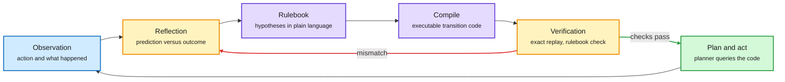

# Memento 3: Model-Based Recursive Self-Improvement through Reflective Rulebooks

**Date:** 2026-10-11 · **Type:** paper (arXiv 2610.11794) · **Authors:** Haoyu Zhao, Zhengxu Yu, Zhiyuan He, Meng Fang, Rasul Tutunov, Haitham Bou-Ammar, Weilin Luo, Jun Wang (UCL, Huawei Noah's Ark Lab UK, University of Liverpool)
**Topic:** [World models and machine reasoning](world-models-reasoning.md)

## TL;DR

Memento 3 lets a frozen LLM agent learn an explicit world model of an unfamiliar environment through external memory. The model has two forms. A natural-language rulebook records the agent's current, revisable hypotheses about objects, actions, dynamics and goals, and leaves unknown aspects unspecified. Executable code compiled from the rulebook is used for prediction and planning. Prediction errors drive a loop of observation, reflection, rule revision, compilation and verification. The authors call the design Code as Model and frame it as a model-based route to recursive self-improvement, with the LLM's weights fixed throughout. On ARC-AGI-3 the single-model agent clears every level of all 25 public games using 44% of the human action count.

Believe in words, predict in code, revise on error

The LLM's weights never change. Everything learned lives in the rulebook and the code compiled from it.

Blue is evidence, purple is the world model in its two forms, amber is reflection and checking, green is acting on the verified model.

## The problem it names

A program that reproduces every observed transition is not guaranteed to generalize. A finite interaction history leaves a version space of programs that agree on the past and disagree on unseen states. The paper's example: if every observed wall lies at column 7, "a box stops at a wall" and "a box stops at column 7" explain the same trajectory and predict different outcomes when a wall appears elsewhere. Replay can reject an inconsistent program. It cannot identify the correct rule among consistent ones.

## Mechanism

- **Two representations with different jobs.** The rulebook states what the agent believes. The code fixes how those beliefs are applied. Together they are a persistent hypothesis that can be inspected, tested and revised.
- **The loop.** After a real action, the agent compares the code's prediction with what happened. On a mismatch it reflects, revises the relevant rule, recompiles, and verifies.
- **Acceptance test.** Updated code is accepted only when the LLM judges it faithful to the rulebook and cell-exact replay reproduces all observed transitions.
- **Simplicity bias.** Among candidates that pass, the LLM favours concise rulebooks and implementations. The paper calls this a practical minimum-description-length bias and says it does not remove uncertainty.
- **Population extension.** N world models, each a rulebook and code pair, share one interaction history. One member is sampled to plan each episode. The resulting transitions check all members. N = 1 recovers the single-model agent.

The paper's worked example: the agent first believes a pad mirrors a carried badge depending on entry direction. An observation contradicts that. Reflection yields "each pad entry rotates the badge 90 degrees clockwise regardless of entry", the rulebook is edited, and the code is regenerated.

## Lineage

The Memento series treats external memory, not parameters, as the agent's learning state. Memento used episodic memory. Memento 2 formalized stateful reflective learning, with memory writing as policy evaluation and reading as policy improvement. Memento-Skills added reusable procedural memory. Those improved the policy side. Memento 3 addresses the model side: the rules that determine how the world behaves.

## Results

- ARC-AGI-3, single-model agent: every level of all 25 public games cleared. Mean Relative Human Action Efficiency (RHAE) is 100.0, the ceiling, using 44% of the human action count.
- That is 59.3 points of mean RHAE above Claude Opus 5 with the ARC Prize standard harness.
- Atari Pong case study: a learned feedback controller wins 21 to 0 in each of three episodes with different openings, with no further LLM calls during execution.

## Gaps

- Results are on the 25 public games. No private or held-out set, underlying LLM or cost per game was in what was read.
- The paper was read through the introduction and the start of the method. The ablations of the rulebook and the population extension were not read. alphaxiv has no overview.
- "Recursive self-improvement" here means the agent improves its own world model and uses it to gather better evidence. The LLM is never improved.

## Relation to earlier wiki pages

- **A fourth source of abstraction.** The concept page lists three from 10-09: timescale ([H-JEPA](2026-10-09-h-jepa-hierarchical-world-models.md)), factor (JEPA-Anything) and an external program (the harness essay). Memento 3 is the external-program route applied to the world model itself: the abstractions are named rules written by an LLM.
- **Contrast with latent world models.** H-JEPA's units are learned and unnamed. Memento's are named and inspectable but borrowed from the LLM's prior. [LeWAM](2026-10-11-lewam-joint-world-action-jepa.md), same window, is the latent counterpart with a learned action proposer.
- **A metric for it.** Agent Plasticity (Meta, same window) measures gain on held-out tasks per dollar of learning with weights frozen and artifacts inherited. It found slow learners often ignore artifacts they already wrote. Memento's verification step forces the artifact to be used.
- **Same checker-as-simulator idea as [PortSimEnv](../reinforcement-learning/2026-10-09-portsimenv-simulation-rl-environments.md)**, where the agent could query a plan checker ten times. Here the agent builds the simulator.

## Research angle (bears on the reasoning-model project)

- This is abduction as an engineering loop: hypotheses are explicit, falsified by prediction error, and kept in a form a planner can execute. One counterexample can repair the model where gradient descent would need many.
- Open: experiment selection. The population version explores by sampling a member, not by choosing the action that best discriminates between surviving hypotheses.
- Open: the rulebook's vocabulary comes from the LLM. Learning the concepts themselves is unsolved.
- A System 2 over a world model could use both kinds: latent rollouts for perception-heavy dynamics, rule code for discrete structure. Nothing yet combines them.

## Links

- Source: [paper](https://arxiv.org/pdf/2610.11794) · [post](https://x.com/hbouammar/status/2108587268172820823)
- Digest: [2026-10-11](../daily-digest/2026-10/2026-10-11.md)
- Raw: `raw/huggingface/2026-10-11-memento-3-model-based-recursive-self-improvement-t.md` (title only) and the X feed capture for the 2026-10-11 window (local only)
