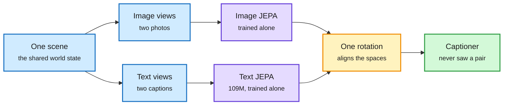

# Proving and Improving the Platonic Representation Hypothesis with JEPAs

**Date:** 2026-11-01 · **Type:** paper (arXiv 2610.39302) with code and demo · **Authors:** Randall Balestriero and Yann LeCun
**Topic:** [World models and machine reasoning](world-models-reasoning.md) · cross-source confirmed via social (HuggingFace Daily Papers and X)

## TL;DR

The Platonic Representation Hypothesis (PRH) conjectured that models trained on different modalities converge to the same representation of the world as they scale. This paper turns it into a theorem for JEPAs (joint-embedding predictive architectures, which learn by predicting the embedding of one view from another instead of reconstructing pixels or tokens). If two JEPAs are trained separately, on any modalities, and their positive pairs are *good views* (two observations of the same scene, such as two captions of one image), they learn the same representation up to one rotation. If the positives are *bad views* (corruptions or parts of one observation, such as masked spans or crops), misalignment is bounded by how much the modalities' positive-pair kernels differ. Next-token prediction is a JEPA with bad views (parts of one document), which explains why language models align with vision only slowly, through scale. Empirically, good views need 42 times fewer samples than next-token prediction on the same corpus to reach the same alignment, and a 109M text JEPA aligns with DINOv2 and CLIP image encoders better than every language model tested up to 72B.

Same world, two encoders, one rotation apart

Alignment depends on what counts as "the same thing" in training, not on how big the model is.

Blue is the world and its views, purple is the separately trained encoders, amber is the single rotation, green is what the alignment enables.

## Key results (abstract and repository)

- **Alignment on WIT-1024** (the PRH paper's own benchmark): the 109M text JEPA scores .184 with DINOv2-B over three seeds, above Qwen2.5-72B (.154), Llama-3-70B (.151) and CLIP's text encoder (.124). Against CLIP ViT-H it scores .230, above Qwen2.5-72B (.210).
- **COCO-5k**: .161 against Llama-3-70B .113 and Qwen2.5-72B .108.
- **Scaling law of alignment** in the fraction of good views and samples seen, registered before training: 85 new runs predicted with RMSE .0093, as close as a seed rerun (.0096).
- **Pair-free alignment**: zero-shot ImageNet-100 top-5 64% against at most 56% for language models up to 8B in the benchmark's paper.
- **Captioner with no image-caption pairs**: frozen DINOv2 and DINOv3, one rotation, and a language model fine-tuned on text only reach CIDEr .838 on COCO.

## Gaps

- The text JEPA is trained on alt-texts and LLaVA recaptions of 940M web images. Those captions already describe images, so "good views" here come from data that is visual in origin. Whether the advantage holds for text that is not about scenes is untested in what was read.
- Alignment is a representational similarity score; downstream language ability of the text JEPA is not the claim.

## Relation to earlier wiki pages

- **Extends** the JEPA line on the [concept page](world-models-reasoning.md): H-JEPA (10-09, hierarchical latent world models for planning) and LeWAM (10-11, one JEPA that predicts the next latent and proposes the action). Those showed JEPAs are useful for planning; this gives a reason they should share structure across modalities.
- **Sits beside** a saved paper from this window, "Vision Transformers Learn Word Meaning from Images Alone", where DINOv3 organizes rendered words by meaning with country-capital offsets like text embeddings.
- **Theoretical complement to** the [architecture ablation](../models-architectures/2026-11-01-architecture-ablations-since-gpt3.md) finding that architecture has about 2% of loss left: this paper says the training objective's choice of positive pairs, not scale or architecture, decides how efficiently a model reaches a shared world representation.

## Research angle (bears on the reasoning-model project)

If concept-space reasoning needs a representation shared across language and vision, this gives a recipe and a test: train with good views, and measure alignment as a rotation. Phillip Isola's gloss, "next-token prediction is multi-view learning with bad views", reframes LLM pretraining as an inefficient route to the same place. Open problems: what are good views for abstract concepts that have no single scene (a proof, a plan, a policy)? Does the rotation theorem extend to predictors over time (world models), so that two agents' world models are also one rotation apart? And can a fast decider operate directly in the shared space, without language?

## Links

- Paper: https://arxiv.org/abs/2610.39302 · Code: https://github.com/galilai-group/prh-proof · Demo: https://huggingface.co/spaces/galilai-group/prh_demo
- Posts: https://x.com/randall_balestr/status/2116173210148601966 · https://x.com/phillip_isola/status/2116261275311436031
- Raw: `raw/huggingface/2026-10-31-proving-and-improving-the-platonic-representation.md` (title only) and the X feed capture (local only)
